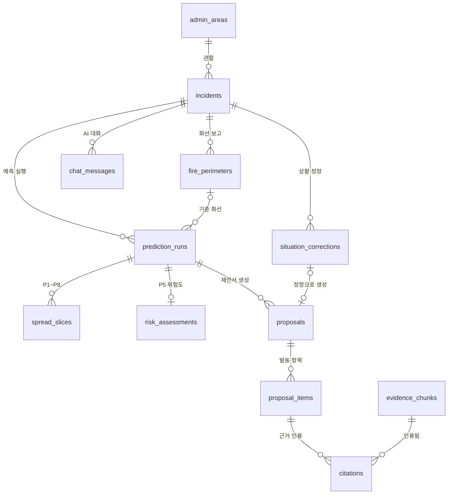
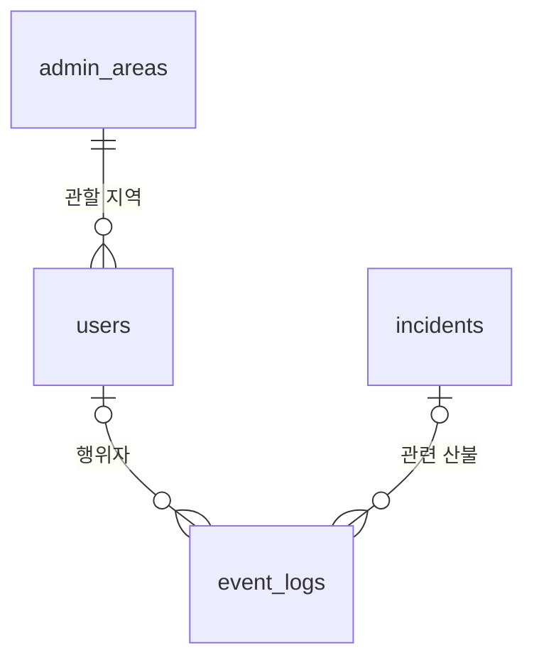
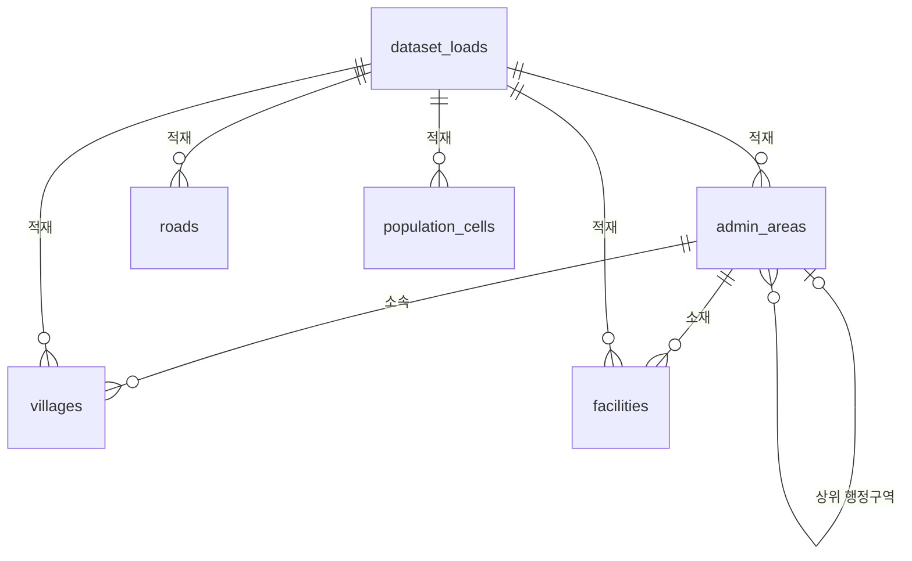
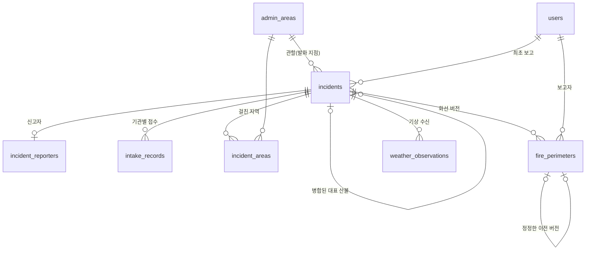
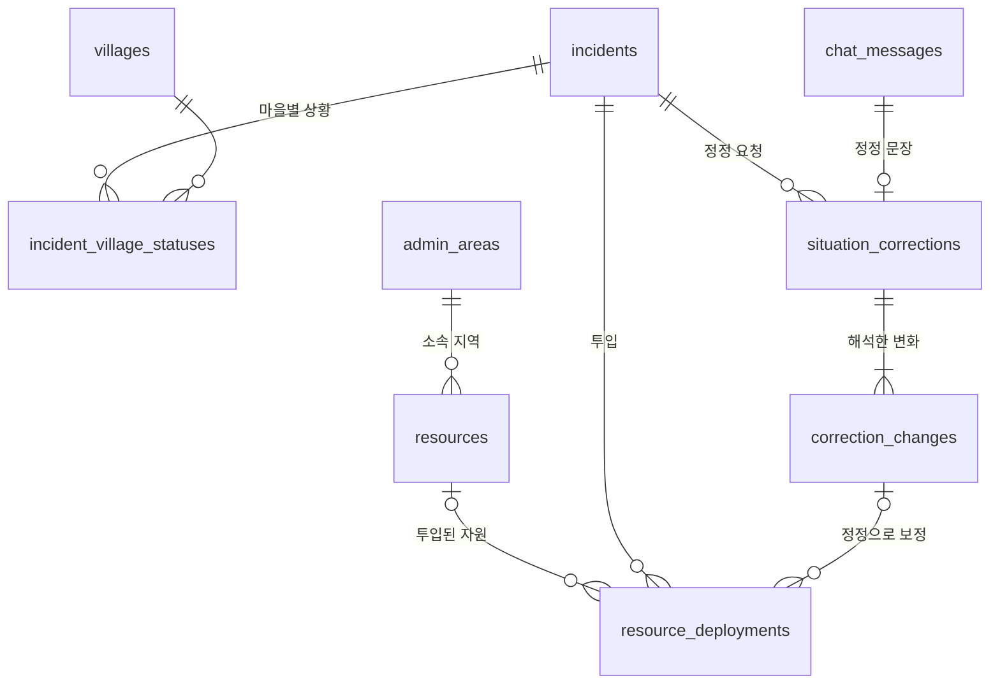
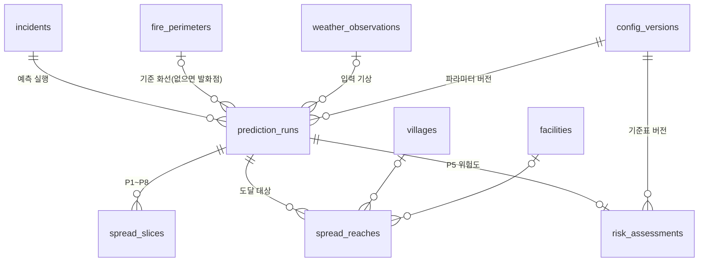
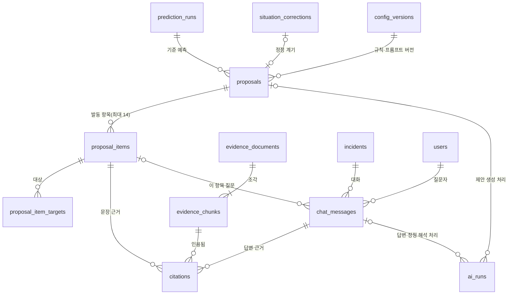
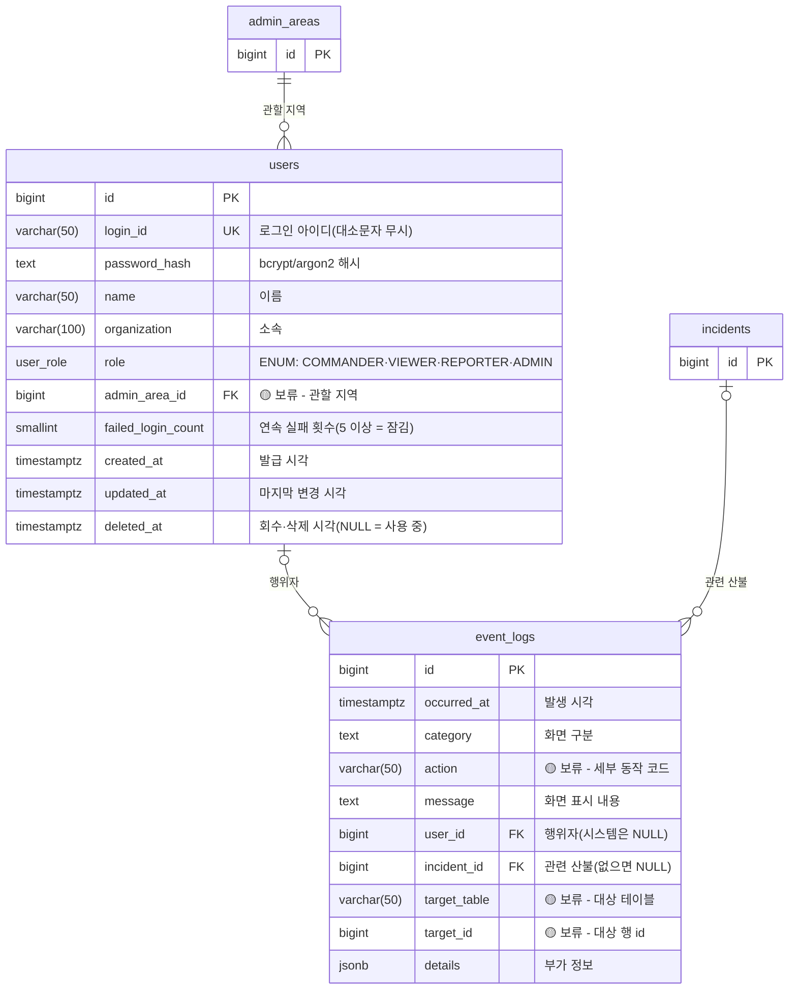

# DB 설계

산불 대응 AI 의사결정 지원 시스템의 데이터베이스 설계 문서입니다. 수정 요구사항 분석서와 프로토타입 보고서를 기준으로 처음부터 다시 설계하고, 단계마다 팀 검토를 거쳐 이 파일에 쌓아 갑니다.

## 메타 정보

| 항목 | 내용 |
|---|---|
| 상태 | 0단계(설계 원칙)·1단계(저장해야 할 데이터)·2-1단계(테이블 목록·관계) 초안 — 팀 검토 대기 |
| 시작일 | 2026-10-16 |
| 최종 산출물 | ERD, 테이블 정의서 (ECR-003 산출정보) → 상세설계서에 반영 |
| 기준 문서 | ① 수정 요구사항 분석서 (`docs/제출물/4-수정요구사항분석서/`, 2026.10.08) — 기능 F-01~F-32, 유스케이스 15개, 비기능 23개, 5장 클래스·6장 관계형 DB ② 프로토타입 보고서 (`docs/제출물/5-프로토타입/`, 2026.10.16) — 특히 48쪽 「프로토타입으로 구체화된 요구사항」 |
| 일정 | SP1(10/19~) 「PostGIS 스키마·기상청 API 어댑터·기상 캐시」(담당 황승준) 안에서 완료 |

### 진행 단계

| 단계 | 내용 | 상태 |
|---|---|---|
| 0 | 설계 원칙 — 저장 범위, 이름·키·시간·좌표 규칙, 삭제·버전 정책 | **초안** |
| 1 | 저장해야 할 데이터 — 기능·화면에서 "저장할 값" 추출 | **초안** |
| 2 | 개념 ERD — 2-1 테이블 목록·관계, 2-2 기능 × 테이블 CRUD 표로 검사 | **2-1 초안** |
| 3 | 논리 설계 — 묶음별 컬럼·타입·키·제약 | **A 초안** |
| 4 | 물리 설계 — PostGIS 타입, 인덱스, DDL, 마이그레이션 | 대기 |
| 5 | 검증 — 의성 시나리오 데이터 적재, 유스케이스별 조회 SQL 실행 | 대기 |

### 진행 방식

- 분석서의 클래스·테이블을 미리 옮기지 않는다. 기능과 화면에서 출발해 새로 설계하고, 묶음 하나를 마칠 때마다 분석서 모델과 비교해 달라진 점과 이유를 「6. 결정 기록」에 남긴다.
- 2~3단계는 묶음 단위로 진행한다. 의존이 적은 것부터: ① 계정·감사 → ② 사건·보고 → ③ 예측·위험도 → ④ 제안·근거·대화 → ⑤ 정적 레이어·자원
- 단계마다 PR을 올리고, 팀이 「7. 결정이 필요한 항목」을 정하면 다음 단계로 넘어간다.

---

## 0. 설계 원칙

### 0.1 저장 범위 — 무엇을 어디에 저장하나

| 데이터 | 저장소 | 이유 |
|---|---|---|
| 운영 데이터 — 계정, 산불 사건, 접수 기록, 실측 화선, 기상 캐시, 예측 실행·확산 범위, 위험도, 제안서·항목·인용, 상황 정정, AI 대화, 이벤트 로그 | **PostgreSQL + PostGIS** | 사건 이력을 한 트랜잭션으로 묶어야 하고(예: 정정 저장 + 새 제안서 버전), 화선·확산 범위·시설의 공간 교차를 DB에서 계산한다 |
| 기준 데이터 — 진화자원 | PostgreSQL | 전산 관리자가 화면에서 등록·수정한다 |
| 정적 벡터 레이어 — 행정경계, 마을, 시설·대피소, 도로, 유관기관, 인구(SGIS) | PostgreSQL + PostGIS | 지도 표시와 위험구역·대피 대상 판정에서 공간 조인한다. 배치로 적재한다(ORP-002) |
| 근거 청크 — 청크 원문, 문서·쪽·조항 메타데이터 | **PostgreSQL** (제안, D-03) | 제안 항목·AI 답변의 인용이 청크를 외래키로 참조해야 근거 번호 ↔ 근거 목록 일치를 DB가 보장한다(TER-001-6) |
| 근거 벡터 인덱스 | FAISS 파일 | 벡터 검색 전용. 청크 ID로 PostgreSQL과 연결하고, 언제든 재구축할 수 있다(ORP-002-5) |
| 래스터 — DEM, 임상도·연료 격자, ELMFIRE 입력·출력(도달 시각 TOA 등) | 파일 저장소 | 크고, DB에서 조회하지 않는다. DB에는 파일 경로와 버전만 기록한다 |
| AI 평가 데이터 — 평가 시나리오, 정답 답변, 채점 결과 | 운영 DB와 분리 (D-05) | 운영 기록과 섞이지 않게 한다 |

> 이 문서는 PostgreSQL에 들어가는 것만 설계한다. 파일과 FAISS는 DB가 참조하는 경로·ID 규칙만 정한다.

### 0.2 이름 규칙

| 대상 | 규칙 | 예 |
|---|---|---|
| 테이블 | 영어 snake_case 복수형 | `incidents`, `fire_perimeters` |
| 컬럼 | 영어 snake_case | `reported_at`, `area_ha` |
| 기본키 | `id` | |
| 외래키 | `<참조 테이블 단수>_id` | `incident_id`, `prediction_run_id` |
| 시각 | `_at` (timestamptz) | `created_at`, `observed_at` |
| 날짜 | `_on` (date) | `issued_on` |
| 사람 | `_by` (users.id 외래키) | `created_by`, `ended_by` |
| 참/거짓 | `is_` / `has_` | `is_confirmed` |
| 단위 있는 수치 | 단위를 접미어로 | `area_ha`, `wind_speed_ms`, `wind_dir_deg` |
| 상태·구분 값 | 영어 대문자 코드로 저장, 한글 라벨은 화면에서 | `RECEIVED` → 「접수」 |
| 설명 | 모든 테이블·컬럼에 한글 `COMMENT` | |

### 0.3 키 규칙

- 모든 테이블의 기본키는 대리키 `bigint GENERATED ALWAYS AS IDENTITY`로 한다.
- 사람이 읽는 번호(예: 산불 번호 `F-2025-0322-01`, 제안서 버전 `v1.2`)는 기본키로 쓰지 않는다. 필요하면 별도 컬럼에 UNIQUE를 걸거나 화면에서 만든다.
- 업무상 유일해야 하는 조합은 반드시 UNIQUE 제약으로 건다(예: 사건별 화선 버전 번호, 예측 실행별 경과 시간).

### 0.4 시간 규칙

- 모든 시각은 `timestamptz`로 저장하고, 화면에는 KST(Asia/Seoul)로 표시한다.
- 시각을 두 종류로 구분한다.
  - **업무 시각** — 현실에서 일이 일어난 때: 발생 일시, 신고 접수 일시, 화선 관측 시각, 예보 기준 시각
  - **기록 시각** — 시스템에 저장된 때: `created_at`
- 업무 시각을 모르면 NULL을 허용한다(예: 발생 일시는 선택 입력).

### 0.5 공간 규칙

- **저장 좌표계를 EPSG:5179(UTM-K, 미터 단위) 하나로 통일**한다(D-01).
  - 면적(ha)·거리(m)·격자 겹침 계산을 변환 없이 할 수 있다.
  - 30 m 분석 격자, ELMFIRE 입출력과 단위가 같다.
  - 지도(MapLibre)에는 API가 GeoJSON을 내보낼 때 `ST_Transform(geom, 4326)`으로 바꿔 준다. 입력 GeoJSON(4326)은 저장할 때 5179로 바꾼다.
- 도형 타입은 컬럼마다 고정한다: 점 `geometry(Point, 5179)`, 면 `geometry(MultiPolygon, 5179)`.
  - 화선·확산 범위·병합 범위는 떨어진 조각(비화 등)이 생길 수 있어 MultiPolygon으로 둔다.
- 모든 도형 컬럼에 GiST 인덱스를 둔다. 도형 유효성 검사(`ST_IsValid`)는 CHECK 제약으로 건다.
- 면적처럼 도형에서 계산되는 값은 원칙적으로 저장하지 않는다. 화면에 자주 나오는 값만 생성 컬럼(`GENERATED ALWAYS AS ... STORED`)으로 둔다.

### 0.6 데이터 성격별 변경·삭제 정책

테이블을 세 가지 성격으로 나누고, 성격마다 허용하는 연산을 정한다.

| 성격 | 해당 데이터 | INSERT | UPDATE | DELETE |
|---|---|---|---|---|
| **기준 데이터** | 계정, 진화자원, 정적 레이어 | O | O (`updated_at` 갱신) | 제한 — 계정은 삭제 대신 회수, 투입 중인 자원은 삭제 불가 |
| **사건 기록** | 산불 사건, 접수 기록, 화선, 기상 캐시, 예측 실행·확산 범위, 위험도, 제안서·항목·인용, 상황 정정, AI 대화 | O | 상태 컬럼만 정해진 전이로 허용(예: 사건 `RECEIVED → IN_PROGRESS → ENDED`, 화선 `VALID → CORRECTED`, 예측 `RUNNING → DONE/FAILED`) | X — 사건은 종료로 끝나고 기록은 이력으로 남는다(ORP-002-4) |
| **감사 로그** | 이벤트 로그 | O | X | X — DB 권한(REVOKE)으로 막는다(ORP-001) |

- 내용을 고쳐야 하면 기존 행을 바꾸지 않고 **새 행(새 버전)을 추가**한다. 화선 정정과 제안서 재생성이 이 방식이다.
- 종료된 사건에는 보고·예측·정정 같은 새 사건 기록을 추가할 수 없다(UC-SIT-01). 이 검사는 API에서 하고, 가능하면 DB 트리거로 한 번 더 막는다.

### 0.7 버전 규칙

프로토타입에서 정한 규칙(보고서 35·48쪽)을 그대로 따른다.

| 대상 | 규칙 | 저장 방식 |
|---|---|---|
| 실측 화선 | 사건별로 처음 받은 보고가 v1, 이후 v2, v3 … 정정하면 이전 버전은 「정정됨」으로 남는다. 보고에 화선이 없으면 발화점이 v1 역할을 한다 | 사건별 `version_no` + UNIQUE(사건, 버전) |
| 제안서 | `v(화선 버전).(대응 생성 순번)` — v1.1 → 정정 후 v1.2 → 새 화선 v2로 재예측하면 v2.1 | 정수 2개(기준 화선 버전, 순번)로 저장, 문자열은 화면에서 조합. UNIQUE(사건, 화선 버전, 순번) |

### 0.8 상태·구분 값 저장 방식

- 값은 영어 대문자 코드로 저장하고, 한글은 화면 라벨로 붙인다.
- **`users.role`은 PostgreSQL `ENUM` 타입(`user_role`)으로 둔다**(2026-10-16 팀장 결정). 값이 4개로 고정되고 바뀔 일이 거의 없으며, 타입 자체가 허용 값을 문서화한다.
- 나머지 상태·구분 값(산불 진행상태, 예측 상태, 이벤트 구분 등)을 ENUM으로 통일할지, `text` + `CHECK`로 둘지는 D-02에서 정한다.
  - 참고: ENUM은 값 **추가**는 `ALTER TYPE ... ADD VALUE`로 쉽지만, 값 **삭제·이름 변경**은 타입을 다시 만들어야 한다.
- 값 목록은 3단계 테이블 정의에서 컬럼마다 확정한다.

### 0.9 JSONB 사용 기준

- 조회 조건·조인·정렬에 쓰는 값은 반드시 일반 컬럼으로 둔다.
- 다음처럼 구조가 자주 바뀌거나 통째로만 읽는 부속 정보만 `jsonb`로 둔다.
  - 위험도 23개 변수 상세(값·단위·가중치·등급), 결측 변수 목록
  - 규칙 판정의 중간 계산값, LLM 원본 응답, 처리 단계 로그
- 위험도 23개 변수가 바뀌어도 테이블 구조를 바꾸지 않으려는 것이다. 요인 점수 4개처럼 화면에 바로 쓰는 값은 컬럼으로 둔다.

### 0.10 동시 실행 방지 (PER-003-3)

- 같은 사건에서 예측 실행·제안 생성·정정 재생성이 겹치지 않게 **DB 제약으로 막는다**. 예: 「사건별로 `RUNNING` 상태 예측은 하나만」을 부분 UNIQUE 인덱스로 건다.
- 화선 버전·제안서 순번처럼 "다음 번호"를 매기는 작업은 사건 행 잠금(`SELECT … FOR UPDATE`) 안에서 한다.

### 0.11 재현성·추적 (QUR-002, DPR-001)

- 예측·위험도·제안서 행에는 **무엇으로 계산했는지**를 남긴다: 기준 화선, 사용한 기상, 모델·프롬프트·규칙 버전, 파라미터 파일 버전.
- 제안 문장마다 근거 인용을 행으로 남겨 근거 번호 ↔ 근거 목록 일치를 검증할 수 있게 한다.
- 사용자 행위는 「누가(`_by`)·언제(`_at`)」를 해당 행과 이벤트 로그 양쪽에 남긴다.

### 0.12 보안·개인정보 (SER-001·003)

- 비밀번호는 해시만 저장한다(bcrypt 또는 argon2).
- 신고자 성명·연락처는 개인정보다. 화면에서 필요한 범위만 저장하고, 이벤트 로그 내용에는 넣지 않는다. 시연 데이터는 가상값을 쓴다.
- 애플리케이션용 DB 계정과 마이그레이션용 DB 계정을 분리한다. 애플리케이션 계정에서는 이벤트 로그의 UPDATE·DELETE 권한을 회수한다.

### 0.13 지역 독립 (공용 스키마)

시연과 검증은 2025년 의성 산불로 하지만, **스키마는 특정 지역을 전제로 만들지 않는다**(D-04 확정).

- 테이블·컬럼·제약에 특정 지역의 이름·코드·좌표 범위를 넣지 않는다. 예: 「의성군 테두리」 대신 「시군구 경계」, 시군구 코드를 CHECK로 고정하지 않음.
- 지역은 **데이터로 구분**한다. 산불 사건, 계정(관할), 진화자원(소속), 정적 레이어(마을·시설·도로·인구)는 모두 행정구역 코드를 가진다.
- 다른 지역을 추가하는 일은 **정적 레이어를 지역 단위로 더 적재하는 것**으로 끝나야 한다. 스키마 변경이 필요하면 설계가 잘못된 것으로 본다.
- 행정구역 코드 체계(행정표준코드, 통계청 SGIS 코드 등)는 자료마다 다르므로, 기준 코드를 하나 정하고 나머지는 대응표로 연결한다(3단계).
- 저장 좌표계 EPSG:5179는 전국을 다루므로 지역이 바뀌어도 그대로 쓴다.
- 지역마다 달라질 수 있는 기준값(위험도 변수 구간·가중치, 규칙 판정 임계값)은 코드 상수가 아니라 **버전을 가진 설정**으로 두고, 예측·위험도·제안서가 어느 버전을 썼는지 기록한다(0.11).
- 의성 데이터는 5단계 검증용 예시 데이터로만 넣는다.

### 0.14 마이그레이션·도구

- 스키마 변경은 마이그레이션 파일로만 한다(Alembic, FastAPI·SQLAlchemy 기준). 직접 DDL을 실행하지 않는다.
- ERD는 이 문서 안에 Mermaid `erDiagram`으로 그린다. GitHub에서 바로 보이고, PR에서 변경점을 diff로 확인할 수 있다.

---

## 1. 저장해야 할 데이터

### 1.1 작성 방법

- 기능 F-01~F-32를 하나씩 보며 **그 기능이 동작하려면 읽어야 하는 값**과 **새로 쓰거나 바꾸는 값**을 적었다.
- 값의 이름은 테이블·컬럼이 아니라 **화면에 나오는 말**로 적었다. 묶는 일은 1.4에서, 엔티티로 확정하는 일은 2단계에서 한다.
- 자료: 수정 요구사항 분석서의 기능 목록·유스케이스 시나리오·시퀀스, 프로토타입 보고서 24~41쪽(화면 칸)·48쪽(구체화된 요구사항), 비기능 요구사항.
- 분석서 5·6장의 클래스·테이블과 08장 추적표의 「데이터」 열은 참고하지 않았다. 2단계가 끝난 뒤 비교한다.
- 표기
  - **[계산]**: 저장하지 않고 다른 값에서 그때그때 계산할 수 있는 값
  - **[정적]**: 운영 전에 배치로 적재하는 지도·통계 자료
  - **[Q-nn]**: 1.5의 확인 필요 항목

### 1.2 기능별 읽는 값 · 쓰는 값

#### 인증·관리

| 기능 | 읽는 값 | 쓰는 값 | 출처 |
|---|---|---|---|
| **F-01** 로그인·계정·권한 관리 | 아이디, 비밀번호 해시, 권한(조작·열람·보고·관리), 계정 상태(발급·회수), 잠금 여부, 연속 실패 횟수 | **로그인**: 연속 실패 횟수, 잠금 여부·잠긴 시각, 마지막 로그인 시각 [Q-10] **계정 관리**: 이름, 소속, 권한, 계정 상태, 발급일, 재발급 시 초기 비밀번호(해시), 잠금 해제, 처리자·처리 시각 | UC-AUTH-01, UC-ADMIN-01, 프로토 25·39쪽 |
| **F-31** 진화자원 데이터 관리 | 자원 목록, 투입 중 여부(삭제 차단) | 구분(헬기·차량·인력), 명칭(호출부호), 소속, 수량, 배치 위치, 상태(대기·투입·정비), 수정자·수정 시각 | UC-ADMIN-02, 프로토 39쪽 |

- 규칙: 마지막 통합지휘권자 계정은 회수·삭제·권한 변경 불가(프로토 39쪽). 회수·잠금 계정은 로그인 차단.

#### 상황 보고

| 기능 | 읽는 값 | 쓰는 값 | 출처 |
|---|---|---|---|
| **F-02** 산불 상황 보고 — 새 산불 | — | 산불명, 주소, 발화 위치(점), 발생 일시(선택), 신고 접수 일시(필수), 신고 내용, **신고자 정보**(신고 기관명·성명·연락처, 모르면 「미확인」), **기관별 접수 기록** n건(접수 기관·시각·경로), 진행상태 = 접수, 보고자·보고 시각 | UC-REPORT-01, 프로토 26·48쪽 |
| **F-02** 산불 상황 보고 — 실측 화선 | 진행상태(종료면 차단), 직전 유효 화선 | 화선 폴리곤, 관측 시각, 입력 방식(지도 그리기·GeoJSON), **화선 버전**(v1, v2 …), 새 보고 / 정정 구분, 정정 시 이전 버전 상태 = 정정됨, 보고자·보고 시각, 진행상태 접수 → 진행 중 꼭짓점 수·면적(ha) [계산] | 프로토 27·48쪽 |

#### 상황 파악

| 기능 | 읽는 값 | 쓰는 값 | 출처 |
|---|---|---|---|
| **F-03** 발화 종료 처리 | 진행상태 | 진행상태 = 종료, 종료 시각, 종료 처리자 | UC-SIT-01, 프로토 37쪽 |
| **F-04** 산불 발생·접수 정보 조회 | 산불 목록(접수·진행 중 / 종료), 발생 장소·일시, 신고 접수 일시, 신고 내용, 신고자 정보, 기관별 접수 기록, 진행상태, **공식 대응단계**, **기상**(풍향·풍속·습도·기온·시정·특보 + 발표 시각·수신 시각) [Q-07], 최신 화선 버전·면적, 5시간·8시간 예측 면적과 기준 화선, **병합된 산불** 정보 [Q-03] | — | UC-SIT-02, 프로토 28·41쪽 |
| **F-05** 통합 상황도 | 발화점, 실측 화선(최신·이전 버전), 최신 확정 예측의 P1~P8, 위험구역(P5)·잠재 위험구역(P8), 확산 범위에 든 마을과 도달 시각, 병합 산불의 P5 겹침 구역, 시군 테두리 [정적] | — | UC-SIT-03, 프로토 24·29·41쪽 |
| **F-06** 지도 레이어 선택 | 레이어 묶음: 예측 / 인구 / 시설 / 도로 [정적] | — (켜고 끄는 상태는 화면에만) | 프로토 24·48쪽 |
| **F-07** 주요 시설 지도 표시 | 마을(이름·위치·인구·취약계층 수), 시설(대피소·취약시설·국가유산·담수지·송전시설·소방서·파출소·유관기관, 위치·수용 인원·보호 등급), 도로 [정적] | — | 프로토 24·48쪽 |
| **F-08** 가용 현황 확인 | 자원 목록(구분·명칭·소속·수량·상태), 상태별 합계 [계산] | — | 프로토 37·38쪽 |

#### 확산 예측·위험도

| 기능 | 읽는 값 | 쓰는 값 | 출처 |
|---|---|---|---|
| **F-09** 확산 예측 실행·갱신 | 진행상태(종료면 차단), 최신 유효 화선(없으면 발화점), 예측용 기상, 격자·연료 자료(파일), 이미 실행 중인 예측 여부(중복 차단) | **예측 실행**: 예측 기준 시각, 기준 화선(또는 발화점), 입력 기상, 실행 상태(실행 중·완료·실패), 실패 사유, 실행자·실행 시각·완료 시각, 모델·파라미터 버전, 결과 파일 위치 **확산 범위** P1~P8: 경과 시간(1~8), 누적 폴리곤 / 면적 [계산] **확산 범위에 든 마을·시설과 도달 시각** [Q-04] 재예측 필요 여부 [계산: 최신 화선 버전 > 예측의 기준 화선 버전] | UC-PRED-01, 프로토 29쪽, PER-003 |
| **F-10** 산불 위험도 조회 | 최신 위험도(통합지휘권자·열람자) | **위험도** (예측 1회마다 1개): 위험도 R(1.00~5.00), 4요인 점수(기상·지형·연료·인프라)와 가중치, **23개 변수 상세**(변수명·값·단위·가중치·등급), 가져오지 못한 변수 목록, 기준 예측(P5)·기준 화선, 계산 시각, 함께 계산한 **병합 산불** [Q-03] 표시 규칙: 예측 전·산불 미선택 시 숨김, 종료 시 처리 [Q-08] | UC-PRED-02, 프로토 30·41쪽 |

- 예측은 성공했지만 제안 생성이 실패하면 새 예측을 확정하지 않고 직전 예측·제안서를 유지한다(UC-PRED-01 E3) → 예측에 **확정 여부**가 필요하다 [Q-05].

#### 대응 제안 — 공통

| 기능 | 읽는 값 | 쓰는 값 | 출처 |
|---|---|---|---|
| **F-11** 대응 제안 생성·갱신·상세 조회 | 확정 예측(P1~P8), 위험도, 현재 상황 값 [Q-01], 진화자원 현황, 확산 범위에 든 마을·시설·도로, 근거 청크(검색) | **제안서** (버전마다 1개): 기준 화선 버전, 생성 순번, 생성 계기(예측 갱신·상황 정정), 기준 예측, 계기가 된 상황 정정, 생성 시각, 공식 대응단계(생성 시점), 판정 대응단계, 격상 검토 권고 여부 **제안 항목** (발동한 항목마다): 항목 코드(S1~S7·E1~E7), 진화/대피, 구분(즉시·대기·협의·요청, 여러 개 가능), 제안 문장, 판정 이유, **대상**(마을·시설·도로·자원 — 지도 강조용), 권한(직접·협의·요청), 근거 부족 여부 **규칙 판정 값·처리 단계 기록**(QUR-002-4, ORP-001-3·4) [Q-04, Q-09] | UC-PRED-01, 시퀀스 4.7, 프로토 31·32쪽 |
| **F-12** 제안 분류 | 제안 항목의 진화/대피, 구분, 구분별 건수 [계산] | — | 프로토 31·32쪽 |
| **F-13** 대응 근거 조회 | 근거 번호 [k] → 근거 청크: 문서명, 쪽수, 항목명·조항, 요약, 원문 문서 연결, 어느 문장의 근거인지 [Q-06] | (근거 인용은 F-11·F-29가 쓴다) 인용: 번호 k, 근거 청크, 검색 점수 | UC-PROP-03, 프로토 33쪽 |
| **F-14** 제안 이력·변경사항 조회 | 버전 목록(버전·생성 시각·계기·구분 건수·변경 건수), 이전 버전 전체, 직전 버전과의 항목별 이전·이후 문장, 「변경」 태그 [Q-12] | — | UC-PROP-04, 프로토 36쪽 |

#### 대응 제안 — 진화 S1~S7 · 대피 E1~E7

14개 기능은 모두 F-11의 **제안 항목 1개**를 쓴다. 기능마다 다른 것은 **판정에 읽는 값**이다.

| 기능 | 판정에 읽는 값 | 출처 |
|---|---|---|
| **F-15** S1 대응단계·격상 | P5 예상 피해면적 [계산], 공식 대응단계, 위기경보 | 프로토 31쪽 |
| **F-16** S2 우선지역·보호대상 | P5·P8에 든 마을(인구)·시설(보호 등급)과 도달 시각 | |
| **F-17** S3 자원 투입·배분 | 진화자원(구분·상태·소속·위치), 현재 투입 수 [Q-02], 확산 범위, 기상(헬기 운용: 풍속·시정) | |
| **F-18** S4 진화 방식·시간대 | 기상(풍속·시정), 주간·야간(일몰 시각 [계산]) | |
| **F-19** S5 시설 보호 | P5·P8에 든 시설(주택·국가유산·전력시설), 보호 등급 | |
| **F-20** S6 유관기관 동원 | 판정 대응단계, 유관기관(시설 묶음), 자원 부족 여부 | |
| **F-21** S7 진화인력 안전 | 진화인력 위치, 확산 범위 도달 시각, 퇴로(도로) | |
| **F-22** E1 위험구역 | P5·P8에 든 마을 → 위험구역(즉시)·잠재 위험구역(대기) | 프로토 32쪽 |
| **F-23** E2 대피 순서·시점 | 마을별 도달 시각, 인구·취약계층 수, 대피 완료 여부 [Q-01], 일몰 시각 [계산] | 프로토 32·35쪽 |
| **F-24** E3 취약시설·미대피 | 위험구역 안 취약시설(수용 인원), 미대피 주민 [Q-01] | |
| **F-25** E4 대피소 배정 | 대피소(위치·수용 인원), 대피 대상 인구, 대피소가 위험구역에 드는지 | |
| **F-26** E5 대피 경로·교통통제 | 도로(대피로), 진화차량 진입로 [Q-11], 확산 범위 도달 시각 | |
| **F-27** E6 재난문자·방송 | 대피 대상 지역, 재난문자 발송 여부 [Q-01] | |
| **F-28** E7 인명구조 요청 | 부상·고립 [Q-01], 미대피 주민, 구조기관(소방서·파출소) | |

#### 질의응답

| 기능 | 읽는 값 | 쓰는 값 | 출처 |
|---|---|---|---|
| **F-29** AI 질의응답 | 최신 제안서·항목, 현재 상황 값, 근거 청크(검색) | **질문**: 내용, 질문 방식(자유·빠른 질문·「이 항목 질문」), 지정한 제안 항목, 질문 시점 제안서, 질문자·시각 **답변**: 내용, 근거 인용, 근거 부족 여부, 거절(무관한 질문)·실패 여부, 생성 시각 | UC-QA-01, 프로토 34쪽 |
| **F-30** AI 상황 정정 요청 | 현재 상황 값 [Q-01], 진행상태(종료면 거부) | **정정 요청**: 입력 문장, 해석한 변화 n건(대상·항목·이전 값·변경 값·「추가」인지 「설정」인지), 해석하지 못한 부분, 확인·취소 여부, 확인자·확인 시각 **현재 상황 값 갱신** [Q-01] → 새 제안서 버전(F-11, 계기 = 상황 정정) | UC-QA-02, 프로토 35쪽 |

- 정정 가능 항목(프로토 35쪽): 대피 완료, 부상·고립, 헬기·소방차·진화인력 투입 수, 예상 진화시간, 대피명령, 재난문자, 공식 단계, 위기경보

#### 시스템

| 기능 | 읽는 값 | 쓰는 값 | 출처 |
|---|---|---|---|
| **F-32** 이벤트 로그 | 시각·구분·내용·사용자 (통합지휘권자만 열람) | 발생 시각, 구분(로그인·로그아웃·입력·예측·제안·근거 부족·정정·종료·관리·시스템), 내용, 사용자, 관련 산불 [Q-09] | ORP-001, 프로토 36쪽 |

### 1.3 비기능 요구사항에서 나온 값

| 요구사항 | 저장할 값 |
|---|---|
| ORP-001-3·4 | AI 처리 단계(질문 작성·검색·답변·충돌 검사·종합·검사)별 실행 상태, 재시도 횟수, 오류 원인 [Q-09] |
| ORP-001-5 | 기상 API 실패 시 마지막 수신값과 수신 시각 |
| QUR-002-4 | 규칙 판정·제안 생성 단계별 입력·출력 [Q-04] |
| DPR-001-3 | 예측·제안에 쓴 모델·프롬프트·설정 버전 |
| PER-003-3 | 같은 산불의 예측·제안 생성 중복 실행 여부 |
| ORP-002 | 정적 레이어·근거 청크의 적재 시각·출처·버전 |

### 1.4 데이터 묶음 후보

1.2·1.3의 값을 성격이 같은 것끼리 묶었다. 2단계에서 이 후보를 엔티티로 확정한다. 「필요한 기능」 열은 ERD 아래 「엔티티 → 근거 기능」 표의 출발점이 된다.

| # | 후보 | 담는 값 | 필요한 기능 | 성격 (0.6) |
|---|---|---|---|---|
| 1 | 계정 | 아이디·비밀번호 해시·이름·소속·권한·상태·잠금·실패 횟수 | F-01, 모든 기능의 행위자 | 기준 |
| 2 | 산불 사건 | 산불명·주소·발화 위치·발생/접수 일시·신고 내용·진행상태·공식 대응단계·위기경보·종료 정보 | F-02~F-05, F-09~F-11, F-30 | 사건 기록 |
| 3 | 신고자 정보 | 신고 기관명·성명·연락처 | F-02, F-04 | 사건 기록 (개인정보) |
| 4 | 기관별 접수 기록 | 접수 기관·시각·경로 | F-02, F-04 | 사건 기록 |
| 5 | 실측 화선 | 폴리곤·관측 시각·버전·상태(유효·정정됨)·입력 방식 | F-02, F-04, F-05, F-09 | 사건 기록 |
| 6 | 기상 | 풍향·풍속·습도·기온·시정·특보·발표/수신 시각 | F-04, F-09, F-17, F-18 | 사건 기록 (캐시) |
| 7 | 예측 실행 | 기준 시각·기준 화선·입력 기상·상태·확정 여부·버전·결과 파일 | F-05, F-09, F-10, F-11 | 사건 기록 |
| 8 | 확산 범위 | P1~P8 누적 폴리곤 | F-05, F-09, F-10, F-11, F-15~F-28 | 사건 기록 |
| 9 | 도달 대상 | 확산 범위에 든 마을·시설과 도달 시각 | F-05, F-16, F-19, F-21~F-26 | 사건 기록 또는 [계산] (Q-04) |
| 10 | 위험도 | R·요인 점수·23개 변수 상세·결측 변수·기준 예측 | F-10, F-15 | 사건 기록 |
| 11 | 산불 병합 | P5가 겹친 산불 묶음, 대표 산불, 겹침 구역 | F-04, F-05, F-10 | 사건 기록 (Q-03) |
| 12 | 현재 상황 값 | 마을별 대피 완료·대피명령·부상·고립, 투입 수, 예상 진화시간, 재난문자 | F-23, F-24, F-27, F-28, F-29, F-30 | 사건 기록 (Q-01) |
| 13 | 제안서 | 버전(화선 버전·순번)·계기·기준 예측·대응단계·격상 권고 | F-11, F-14 | 사건 기록 |
| 14 | 제안 항목 | 항목 코드·구분·문장·판정 이유·권한·근거 부족 | F-11~F-28 | 사건 기록 |
| 15 | 제안 대상 | 항목별 대상 마을·시설·도로·자원 | F-11, F-16~F-28 (지도 강조) | 사건 기록 |
| 16 | 근거 청크 | 문서명·쪽수·조항·요약·원문·적용 항목·단계 | F-11, F-13, F-29 | 기준 (재구축 가능) |
| 17 | 근거 인용 | 번호 k·청크·점수·인용한 문장 | F-11, F-13, F-29 | 사건 기록 |
| 18 | AI 대화 | 질문·답변·질문 방식·지정 항목·근거 부족·실패 | F-29, F-30 | 사건 기록 |
| 19 | 상황 정정 | 입력 문장·해석한 변화 n건·확인 여부 | F-30, F-11 | 사건 기록 |
| 20 | 진화자원 | 구분·명칭·소속·수량·배치 위치·상태 | F-08, F-17, F-21, F-31 | 기준 |
| 21 | 이벤트 로그 | 시각·구분·내용·사용자·관련 산불 | F-32, 모든 쓰기 기능 | 감사 로그 |
| 22 | AI 처리 기록 | 단계별 입력·출력·상태·재시도·오류, 모델·프롬프트 버전 | F-11, F-29 (QUR-002, ORP-001) | 감사 로그 (Q-09) |
| 23 | 행정경계 | 시군·읍면동 경계 | F-05, F-27 | 정적 |
| 24 | 마을 | 이름·위치·인구·취약계층 수 | F-07, F-16, F-22~F-25 | 정적 |
| 25 | 시설 | 종류·이름·위치·수용 인원·보호 등급 | F-07, F-16, F-19, F-20, F-24, F-25, F-28 | 정적 |
| 26 | 도로 | 도로 선형·종류 | F-07, F-21, F-26 | 정적 |
| 27 | 인구 격자 | SGIS 인구(65세 이상·0~14세) | F-10 (위험도 인프라 요인) | 정적 |

> 격자 변수(지형·연료)와 ELMFIRE 입출력은 0.1에 따라 파일로 두고, 예측 실행이 파일 위치·버전을 가리킨다.

### 1.5 1단계에서 나온 확인 필요 항목

기능에서 데이터를 뽑다가 나온 질문이다. 2단계에서 엔티티를 확정하기 전에 정해야 한다. 추천안은 「7. 결정이 필요한 항목」 D-07~D-19에 적었다.

| # | 질문 | 왜 문제인가 |
|---|---|---|
| Q-01 | 「현재 상황 값」을 어디에 두나 | 정정 가능 항목 8종(대피 완료·부상/고립·투입 수·예상 진화시간·대피명령·재난문자·공식 단계·위기경보)이 F-23·24·27·28 판정 입력이 된다. 대상도 마을·자원·산불로 제각각이다 |
| Q-02 | 자원 투입을 자원 단위로 볼까, 수량으로 볼까 | F-08·F-31은 자원마다 상태(대기·투입·정비)를 둔다. 정정은 「헬기 4대 → 6대(추가 2)」처럼 수량으로 바꾼다. 두 방식이 맞물려야 한다 |
| Q-03 | 산불 병합을 어떻게 저장하나 | P5가 겹치면 하나의 산불로 보고(목록 1건, 먼저 신고된 이름, 위험도 1개), 두 번째 산불 정보도 보여야 한다(프로토 41쪽) |
| Q-04 | 규칙 판정 결과와 도달 대상을 저장하나 | 공간 교차로 매번 계산할 수 있지만, 그때의 판정을 다시 보여주고(QUR-002 재현성) 지도에서 대상을 강조하려면 남겨야 한다 |
| Q-05 | 예측 「확정」 상태가 필요한가 | 예측은 성공했지만 제안이 실패하면 새 예측을 확정하지 않는다(UC-PRED-01 E3) |
| Q-06 | 근거 인용 단위는 항목인가, 문장인가 | 근거 창은 「어떤 문장의 근거인지」를 보여준다(프로토 33쪽). 한 항목에 문장이 여러 개면 인용이 문장을 가리켜야 한다 |
| Q-07 | 기상 값을 어디까지 저장하나 | 산불현황에 기온·특보·발표 시각·수신 시각까지 나온다(프로토 28쪽). 실패 시 마지막 수신값도 보여야 한다(ORP-001-5) |
| Q-08 | 종료된 산불의 위험도 표시 | 프로토 30쪽은 「종료된 산불에서는 네모를 숨긴다」, 수정 분석서 F-10은 「종료된 산불은 「종료」로 표시」라고 적었다. 저장에는 영향이 적지만 규칙을 하나로 정해야 한다 |
| Q-09 | 사용자용 이벤트 로그와 AI 처리 기록을 나누나 | 이벤트 로그는 통합지휘권자가 화면에서 읽는다. AI 단계별 입출력·재시도·오류는 양이 많고 개발자용이다 |
| Q-10 | 로그인 상태(세션)를 DB에 두나 | JWT만 쓰면 DB 저장이 없지만, 계정 회수·권한 변경을 즉시 적용하려면(프로토 39쪽 「즉시 적용」) 토큰 무효화 수단이 필요하다 → **D-16 확정: 세션 테이블 없음** |
| Q-11 | E5 「진화차량 진입로」 자료는 어디서 오나 | 대피로와 진입로의 겹침을 판정해야 하는데, 진입로의 출처가 문서에 없다 |
| Q-12 | 「변경」 태그를 저장하나 | 직전 버전과 비교하면 계산할 수 있지만, 생성할 때 비교 결과를 남기면 조회가 단순하다 |
| Q-13 | 산불이 여러 시·군에 걸치면 관할을 어떻게 보나 | 지역 독립(0.13)으로 설계하면 발화 지점 시군과 확산 범위 시군이 다를 수 있다. 사건의 관할 지역과 계정의 관할 범위를 어떻게 맞출지 정해야 한다 |

## 2. ERD

2단계는 두 번에 나눠 진행한다.

- **2-1 (이번)**: 필요한 테이블 목록과 테이블 사이 관계만 정한다. 컬럼은 적지 않는다.
- **2-2 (다음)**: 기능 × 테이블 CRUD 표로 빠진 테이블·기능이 없는지 검사하고 ERD를 확정한다.

### 2.1 이번 단계에서 임시로 적용한 결정

아직 팀이 정하지 않은 항목은 「7. 결정이 필요한 항목」의 추천안으로 그렸다. 팀 결정이 다르면 아래 테이블이 바뀐다.

| 결정 | 임시 적용 | 영향받는 테이블 |
|---|---|---|
| D-03 근거 청크 위치 | PostgreSQL | `evidence_documents`, `evidence_chunks` |
| D-07 현재 상황 값 | 「현재 상황」을 따로 두고, 정정은 이력으로 | `incident_village_statuses`, `resource_deployments`, `incidents` |
| D-08 자원 투입 표현 | 자원 단위 + 수량 보정 둘 다 | `resource_deployments` |
| D-09 산불 병합 | 산불이 「병합된 대표 산불」을 가리킴 | `incidents` (자기 참조) |
| D-10 판정·도달 대상 | 저장 | `spread_reaches`, `proposal_item_targets` |
| D-15 이벤트 로그와 AI 처리 기록 | 분리 | `event_logs`, `ai_runs` |
| D-19 여러 시·군에 걸친 산불 | 관할은 발화 지점 시군 하나, 걸친 지역은 따로 | `incidents`, `incident_areas` |

### 2.2 테이블 목록

7개 묶음, 32개 테이블. 「구분」의 **핵심**은 MVP 기능에 꼭 필요한 테이블, **지원**은 재현성·운영·확장을 위한 테이블이다. 「근거 기능」은 1.2에서 이 테이블의 값을 읽거나 쓰는 기능이다.

#### A. 계정·감사

| 테이블 | 이름 | 담는 것 | 성격 | 구분 | 근거 기능 |
|---|---|---|---|---|---|
| `users` | 계정 | 사용자 한 명의 계정·권한·관할·잠금(실패 횟수)·회수 여부 | 기준 | 핵심 | F-01, 모든 행위자 기록 |
| `event_logs` | 이벤트 로그 | 화면에서 읽는 사용자 행위·시스템 이벤트 1건 = 1행 | 감사 로그 | 핵심 | F-32, ORP-001 |

#### B. 지역·정적 레이어

| 테이블 | 이름 | 담는 것 | 성격 | 구분 | 근거 기능 |
|---|---|---|---|---|---|
| `admin_areas` | 행정구역 | 시도·시군구·읍면동 경계. 상위 행정구역을 가리키는 계층 구조 | 정적 | 핵심 | F-05, F-27, 관할 (0.13) |
| `villages` | 마을 | 행정리 단위 마을과 인구·취약계층 수 | 정적 | 핵심 | F-07, F-16, F-22~F-25 |
| `facilities` | 시설 | 대피소·취약시설·국가유산·담수지·송전시설·소방서·파출소·유관기관 | 정적 | 핵심 | F-07, F-16, F-19, F-20, F-24, F-25, F-28 |
| `roads` | 도로 | 도로 선형과 종류 | 정적 | 핵심 | F-07, F-21, F-26 |
| `population_cells` | 인구 집계 단위 | SGIS 연령별 인구(65세 이상·0~14세)를 가진 공간 단위 | 정적 | 핵심 | F-10 (위험도 인프라 요인) |
| `dataset_loads` | 적재 이력 | 정적 레이어·근거 문서를 언제, 어떤 출처·버전으로 적재했는지 | 기준 | 지원 | ORP-002, LGR-003 (출처 표기) |

#### C. 산불 사건·보고

| 테이블 | 이름 | 담는 것 | 성격 | 구분 | 근거 기능 |
|---|---|---|---|---|---|
| `incidents` | 산불 사건 | 산불 하나의 발생·접수·진행상태·공식 단계·위기경보·종료 정보. 병합되면 대표 산불을 가리킴 | 사건 기록 | 핵심 | F-02~F-05, F-09~F-11, F-30 |
| `incident_reporters` | 신고자 | 신고 기관·성명·연락처. 개인정보라 사건과 분리해 접근을 제한 | 사건 기록 | 핵심 | F-02, F-04 |
| `intake_records` | 기관별 접수 기록 | 기관 하나가 접수한 기록 1건 = 1행 | 사건 기록 | 핵심 | F-02, F-04 |
| `incident_areas` | 산불 관련 지역 | 산불이 걸친 행정구역(관할 외 지역 포함) | 사건 기록 | 지원 | F-04, F-20 (D-19) |
| `fire_perimeters` | 실측 화선 | 화선 보고 1건 = 1버전. 정정되면 이전 버전은 「정정됨」 | 사건 기록 | 핵심 | F-02, F-04, F-05, F-09 |
| `weather_observations` | 기상 | 산불 위치의 기상 수신 1회 = 1행(예보·관측, 발표·수신 시각) | 사건 기록 | 핵심 | F-04, F-09, F-17, F-18, ORP-001-5 |

#### D. 현재 상황·정정·자원

| 테이블 | 이름 | 담는 것 | 성격 | 구분 | 근거 기능 |
|---|---|---|---|---|---|
| `incident_village_statuses` | 마을별 현재 상황 | 산불 × 마을의 현재 상황(대피명령·대피 완료·부상/고립 등) | 사건 기록 (현재 값) | 핵심 | F-23, F-24, F-27, F-28, F-30 |
| `situation_corrections` | 상황 정정 요청 | 정정 문장 1건과 확인·취소 결과 | 사건 기록 | 핵심 | F-30 |
| `correction_changes` | 정정 변화 | 정정 1건에서 해석한 변화 하나(대상·항목·이전→변경) = 1행 | 사건 기록 | 핵심 | F-30, F-14 |
| `resources` | 진화자원 | 헬기·차량·인력 하나(또는 한 조)의 소속·수량·위치·상태 | 기준 | 핵심 | F-08, F-17, F-21, F-31 |
| `resource_deployments` | 자원 투입 | 어떤 산불에 자원을 투입·철수한 기록. 정정의 「헬기 2대 추가」 같은 수량 보정도 여기에 | 사건 기록 | 핵심 | F-08, F-17, F-30 (D-08) |

> 산불 단위 현재 값(공식 대응단계·위기경보·예상 진화시간)은 `incidents`에 둔다. 마을 단위는 `incident_village_statuses`, 자원은 `resource_deployments`가 맡는다. 정정이 어떤 값을 바꿨는지는 `correction_changes`에 남는다.

#### E. 확산 예측·위험도

| 테이블 | 이름 | 담는 것 | 성격 | 구분 | 근거 기능 |
|---|---|---|---|---|---|
| `prediction_runs` | 예측 실행 | 「확산 예측 실행」 1회. 기준 화선·입력 기상·상태(실행 중·완료·실패·확정)·결과 파일 위치 | 사건 기록 | 핵심 | F-05, F-09, F-10, F-11 |
| `spread_slices` | 시간별 확산 범위 | 예측 1회의 P1~P8 누적 범위(실행당 최대 8행) | 사건 기록 | 핵심 | F-05, F-09, F-15~F-28 |
| `spread_reaches` | 도달 대상 | 예측 1회에서 확산 범위에 든 마을·시설과 처음 도달하는 시각 | 사건 기록 | 핵심 | F-05, F-16, F-19, F-21~F-26 (D-10) |
| `risk_assessments` | 위험도 | 예측 1회의 P5 기준 위험도 R·요인 점수·변수 상세 | 사건 기록 | 핵심 | F-10, F-15 |

> 위험도 23개 변수 상세는 0.9에 따라 `risk_assessments` 안의 JSONB로 두고 테이블로 나누지 않는다.

#### F. 대응 제안·근거·AI

| 테이블 | 이름 | 담는 것 | 성격 | 구분 | 근거 기능 |
|---|---|---|---|---|---|
| `proposals` | 제안서 | 제안서 한 버전(v화선.순번). 기준 예측, 생성 계기(예측 갱신·상황 정정), 판정 대응단계·격상 권고 | 사건 기록 | 핵심 | F-11, F-14, F-15 |
| `proposal_items` | 제안 항목 | 제안서 안의 발동 항목 하나(S1~S7·E1~E7). 구분·문장·판정 이유·권한·변경 여부 | 사건 기록 | 핵심 | F-11~F-28 |
| `proposal_item_targets` | 제안 대상 | 항목이 가리키는 마을·시설·도로·자원 하나 = 1행(지도 강조용) | 사건 기록 | 핵심 | F-11, F-16~F-28 |
| `evidence_documents` | 근거 문서 | 표준매뉴얼·규정·법령 문서 하나와 판본·원문 파일 위치 | 기준 | 핵심 | F-13, LGR-001 |
| `evidence_chunks` | 근거 청크 | 문서의 절·표 행·조문 단위 조각과 쪽수·조항·요약·적용 항목. FAISS 벡터와 같은 ID | 기준 (재구축 가능) | 핵심 | F-11, F-13, F-29 |
| `citations` | 근거 인용 | 제안 문장 또는 AI 답변 문장이 청크를 인용한 것 1건(번호 k) | 사건 기록 | 핵심 | F-11, F-13, F-29, TER-001-6 |
| `chat_messages` | AI 대화 | 질문 또는 답변 메시지 1건. 지정한 제안 항목, 근거 부족·거절·실패 여부 | 사건 기록 | 핵심 | F-29, F-30 |
| `ai_runs` | AI 처리 기록 | 제안 생성·답변·정정 해석의 단계별 입력·출력·상태·재시도·오류 | 감사 로그 | 지원 | QUR-002-4, ORP-001-3·4 (D-15) |

#### G. 설정 버전

| 테이블 | 이름 | 담는 것 | 성격 | 구분 | 근거 기능 |
|---|---|---|---|---|---|
| `config_versions` | 설정 버전 | 위험도 기준표(변수 구간·가중치), 규칙 임계값, 연료 파라미터, 모델·프롬프트의 버전 하나 = 1행 | 기준 | 지원 | DPR-001-3, QUR-002, 0.11·0.13 |

### 2.3 1.4 데이터 묶음 후보 → 테이블

| 후보 (1.4) | 테이블 |
|---|---|
| 1 계정 | `users` |
| 2 산불 사건 | `incidents` |
| 3 신고자 정보 | `incident_reporters` |
| 4 기관별 접수 기록 | `intake_records` |
| 5 실측 화선 | `fire_perimeters` |
| 6 기상 | `weather_observations` |
| 7 예측 실행 | `prediction_runs` |
| 8 확산 범위 | `spread_slices` |
| 9 도달 대상 | `spread_reaches` |
| 10 위험도 | `risk_assessments` |
| 11 산불 병합 | `incidents` 자기 참조 (테이블 없음) |
| 12 현재 상황 값 | `incidents`(산불 단위) + `incident_village_statuses`(마을 단위) + `resource_deployments`(자원) |
| 13 제안서 | `proposals` |
| 14 제안 항목 | `proposal_items` |
| 15 제안 대상 | `proposal_item_targets` |
| 16 근거 청크 | `evidence_documents`, `evidence_chunks` |
| 17 근거 인용 | `citations` |
| 18 AI 대화 | `chat_messages` |
| 19 상황 정정 | `situation_corrections`, `correction_changes` |
| 20 진화자원 | `resources`, `resource_deployments` |
| 21 이벤트 로그 | `event_logs` |
| 22 AI 처리 기록 | `ai_runs`, `config_versions` |
| 23 행정경계 | `admin_areas` |
| 24 마을 | `villages` |
| 25 시설 | `facilities` |
| 26 도로 | `roads` |
| 27 인구 격자 | `population_cells` |
| (새로 추가) | `incident_areas` (D-19), `dataset_loads` (ORP-002) |

### 2.4 ERD (테이블·관계만)

관계 표기: `||` 정확히 1, `|o` 0 또는 1, `|{` 1개 이상, `o{` 0개 이상. 묶음별로 그리고, 다른 묶음의 테이블은 연결되는 것만 함께 그렸다.

#### 전체 개요 — 산불 사건 중심

#### A. 계정·감사

#### B. 지역·정적 레이어

> `roads`·`population_cells`는 행정구역 경계를 넘을 수 있어 외래키 대신 공간 교차로 연결한다.

#### C. 산불 사건·보고

#### D. 현재 상황·정정·자원

#### E. 확산 예측·위험도

#### F. 대응 제안·근거·AI

### 2.5 3단계로 넘긴 구조 문제

테이블 목록은 정했지만, 컬럼을 정할 때 함께 풀어야 하는 구조 문제다.

| # | 문제 | 관련 테이블 |
|---|---|---|
| S-01 | 하나의 테이블이 여러 종류를 가리키는 경우(마을·시설·도로·자원)를 외래키 여러 개로 할지, 종류+ID로 할지 | `proposal_item_targets`, `spread_reaches`, `correction_changes` |
| S-02 | 인용이 「제안 항목」 또는 「AI 답변」 중 한쪽만 가리키게 하는 제약, 문장 번호 표현(D-12) | `citations` |
| S-03 | 질문과 답변을 한 행에 둘지, 메시지 2행으로 둘지 | `chat_messages` |
| S-04 | 제안서 버전을 산불별로 유일하게 하려면 `proposals`에 산불 참조를 중복으로 둘지 | `proposals` |
| S-05 | 행정구역 코드 체계(행정표준코드·SGIS 코드) 대응표가 필요한지 | `admin_areas` |
| S-06 | 정적 레이어를 다시 적재할 때 기존 ID를 유지하는 방법(과거 제안서의 대상이 가리키고 있음) | `villages`, `facilities`, `dataset_loads` |

## 3. 테이블 정의

묶음별로 컬럼·타입·키·제약을 정한다. 각 묶음은 **상세 ERD → 테이블 정의 → 규칙 → 결정 필요 항목** 순서로 적는다.

- 타입은 PostgreSQL 기준. 문자열은 길이 제한이 꼭 필요할 때만 `varchar(n)`, 그 밖에는 `text`(+ 필요하면 CHECK).
- 「근거」 열은 그 컬럼이 필요한 기능·요구사항이다. 근거가 없는 컬럼은 만들지 않는다.
- 다른 묶음의 테이블은 상세 ERD에 `id`만 적어 연결만 보여 준다.
- **🟡 보류** — 넣을지 뺄지 애매한 컬럼. 일단 표에 남겨 두고, 테이블 아래 「🟡 보류 컬럼」 상자에 ① 왜 넣었는지 ② 왜 빼려고 하는지 ③ 무엇을 보고 정할지를 적는다. 팀이 정하면 표시를 지우고 결과를 「6. 결정 기록」에 남긴다.

### 3.1 A. 계정·감사

#### 상세 ERD

#### `users` — 계정

사용자 한 명 = 1행. 전산 관리자가 발급하고 회원가입은 없다.

| 컬럼 | 타입 | NULL | 기본값 | 제약 | 설명 | 근거 |
|---|---|---|---|---|---|---|
| `id` | bigint | N | identity | PK | 계정 ID | 0.3 |
| `login_id` | varchar(50) | N | | UNIQUE (`lower(login_id)`) | 로그인 아이디. 예: `cmd01` | F-01 |
| `password_hash` | text | N | | | 비밀번호 해시. 원문은 저장하지 않음 | SER-003-3 |
| `name` | varchar(50) | N | | | 이름 | F-01, 프로토 39쪽 |
| `organization` | varchar(100) | N | | | 소속 기관 | 프로토 39쪽 |
| `role` | `user_role` (ENUM) | N | | `CREATE TYPE user_role AS ENUM ('COMMANDER','VIEWER','REPORTER','ADMIN')` | 권한: 조작(통합지휘권자)·열람(열람자)·보고(상황 보고자)·관리(전산 관리자) | SER-001 |
| 🟡 `admin_area_id` | bigint | Y | | FK → `admin_areas.id` CHECK `role = 'ADMIN' OR admin_area_id IS NOT NULL` | **보류.** 관할 지역(시군구). 전산 관리자만 NULL 허용(= 전체) | (직접 요구 없음) D-24 |
| `failed_login_count` | smallint | N | `0` | CHECK `>= 0` | 연속 로그인 실패 횟수. **5 이상이면 잠김**, 로그인 성공·관리자 잠금 해제 시 0 | SER-001-7 |
| `created_at` | timestamptz | N | `now()` | | 발급 시각 | F-01 |
| `updated_at` | timestamptz | N | `now()` | | 마지막 변경 시각 | 0.6 |
| `deleted_at` | timestamptz | Y | | | 회수·삭제 시각. **NULL이면 사용 중**, 값이 있으면 로그인 불가·목록에서 숨김 [D-20] | F-01, 프로토 39쪽 |

인덱스

- `UNIQUE (lower(login_id))` — 대소문자만 다른 아이디 금지 [D-21]. 회수된 계정의 아이디도 재사용하지 않음(이력 혼동 방지)
- 🟡 `(admin_area_id, role) WHERE deleted_at IS NULL` — 관할별 사용 중 계정 목록, 마지막 통합지휘권자 검사 (`admin_area_id`를 빼면 `(role) WHERE deleted_at IS NULL`)

> [!WARNING]
> **🟡 보류 컬럼 — `admin_area_id` (관할 지역)** [D-24]
>
> - **왜 넣었나**: ① D-04에서 여러 지역을 지원하기로 했으니 사용자도 담당 지역이 있어야 한다고 봤다. ② 통합지휘권자는 해당 시·군·구의 시장·군수·구청장이라, 법적으로 자기 관할 산불만 지휘한다. ③ 「마지막 통합지휘권자 보호」(A-6)를 지역마다 적용하려면 관할이 필요하다. ④ 분석서 모델에도 `sigungu_code`가 있었다.
> - **왜 빼려 하나**: ① 이 컬럼을 직접 요구하는 기능 요구사항이 없다. F-01·SER-001은 권한(조작·열람·보고·관리) 구분만 요구한다. ② MVP 시연은 한 지역이라 모든 사용자가 모든 산불을 봐도 문제가 없다. ③ 제대로 하려면 컬럼 하나로 부족하다. 도 단위 상급 본부 열람자는 여러 시·군을 보고, 산불이 시·군 경계를 넘으면 관할이 바뀐다(D-19). ④ 나중에 NULL 허용 컬럼으로 추가하기 쉽다.
> - **빼도 지켜지는 것**: 공용 스키마(0.13)는 산불·마을·시설 같은 **데이터**의 행정구역 코드로 지켜진다. 사용자 관할은 「누가 무엇을 볼 수 있나」라는 **권한** 문제라 별개다.
> - **무엇을 보고 정하나**: MVP에서 「지역별로 보이는 산불을 나눈다」를 시연할지. 안 한다면 빼고, A-6은 「시스템 전체의 마지막 통합지휘권자」로 바꾼다.

MVP에서 뺀 컬럼과 대신하는 방법

| 뺀 컬럼 | 대신하는 방법 |
|---|---|
| `status` | `deleted_at`이 NULL인지로 사용 중·회수 판단. 화면의 「회수」와 「삭제」를 하나로 합침 |
| `is_locked`, `locked_at` | `failed_login_count >= 5`이면 잠김 |
| `token_version` | API 요청마다 `users` 행을 읽어 `deleted_at`·`role`을 확인하므로 회수·권한 변경이 바로 적용됨 |
| `last_login_at` | 필요하면 `event_logs`의 `LOGIN_SUCCESS`로 조회 |
| `created_by`, `updated_by` | 누가 발급·변경했는지는 `event_logs`(`ADMIN` 구분)에 남음. 대상 계정은 `target_id` 또는 `details`로 찾음 (D-26) |
| `revoked_at` | `deleted_at`으로 통합 |

#### `event_logs` — 이벤트 로그

화면 「이벤트 로그」에 한 줄로 보이는 이벤트 1건 = 1행. **추가만** 한다(0.6).

| 컬럼 | 타입 | NULL | 기본값 | 제약 | 설명 | 근거 |
|---|---|---|---|---|---|---|
| `id` | bigint | N | identity | PK | 로그 ID | 0.3 |
| `occurred_at` | timestamptz | N | `now()` | | 발생 시각 | F-32, ORP-001-2 |
| `category` | text | N | | CHECK `IN ('AUTH','INPUT','PREDICTION','PROPOSAL','NO_EVIDENCE','CORRECTION','CLOSE','ADMIN','SYSTEM')` | 화면의 「구분」: 로그인·입력·예측·제안·근거 부족·정정·종료·관리·시스템 | F-32, 프로토 36쪽 |
| 🟡 `action` | varchar(50) | N | | | **보류.** 세부 동작 코드. 예: `LOGIN_SUCCESS`, `LOGIN_FAILED`, `ACCOUNT_LOCKED`, `PERIMETER_REPORTED`, `PROPOSAL_CREATED`. 목록은 아래 | ORP-001-1, D-25 |
| `message` | text | N | | | 화면에 그대로 보이는 한 줄. 예: 「대응 제안 v1.2 생성(상황 정정) · 변경 2건」 | F-32 |
| `user_id` | bigint | Y | | FK → `users.id` | 행위자. 시스템 이벤트·없는 아이디로 로그인 실패는 NULL | ORP-001-2 |
| `incident_id` | bigint | Y | | FK → `incidents.id` | 관련 산불. 로그인·계정 관리 이벤트는 NULL | F-32 |
| 🟡 `target_table` | varchar(50) | Y | | CHECK `(target_table IS NULL) = (target_id IS NULL)` | **보류.** 이벤트가 만든·바꾼 행의 테이블. 예: `proposals` | 0.11, D-26 |
| 🟡 `target_id` | bigint | Y | | | **보류.** 그 행의 id | 0.11, D-26 |
| `details` | jsonb | Y | | | 부가 정보. 예: 로그인 실패 시 시도한 아이디, 변경 전후 권한. **개인정보(신고자 성명·연락처)는 넣지 않음** | 0.9, 0.12 |

인덱스

- `(incident_id, occurred_at DESC)` — 산불별 이벤트 로그 화면
- `(occurred_at DESC)` — 전체 최근 이벤트
- `(user_id, occurred_at DESC)` — 사용자별 행위 추적

`action` 코드 초안 (category별)

| category | action |
|---|---|
| `AUTH` | `LOGIN_SUCCESS`, `LOGIN_FAILED`, `ACCOUNT_LOCKED`, `LOGOUT` |
| `INPUT` | `INCIDENT_REPORTED`, `PERIMETER_REPORTED`, `PERIMETER_CORRECTED` |
| `PREDICTION` | `PREDICTION_STARTED`, `PREDICTION_CONFIRMED`, `PREDICTION_FAILED`, `RISK_COMPUTED` |
| `PROPOSAL` | `PROPOSAL_CREATED`, `PROPOSAL_FAILED` |
| `NO_EVIDENCE` | `ITEM_NO_EVIDENCE`, `ANSWER_NO_EVIDENCE` |
| `CORRECTION` | `CORRECTION_CONFIRMED`, `CORRECTION_CANCELLED`, `CORRECTION_REJECTED` |
| `CLOSE` | `INCIDENT_CLOSED` |
| `ADMIN` | `ACCOUNT_ISSUED`, `ACCOUNT_REVOKED`, `ACCOUNT_REISSUED`, `ROLE_CHANGED`, `ACCOUNT_UNLOCKED`, `RESOURCE_CREATED`, `RESOURCE_UPDATED`, `RESOURCE_DELETED` |
| `SYSTEM` | `WEATHER_FETCH_FAILED`, `EXTERNAL_FAILED` |

> `action`은 코드가 계속 늘어날 수 있어 CHECK를 걸지 않고 애플리케이션 상수로 관리한다. 화면 필터는 `category`로 한다.

> [!WARNING]
> **🟡 보류 컬럼 — `action` (세부 동작 코드)** [D-25]
>
> - **왜 넣었나**: `category`는 화면용 9종이라 「로그인 성공·실패·잠김」이 모두 `AUTH`로 묶인다. 로그인 실패만 세거나 특정 동작을 골라 보려면 세부 코드가 있어야 한다(ORP-001-1의 이벤트 종류 구분).
> - **왜 빼려 하나**: 화면(프로토 36쪽)은 구분·내용·사용자·시각만 보여 주고 세부 코드를 쓰지 않는다. 같은 정보가 `message` 문장에도 들어 있다. 코드 목록을 계속 관리해야 하는 부담이 있다.
> - **무엇을 보고 정하나**: 이벤트 로그를 코드에서 조건으로 검색할 일이 있는지(예: 로그인 실패 통계, 테스트에서 특정 이벤트 기록 여부 검사 — TER-001). 있으면 남긴다.

> [!WARNING]
> **🟡 보류 컬럼 — `target_table`, `target_id` (대상 행)** [D-26]
>
> - **왜 넣었나**: 이벤트가 만들거나 바꾼 행을 정확히 가리키려고. 예: 「대응 제안 v1.2 생성」 로그에서 그 제안서로 바로 이동, 「권한 변경」 로그에서 어느 계정인지 확인. `users`의 `created_by`·`updated_by`를 뺀 대신 「누가 이 계정을 바꿨나」도 이 컬럼으로 찾는다.
> - **왜 빼려 하나**: 화면에 「로그 → 해당 화면으로 이동」 기능이 없다(프로토 36쪽). 한 컬럼이 여러 테이블을 가리켜 외래키를 걸 수 없다. 대상은 `message`나 `details`에도 적을 수 있다.
> - **무엇을 보고 정하나**: 「이 계정·제안서에 무슨 일이 있었나」를 거꾸로 찾는 조회가 필요한지. 필요 없으면 빼고 `details`에 대상 id를 넣는다.

#### 규칙

| # | 규칙 | 구현 위치 |
|---|---|---|
| A-1 | `deleted_at IS NOT NULL`이거나 `failed_login_count >= 5`이면 로그인 거부 | API |
| A-2 | 로그인 실패 시 `failed_login_count + 1`(5가 되면 `ACCOUNT_LOCKED` 로그), 성공하면 0 | API (한 트랜잭션) |
| A-3 | 잠금 해제는 전산 관리자만: `failed_login_count = 0` | API |
| A-4 | 회수·삭제는 `deleted_at = now()`. 행은 지우지 않는다 | API (D-20) |
| A-5 | API 요청마다 JWT의 `user_id`로 `users` 행을 읽어 `deleted_at`·`failed_login_count`·`role`을 확인. 회수·권한 변경이 다음 요청부터 바로 적용됨 | API (인증 미들웨어, D-16) |
| A-6 | 관할 지역의 마지막 사용 중 통합지휘권자는 회수·권한 변경 불가 | API |
| A-7 | `event_logs`는 애플리케이션 DB 계정에서 UPDATE·DELETE 권한 회수 | DB 권한 (0.12) |

#### 분석서 모델과 비교

| 항목 | 분석서 (User·EventLog) | 이번 설계 | 이유 |
|---|---|---|---|
| 관할 | `sigungu_code` 문자열 | `admin_area_id` 외래키, 관리자는 NULL 허용 | 0.13 지역 독립, 행정구역 테이블과 연결 |
| 소속 | `name`에 「열람자 1(유관기관)」처럼 섞음 | `organization` 분리 | 프로토 39쪽 발급 화면이 이름·소속을 따로 받음 |
| 계정 상태 | `status`(발급·회수) | `deleted_at` 하나로 회수·삭제 표현 | MVP 단순화. 회수와 삭제를 구분할 기능이 없음 |
| 잠금 | `locked` 컬럼 + `failed_count` | `failed_login_count`만 (5 이상 = 잠김) | 같은 정보를 두 컬럼에 두지 않음 |
| 발급일 | `issued_at`(date) | `created_at`(timestamptz) | 0.2·0.4 시간 규칙 |
| 이벤트 구분 | 8종 | 9종 (로그인 `AUTH` 추가) + 세부 `action` | F-32가 로그인·로그아웃을 기록 대상으로 명시 |
| 대상 행·부가 정보 | 없음 | `target_table`·`target_id`·`details` | 로그에서 해당 제안서·화선으로 바로 이동, 변경 전후 값 확인 |

### 3.2 B. 지역·정적 레이어

(다음 피드백에서 작성)

## 4. 물리 설계

(4단계에서 작성)

## 5. 검증

(5단계에서 작성)

## 6. 결정 기록

분석서 모델(수정 요구사항 분석서 5·6장)과 달라진 점과 그 이유를 남긴다.

| # | 단계 | 결정 | 분석서 모델 | 이유 |
|---|---|---|---|---|
| R-01 | 0 | 저장 좌표계를 EPSG:5179로 통일 | 발화 위치는 4326, 화선·확산 범위는 5179로 섞여 있음 | 같은 사건의 점과 면을 비교할 때 매번 변환해야 하고, 실수하기 쉽다 |
| R-02 | 0 | 모든 기본키를 bigint 대리키로 | 산불 사건 `id`가 문자열(`F-2025-0322-01`), 마을·시설도 문자열 | 표시 번호 규칙이 바뀌어도 외래키가 영향을 받지 않는다. 표시 번호는 별도 컬럼으로 |
| R-03 | 0 | 근거 청크를 PostgreSQL로 (D-03 확정 시) | ECR-003은 SQLite 청크 테이블 + FAISS, 6장은 citations → evidence_chunks 외래키(RESTRICT) | 두 설계가 서로 맞지 않는다. 외래키를 유지하려면 같은 DB에 있어야 한다 |
| R-04 | 0 | 제안서 버전을 정수 2개로 | `version` 단일 번호(버전 n) | 프로토타입에서 `v화선.순번` 규칙으로 바뀜(보고서 48쪽) |
| R-05 | 0 | 상태값은 영어 코드로 통일 (`role`은 ENUM, 나머지는 D-02) | 한글 값(발급·회수, 접수·진행 중·종료) 과 영어 enum(COMMANDER·RUNNING)이 섞여 있음 | 한 가지 규칙으로 통일하고, 한글은 화면 라벨로 |

## 7. 결정이 필요한 항목

팀 회의에서 정할 항목이다. 각 항목에 추천안을 적었다.

| # | 질문 | 선택지 | 추천 |
|---|---|---|---|
| D-01 | 저장 좌표계 | ① EPSG:5179 통일 ② EPSG:4326 통일(면적·거리는 geography로 계산) | ① — 격자·ELMFIRE와 단위가 같고 면적·거리 계산이 단순 |
| D-02 | 상태값 저장 방식 | ① text + CHECK ② PostgreSQL ENUM ③ 코드 테이블 | **`users.role`은 ② 확정** (2026-10-16 팀장 결정). 나머지 상태값도 ②로 통일할지 결정 필요 — 통일하면 규칙이 하나라 단순함 |
| D-03 | 근거 청크 저장 위치 | ① PostgreSQL(FAISS는 벡터만) ② ECR-003대로 SQLite | ① — 인용 외래키 유지. 채택하면 ECR-003 문구 수정 필요 |
| D-04 | 관할 범위 | ① 처음부터 여러 지역 지원(사건·계정·자원·레이어에 행정구역 코드) ② 의성군 단일로 시작 | **확정: ①** (2026-10-16 팀장 결정) — 0.13 지역 독립 원칙 |
| D-05 | AI 평가 데이터 위치 | ① 같은 DB의 별도 스키마(`eval`) ② 파일(CSV/JSON) ③ 이번 범위에서 제외 | ③ 후 SP5 전에 결정 — 운영 스키마부터 확정 |
| D-06 | 종료 사건 쓰기 차단 위치 | ① API만 ② API + DB 트리거 | ② — 두 겹으로 막는 편이 안전, 트리거는 4단계에서 |
| D-07 (Q-01) | 현재 상황 값 저장 | ① 정정 기록만 쌓고 현재 값은 매번 합산 ② 「현재 상황」을 따로 두고 정정 때 갱신 + 정정 기록은 이력으로 ③ 대상별 테이블에 컬럼으로(마을에 대피 완료 등) | ② — 판정이 바로 읽을 수 있고, 이력은 정정 기록이 맡음. 정적 레이어(마을)에 사건 값을 섞지 않음 |
| D-08 (Q-02) | 자원 투입 표현 | ① 자원 단위 상태만 ② 산불별 투입 수량만 ③ 둘 다(자원 단위가 기본, 정정은 수량 보정으로) | 팀 논의 필요 — 정정 문장이 「헬기 2대 추가」처럼 개별 자원을 지정하지 않으므로 ③이 현실적 |
| D-09 (Q-03) | 산불 병합 저장 | ① 산불에 「병합된 대표 산불」 참조 ② 병합 묶음을 따로 두고 산불들을 연결 | ① — 프로토 규칙(먼저 신고된 산불 하나로 표시)과 맞고 단순. 위험도는 병합 범위로 계산했다는 사실만 함께 기록 |
| D-10 (Q-04) | 규칙 판정·도달 대상 저장 | ① 저장 ② 매번 계산 | ① — 제안서 버전마다 판정 근거를 다시 보여줄 수 있어야 함 |
| D-11 (Q-05) | 예측 확정 상태 | ① 예측 상태에 「확정」 추가 ② 제안서가 가리키는 예측만 유효로 간주 | ① — 「최신 확정 예측」을 바로 조회 가능 |
| D-12 (Q-06) | 인용 단위 | ① 항목 단위 ② 문장 단위(항목 안 문장 번호) | ② — 근거 창 요구와 맞음. 문장 분리 규칙은 3단계에서 |
| D-13 (Q-07) | 기상 저장 범위 | 프로토 28쪽 항목 전부 + 발표·수신 시각 | 그대로 채택 |
| D-14 (Q-08) | 종료 산불 위험도 | ① 숨김(프로토) ② 「종료」 표시(수정 분석서) | 팀 결정 — 저장 구조는 같음 |
| D-15 (Q-09) | 이벤트 로그와 AI 처리 기록 | ① 한 테이블 ② 분리 | ② — 화면용 로그를 짧고 읽기 쉽게 유지 |
| D-16 (Q-10) | 세션 저장 | ① JWT만(짧은 만료) ② 세션·토큰 무효화 기록을 DB에 | **확정: ①** (2026-10-16 팀장 결정) — 세션 테이블 없이 JWT로 관리. 회수·권한 변경의 즉시 적용은 요청마다 `users` 행을 읽어 확인(규칙 A-5) |
| D-17 (Q-11) | E5 진화차량 진입로 | ① 도로 레이어 속성(진입로 표시) ② 별도 정적 자료 ③ 이번 범위에서 제외 | 팀 확인 필요 — 자료 출처부터 |
| D-18 (Q-12) | 변경 태그 | ① 생성 시 저장 ② 조회 시 계산 | ① — UC-PRED-01이 「생성 시 변경 태그를 붙인다」고 정의 |
| D-19 (Q-13) | 여러 시·군에 걸친 산불의 관할 | ① 사건은 발화 지점 시군 하나에 속하고, 확산 범위가 걸친 시군은 따로 기록 ② 사건이 여러 시군에 속할 수 있음 | ① — 관할 기준이 단순하고, 걸친 시군 목록은 열람 권한·유관기관 판정에 씀. 법령상 지휘권 인계(S6)와 함께 팀 확인 |
| D-20 | 계정 「회수·삭제」 처리 | ① 행 유지 + `deleted_at` ② 실제 행 삭제 | **확정: ①** (2026-10-16 팀장 결정) — 회수와 삭제를 `deleted_at` 하나로 합침. 이벤트 로그·산불·화선이 계정을 참조하므로 행은 남김 |
| D-21 | 로그인 아이디 대소문자 | ① 구분 안 함 ② 구분 | ① — `CMD01`과 `cmd01`이 다른 계정이 되는 혼란 방지 |
| D-22 | 재발급 후 비밀번호 변경 강제 | ① 강제(`must_change_password` 추가) ② 강제 안 함 | ② — 요구사항에 없음. 필요하면 컬럼 하나로 추가 가능 |
| D-23 | 이벤트 로그에 접속 IP 기록 | ① 기록 ② 기록 안 함 | ② — 요구사항(SER-003-4)은 사용자·시각만 요구. 필요하면 `details`에 추가 |
| 🟡 D-24 | `users.admin_area_id`(관할 지역) | ① 유지 ② MVP에서 빼고 나중에 지역별 권한을 따로 설계 | ② 추천 — 3.1 보류 상자 참고 |
| 🟡 D-25 | `event_logs.action`(세부 코드) | ① 유지 ② 빼고 `category`·`message`만 | 팀 판단 — 코드로 로그를 검색할 일이 있는지 |
| 🟡 D-26 | `event_logs.target_table`·`target_id` | ① 유지 ② 빼고 `details`에 대상 id | ② 추천 — 화면에 로그→대상 이동 기능 없음 |
