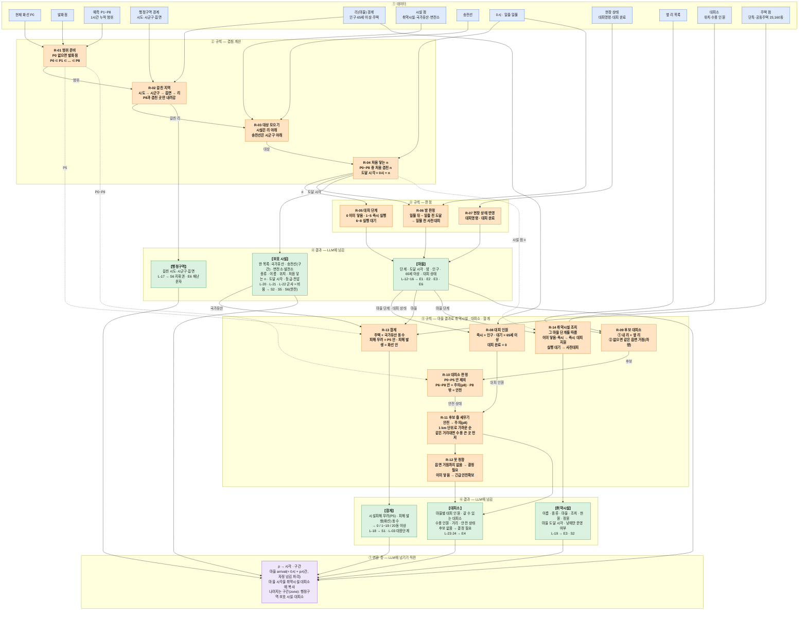
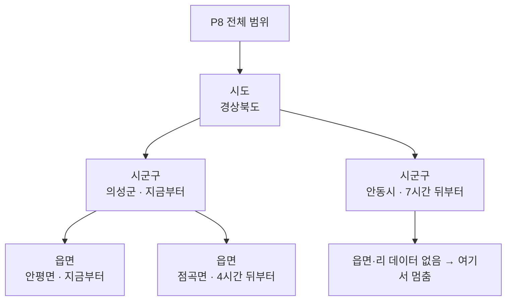
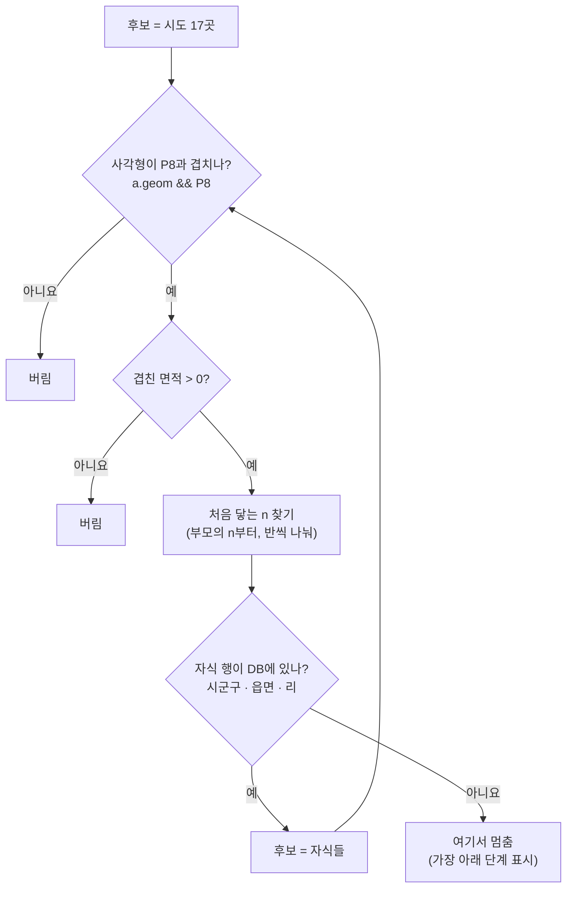
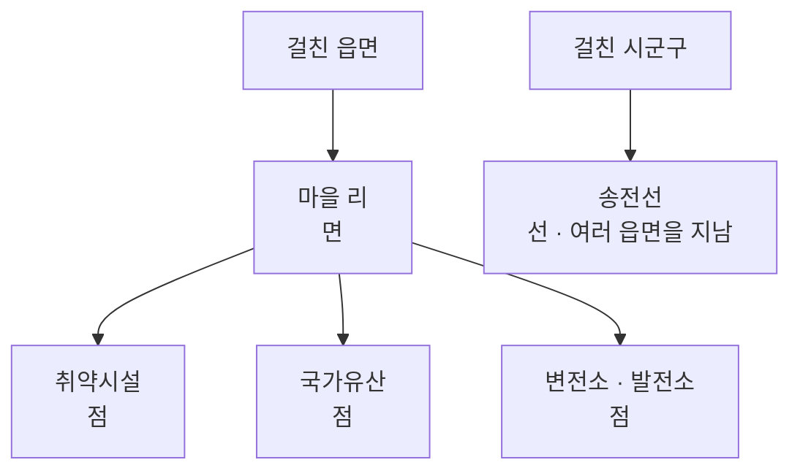
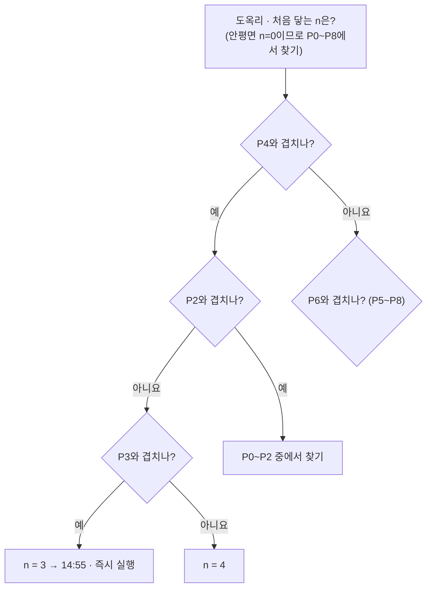
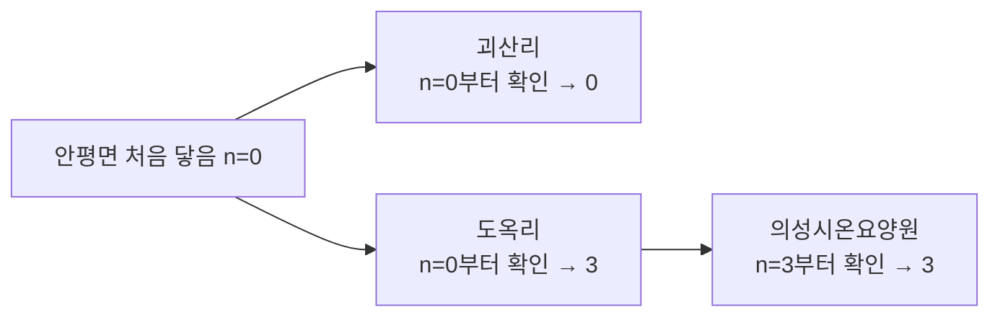
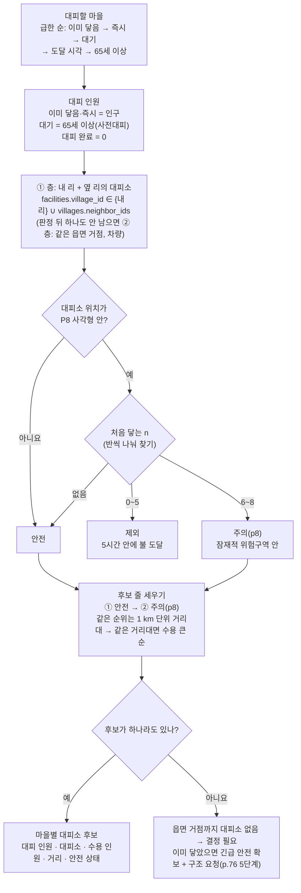

# 규칙 엔진 설계

[`LLM-입력-정리.md`](LLM-입력-정리.md)의 값을 규칙 엔진이 **어떤 데이터로 무엇을 계산·판정해서 LLM에 어떤 형태로 넘기는지** 정리합니다. LLM 입력 표를 한 행씩 같이 확인하면서 4절에 항목을 하나씩 채웁니다.

| 항목 | 내용 |
|---|---|
| 최종 갱신 | 2026-11-03 |
| 기준 | [`LLM-입력-정리.md`](LLM-입력-정리.md)(김지오, 10/27), [`DB-설계.md`](DB-설계.md), 「산불 재난」 위기관리 표준매뉴얼(2026.6) |

## 1. 하는 일

```
① 데이터 ──▶ ② 계산(면적·겹침·풍속) ──▶ ③ 판정(매뉴얼 기준) ──▶ ④ LLM에 넘길 값
```

- 판정 기준은 매뉴얼에서 옮기고, 판정마다 근거 청크를 붙인다
- LLM은 판정을 바꾸지 않고, 근거 청크로 설명하는 문장만 쓴다
- 기준이 매뉴얼에 없으면 판정하지 않고 비운다(`withheld`)
- 제안서를 만들 때마다(예측 갱신·상황 정정) 처음부터 다시 계산한다. 계산으로 나오는 값은 DB에 칸을 늘리지 않는다

## 2. LLM에 넘기는 형식

항목마다 같은 형식이다. 같은 값이 `proposal_items.detail`에도 저장된다.

| 칸 | 뜻 |
|---|---|
| `finding` | 판정 한 줄 |
| `facts` | 문장에 쓸 값 |
| `targets` | 대상 마을·시설 |
| `categories` | 즉시·대기·협의·요청 |
| `withheld` | 기준·데이터가 없어 비운 칸 |
| `rule_basis` | 근거 청크(예: `SM-p072` = 표준매뉴얼 p.72) |

## 3. 계산 목록

여러 항목이 함께 쓰는 계산이다.

| ID | 계산 | 입력 | 출력 | 쓰는 곳 |
|---|---|---|---|---|
| C-01 | 면적 | 현재 화선(없으면 v0 발화점), P1~P8 | ha(`ST_Area` ÷ 10,000), Pn 끝 시각 = 0시 + n시간 | L-01, L-07 |
| C-02 | 걸친 행정구역 | 현재 화선·P5, `admin_areas`(전국 시도·시군구) | 걸친 시군구·시도 목록 | L-01 |
| C-03 | 주택 등 주요시설 동수 | 현재 화선·P5, `map_features`(`house`, GIS건물통합정보 단독·공동주택 점), 국가유산 | 피해 우려 = P5 안 점 수, 피해 발생 = 현재 화선 안 점 수(시행령 [별표 3] 비고 4: 주택 + 국가유산) | L-01, L-03 |
| C-04 | 기상 요약 | 화선 보고 시각 기상(기상청 API), `predictions.weather.hours[]` | 현재 풍향·풍속·기온·습도, 0~5시간 평균풍속, 0~8시간 최대 풍속과 시각, 8시간 뒤 풍향·풍속. 풍향은 16방위 말과 각도(°)를 함께 | L-01, L-05 |
| C-05 | 일출·일몰 | 기준점 위경도(현재 화선 안의 한 점, 없으면 발화점), 날짜(`base_at`) | 일출·일몰 시각, 0~8시간이 자정을 넘으면 다음 날 일출. 천문 공식으로 계산(API 불필요) | L-06, L-12 |
| C-06 | 진화자원 집계 | `resources`(대기 상태), `resource_bases`(위치·관할), 발화점 | 기지별 대기 대수와 종류, 발화점에서 직선거리, 관할·응원 구분(산불 시군구가 기지 관할에 들어 있으면 관할). 관할 전부 + 응원 가까운 순 5곳, 위치 모르는 기지는 각 묶음의 맨 뒤 | L-10 |
| C-07 | 마을 겹침(→ 확산 노출 엔진 R-02 · R-04) | 현재 화선, P1~P8, `villages.geom`, `facilities`(마을 안 취약시설) | 마을마다 현재 화선과 겹치는지, 처음 겹치는 P(n), 겹친 비율(= 겹친 면적 ÷ 마을 면적, 현재·P5·P8). 겹침 = 겹친 면적 > 0. 어느 것과도 안 겹치는 마을은 뺀다 | L-12 |

## 4. 항목별 정리

### L-01 지휘권자 (프롬프트 [인물] 칸 · S6-a 지휘권 인계)

**① 데이터**

| 값 | 값 종류 | 출처 |
|---|---|---|
| 읽는 사람 | 입력 | 로그인한 `users` |
| 현재 화선 / P5 | 입력 / 예측 결과 | `fire_perimeters`, `prediction_slices` |
| 현재 대응단계 | 계산(저장됨) | `incidents.current_stage` — 화선 보고·정정 때 아래 「대응단계」 판정으로 갱신 |
| 풍속 | 데이터 | `predictions.weather` |
| 시도·시군구 경계 | 데이터 | `admin_areas` |
| 마을 경계·주택 동수 | 데이터 | `villages.geom`·`houses_est` |

**② 계산:** C-01 면적, C-02 걸친 행정구역, C-03 주택 동수, C-04 풍속

**③ 판정**

| 판정 | 규칙 | 근거 |
|---|---|---|
| 대응단계 | ① 면적 10·100 ha ② 평균풍속 3·11 m/s ④ 시설피해 20동 — 하나라도 상위 기준이면 상위 단계. ③ 진화예상시간은 제외. **현재** = 화선 보고·정정 때 그 화선과 그 시각 풍속으로 판정해 `incidents.current_stage`에 저장, **P5** = 제안서를 만들 때 P5와 0~5시간 평균풍속으로 판정. 산림청장 공식 발령은 두지 않음 | `SM-p073` |
| 지휘권자 | 2개 이상 시도 → 산림청장 / 2개 이상 시군구 → 시·도지사 / 2단계 + 1,000 ha 이상 → 산림청장 / 2단계 → 시·도지사 / 그 밖 → 관할 시장·군수. **지금** = `current_stage` + 현재 화선, **곧** = P5 단계 + P5 | `SM-p072` |
| 인계 여부 | 읽는 사람 ≠ 지금 지휘권자 → **인계 검토** / 지금은 같고 곧 바뀜 → **인계 대비** / 그 밖 → 없음 | `SM-p072` |

**④ LLM에 넘기는 값** (숫자는 예시)

```json
{
  "finding": "현재 1단계(8 ha)·1개 군 → 의성군수 지휘 / P5 2단계(150 ha) → 격상 시 경상북도지사 인계",
  "facts": {
    "reader": "의성군 통합지휘권자",
    "commander_now": "의성군수",
    "commander_next": "경상북도지사",
    "handover": "대비",
    "stage_now": "1단계",
    "stage_p5": "2단계",
    "area_now_ha": 8,
    "area_p5_ha": 150,
    "sigungu_p5": ["의성군"]
  },
  "withheld": [],
  "rule_basis": ["SM-p072", "SM-p073"]
}
```

- L-01 [인물] 칸과 S6-a 항목이 이 값을 함께 쓴다
- MVP에서 판정하지 않는 것: 재난성 대형산불 우려(숫자 기준 없음), 국유림관리소장(국유림 구분 안 함)

### L-02 산불 기본 정보 (모든 항목 프롬프트 머리)

**① 데이터**

| 값 | 값 종류 | 출처 |
|---|---|---|
| 주소 | 입력 | `incidents.address` |
| 발생 일시 | 입력 | `incidents.started_at`(모르면 비어 있음) |
| 접수 일시 | 입력 | `incidents.reported_at` |
| 진행 상태 | 입력 | `incidents.status` |
| 읍면동·시군구 이름 | 데이터 | `incidents.admin_area_id` → `admin_areas`. 보고자가 찍은 발화 지점으로 자동 계산(주소 글자와 별개) |

**② 계산 · ③ 판정:** 없음. 산불명만 「시군구 + 읍면동 + 날짜」로 붙인다(날짜는 발생 일시, 없으면 접수 일시)

**④ LLM에 넘기는 값** (예시) — 항목별 형식이 아니라 모든 항목 프롬프트에 한 번 들어가는 머리 정보

```json
{
  "incident": {
    "name": "의성군 안평면 산불 (2025-03-22)",
    "sigungu": "의성군",
    "emd": "안평면",
    "address": "경북 의성군 안평면 괴산리 산61 일원",
    "started_at": "2025-03-22 11:24",
    "reported_at": "2025-03-22 11:25",
    "status": "진행 중"
  }
}
```

### L-03 현재 대응단계 (모든 항목 공통)

**① 데이터**

| 값 | 값 종류 | 출처 |
|---|---|---|
| 현재 대응단계 | 계산(저장됨) | `incidents.current_stage` — 화선 보고·정정 때 L-01 「대응단계」 판정으로 갱신 |
| 판정한 화선 | 입력 | `fire_perimeters` 현재 화선(버전·관측 시각) |

**② 계산 · ③ 판정:** 없음. 화선 보고 때 판정해 둔 값을 읽기만 한다. 단계를 그렇게 판정한 이유(면적·풍속·시설피해)와 P5 단계 비교는 S1에서 넘긴다

**④ LLM에 넘기는 값** (예시)

```json
{
  "current_stage": "확산대응 1단계",
  "current_stage_perimeter": "v2 (12:55)"
}
```

- 위기경보는 판정에 쓰는 곳이 없어 제외(5절, 팀 논의)

### L-04 제안서 정보 (모든 항목 공통)

**① 데이터**

| 값 | 값 종류 | 출처 |
|---|---|---|
| 제안서 버전 | 시스템 | `proposals.perimeter_version`.`seq` → 「v1.2」 |
| 생성 사유 | 시스템 | `proposals.trigger`: 예측 갱신 / 상황 정정 |
| 기준 화선 | 입력 | `predictions.perimeter_id` → `fire_perimeters`(버전·관측 시각) |
| 0시(`base_at`) | 시스템 | `predictions.base_at` = 기준 화선의 관측 시각. Pn의 시각 = 0시 + n시간 |

**② 계산 · ③ 판정:** 없음

**④ LLM에 넘기는 값** (예시)

```json
{
  "proposal": {
    "version": "v1.2",
    "trigger": "상황 정정",
    "base_perimeter": "v1 (11:55)",
    "base_at": "2025-03-22 11:55"
  }
}
```

### L-05 기상 (S1·S4·S7)

**① 데이터**

| 값 | 값 종류 | 출처 |
|---|---|---|
| 시간별 기상 9개(0시 ~ 8시간 뒤) | 데이터 | `predictions.weather.hours[]` — 운영: 기상청 단기예보 / 시연: 기상청 AWS 관측(`capston-data/검증용/기상/aws_hourly/by_case/UISEONG20250322.csv`, 가장 가까운 관측소) |

**② 계산:** C-04 기상 요약

| 값 | 계산 |
|---|---|
| 현재 풍향·풍속·기온·습도 | 0시 시각 값 |
| 0~5시간 평균풍속 | 0~5시간 풍속의 산술평균 |
| 최대 풍속과 시각 | 0~8시간 중 최대값과 그 시각 |
| 8시간 뒤 바람 | 마지막 시각 풍향(방위·각도)과 풍속. 바람이 약하면 풍향이 쉽게 흔들리므로 풍속을 같이 넘김(풍향 변화 확인용) |

**③ 판정:** 없음. 이 값으로 S1(평균풍속 3·11 m/s), S4(헬기 운용), S7(풍향 급변)을 각 항목에서 판정한다

**④ LLM에 넘기는 값** (예시: 3/22 단북 관측소 실제 관측, 0시 12:00) — 20시에 바람이 약해지며(0.9 m/s) 풍향이 북북서로 바뀜

```json
{
  "weather": {
    "now": { "wind_dir": "서", "wind_deg": 281, "wind_ms": 8.4, "temp_c": 21.9, "rh_pct": 26 },
    "avg_wind_0_5h_ms": 8.2,
    "max_wind": { "ms": 9.1, "at": "17:00" },
    "wind_8h": { "wind_dir": "북북서", "wind_deg": 339, "wind_ms": 0.9, "at": "20:00" }
  }
}
```

- 시연은 과거 날짜라 예보 대신 관측값을 쓴다. 그래서 「최대 풍속」은 시연에서는 관측 최대값
- 한계: 한 지점(가장 가까운 관측소) 기상을 예측 범위 전체에 쓴다

### L-06 일출·일몰 (S4·E2)

**① 데이터**

| 값 | 값 종류 | 출처 |
|---|---|---|
| 기준점 위경도 | 입력 | 현재 화선 안의 한 점(`ST_PointOnSurface`), 화선이 없으면 발화점. 기상 지점을 정하는 방법과 같음 |
| 날짜 | 시스템 | `predictions.base_at` |

**② 계산:** C-05 일출·일몰. 위치와 날짜만으로 천문 공식으로 계산하고 외부 데이터는 받지 않는다(데이터 자원 D-28)

**③ 판정:** 없음. 낮·밤 판단은 S4(헬기 운용)·E2(야간 도달 마을 사전 대피)·L-15(마을 야간 도달 여부)에서 한다

**④ LLM에 넘기는 값** (예시: 2025-03-22 의성 발화점 36.37°N 128.60°E, 계산값)

```json
{
  "sun": {
    "sunrise": "06:28",
    "sunset": "18:38",
    "next_sunrise": "06:26"
  }
}
```

### L-07 면적 (S1·S2·S6)

**① 데이터**

| 값 | 값 종류 | 출처 |
|---|---|---|
| 현재 화선 | 입력 | `fire_perimeters` 최신 유효 행(없으면 v0 발화점 → 면적 0) |
| P1~P8 | 예측 결과 | `prediction_slices` n = 1~8 |
| 0시 | 시스템 | `predictions.base_at` |

**② 계산:** C-01 면적. 면적(ha) = `ST_Area` ÷ 10,000(EPSG:5179라 m²), Pn 끝 시각 = 0시 + n시간

**③ 판정:** 없음. 이 면적으로 S1(대응단계 10·100 ha)·S6(지휘권 1,000 ha)을 각 항목에서 판정한다

**④ LLM에 넘기는 값** (예시, 숫자는 예시값)

```json
{
  "area": {
    "now_ha": 8,
    "slices": [
      { "p": 1, "until": "13:55", "ha": 21 },
      { "p": 2, "until": "14:55", "ha": 40 },
      { "p": 3, "until": "15:55", "ha": 68 },
      { "p": 4, "until": "16:55", "ha": 105 },
      { "p": 5, "until": "17:55", "ha": 150 },
      { "p": 6, "until": "18:55", "ha": 190 },
      { "p": 7, "until": "19:55", "ha": 228 },
      { "p": 8, "until": "20:55", "ha": 260 }
    ]
  }
}
```

- P1~P8은 서버(`wfg-server` main) `spread/slices.py`가 ELMFIRE 도착 시간 래스터에서 1~8시간으로 잘라 만든다(`hourly(toa, hours=8)`). 홍준서 의성 예제의 1~5시간 등시선은 확인용 그림이라 서비스와 별개

### L-10 진화자원 (S3·S6·S7·정정)

**① 데이터**

| 값 | 값 종류 | 출처 |
|---|---|---|
| 이 산불 투입 수 | 입력 | `incidents.situation.deployed` — 산림청 산불 상황 보고 양식(헬기·장비·인력, 합계와 기관·종류별) |
| 보유·대기 | 데이터 | `resources`(헬기·차량, 상태), `resource_bases`(위치·관할). 시연 헬기 20 · 차량 142(관할 37 + 응원 105) |
| 발화점 | 입력 | `incidents.ignition_point` (거리 기준점) |
| 산불 시군구 | 데이터 | `incidents.admin_area_id` → 상위 시군구 (관할·응원 구분) |

**② 계산:** C-06 진화자원 집계. 인력은 보유를 관리하지 않아 투입 수만 넘긴다

**③ 판정:** 없음. 자원을 어디에 먼저 쓸지는 S3, 응원을 요청할지는 S6, 인력 안전은 S7에서 판정한다. 「보유보다 많이 투입」 확인은 상황 정정 때 시스템이 한다(LLM 아님)

**④ LLM에 넘기는 값** (예시: 발화점 안평면 괴산리, 투입 수는 3/22 13:45 산림청 3보)

```json
{
  "resources": {
    "helicopter": {
      "deployed": { "total": 28, "forest": 8, "local": 17, "fire": 2, "military": 1 },
      "bases": [
        { "base": "안동산림항공관리소", "side": "관할", "km": 22.3, "available": 5, "detail": "S-64E 1 · KA-32T 3 · Bell-206 1" },
        { "base": "의성군 임차헬기", "side": "관할", "km": null, "available": 2, "detail": "임차 2" },
        { "base": "울진산림항공관리소", "side": "응원", "km": 89.2, "available": 3, "detail": "S-64E 1 · KA-32T 2" },
        { "base": "양산산림항공관리소", "side": "응원", "km": 106.2, "available": 5, "detail": "KA-32T 2 · Bell-206 3" }
      ]
    },
    "vehicle": {
      "deployed": { "total": 36, "forest_vehicle": 13, "fire_truck": 21, "other": 2 },
      "bases": [
        { "base": "의성소방서", "side": "관할", "km": 6.2, "available": 4, "detail": "펌프차 2 · 물탱크차 1 · 산불전문진화차 1" },
        { "base": "의성 119안전센터", "side": "관할", "km": 8.7, "available": 2, "detail": "펌프차 1 · 물탱크차 1" },
        { "base": "의성군 산불전문예방진화대", "side": "관할", "km": null, "available": 23, "detail": "산불진화차 23" },
        { "base": "일직119지역대(안동)", "side": "응원", "km": 13.1, "available": 1, "detail": "펌프차 1" },
        { "base": "군위 119안전센터", "side": "응원", "km": 18.0, "available": 2, "detail": "펌프차 2" }
      ]
    },
    "crew": {
      "deployed": { "total": 357, "special_crew": 187, "forest_officials": 113, "fire": 57 }
    }
  }
}
```

- 예시는 목록 일부만 적었다. 실제로는 관할 기지 전부 + 응원 가까운 순 5곳
- 위치를 모르는 기지(임차헬기·진화대)는 `km: null`로 각 묶음의 맨 뒤에 둔다

### L-12 ~ L-24 확산 노출 엔진 (E1~E7 · S1 · S2 · S5 · S6)

예측한 불(현재 화선 · P1~P8)이 **어느 지역 · 어느 마을 · 어느 시설과 언제 겹치나**를 한 번에 계산하는 엔진이다. 김지오 표의 L-12(마을) · L-13(인구) · L-14(도달) · L-15(야간) · L-16(대피 상태) · L-17(행정구역) · L-18(주택) · L-19(취약시설) · L-20(국가유산) · L-21(송전) · L-22(군사시설) · L-23(대피소) · L-24(마을 → 대피소)를 따로 계산하지 않고 이 엔진 하나에서 낸다(11/3)

- 다른 항목(L-01 ~ L-10)은 L 번호마다 ① 데이터 → ② 계산 → ③ 판정 → ④ LLM 값으로 정리했지만, 이 엔진은 규칙끼리 결과를 이어 쓰므로 **규칙(R-01 ~ R-14)마다** 정리하고 「L 번호로 보기」 표로 L 번호와 잇는다
- 근거 표기: 「p.」 = 표준매뉴얼 인쇄 쪽, 「백서 p.」 = 2025 의성산불백서 인쇄 쪽, 「[별표 3]」 = 산림재난방지법 시행령 산불 대응 단계 기준
- 결과는 6절 `context`의 블록(`admin_span` · `villages` · `protected_facilities` · `vulnerable_facilities` · `shelter_options` · `facility_damage`)으로 넘긴다

#### 그림 — 데이터 → 규칙 → 결과

> **규칙 엔진 파이프라인 — 데이터에서 결과까지 한 줄기로 이어지는 층별 흐름도**
> 층마다 한 종류(데이터 / 규칙 / 결과)만 두고, 앞 결과가 다음 규칙의 입력이 된다. 결과에서 화살표를 거꾸로 따라가면 어떤 데이터와 규칙(R-번호 → 아래 근거 표)을 거쳤는지 보인다.

그림은 위에서 아래로 줄을 나눈다: **데이터 → 규칙 → 규칙 → 결과 → 규칙 → 결과**. 앞 결과(마을)가 다음 규칙(대피소)의 입력이 된다. 결과는 묶음마다 따로 있어 필요한 것만 LLM에 넘길 수 있다.

🟦 데이터 · 🟧 규칙(R-번호, 근거는 아래 표) · 🟩 결과(【 】 = 무엇에 관한 정보, 「→」 뒤 = 쓰는 제안) · 🟪 변환 층(엔진 안은 P 번호만, LLM에 넘길 때 시각으로 바꿈)



#### 규칙 번호 → 왜 이렇게 정했나

📖 = 「산불재난」 위기관리 표준매뉴얼(2026.6) 인쇄 쪽(「p.」) · 「백서 p.」 = 2025 의성산불백서 인쇄 쪽(PDF 쪽 − 13) · ⚠ = 매뉴얼에 없어 우리가 정한 것 · ⚙ = 계산 방법

| 번호 | 규칙 | 📖 매뉴얼 근거 | ⚠ 가정 · ⚙ 방법 |
|---|---|---|---|
| R-01 | 범위 준비: P0 = 현재 화선(없으면 발화점), P1~P8 누적 | p.75 「화선도달거리(위험구역 5시간, 잠재적 위험구역 8시간) 설정」 → 8시간까지 필요 · 화선 정보가 없으면 「인명피해 최소화를 위해 보수적으로 설정」 | ⚙ 누적이라 시간 띠는 안 만듦 |
| R-02 | 걸친 지역: 큰 단위 → 작은 단위, P8과 겹친 곳만 | p.72 「2개 이상 시·도 → 산림청장, 2개 이상 시·군·구 → 시·도지사 지휘」 → 걸친 시도·시군구 필요 · p.76 「대피명령은 마을 및 읍·면·동 단위로 지시」 → 리까지 필요 | ⚙ 사각형(`&&`) → 겹친 면적 > 0 · ⚠ 시군구 최소 겹침 면적 미정 · ⚠ 의성 밖은 시군구까지(데이터 범위) |
| R-03 | 대상 모으기: 취약시설·국가유산·변전소·송전선·군사시설 | p.62 「산불 중점 관리대상 지역·시설」: 주민 대피시설, 학교, 요양원 등 안전취약계층 거주시설, 전력시설, 산간지역 군부대 시설 · p.77 진화 우선순위 「① 인명 ② 국가기간산업시설·군사시설·국가유산 ③ 가옥 등 재산」 · p.75 「인근에 취약시설(요양원·장애인시설 등)이 있는 경우 포함」 · p.61 한전 「송전선로 주변 위험목 제거」 · p.114 「인명, 국가유산, 고압선 등 피해 여부 및 확대 가능성 판단」 · p.79 국가유산 「전문가 입회 … 안전지대로 이동 및 경찰관서에 경비 보호 요청」 · p.111 「국가유산·사찰, 주택 등 주요시설 보호」 · p.95 한전 「송전시설 보호 및 우회선로 확보」 | ⚠ 송전선은 선로 단위(한전 요청 단위) · ⚠ 군사시설 자료 없음 → 비움 |
| R-04 | 처음 닿는 n, 도달 시각 = 0시 + n | p.75 대피 기준이 「5시간 · 8시간」 시간 단위 → 몇 시간 뒤 닿는지가 필요 | ⚙ 반씩 나눠 찾기(최대 4번), 부모의 n부터 |
| R-05 | 대피 단계: 0 이미 닿음 · 1~5 즉시 실행 · 6~8 실행 대기 | p.75 「5시간 범위 내 도달 지역은 전 주민 즉시 대피(즉시실행)」 · 「5~8시간 … 대피 준비, 취약계층 사전대피(실행대기)」 · 「8시간 이후 지역은 대피지시 가능성 인지(준비)」 · p.76 주민대피 5단계 | — |
| R-06 | 밤 판정: 일몰 뒤 ~ 일출 전 도달 → 일몰 전 사전대피 | p.75 「야간에 위험구역이 포함된 경우, 일몰 전 사전대피 실시」 | ⚙ 일출·일몰은 계산(C-05) |
| R-07 | 현장 상태 반영 | p.76 「대피명령 실시」 · p.79 「대피하지 않은 주민 강제 대피 조치」 | 상황 정정으로 입력 |
| R-08 | 대피 인원: 즉시 = 인구, 대기 = 65세 이상, 대피 완료 = 0 | p.75 「전 주민 즉시 대피」 · 「취약계층은 사전대피」 · p.76 Set 단계 「고령자 등 안전취약계층 사전대피」 · p.79 「어린이·노인·장애인·환자 등 안전취약계층의 우선적인 대피」 | ⚠ 65세 이상 = 집계구로 추정(`pop65_est`) |
| R-09 | 후보 대피소: ① 내 리 + 옆 리 → 판정 뒤 하나도 없으면 ② 같은 읍면 거점(학교 · 복지·체육 · 공공·문화 · 면사무소, 차량 이동) | 매뉴얼 p.66 「행정리별 대피장소 … 이동거리 및 시간」, 「버스 진입 및 회차 공간」 · p.79 「마을회관, 학교 등」 · p.76 「시군구 단위를 넘어설 경우 상호 대피소 사용」 · 백서 p.219 「주민대피 관리카드: 마을별 대피소 위치, 차량 이동 거리, 1·2차 집결지」 · 백서 p.167 재난문자(리별로 내 리 · 옆 리 장소 지정, 「단촌면 전 주민 → 단촌초등학교」) · 백서 p.187 자가용 · 전세버스 · 119구급차 대피 · 백서 p.205 체육관 · 학교 강당 순차 가동 | ⚠ 거점 종류는 우리가 정함 · ⚠ 후보지 = 이재민 임시주거시설 + 2025 안내 대피장소(산불 대피소 전용 자료 없음, 같은 건물이 대응 중 대피소 · 수습 때 이재민 수용시설, p.66 · p.79 · p.88) · 모텔 11곳은 시험 후 결정 |
| R-10 | 대피소 판정: P0~P5 안 제외 · P6~P8 안 = 주의(`p8`) · P8 밖 = 안전 | p.79 「산불로부터 안전한 경로를 이용하고 … 마을회관, 학교 등 대피장소로 선정」 · p.75 5시간 범위 = 위험구역 · 대피 = 「마을 밖으로」가 아니라 「안전한 대피장소로」: p.79 대표 예가 마을회관 · p.66 「행정리별 대피장소」 · p.76 「즉시 ○○으로 대피」 | ⚠ 5시간 기준(R-05)을 대피소 위치에도 적용 · 재이동 시각은 넣지 않음: 화선이 새로 보고되면 제안이 다시 만들어져, P5 안으로 들어온 대피소는 그때 빠진다(MVP, 11/3) · 대피소가 있는 마을이 대피 중이어도 대피소 점이 범위 밖이면 후보로 둔다(마을 단계로 빼지 않음, 11/3) |
| R-11 | 후보 줄 세우기: 안전 → 주의(`p8`), 같은 순위 안에서는 1 km 단위 거리대로 가까운 순, 같은 거리대면 수용 큰 곳 먼저. 사람은 나누지 않고 수용 인원만 알림 | 매뉴얼 p.79 「안전한 경로 … 보급·취사가 용이한 마을회관, 학교 등」 · 백서 p.205 · p.230 큰 체육관 · 학교 강당을 거점으로 씀 | ⚠ 1 km 거리대는 우리가 정한 값 · ⚠ 몇 명을 어디로 보낼지는 정하지 않음(MVP) · ⚠ 수용 인원 = 대피소 데이터 값(없는 6곳은 「모름」, 거리대 맨 뒤) |
| R-12 | 못 정함: ② 읍면 거점까지 없음 → 결정 필요, 이미 닿음 → 긴급안전확보 + 구조 요청 | 매뉴얼 p.76 주민대피 5단계 「긴급안전확보 · 현 지점 안전확보」 · 백서 p.188 「대체 대피소 확보 없이 무작정 이동만 지시하는 지휘 지양」 | — |
| R-13 | 합계: 주택 + 국가유산 동수를 두 범위로 셈. 시설피해 우려 = P5 안, 피해 발생 = 현재 화선 안. 동수 → 우려 없음(0) · 1단계(1~19) · 2단계(20 이상) | 시행령 [별표 3] · p.73 시설피해 「주택 등 주요시설 20동 미만 / 이상 **피해 우려**」 · [별표 3] 비고 4 「주택 등 주요시설 = 주택과 산불상황관제시스템에 등재된 국가유산, 원자력발전소 등 국가 중요시설」 · p.75 5시간 범위 = 위험구역 · p.50 · p.80 「20동 이상 피해가 발생한 경우」 | ⚠ 「우려」의 시간 범위는 법령에 없음 → 위험구역(P5)으로 정함(11/3) · 주택 = GIS건물통합정보 주용도 단독·공동주택만(용도 없는 72%는 뺌) |
| R-14 | 취약시설 조치: 그 마을 단계를 따름. 이미 닿음·즉시 실행 → 즉시 대피 지원, 실행 대기 → 사전대피. 순서는 즉시 지원 → 사전대피, 같은 조치면 도달 빠른 순 → 현원 많은 순 | p.76 「대피명령은 마을 및 읍·면·동 단위로 지시」 → 마을 단계를 따름 · p.75 「5시간 범위 내 … 전 주민 즉시 대피」 · 「5~8시간 … 취약계층은 사전대피」 · p.76 Set 「고령자 등 안전취약계층 사전대피」 · p.79 「안전취약계층의 우선적인 대피 조치」 · p.77 「① 인명보호」 | ⚠ 마을 밖 가까운 취약시설은 넣지 않음(p.75 「인근 취약시설 포함」은 MVP 제외) · 주야간보호는 `daytime_only`만 표시, 판단은 LLM |

(아래 「규칙별 설명」에 R-01 ~ R-14, 「LLM에 넘기는 결과」에 JSON)

#### L 번호로 보기 — 김지오 표의 각 줄이 어디서 나오나

김지오 표(`LLM-입력-정리.md`)의 L-12 ~ L-24는 따로 계산하지 않고 위 엔진 하나에서 나온다. 줄마다 **어느 규칙이 만들고 · 어느 결과의 어느 칸에 들어가는지 · 바꾼 점**만 적는다

| L | 김지오 표 내용 | 만드는 규칙 · 데이터 | 결과 → 칸 | 바꾼 점 · 결정 |
|---|---|---|---|---|
| L-12 | 불이 닿는 마을(법정리), 단계 묶음 | R-02 걸친 리 → R-04 처음 닿는 n → R-05 단계 | `villages` → `burning` · `immediate` · `standby`, `id` · `emd` · `name` · `overlap` | 기준점 대신 **리 영역 겹침**(10/29). 사람이 사는 리면 영역에 닿는 순간 대상 |
| L-13 | 마을별 인구 · 고령자 · 유소년 · 장애인 | 데이터: `villages.population`(행안부 리별 주민등록) · `pop65_est`(리 인구 × 겹친 SGIS 집계구의 65세 이상 비율, 면적 가중) | `villages` → `population` · `pop65_est` | 0~14세(`pop0_14_est`)는 DB에만 두고 위험도(L-09)에서 씀 · 장애인은 리 단위 자료가 없어 MVP 제외(시설 입소자는 L-19 취약시설로) |
| L-14 | 도달 P · 도달 시각 · 위험구역 여부 | R-04 · R-05 · 변환 층 | `villages` → `first_p` · `arrival` · 단계 | 위험구역 = P1~P5, 잠재적 위험구역 = P6~P8(p.75) |
| L-15 | 야간 도달 여부 | R-06 | `villages` → `night` (일몰 시각은 `sun`) | — |
| L-16 | 대피 상태 | R-07 | `villages` → `evac_order` · `evacuated` | **부상 · 고립 뺌**(데이터 없음, 11/3) |
| L-17 | 걸친 시군구 · 시도 · 읍면 | R-02 | `admin_span` → 시도 → 시군구 → 읍면, `zone` · `lowest` | 시각 대신 **구간**(11/3) |
| L-18 | 범위 안 주택 수(동) | R-13 · 데이터: GIS건물통합정보 단독 · 공동주택 23,160동 | `facility_damage` → `at_risk_p5` · `damaged_now` | 「피해 우려」 = **P5 안**, 주택 + 국가유산([별표 3] 비고 4) · 작은 마을 예외(비고 3 단서)는 뺌(11/3) |
| L-19 | 취약시설 위치 · 정원 · 도달 | R-03 → R-14 | `vulnerable_facilities` → `action` · `village_stage` · `village_arrival` · `occupancy` | 단계는 **그 마을 단계를 따름** · 주야간보호는 `daytime_only`만 · 마을 밖 시설은 안 넣음(11/3) |
| L-20 | 국가유산 위치 · 도달 | R-03 · R-04 | `protected_facilities` → `kind: heritage` · `grade` · `zone` | 단계 · 기관 안 붙임, **구간만**(11/3) |
| L-21 | 송전선이 처음 걸리는 P | R-03 · R-04 | `protected_facilities` → `kind: power_line` · `zone` · `km_in_range` · `segments` | 철탑은 뺌(DB에는 둠) · 구간만(11/3) |
| L-22 | 군사시설 | — | `withheld` | 공개 자료 없음 |
| L-23 | 대피소 위치 · 수용 · P5 · P8 안 여부 | R-09 · R-10 · 데이터: 이재민 임시주거시설 + 2025 안내 대피장소 84곳 | `shelter_options` → `shelters[]` `tier` · `zone` · `capacity` · `km` | 대피소 점 위치로만 판정 · P8 바로 바깥은 위험 아님 · 수용 모름은 「모름」(11/3) |
| L-24 | 마을 → 대피소 배정 · 이동 시간 · 수용 초과 | R-08 · R-11 · R-12 | `shelter_options` → `people` · 순서 · `vehicle_needed` · `decision_needed` | 배정 → **후보만** · 이동 시간 → 직선거리 · 수용 초과 → 수용 인원만 · ① 내 리 + 옆 리 → ② 읍면 거점(차량) → 없으면 결정 필요(11/3) |

#### 규칙별 설명

규칙마다 같은 순서로 적는다: **하는 일 · 입력 · 출력 · 계산 · 📖 왜 이렇게(매뉴얼 근거) · ⚠ 가정 / ⚙ 방법**. 쪽은 「산불재난」 위기관리 표준매뉴얼(2026.6) 인쇄 쪽. 좌표는 모두 EPSG:5179(m)

##### R-01 범위 준비

> 판정에 쓸 불의 범위 9개(P0~P8)를 준비한다

| | |
|---|---|
| 입력 | 현재 화선(`fire_perimeters` 가장 최근 보고) · 발화점(`incidents`) · 예측 P1~P8(`prediction_slices`, ELMFIRE 도달 시간 `toa`를 1시간 단위로 자른 것) · 0시(`predictions.base_at`) |
| 출력 | P0 ~ P8 도형, Pn 끝 시각(= 0시 + n시간) |
| 계산 | 1. **P0** = 가장 최근 현재 화선. 보고된 화선이 없으면 발화점(점)<br/>2. **P1~P8** = 그 화선으로 돌린 예측에서 `toa ≤ n시간`인 곳. 이렇게 자르므로 저절로 **누적**(P0 ⊂ P1 ⊂ … ⊂ P8)<br/>3. Pn 끝 시각 = 0시 + n시간<br/>4. P8의 경계 사각형을 미리 잡아 둔다(R-02 빠른 거르기에 씀) |

**📖 왜 이렇게**

| 정한 것 | 이유 | 근거 |
|---|---|---|
| 8시간까지 본다 | 매뉴얼이 대피 범위를 5시간(위험구역) · 8시간(잠재적 위험구역)으로 나눔. 둘 다 가르려면 P8까지 필요 | p.75 「화선도달거리(위험구역: 5시간, 잠재적 위험구역: 8시간) 설정」 · 「지자체: 대피범위 설정·대피명령(5시간: 즉시실행, 8시간: 실행대기)」 |
| 1시간 간격 | 「몇 시에 닿나」를 시 단위로 말해야 대피 순서(E2)를 정할 수 있음. 5·8시간만 있으면 도달 시각을 모름 | p.75 (시간 단위 기준) |
| P0 = 현재 화선을 따로 둔다 | 이미 불이 닿은 곳은 즉시 대피가 아니라 「긴급안전확보」 단계라 구분해야 함 | p.76 주민대피 5단계 「즉시 대피 · 긴급안전확보」 |
| 화선이 없으면 발화점 | 정보가 없다고 멈추지 않고, 가장 확실한 위치에서 보수적으로 시작 | p.75 「화선 정보 미확보 시 … 인명피해 최소화를 위해 보수적으로 설정」 |

- ⚙ 시간 띠(Pn − P(n−1))는 만들지 않는다. 누적 범위에서 「처음 겹친 n」이 곧 「그 시간에 새로 닿음」이라 같은 답이 나오고 도형 계산만 는다. 시간마다 새로 번진 면적은 면적 차이(P2 − P1)로 구한다
- ⚠ P0가 발화점(점)이면 면적이 0이라, P0와의 겹침만 「닿는가(`ST_Intersects`)」로 본다

##### R-02 걸친 지역

> P8과 겹치는 시도 → 시군구 → 읍면 → 리를 위에서부터 찾는다

| | |
|---|---|
| 입력 | P0~P8(R-01) · `admin_areas`(시도·시군구·읍면, `level`·`parent_id`·`geom`) · `villages`(리, `admin_area_id` = 속한 읍면) |
| 출력 | 걸친 지역 트리(시도 → 시군구 → 읍면 → 리), 지역마다 처음 닿는 n(R-04 방법), 가장 아래까지 내려간 단계 |
| 계산 | 아래 표 1~8 |

**📖 왜 이렇게**

| 정한 것 | 이유 | 근거 |
|---|---|---|
| 시도·시군구를 센다 | 지휘권자가 걸친 시도·시군구 수로 바뀜 | p.72 「2개 이상의 시·도 → 산림청장, 2개 이상 시·군·구 → 시·도지사 지휘」 |
| 읍면·리까지 내려간다 | 대피명령 단위가 마을·읍면동 | p.76 「대피명령은 녹지형태와 지형을 고려하여 마을 및 읍·면·동 단위로 지시」 |
| 시군구 경계를 넘어도 본다 | 대피가 시군구를 넘으면 인근 자치단체와 협조 | p.76 「시군구 단위를 넘어설 경우 인근 자치단체와 협조체계」 |
| P8 기준으로 고른다 | P8 밖은 「대피지시 가능성 인지(준비)」 단계라 대피 판단 대상이 아님 | p.75 「(준비단계) 화선도달범위 8시간 이후 지역은 대피지시 가능성을 인지」 |

- ⚙ 위에서 아래로 내려가며 안 겹치는 지역은 버리므로 의성 182리를 매번 다 보지 않는다
- ⚙ 겹침 = 겹친 면적 > 0(경계선만 맞닿으면 아님)
- ⚠ 시군구 경계에 조금만 걸친 경우(예: 0.3 ha) 최소 겹침 면적을 둘지 미정(지휘권 판정이 흔들릴 수 있음)
- ⚠ 의성 밖은 읍면·리 데이터가 없어 시군구에서 멈춘다(데이터를 넣으면 코드 그대로 내려감)



###### 어떻게 계산하나

쓰는 테이블: `admin_areas`(시도·시군구·읍면, `level`·`parent_id`·`geom`), `villages`(리, `admin_area_id` = 속한 읍면). 좌표는 모두 EPSG:5179(m)

| 순서  | 무엇을          | 구하는 과정                                                                                                    | 예 (의성 3/22, 숫자는 예시)                                   |
| --- | ------------ | --------------------------------------------------------------------------------------------------------- | ----------------------------------------------------- |
| 1   | 맨 위 후보       | `admin_areas`에서 `level = 'SIDO'`인 행 전부를 후보로 둔다                                                            | 시도 17곳                                                |
| 2   | **빠른 거르기**   | 후보의 경계 사각형이 P8의 경계 사각형과 겹치는지만 본다(`a.geom && P8`, 공간 인덱스라 빠름). 안 겹치면 버린다                                   | 17곳 → 경상북도·대구 2곳                                      |
| 3   | **정확히 겹치나**  | 남은 후보마다 `ST_Area(ST_Intersection(a.geom, P8)) > 0`. 0이면 버린다(경계선만 닿은 경우)                                   | 2곳 → 경상북도 1곳                                          |
| 4   | 처음 닿는 n      | 남은 지역마다 P0~P8 중 처음 겹치는 n을 **반씩 나눠 찾기**로 구한다(R-04와 같은 방법). 맨 위는 n = 0부터 찾는다                                | 경상북도 n = 0                                            |
| 5   | **한 단계 아래로** | 남은 지역의 자식을 새 후보로 둔다: 시도 → `parent_id`가 그 시도인 시군구, 시군구 → 그 시군구의 읍면, 읍면 → `villages.admin_area_id`가 그 읍면인 리 | 경북 시군구 22곳이 후보                                        |
| 6   | 2~4 반복       | 새 후보에 2·3·4를 다시 한다. 4는 **부모의 n부터** 찾는다(자식은 부모보다 먼저 닿을 수 없음)                                               | 22곳 → 의성군(n 0) · 안동시(n 7)                             |
| 7   | **멈추기**      | 자식 행이 DB에 없으면 그 지역에서 멈추고 「가장 아래 단계 = 시군구」로 표시한다                                                           | 안동시: 읍면 데이터 없음 → 멈춤                                   |
| 8   | 끝까지          | 리까지 내려가면 끝. 다음 R-03(대상 모으기)은 **남은 읍면·리 안에서만** 찾는다                                                          | 의성 18개 읍면 → 3곳(안평 13리 · 점곡 8리 · 단촌 9리) → 30리 중 겹치는 리만 |

- 한 번에 보는 후보 수: 시도 17 → 시군구 22 → 읍면 18 → 리 30. 의성 182리 전부를 매번 보지 않는다
- 시군구 경계에 **조금만 걸친 경우**(예: 0.3 ha)는 지휘권 판정을 흔들 수 있어, 시군구 단계에서만 최소 겹침 면적(예: 1 ha)을 둘지 정할 것(규칙 엔진 설계 C-02)



```sql
-- 2~3단계 예: P8과 겹치는 시군구 (부모 시도가 정해진 뒤)
SELECT a.id, a.name
FROM admin_areas a
JOIN prediction_slices s ON s.prediction_id = :pid AND s.n = 8
WHERE a.level = 'SIGUNGU'
  AND a.parent_id = :sido_id                        -- 5: 남은 부모의 자식만
  AND a.geom && s.geom                              -- 2: 사각형으로 빠르게 거름
  AND ST_Area(ST_Intersection(a.geom, s.geom)) > 0; -- 3: 정확히 겹치나
```

##### R-03 대상 모으기

> 걸친 지역 안에서 판정할 시설을 모은다

| | |
|---|---|
| 입력 | 걸친 리·시군구(R-02) · `facilities`(`vulnerable` 취약시설 · `heritage` 국가유산) · `map_features`(`substation` 변전소·발전소 · `power_line` 송전선) |
| 출력 | 리 아래: 취약시설 · 국가유산 · 변전소·발전소(점) / 시군구 아래: 송전선(선, 읍면 구간으로 자름) / 비운 것: 군사시설 |
| 계산 | 1. 취약시설 · 국가유산: `facilities.village_id` ∈ 걸친 리(공간 계산 없음)<br/>2. 변전소·발전소: `map_features` 점이 걸친 리 경계 안(`ST_Within`)<br/>3. 송전선: P8과 사각형 겹침(`&&`) → 실제로 걸침(`ST_Intersects`) → 걸친 읍면 경계로 잘라 구간(`ST_Intersection`)<br/>4. 군사시설: 자료가 없어 `withheld`에 적음 |

**📖 왜 이렇게**

| 정한 것 | 이유 | 근거 |
|---|---|---|
| 이 종류들을 모은다 | 매뉴얼이 산불 때 따로 챙기라고 한 시설 | p.62 「산불 관련 중점 관리대상 지역·시설」: 요양원 등 안전취약계층 거주시설 · 전력시설 · 산간지역 군부대 시설 |
| 취약시설 · 국가유산 · 송전 · 군사 | 진화 우선순위 ①·②에 해당 | p.77 「① 인명보호 ② 국가기간산업시설, 군사시설 및 국가유산의 보호 ③ 가옥 등 재산보호」 |
| 국가유산 · 고압선 | 현장에서 피해 여부를 판단해야 하는 대상 | p.114 「인명, 국가유산, 고압선 등 피해 여부 및 확대 가능성 판단」 |
| 송전선을 선로 단위로 | 한전이 선로 단위로 보호·우회 | p.95 「송전시설 보호 및 우회선로 확보」 |

- 대피소는 여기서 모으지 않는다. 불이 걸친 리 안만 보면 안전한 대피소를 못 찾으므로 아래 「대피소 후보」에서 따로 본다
- ⚠ 걸친 리 밖의 가까운 취약시설은 넣지 않는다(p.75 「인근에 취약시설이 있는 경우 포함」은 MVP 제외, 11/3)
- ⚠ 철탑(159기)은 넣지 않는다(송전선 구간과 같은 정보). DB `map_features`에는 그대로 둔다
- ⚠ 군사시설은 공개 자료가 없어 비운다



##### R-04 처음 닿는 n

> 대상마다 P0~P8 중 처음 겹치는 n과 도달 시각을 구한다

| | |
|---|---|
| 입력 | 대상(리 면 · 시설 점 · 송전선 구간) · P0~P8(R-01) · 부모의 n(읍면 → 리 → 시설) · 0시 |
| 출력 | `first_p`(0~8, 안 닿으면 없음) · `arrival`(= 0시 + n시간) · 얼마나(리: 겹친 비율 · 송전선: 범위 안 km) |
| 계산 | 1. **겹침 기준**: 면 = 겹친 면적 > 0 · 점 = 범위 안 · 선 = 걸친 길이 > 0<br/>2. **반씩 나눠 찾기**: 찾는 구간 = [부모의 n, 8]. 가운데 Pk와 겹치면 앞쪽 절반, 아니면 뒤쪽 절반 → 최대 4번<br/>3. P8과도 안 겹치면 「안 닿음」(시설 점에서 생길 수 있음)<br/>4. 도달 시각 = 0시 + n시간<br/>5. 리 겹친 비율 = 겹친 면적 ÷ 리 면적(이미 닿음 = P0 · 즉시 = P5 · 대기 = P8 기준) · 송전선 = `ST_Length(ST_Intersection(선, P8))`, 구간마다 n |

**📖 왜 이렇게**

| 정한 것 | 이유 | 근거 |
|---|---|---|
| 「처음 닿는 시간」을 구한다 | 대피 기준이 「몇 시간 안에 닿나」(5시간 · 8시간) | p.75 「5시간 범위 내 도달 지역」 · 「5~8시간 도달 범위 지역」 |
| 도달 시각을 붙인다 | 밤 판정(R-06)과 대피 순서(E2)에 씀 | p.75 「야간에 위험구역이 포함된 경우 일몰 전 사전대피」 |

- ⚙ 누적이라 한 번 겹치면 뒤도 모두 겹친다 → 이진 탐색으로 최대 4번(하나씩 보면 최대 9번)
- ⚙ 아래 단계는 위 단계보다 먼저 닿을 수 없다(리는 읍면 안) → 부모의 n부터 찾는다





##### R-05 대피 단계 (마을)

> 처음 닿는 n으로 마을의 대피 단계를 정한다

| | |
|---|---|
| 입력 | 마을의 `first_p`(R-04) |
| 출력 | `burning` · `immediate` · `standby` 묶음, 묶음 안 정렬 |
| 계산 | 1. n = 0 → `burning` 이미 닿음<br/>2. n = 1~5 → `immediate` 즉시 실행<br/>3. n = 6~8 → `standby` 실행 대기<br/>4. 묶음 안: 도달 시각 빠른 순 → 65세 이상 많은 순 |

**📖 왜 이렇게**

| 정한 것 | 이유 | 근거 |
|---|---|---|
| 1~5 = 즉시 실행 | 5시간 안에 닿으면 전 주민 즉시 대피 | p.75 「(즉시실행) 5시간 범위 내 도달 지역은 전 주민 즉시 대피」 |
| 6~8 = 실행 대기 | 5~8시간은 대피 준비, 취약계층만 먼저 | p.75 「(실행대기) 5~8시간 도달 범위 지역은 대피소 및 경로 확인, 비상용품 확보 등 대피 준비, 취약계층은 사전대피 실시」 |
| 0 = 이미 닿음을 따로 | 이미 불이 닿은 마을은 「긴급안전확보」까지 봐야 함 | p.76 주민대피 5단계 「즉시 대피 · 긴급안전확보(현 지점 안전확보)」 |
| 8시간 밖은 안 넘김 | 준비 단계는 「인지」뿐이라 대피 판단 대상이 아님 | p.75 「(준비단계) 8시간 이후 지역은 대피지시 가능성을 인지」 |
| 65세 이상 많은 순 | 안전취약계층 우선 | p.79 「어린이·노인·장애인·환자 등 안전취약계층의 우선적인 대피 조치」 |

- ⚠ 정렬 순서(도달 시각 → 65세 이상)는 매뉴얼 원칙을 따라 우리가 정한 것
- 보호 시설(국가유산·송전)에는 단계를 붙이지 않는다(주민대피 기준이라서, 아래 「보호 시설」)

##### R-06 밤 판정 (마을)

> 마을에 불이 밤에 닿는지 정한다

| | |
|---|---|
| 입력 | 마을의 `arrival`(R-04) · 일출·일몰(C-05: 기준점 위경도와 날짜로 천문 계산) |
| 출력 | `night`(참/거짓). 일몰 시각은 `sun` 블록으로 따로 넘김 |
| 계산 | 1. `night` = 도달 시각 ≥ 일몰 또는 도달 시각 < 다음 날 일출<br/>2. 0~8시간이 자정을 넘으면 다음 날 일출을 씀<br/>3. 이미 닿은 마을은 도달 시각 = 0시 |

**📖 왜 이렇게**

| 정한 것 | 이유 | 근거 |
|---|---|---|
| 밤에 닿는 마을을 표시 | 밤에 위험구역이 걸리면 해가 지기 전에 미리 대피 | p.75 「※ 야간에 위험구역이 포함된 경우, 일몰 전 사전대피 실시」 |

- 단계와 상관없이 `night` = 참이면 LLM은 「일몰(18:38) 전 사전대피」로 쓴다(실행 대기 마을도 해당)
- ⚙ 일출·일몰은 API 없이 천문 공식으로 계산

##### R-07 현장 상태 반영 (마을)

> 지휘권자가 정정한 대피명령 · 대피 완료를 마을에 붙인다

| | |
|---|---|
| 입력 | `incidents.situation.villages`(마을 id별 `evac_order` · `evacuated`, 상황 정정으로 바뀜) |
| 출력 | 걸친 마을마다 `evac_order` · `evacuated`(정정이 없으면 거짓) |
| 계산 | 1. 걸친 마을 id로 상황 값을 찾아 붙인다<br/>2. 걸친 마을이 아닌 곳의 상황 값은 넘기지 않는다 |

**📖 왜 이렇게**

| 정한 것 | 이유 | 근거 |
|---|---|---|
| 대피명령 여부 | 이미 명령한 마을에 같은 명령을 다시 제안하지 않기 위해 | p.76 「(대피명령) 화선도달거리 … 자료와 지역 상황을 고려하여 대피명령 실시」 |
| 대피 완료 여부 | 명령했는데 완료가 안 된 마을 = 미대피 주민 조치 대상(E3) · 대피 인원 0(R-08) | p.79 「대피하지 않은 주민 강제 대피 조치」 |

- ⚠ 부상·고립은 넣지 않는다(데이터 없음, 11/3)

##### 보호 시설 — 국가유산 · 송전 (R-03 · R-04)

사람이 없는 보호 대상(국가유산 · 송전선 · 변전소·발전소)은 **한 목록**으로 묶는다. 진화 우선순위에서 국가유산과 국가기간산업시설이 같은 ② 순위(p.77)이고, 쓰는 제안도 같다(S2 보호대상 · S5 시설 보호). 사람이 없으니 마을 단계를 따르지 않고 **자기 위치가 언제 범위에 드나**만 넘긴다. 「즉시 실행 · 실행 대기」는 주민대피 기준(p.75)이라 보호 시설에는 붙이지 않는다. 어느 기관에 알릴지(국가유산 → 국가유산청·경찰 p.79·p.90, 송전 → 한전 p.95)는 **LLM이 매뉴얼 청크를 보고** 쓴다

**① 데이터**

| 종류 `kind` | 의성 | 모양 | 붙는 속성 | 저장 위치 |
|---|---|---|---|---|
| `heritage` 국가유산 | 46곳 = 국보 1 · 보물 7 · 사적 1 · 천연기념물 3 · 국가민속 1 · 시도유형 15 · 시도민속 2 · 문화유산자료 16 | 점 | 등급 | `facilities` |
| `power_line` 송전선 | 10개(345 · 154 kV) | 선 | 전압 | `map_features` |
| `substation` 변전소·발전소 | 14곳(태양광 12) | 점 | 종류 | `map_features` |
| 군사시설 | 0(자료 없음) | — | — | — → `withheld` |

**② 계산**

| 규칙 | 점(국가유산 · 변전소) | 선(송전선) |
|---|---|---|
| R-03 모으기 | 걸친 리 안의 점(국가유산은 `village_id`, `map_features`는 리 경계 안 공간 조회) | P8과 걸치는 선 → 시군구 아래, 읍면 경계로 잘라 구간 |
| R-04 처음 닿는 n | 점이 처음 들어가는 n(그 리의 n부터) | 처음 걸리는 n · 범위 안 길이 `ST_Length(ST_Intersection)` |

**③ 묶기 · 이름**

- 정렬: 도달 시각 빠른 순(국가유산과 송전 사이에 우선을 두지 않음, p.77 같은 ② 순위)
- 철탑(159기)은 넣지 않는다. 송전선 위의 점이라 송전선 구간과 같은 정보이고, 매뉴얼도 「고압선」(p.114)·「송전시설·우회선로」(p.95)처럼 선로 단위로 말한다
- 이름 없는 것은 판정할 때 이름을 만든다(DB 설계 `map_features` 「이름 없는 것 부르기」): 송전선 = 전압 + 위험 구간 양 끝 마을 + 길이, 끝이 변전소면 변전소 이름 · 발전소 = 마을 + 종류
- ⚠ 국가유산은 등급과 상관없이 46곳 모두, 발전소(태양광)도 모두 넣는다(MVP). 줄일지는 나중에 정함

**④ LLM에 넘기는 값**

```json
"protected_facilities": [
  {"kind":"power_line","name":"154 kV 송전선 원당리~용연리 구간","voltage_kv":154,
   "zone":"p5","km_in_range":1.2,
   "segments":[{"emd":"안평면","km":0.8,"zone":"p5"},{"emd":"점곡면","km":0.4,"zone":"p5"}]},
  {"kind":"heritage","name":"○○사 대웅전","grade":"보물","village":"○○리","zone":"p5"}
],
"withheld": ["군사시설: 공개 자료 없음"]
```

- `zone` = 구간: `burning` 이미 화선 안(피해 여부 판단, p.114) · `p5` 위험구역(P1~P5) · `p8` 잠재적 위험구역(P6~P8). 시각은 넘기지 않는다(L-20 · L-21은 「도달 P」만 요구, 매뉴얼 판단 단위도 5시간 · 8시간 구간, 11/3)
- 국가유산은 매뉴얼 대응단계 「주택·국가유산 등 중요시설 20동」(p.73·p.80)에 들어가므로, R-13 합계의 시설피해 수에 화선 안 국가유산도 더한다

LLM 문장 예(기관은 LLM이 매뉴얼로 고름): 「154 kV 송전선 원당리~용연리 구간(1.2 km)이 위험구역(5시간 안) → 한전에 송전시설 보호·우회선로 확보 요청(p.95)」 · 「보물 ○○사 대웅전이 위험구역 안 → 국가유산청 전문가 입회 이동 조치, 경찰 경비 요청(p.79)」

##### 대피소 후보 — 「이 마을은 어느 대피소로 갈 수 있나」 (R-08 ~ R-12)

대피소는 **대피명령의 「어디로」**다. 매뉴얼 주민대피 5단계(p.76)의 즉시 실행 문구가 「즉시 ○○으로 대피하시기 바랍니다」이고, 대피장소는 산불로부터 안전한 경로·마을회관·학교 등으로 고른다(p.79). 매뉴얼은 행정리마다 미리 정한 대피장소(주민대피경로카드, p.66)를 쓰지만 공개 자료가 없어 엔진이 후보를 대신 고른다. LLM은 후보 목록으로 문장만 쓴다

**후보지 = 이재민 임시주거시설 + 2025 실제 안내 대피장소(84곳).** 산불 대피소 전용 자료가 없어 임시로 쓴다. 같은 건물이 대응 중에는 대피소, 수습 때는 이재민 수용시설이다(매뉴얼은 기능으로 나눔: 대피장소 p.66 · p.79 · p.81 / 이재민 수용시설 p.66 · p.81 · p.102, 건물은 겹침: 학교 p.79 · p.88). 엔진은 후보지만 보낸다. ⚠ 모텔 11곳은 시험해 본 뒤 뺄지 정한다 · P8 바로 바깥은 위험으로 보지 않는다(MVP, 11/3)

**범위 = 두 층.** 알고리즘이 완벽할 수는 없으므로, MVP에서는 **선택마다 근거가 있는 만큼**만 정한다(11/3)

| 층 | 후보 | 언제 | 근거 |
|---|---|---|---|
| ① `nearby` | 내 리 + 옆 리(경계가 맞닿은 리)의 대피소 | 먼저 | 매뉴얼 p.66 「**행정리별** 대피장소 … 이동거리 및 시간」 · 백서 p.219 의성 「주민대피 관리카드: **마을별** 대피소 위치, 차량 이동 거리, 1·2차 집결지」 · 백서 p.167 재난문자가 우리 데이터에 있는 장소는 모두 내 리 또는 옆 리(점곡면 동변리 → 점곡초, 금성면 개일리 → 금성면문화센터, 옥산면 정자리 → 정자 경로당) |
| ② `emd_hub` | 같은 읍면의 **거점** 대피소(학교 · 복지·체육 · 공공·문화 · 면사무소). `vehicle_needed: true` | ①이 없을 때만 | 백서 p.167 「단촌면 **전 주민** → 단촌초등학교 운동장 집결」(면 단위 거점) · 백서 p.187 「대부분 주민은 **자가용** 등으로 사전 대피」, 「**전세버스나 119구급차**로 대피」 · 백서 p.205 「의성종합체육관을 시작으로 **초·중·고교 강당** 등 대피 공간을 순차 가동」 · 매뉴얼 p.66 「**버스 진입 및 회차** 공간」 · p.79 「보급·취사가 용이한 마을회관, **학교** 등」 |
| — | 둘 다 없음 → **결정 필요** | | 백서 p.188 「**대체 대피소 확보 없이 무작정 이동만 지시**하는 행정 편의주의적 지휘 지양」 |

- **② 층에도 없으면 더 넓히지 않고 「결정 필요」로 넘긴다.** 다른 읍면이나 인접 시군구까지 엔진이 찾아 억지로 붙이지 않는다. 데이터가 없는 곳도 마찬가지로 「결정 필요」로 두고, 데이터는 나중에 채운다(MVP, 11/3)

- ⚠ 거점 종류(학교 · 복지·체육 · 공공·문화 · 면사무소)는 우리가 정했다. 경로당 · 숙박 · 휴양마을은 거점에 넣지 않는다
- ⚠ 처음에는 「고령자가 걸어서 대피하므로 옆 리까지」로 정했으나, 백서에 차량 대피가 흔했다는 기록이 있어 ② 층을 더했다
- 의성 182리 확인(11/3): ① 층 후보 있음 **147리** · ② 층으로 후보 생김 **28리**(마을 중심 → 가장 가까운 거점 직선거리 가운데값 4.0 km, 최대 7.1 km) · 둘 다 없음 **7리**(구천면 6리 · 옥산면 금봉리 — 두 면에 거점 종류 대피소가 데이터에 없음. 2025년에 쓰인 옥산면실내체육관 등은 데이터를 채우면 풀림)



**엔진은 사람을 나누지 않는다.** 마을마다 「대피 인원 ○명」과 「갈 수 있는 대피소 · 수용 ○명」까지만 넘긴다. 몇 명을 어디로 보낼지는 지휘권자와 지자체가 정한다(MVP 범위)

| 순서 | 무엇을 | 구하는 과정 |
|---|---|---|
| 1 | 대피 인원 | 이미 닿음·즉시 실행 = 인구(p.75 전 주민 즉시 대피), 실행 대기 = 65세 이상(p.75·p.76 「취약계층 사전대피」), 대피 완료 = 0 |
| 2 | **범위** | ① 내 리 + 옆 리(`villages.neighbor_ids`, 적재 때 미리 계산)에 있는 대피소(`facilities.village_id`로 고름, 공간 계산 없음). 옆 리가 다른 시군구여도 그 리 데이터가 있으면 포함 → 3번 판정 뒤 하나도 안 남으면 ② 같은 읍면의 거점(학교 · 복지·체육 · 공공·문화 · 면사무소), `vehicle_needed: true` |
| 3 | 대피소 안전 판정 | 대피소 **자기 위치**로만 판정(그 대피소가 있는 마을의 단계는 보지 않음). P8 사각형 밖이면 바로 안전, 안이면 처음 닿는 n → 0~5 제외 · 6~8 주의(`p8`) · 없음 안전. 재이동 시각은 넣지 않음(화선이 새로 보고되면 제안이 다시 만들어지며 P5 안으로 들어온 대피소는 빠짐) |
| 4 | 후보 줄 세우기 | ① 안전 → ② 주의(`p8`). 같은 순위 안에서는 마을 중심에서 직선거리를 **1 km 단위 거리대**로 묶어 가까운 거리대 먼저, **같은 거리대면 수용 인원 큰 곳 먼저**(수용 모름은 그 거리대 맨 뒤). 근거: 백서 p.205 · p.230 큰 체육관·학교 강당을 거점으로 씀, 매뉴얼 p.79 「보급·취사 용이」. ⚠ 1 km는 우리가 정한 값 |
| 5 | 못 정함 | ② 층까지 후보가 없으면 「주변 대피소 없음 → 결정 필요」, 이미 닿았는데 없으면 「긴급 안전 확보 + 구조 요청」. LLM은 「추가 대피소 개설 또는 차량(버스) 이송 검토 필요」로 알린다(E4, p.66 버스 진입·회차) |

예시(숫자는 예시)

| 마을 | 단계 | 대피 인원 | 대피소 후보 (줄 순서) |
|---|---|---|---|
| 괴산리 | 이미 닿음 | 150 | 복지회관(옆 리) ✅ 수용 80 · 안평초교(옆 리) ⚠ 주의(P8 안), 수용 200 |
| 도옥리 | 즉시 실행 | 118 | 안평초교(내 리) ⚠ 주의(P8 안), 수용 200 · 복지회관(옆 리) ✅ 수용 80 |
| 구암리 | 실행 대기 | 66 | 구암마을회관(내 리) ✅ 수용 50 · 점곡중(옆 리) ✅ 수용 150 |
| 비봉리 | 즉시 실행 | 95 | ① 층 없음 → ② ○○초등학교(같은 읍 거점, 차량) ✅ 수용 300 |
| 장국리 | 즉시 실행 | 60 | ① · ② 없음 → **결정 필요** |

(괴산경로당은 P1 안이라 후보에서 빠짐)

```json
"shelter_options": [
  {"village":"괴산리","stage":"burning","arrival":"11:55","people":150,"shelters":[
     {"name":"복지회관","tier":"nearby","where":"neighbor","zone":"safe","capacity":80,"km":1.2},
     {"name":"안평초교","tier":"nearby","where":"neighbor","zone":"p8","capacity":200,"km":1.8}]},
  {"village":"비봉리","stage":"immediate","arrival":"14:55","people":95,"shelters":[
     {"name":"○○초등학교","tier":"emd_hub","zone":"safe","capacity":300,"km":3.4,"vehicle_needed":true}]},
  {"village":"장국리","stage":"immediate","arrival":"15:55","people":60,"shelters":[],"decision_needed":"읍면 거점까지 대피소 없음"}
]
```

- 수용 인원이 없는 대피소(2025년 안내 장소 6곳)는 수용 칸을 비우고 「수용 인원 모름」으로 넘긴다

##### 취약시설 조치 (R-14)

취약시설(요양원·요양병원·장애인시설 등)에 있는 사람은 스스로 걸어서 대피하기 어렵다. 그래서 마을 주민과 따로 「누구를 · 언제 · 어떻게 도와 옮길지」를 알려야 한다(E3). 대피명령이 마을 단위(p.76)이므로 **시설 단계는 시설 점이 아니라 그 마을 단계를 따른다.** 점 기준으로만 보면 「마을은 즉시 대피인데 안의 요양원은 안 닿음」이 나올 수 있기 때문이다

**① 데이터**

| 값 | 출처 | 예 (기쁨의집) |
|---|---|---|
| 이름 · 종류 | `facilities`(type = vulnerable), 의성 34곳 = 노인요양원 16 · 주야간보호 9 · 요양병원 5 · 병원 2 · 정신병원 1 · 장애인거주시설 1 | 노인요양원 |
| 정원 | `capacity` | 29 |
| 현원 | `attrs.occupancy` | 24 |
| 낮에만 운영 | `attrs.daytime_only`(주야간보호 9곳 = true) | false |
| 들어 있는 리 | `village_id` | 의성읍 후죽리 |
| 그 마을 결과 | ④ 마을(단계 · 도달 시각 · 밤) | — |

**② 계산**

| 규칙 | 하는 일 |
|---|---|
| R-03 | 걸친 리 안의 취약시설을 `village_id`로 모두 모음(마을 밖 시설은 안 봄) |
| R-04 | 시설 점이 처음 들어가는 n → 도달 시각(참고용, 그 리의 n부터 찾음) |

**③ 판정**

| 그 마을 단계 | 조치 `action` | 📖 근거 |
|---|---|---|
| 이미 닿음 · 즉시 실행 | `immediate_support` 즉시 대피 지원(차량·인력) | p.75 「5시간 범위 내 도달 지역은 전 주민 즉시 대피」 · p.79 「안전취약계층의 우선적인 대피 조치」 |
| 실행 대기 | `pre_evacuation` 사전대피 | p.75 「5~8시간 … 취약계층은 사전대피 실시」 · p.76 Set 「고령자 등 안전취약계층 사전대피」 |

- 순서: 즉시 지원 → 사전대피. 같은 조치면 도달 시각 빠른 순 → 현원 많은 순(p.77 「① 인명보호」)
- 주야간보호(낮에만 운영)는 `daytime_only: true`만 붙인다. 운영 시간 자료가 없어 엔진이 「지금 비어 있음」을 판정하지 않고, LLM이 「야간이면 이용자 귀가 여부 확인」 정도로 쓴다
- 마을 밖 가까운 취약시설(p.75 「인근에 취약시설이 있는 경우 포함」)은 MVP에서 넣지 않는다(11/3 결정)

**④ LLM에 넘기는 값**

```json
"vulnerable_facilities": [
  {"name":"의성시온요양원","kind":"노인요양원","village":"도옥리","village_stage":"immediate","village_arrival":"14:55",
   "action":"immediate_support","occupancy":27,"capacity":29,"daytime_only":false},
  {"name":"○○주야간보호","kind":"주야간보호","village":"구암리","village_stage":"standby","village_arrival":"18:55",
   "action":"pre_evacuation","occupancy":12,"capacity":20,"daytime_only":true}
]
```

LLM 문장 예: 「의성시온요양원(현원 27명) 즉시 차량 이송 지원 필요, 14:55 도달 예상」 · 「구암리 ○○주야간보호는 사전대피 대상(낮에만 운영 — 야간이면 이용자 귀가 여부 확인)」

##### R-13 합계 — 주택 등 주요시설 동수

> 대응단계의 시설피해 기준(「주택 등 주요시설 20동 피해 우려」)을 판정할 동수를 센다

| | |
|---|---|
| 입력 | 주택 점(`map_features` `house`, GIS건물통합정보 단독·공동주택 23,160동) · 국가유산 점(보호 시설, R-03) · P0 · P5(R-01) |
| 출력 | 시설피해 우려 동수(P5) · 피해 발생 동수(현재 화선) · 시설피해 단계 |
| 계산 | 1. **피해 우려** = P5 안에 든 주택 점 + 국가유산 점<br/>2. **피해 발생** = 현재 화선(P0) 안에 든 주택 점 + 국가유산 점<br/>3. 시설피해 단계: 피해 우려 0 → 우려 없음(초기) · 1~19 → 1단계 · 20 이상 → 2단계 |

**📖 왜 이렇게**

| 정한 것 | 이유 | 근거 |
|---|---|---|
| 주택 + 국가유산을 센다 | 법령이 「주택 등 주요시설」을 이렇게 정의 | 시행령 [별표 3] 비고 4 「주택과 산불상황관제시스템에 등재된 국가유산, 원자력발전소 등 국가 중요시설」 |
| 동(건물 수)으로 센다 | 기준 단위가 「동」 | [별표 3] · p.73 「주택 등 주요시설 20동」 |
| 「피해 우려」 = P5 안 | 아직 안 탄 시설의 위험을 보는 기준. 매뉴얼이 5시간 범위를 「위험구역」(전 주민 즉시 대피)으로 씀. P8은 시골에서 거의 늘 집이 걸려 늘 1단계가 됨 | [별표 3] 「20동 미만 / 이상 **피해 우려**」 · p.75 「화선도달거리(위험구역: 5시간 …)」 |
| 피해 발생은 따로 | 이미 화선 안의 시설은 「우려」가 아니라 「발생」이고, 위기경보·중수본 기준에 씀 | p.50 · p.80 「주택·국가유산 등 주요시설 20동 이상의 피해가 발생한 경우」 |
| 단계를 「올릴 수 있음」으로 넘김 | 법령은 면적이 기본이고 바람·시설은 상위 단계로 「발령할 수 있다」 | [별표 3] 비고 1 · 2 · 3 |

- ⚠ 주택은 주용도가 단독주택·공동주택인 건물만 센다. 의성 건물의 72%는 건축물대장과 연결되지 않아 용도가 없다(대부분 부속 창고로 보임)
- ⚠ 「우려」의 시간 범위는 법령에 없어 위험구역(P5)으로 정했다(11/3)
- [별표 3] 비고 3 단서(「산불발생 지역의 시설 전체 규모가 20동 미만이면 2단계 발령 가능」)는 「산불발생 지역」의 범위가 정해져 있지 않아 **넣지 않는다**(11/3). 필요하면 나중에 넣는다
- 평균풍속은 대형 산불 30건 관측에서도 71%가 3 m/s 미만, 11 m/s 이상은 거의 없음 → 실제로 단계를 올리는 것은 면적과 시설피해

**LLM에 넘기는 값**

```json
"facility_damage": {
  "at_risk_p5":   {"houses": 45, "heritage": 1, "total": 46, "stage": "확산대응 2단계"},
  "damaged_now":  {"houses": 3,  "heritage": 0, "total": 3},
  "rule_basis": ["시행령 별표 3", "SM-p073"]
}
```

- `stage` = 시설피해만 본 단계. 면적·바람과 합친 현재 단계는 L-03(`current_stage`)이 정한다
- 마을 수·인구·65세 이상 합계는 요약 문장용으로 필요하면 나중에 넣는다
- 시간표(몇 시에 무엇이 닿나)는 따로 만들지 않는다. 결과마다 도달 시각(`arrival`)을 붙여 두었기 때문(11/3)

#### LLM에 넘기는 결과 (JSON)

##### 변환 층 — P 번호를 시각으로 (LLM에 넘기기 직전)

엔진(R-01 ~ R-14) 안에서는 **P 번호(`first_p` = 0~8)만** 들고 계산한다. LLM에 넘기기 직전에 **변환 층** 하나가 P 번호를 시각으로 바꿔 붙인다(11/3 결정)

- 엔진은 「몇 번째 P에서 겹치나」만 판단 → 시각 · 날짜 · 자정 처리를 모름 → 단순하고 테스트하기 쉬움
- 시각 계산은 변환 층 한 곳 → 0시(`base_at`)나 자정 규칙이 바뀌어도 한 곳만 고침
- 지도 · 시스템은 `first_p`를 그대로 쓰고, LLM에게만 시각을 붙여 줌
- 중복(같은 시각을 여러 곳에)은 LLM용 JSON에서만 생김. 엔진 결과에는 없음

**LLM에게 시각을 함께 주는 이유**: LLM은 표에서 값을 찾아 맞추기와 시각 계산(특히 자정 넘김)을 자주 틀린다. 값이 항목 바로 옆에 있으면 찾을 일도 계산할 일도 없고, 문장의 시각이 입력에 그대로 있는지 문자열 비교로 검증할 수 있다. 결과를 따로 넘겨도 혼자서 완결된다. 늘어나는 토큰은 수백 개로, 함께 넘기는 매뉴얼 청크보다 훨씬 작다

**변환 층이 하는 일**

1. 마을에 `arrival` = 0시 + `first_p`시간(자정을 넘으면 「다음 날 01:55」)
2. 다른 결과의 시각을 필요한 곳에 복사: 취약시설 ← 마을 시각(`village_arrival`), 대피소 ← 마을 시각(`arrival`)
3. 행정구역 · 보호 시설 · 송전 구간 · 대피소: `first_p` → `zone`(0 = `burning` · 1~5 = `p5` · 6~8 = `p8`). 시각은 붙이지 않음

**어디에 시각(`arrival`)이 들어가고, 어디는 구간(`zone`)만 들어가나** (11/3 결정)

원칙: 매뉴얼의 판단 단위는 시각이 아니라 **구간**(이미 닿음 · 5시간 · 8시간, p.75)이다. 시각은 **사람을 언제까지 옮겨야 하나**를 말해야 하는 곳에만 붙인다(L-14 「도달 시각」, E2 「도달 시각 순 · 대피 시점」)

| 결과 | 항목 | LLM에 넘기는 칸 | 쓰이는 문장 |
|---|---|---|---|
| 마을 `villages` | 리 | 단계(`burning` · `immediate` · `standby`) + **`arrival`** + `night` | 「도옥리 14:55 도달 예상, 즉시 대피」(E1 · E2) |
| 취약시설 `vulnerable_facilities` | 그 시설의 마을 | `village_stage` + **`village_arrival`** | 「의성시온요양원 14:55 전까지 차량 이송」(E3) |
| 대피소 `shelter_options` | 대피할 마을 | `stage` + **`arrival`** | 「비봉리 14:55 전 대피 완료」(E4) |
| | 대피소 | `zone`(`safe` · `p8`) | 「안평초교는 잠재적 위험구역 안, 주의」(E4) |
| 행정구역 `admin_span` | 시도 · 시군구 · 읍면 | `zone` | 「안동시도 잠재적 위험구역에 걸림」(S6 · E6) |
| 보호 시설 `protected_facilities` | 국가유산 · 변전소 · 송전선 · 송전 구간 | `zone` | 「보물 ○○이 위험구역 안」(S2 · S5) |
| 시설피해 `facility_damage` | P5 안 · 지금 화선 안 동수 | 범위가 키 이름에 고정(`at_risk_p5` · `damaged_now`) | 「위험구역 안 주택 45동 피해 우려」(S1) |

- `zone`: `burning` 이미 화선 안 · `p5` 위험구역(P1~P5) · `p8` 잠재적 위험구역(P6~P8) · 대피소만 `safe`(P8 밖)
- `first_p`는 엔진 안과 시스템(정렬 · 판정 · 지도 P1~P8 띠)이 쓰고, LLM용 JSON에는 마을에만 남긴다


결과는 **묶음마다 따로** 넘길 수 있게 키를 나눈다. **LLM이 바로 쓰기 쉽게** 만들고 중복은 신경 쓰지 않는다: 도달 시각은 `first_p`(n)로 계산되지만 항목마다 `arrival`(시각)을 같이 붙이고, 다른 결과에 있는 마을 도달 시각도 필요한 곳에 다시 붙인다(11/3). 여기 적은 것이 기준 형식이고, 위 각 규칙의 예시는 이 형식을 따른다. 예시 숫자는 지어낸 값(0시 11:55, 일몰 18:38)

| 키 | 결과 | 만드는 규칙 | L 번호 | 상태 |
|---|---|---|---|---|
| `admin_span` | 행정구역 | R-02 · R-04 | L-17 | ✅ 정함 |
| `villages` | 마을 | R-04 · R-05 · R-06 · R-07 | L-12 ~ L-16 | ✅ 정함 |
| `protected_facilities` | 보호 시설 | R-03 · R-04 | L-20 · L-21 · L-22 | ✅ 정함 |
| `vulnerable_facilities` | 취약시설 | R-14 | L-19 | ✅ 정함 |
| `shelter_options` | 대피소 | R-08 ~ R-12 | L-23 · L-24 | ✅ 정함 (`neighbor_ids` 적재는 데이터 할 일) |
| `facility_damage` | 합계(주택 등 주요시설 동수) | R-13 | L-18 | ✅ 정함 |

##### 행정구역 `admin_span`

```json
"admin_span": {
  "sido": [
    {"name": "경상북도", "zone": "burning",
     "sigungu": [
       {"name": "의성군", "zone": "burning", "lowest": "리",
        "emd": [
          {"name": "안평면", "zone": "burning"},
          {"name": "점곡면", "zone": "p5"}
        ]},
       {"name": "안동시", "zone": "p8", "lowest": "시군구"}
     ]}
  ]
}
```

| 칸 | 뜻 | 쓰는 곳 |
|---|---|---|
| `sido` → `sigungu` → `emd` | P8과 겹친 지역만, 위에서 아래로 | — |
| `zone` | 그 지역이 처음 걸리는 구간: `burning` 지금 화선이 걸침 · `p5` 위험구역(P1~P5) · `p8` 잠재적 위험구역(P6~P8) | 지휘권: 지금 걸침 = `burning`, P5 안 = `burning`·`p5`(L-01 · S6, p.72) · 재난문자 대상 읍면(E6) |
| `lowest` | 데이터가 있어 내려간 가장 아래 단계(의성 = 리, 의성 밖 = 시군구) | 「안동시는 읍면 자료 없음」을 LLM이 알게 함 |

- 리 목록은 여기 넣지 않는다(`villages`에 있음)
- 재난문자(E6)는 `emd`의 이름을 쓴다

##### 마을 `villages`

대피 단계별로 묶는다(매뉴얼 행동 단위 = E1 · E2 문장 단위)

```json
"villages": {
  "burning": [
    {"id": 1024, "emd": "안평면", "name": "괴산리", "first_p": 0, "arrival": "11:55",
     "night": false, "overlap": 0.12, "population": 150, "pop65_est": 85,
     "evac_order": true, "evacuated": false}
  ],
  "immediate": [
    {"id": 1029, "emd": "안평면", "name": "도옥리", "first_p": 3, "arrival": "14:55",
     "night": false, "overlap": 0.30, "population": 118, "pop65_est": 66,
     "evac_order": false, "evacuated": false}
  ],
  "standby": [
    {"id": 1040, "emd": "점곡면", "name": "구암리", "first_p": 7, "arrival": "18:55",
     "night": true, "overlap": 0.15, "population": 133, "pop65_est": 83,
     "evac_order": false, "evacuated": false}
  ]
}
```

| 칸 | 뜻 | 만드는 규칙 |
|---|---|---|
| `burning` · `immediate` · `standby` | 이미 닿음 · 즉시 실행(1~5시간) · 실행 대기(6~8시간). 묶음 안은 도달 시각 → 65세 이상 많은 순 | R-05 |
| `id` · `emd` · `name` | 리 id(시스템이 찾을 때) · 읍면 · 리 이름 | R-02 |
| `first_p` · `arrival` | 처음 닿는 n과 시각 | R-04 |
| `night` | 밤에 닿나 → 일몰 전 사전대피 | R-06 |
| `overlap` | 겹친 비율(이미 닿음 = P0, 즉시 = P5, 대기 = P8 기준). 순서 참고용 | R-04 |
| `population` · `pop65_est` | 인구 · 65세 이상 추정(DB 값 그대로) | — |
| `evac_order` · `evacuated` | 대피명령 · 대피 완료(상황 정정) | R-07 |

- 어느 P와도 겹치지 않는 마을은 넘기지 않는다
- L-13 처리(0~14세 · 장애인 제외)는 위 「L 번호로 보기」 참고
- 마을 안 취약시설은 여기 넣지 않고 `vulnerable_facilities`에 둔다(`village` 칸으로 이어짐). 결과를 묶음별로 따로 넘기기 위해서
- 부상·고립은 넣지 않는다(데이터 없음)

##### 보호 시설 `protected_facilities`

```json
"protected_facilities": [
  {"kind": "power_line", "name": "154 kV 송전선 원당리~용연리 구간", "voltage_kv": 154,
   "zone": "p5", "km_in_range": 1.2,
   "segments": [
     {"emd": "안평면", "km": 0.8, "zone": "p5"},
     {"emd": "점곡면", "km": 0.4, "zone": "p5"}
   ]},
  {"kind": "heritage", "name": "○○사 대웅전", "grade": "보물", "village": "○○리", "zone": "p5"},
  {"kind": "substation", "name": "팔성리 태양광 발전소", "village": "팔성리", "zone": "p8"}
],
"withheld": ["군사시설: 공개 자료 없음"]
```

| 칸 | 뜻 |
|---|---|
| `kind` | `heritage` 국가유산 · `power_line` 송전선 · `substation` 변전소·발전소 |
| `name` | 이름. 이름 없는 송전선·발전소는 판정할 때 만듦(전압 + 구간 양 끝 마을 / 마을 + 종류) |
| `grade` · `voltage_kv` | 국가유산 등급 · 송전 전압 |
| `village` | 점이 들어 있는 리(송전선은 `segments`의 읍면) |
| `zone` | 구간: `burning` 이미 화선 안(피해 여부 판단, p.114) · `p5` 위험구역(P1~P5) · `p8` 잠재적 위험구역(P6~P8) |
| `km_in_range` · `segments` | 송전선만: P8 안 길이, 읍면 구간별 길이 · 구간 |
| `withheld` | 자료가 없어 비운 것 |

- 단계(즉시 · 대기)는 붙이지 않는다(주민대피 기준이라서)
- 어느 기관에 알릴지는 넣지 않는다. LLM이 매뉴얼 청크로 쓴다(국가유산 → 국가유산청·경찰 p.79 · p.90, 송전 → 한전 p.95)
- 정렬: 이미 화선 안 → P5 → P8
- 시각은 넘기지 않는다(L-20 · L-21은 「도달 P」만 요구, 11/3)

##### 취약시설 `vulnerable_facilities`

```json
"vulnerable_facilities": [
  {"name": "의성시온요양원", "kind": "노인요양원", "village": "도옥리", "village_stage": "immediate", "village_arrival": "14:55",
   "action": "immediate_support", "occupancy": 27, "capacity": 29, "daytime_only": false},
  {"name": "○○주야간보호", "kind": "주야간보호", "village": "구암리", "village_stage": "standby", "village_arrival": "18:55",
   "action": "pre_evacuation", "occupancy": 12, "capacity": 20, "daytime_only": true}
]
```

| 칸 | 뜻 | 만드는 규칙 |
|---|---|---|
| `name` · `kind` | 이름 · 종류(노인요양원 · 주야간보호 · 요양병원 · 병원 · 정신병원 · 장애인거주시설) | R-03 |
| `village` · `village_stage` · `village_arrival` | 들어 있는 리, 그 마을의 대피 단계와 도달 시각(언제까지 옮겨야 하나) | R-04 · R-05 |
| `action` | `immediate_support` 즉시 대피 지원(마을이 이미 닿음·즉시) · `pre_evacuation` 사전대피(마을이 대기) | R-14 |
| `occupancy` · `capacity` | 현원 · 정원 | — |
| `daytime_only` | 낮에만 운영(주야간보호). 판단은 LLM | — |

- 정렬: 즉시 지원 → 사전대피, 같은 조치면 도달 빠른 순 → 현원 많은 순
- 걸친 리 밖의 시설은 넣지 않음

##### 대피소 `shelter_options`

```json
"shelter_options": [
  {"village": "괴산리", "stage": "burning", "arrival": "11:55", "people": 150, "shelters": [
     {"name": "복지회관", "tier": "nearby", "where": "neighbor", "zone": "safe", "capacity": 80, "km": 1.2},
     {"name": "안평초교", "tier": "nearby", "where": "neighbor", "zone": "p8", "capacity": 200, "km": 1.8}]},
  {"village": "비봉리", "stage": "immediate", "arrival": "14:55", "people": 95, "shelters": [
     {"name": "○○초등학교", "tier": "emd_hub", "zone": "safe", "capacity": 300, "km": 3.4, "vehicle_needed": true}]},
  {"village": "장국리", "stage": "immediate", "arrival": "15:55", "people": 60, "shelters": [], "decision_needed": "읍면 거점까지 대피소 없음"}
]
```

| 칸 | 뜻 | 만드는 규칙 |
|---|---|---|
| `village` · `stage` · `arrival` | 대피할 마을, 단계, 마을 도달 시각(언제까지 대피를 끝내야 하나) | R-04 · R-05 |
| `people` | 대피 인원: 이미 닿음·즉시 = 인구, 대기 = 65세 이상, 대피 완료 = 0 | R-08 |
| `shelters[].tier` · `where` | `nearby` 내 리 · 옆 리(`where`: `own` · `neighbor`) / `emd_hub` 같은 읍면 거점 | R-09 |
| `shelters[].vehicle_needed` | `emd_hub`이면 참 → 「차량(버스) 이송 필요」 | R-09 |
| `shelters[].zone` | `safe` P8 밖 · `p8` P6~P8 안(주의). P0~P5 안 대피소는 후보에서 빠짐 | R-10 |
| `shelters[].capacity` · `km` | 수용 인원(데이터 값, 없으면 비움) · 마을 중심에서 직선거리. 순서: 안전 → 주의, 1 km 거리대 → 같은 거리대면 수용 큰 순 | R-11 |
| `decision_needed` | ② 읍면 거점까지 후보가 없을 때 이유. 이미 닿은 마을이면 긴급안전확보 | R-12 |

- 사람을 나누지 않음. 몇 명을 어디로 보낼지는 지휘권자가 정함
- **대피 후보지 = 행안부 이재민 임시주거시설 + 2025 실제 안내 대피장소**(84곳: 경로당 31 · 학교 18 · 공공·문화 11 · 숙박 11 · 복지·체육 8 · 휴양마을 3 · 면사무소 2). 산불 대피소 전용 자료가 없어 임시로 쓴다. 같은 건물이 대응 중에는 대피소, 수습 때는 이재민 수용시설이 된다(매뉴얼은 기능으로 나눔: 대피장소 p.66 · p.79 · p.81, 이재민 수용시설 p.66 · p.81 · p.102. 건물은 겹침: 학교 p.79 · p.88). 엔진은 후보지만 보낸다(11/3)
- ⚠ 모텔 11곳(숙박시설)은 매뉴얼 대피장소 예(「마을회관, 학교 등」, p.79)와 거리가 있다. 지금은 후보에 두고, 시험해 본 뒤 뺄지 정한다
- P8 바로 바깥 대피소(예: 경계에서 1 km 안)는 위험으로 보지 않는다(MVP, 11/3)
- 수용 인원이 없는 대피소(2025 안내 장소)는 `capacity`를 비우고 「수용 인원 모름」으로 넘긴다. 사실 그대로라서. 문제가 생기면 그때 가정값을 넣는다(11/3)
- **대피소는 자기 점 위치로만 판정한다.** 대피소가 있는 마을이 즉시 실행이어도(리 끝 산자락만 P5에 걸린 경우 등) 대피소 점이 P5 밖이면 후보다. 매뉴얼의 대피는 「마을 밖으로」가 아니라 「안전한 대피장소로」이고, 대표 예가 마을 안의 마을회관이다(p.79 · p.66 · p.76). 리 경계에는 산이 넓어 마을 단계로 빼면 멀쩡한 대피소까지 빠진다(11/3)
- 여러 마을이 같은 대피소를 후보로 가져도 따로 표시하지 않는다(`shared_with`는 MVP 제외, 11/3). 사람을 나누지 않으므로 수용 인원은 대피소마다 데이터 값 그대로
- 김지오 표 L-24(「마을→대피소 배정, 이동 시간, 수용 초과」)에서 바뀐 점: 배정 → **후보만** · 이동 시간 → **직선거리(km)** · 수용 초과 → **수용 인원만 알림**(11/3)
- 데이터 할 일: `villages.neighbor_ids`(옆 리 목록) 적재. 확인 계산으로는 182리 중 148리(81%)가 내 리 또는 옆 리에 대피소 있음

##### 시설피해 `facility_damage`

```json
"facility_damage": {
  "at_risk_p5":  {"houses": 45, "heritage": 1, "total": 46, "stage": "확산대응 2단계"},
  "damaged_now": {"houses": 3, "heritage": 0, "total": 3},
  "rule_basis": ["시행령 별표 3", "SM-p073"]
}
```

| 칸 | 뜻 | 쓰는 곳 |
|---|---|---|
| `at_risk_p5` | **피해 우려**: P5(5시간 안 위험구역) 안 주택 + 국가유산 동수와, 그 동수만 본 단계 | 대응단계 시설피해 기준(S1 · L-03) |
| `damaged_now` | **피해 발생**: 지금 화선 안에 이미 든 동수 | 위기경보 · 중수본 판단(p.50 · p.80) |

## 5. 정할 것

| 대상 | 정할 것 |
|---|---|
| C-02 | 시군구 경계에 조금만 걸친 경우의 최소 겹침 면적(구현할 때 정함, 기본 1 ha) |
| C-03 | ~~`houses_est`를 무엇으로 채울지~~ → GIS건물통합정보로 채움(11/3). 「피해 우려」 = P5 안으로 정함 |
| L-01 | 인계의 구분(즉시·대기·협의·요청) — S6-a를 볼 때 정함 |
| L-08 | 주 확산 방향의 정의 — **나중에 다시 정함**. ELMFIRE는 방향을 직접 내지 않음. 후보: P1~P8로 계산(현재 화선 중심 → P5 중심, 또는 불머리 방향) / 바람으로(풍향 + 180°). S3·S7에서 씀 |
| L-09 | 위험도 R과 4축 점수 — **제일 나중에 정함**([`위험도-정리.md`](위험도-정리.md)). 제안 문장에도 쓸지 함께 정함 |
| L-11 | 근거 청크를 LLM에 어떻게 넘기는지 — **나중에 다시 정함**. 규칙 엔진은 판정마다 근거 청크 ID(`rule_basis`)를 붙이고, 근거 검색(김지오)이 그 본문과 추가 검색 결과를 붙여 LLM에 [k] 번호로 넘기는 구조. 표준매뉴얼 청킹이 아직 안 됨 |
| L-03 | 위기경보(관심·주의·경계·심각)를 둘지 — **팀 논의**. 산림청 발령 값이고 기준이 지역 산불위험지수·회의 판단이라 규칙 엔진이 판정하기 어려움(표준매뉴얼 p.50). 판정에 쓰는 곳은 없음 |
| 확산 노출 | [별표 3] 비고 3 단서(산불발생 지역의 시설 전체가 20동 미만이면 2단계 가능) — 「산불발생 지역」 범위가 애매해 뺌. 필요하면 넣기 |
| 확산 노출 | 대피소 후보의 모텔 11곳 — 시험해 보고 뺄지 정함 · 국가유산 등급 · 태양광 발전소를 줄일지 |
| 확산 노출 | 데이터 적재: `villages.neighbor_ids` · 대피소 거점 여부(② 층) · `map_features`(`house`) · 전국 시도·시군구 경계 |

## 6. LLM에 넘기는 전체 형태

4절은 **항목별로 따로 넘길 때의 값**(그대로 유지)이고, 이 절은 **한 번에 묶어 넘길 때의 형태**다. 묶어서 보낼 때는 **공통 정보(`context`)는 한 번, 항목별 판정(`items`)은 항목마다** 넣어 중복을 없앤다. 4절을 한 행씩 정리할 때마다 여기도 함께 고친다.

- **`context`** = LLM 입력 표의 L-xx(공통·규칙 엔진 공통 판정). 제안서 하나에 한 번 계산한다. **뜻이 같은 값끼리 블록으로 묶고**, 블록마다 `used_by`(어느 항목에서 쓰는지)를 붙인다. 쓰이지 않는 것으로 드러나면 나중에 뺀다
- **`items`** = S1~S7·E1~E7. 2절 형식(`finding`·`facts`·`targets`·`categories`·`withheld`·`rule_basis`)이고, `facts`에는 그 항목에만 필요한 값을 넣는다
- LLM이 문장에 쓸 수 있는 숫자 = `context` + 항목의 `finding`·`facts` + 근거 청크

| `context` 블록 | 담는 것 | LLM 입력 | 확인 |
|---|---|---|---|
| `incident` | 산불 기본 정보 | L-02 | ✅ |
| `proposal` | 제안서 버전·생성 사유·기준 화선·0시 | L-04 | ✅ |
| `stage` | 지금·P5 대응단계 | L-03 (+ L-01 판정) | ✅ |
| `weather` | 현재 기상, 0~5시간 평균풍속, 최대 풍속, 8시간 뒤 바람 | L-05 | ✅ |
| `sun` | 일출·일몰, 다음 날 일출 | L-06 | ✅ |
| `area` | 현재 화선 면적, P1~P8 면적·끝 시각 | L-07 | ✅ |
| `villages` | 불이 닿는 마을 목록: 대피 단계(이미 닿음·즉시 실행·실행 대기), 도달 시각, 밤 도달, 인구·65세 이상, 현장 상태(대피명령·대피 완료) | L-12 ~ L-16 | ✅ 11/3 (취약시설은 `vulnerable_facilities`로 뺌) |
| `resources` | 투입 수(산림청 보고 양식), 기지별 대기 자원(관할 전부 + 응원 가까운 5곳, 발화점 거리순) | L-10 | ✅ |
| `admin_span` | P8과 겹친 시도 → 시군구 → 읍면, 지역마다 구간(`zone`) | L-17 | ✅ 11/3 |
| `protected_facilities` | 보호 시설(국가유산 · 송전선 · 변전소·발전소), 구간(`zone`), 비운 것(군사시설) | L-20 · L-21 · L-22 | ✅ 11/3 |
| `vulnerable_facilities` | 걸친 리 안 취약시설, 조치(즉시 대피 지원 · 사전대피), 그 마을 도달 시각 | L-19 | ✅ 11/3 |
| `shelter_options` | 마을별 대피 인원과 대피소 후보(내 리 · 옆 리 → 읍면 거점), 없으면 결정 필요 | L-23 · L-24 | ✅ 11/3 |
| `facility_damage` | 주택 + 국가유산 동수: 피해 우려(P5 안) · 피해 발생(화선 안) | L-18 | ✅ 11/3 |
| `commander` | 읽는 사람, 지금·곧 지휘권자, 인계 여부 | L-01 | ✅ |

```json
{
  "context": {
    "incident": {
      "name": "의성군 안평면 산불 (2025-03-22)",
      "sigungu": "의성군",
      "emd": "안평면",
      "address": "경북 의성군 안평면 괴산리 산61 일원",
      "started_at": "2025-03-22 11:24",
      "reported_at": "2025-03-22 11:25",
      "status": "진행 중",
      "used_by": ["전체"]
    },
    "proposal": {
      "version": "v1.2",
      "trigger": "상황 정정",
      "base_perimeter": "v1 (11:55)",
      "base_at": "2025-03-22 11:55",
      "used_by": ["전체"]
    },
    "stage": {
      "now": "확산대응 1단계",
      "now_perimeter": "v2 (12:55)",
      "p5": "확산대응 2단계",
      "rule_basis": ["SM-p073"],
      "used_by": ["S1", "S6", "L-01"]
    },
    "weather": {
      "now": { "wind_dir": "서", "wind_deg": 281, "wind_ms": 8.4, "temp_c": 21.9, "rh_pct": 26 },
      "avg_wind_0_5h_ms": 8.2,
      "max_wind": { "ms": 9.1, "at": "17:00" },
      "wind_8h": { "wind_dir": "북북서", "wind_deg": 339, "wind_ms": 0.9, "at": "20:00" },
      "used_by": ["S1", "S4", "S7"]
    },
    "sun": {
      "sunrise": "06:28",
      "sunset": "18:38",
      "next_sunrise": "06:26",
      "used_by": ["S4", "E2", "L-15"]
    },
    "area": {
      "now_ha": 8,
      "slices": [
        { "p": 1, "until": "13:55", "ha": 21 },
        { "p": 5, "until": "17:55", "ha": 150 },
        { "p": 8, "until": "20:55", "ha": 260 }
      ],
      "used_by": ["S1", "S2", "S6", "L-01"]
    },
    "admin_span": {
      "sido": [
        {"name": "경상북도", "zone": "burning",
         "sigungu": [
           {"name": "의성군", "zone": "burning", "lowest": "리",
            "emd": [{"name": "안평면", "zone": "burning"}, {"name": "점곡면", "zone": "p5"}]},
           {"name": "안동시", "zone": "p8", "lowest": "시군구"}
         ]}
      ],
      "used_by": ["S6", "E6", "L-01"]
    },
    "villages": {
      "burning":   [ { "id": 1024, "emd": "안평면", "name": "괴산리", "first_p": 0, "arrival": "11:55", "night": false, "population": 150, "pop65_est": 85, "evac_order": true, "evacuated": false } ],
      "immediate": [ { "id": 1029, "emd": "안평면", "name": "도옥리", "first_p": 3, "arrival": "14:55", "night": false, "population": 118, "pop65_est": 66, "evac_order": false, "evacuated": false } ],
      "standby":   [ { "id": 1040, "emd": "점곡면", "name": "구암리", "first_p": 7, "arrival": "18:55", "night": true, "population": 133, "pop65_est": 83, "evac_order": false, "evacuated": false } ],
      "used_by": ["E1", "E2", "E3", "E5", "E6", "E7", "S2", "S3", "S5"]
    },
    "protected_facilities": {
      "items": [
        { "kind": "power_line", "name": "154 kV 송전선 원당리~용연리 구간", "zone": "p5", "km_in_range": 1.2,
          "segments": [ { "emd": "안평면", "km": 0.8, "zone": "p5" }, { "emd": "점곡면", "km": 0.4, "zone": "p5" } ] },
        { "kind": "heritage", "name": "○○사 대웅전", "grade": "보물", "village": "○○리", "zone": "p5" }
      ],
      "withheld": ["군사시설: 공개 자료 없음"],
      "used_by": ["S2", "S5", "S6"]
    },
    "vulnerable_facilities": {
      "items": [
        { "name": "의성시온요양원", "kind": "노인요양원", "village": "도옥리", "village_stage": "immediate", "village_arrival": "14:55",
          "action": "immediate_support", "occupancy": 27, "capacity": 29, "daytime_only": false }
      ],
      "used_by": ["E3", "S2", "S5"]
    },
    "shelter_options": {
      "items": [
        { "village": "괴산리", "stage": "burning", "arrival": "11:55", "people": 150, "shelters": [
            { "name": "복지회관", "tier": "nearby", "where": "neighbor", "zone": "safe", "capacity": 80, "km": 1.2 },
            { "name": "안평초교", "tier": "nearby", "where": "neighbor", "zone": "p8", "capacity": 200, "km": 1.8 } ] },
        { "village": "장국리", "stage": "immediate", "arrival": "15:55", "people": 60, "shelters": [], "decision_needed": "읍면 거점까지 대피소 없음" }
      ],
      "used_by": ["E4"]
    },
    "facility_damage": {
      "at_risk_p5":  { "houses": 45, "heritage": 1, "total": 46, "stage": "확산대응 2단계" },
      "damaged_now": { "houses": 3, "heritage": 0, "total": 3 },
      "rule_basis": ["시행령 별표 3", "SM-p073"],
      "used_by": ["S1", "S2", "S5", "L-03"]
    },
    "resources": {
      "helicopter": { "deployed": { "total": 28 }, "bases": [ { "base": "안동산림항공관리소", "side": "관할", "km": 22.3, "available": 5 } ] },
      "vehicle":    { "deployed": { "total": 36 }, "bases": [ { "base": "의성소방서", "side": "관할", "km": 6.2, "available": 4 } ] },
      "crew":       { "deployed": { "total": 357 } },
      "used_by": ["S3", "S6", "S7"]
    },
    "commander": {
      "reader": "의성군 통합지휘권자",
      "now": "의성군수",
      "next": "경상북도지사",
      "handover": "대비",
      "rule_basis": ["SM-p072"],
      "used_by": ["프롬프트 [인물]", "S6"]
    }
  },
  "items": []
}
```

- `used_by`는 김지오 LLM 입력 표의 「쓰는 곳」 칸을 따른다
- 목록인 결과(`protected_facilities` · `vulnerable_facilities` · `shelter_options`)는 `items`로 감싸 `used_by`를 붙인다. 칸 뜻은 4절 「확산 노출 엔진 → LLM에 넘기는 결과」
- 시각(`arrival`)은 마을 · 취약시설의 마을 · 대피소의 마을에만 붙이고, 나머지는 구간(`zone`: `burning` · `p5` · `p8`)으로 넘긴다(변환 층, 11/3)
- `area.slices`는 이 예시에서 P1·P5·P8만 적었고 실제로는 P1~P8 8개
- `items`는 S·E 항목을 정리하면서 채운다
- 제안서마다 `context`를 함께 저장하면 AI 어시스턴트가 상황 전체를 다시 읽을 수 있다(LLM 입력 A-03). 저장 위치는 DB 설계에서 정한다(예: `proposals.context`)
