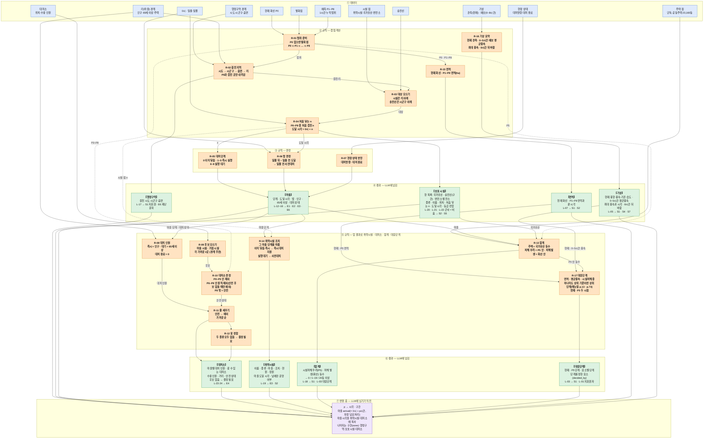
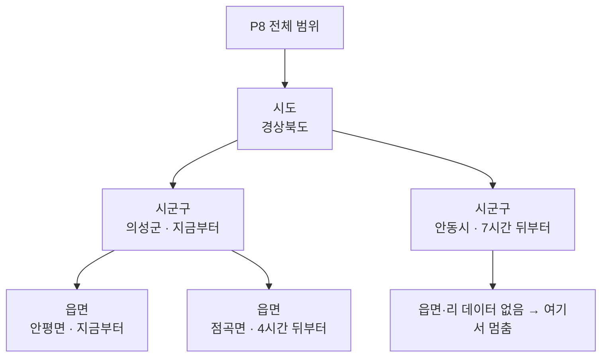
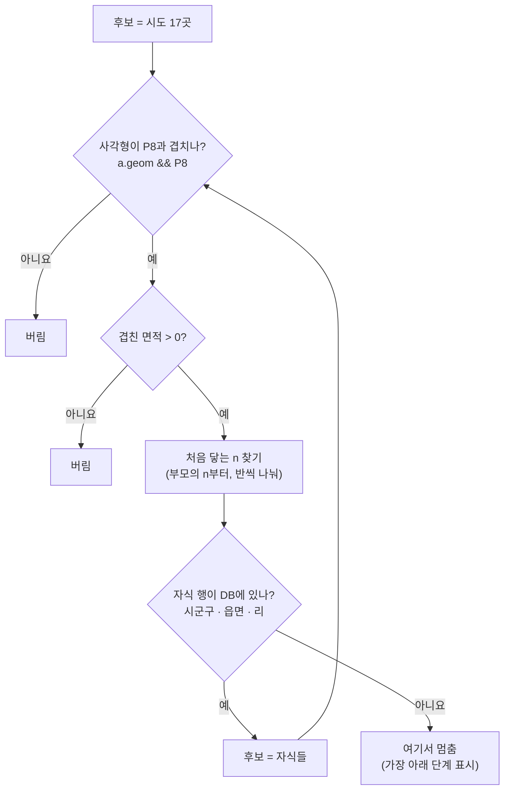
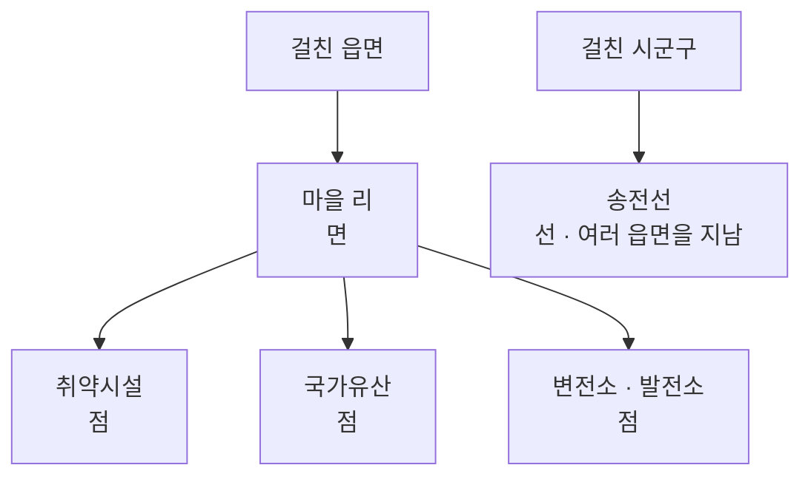
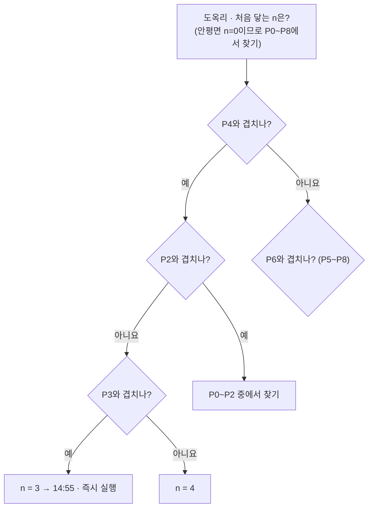
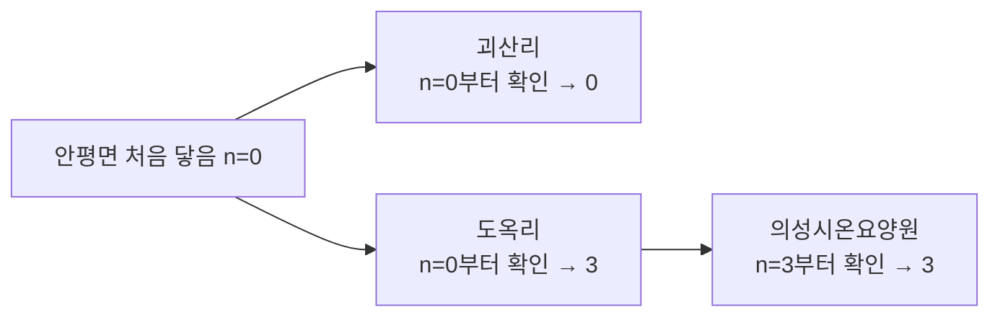
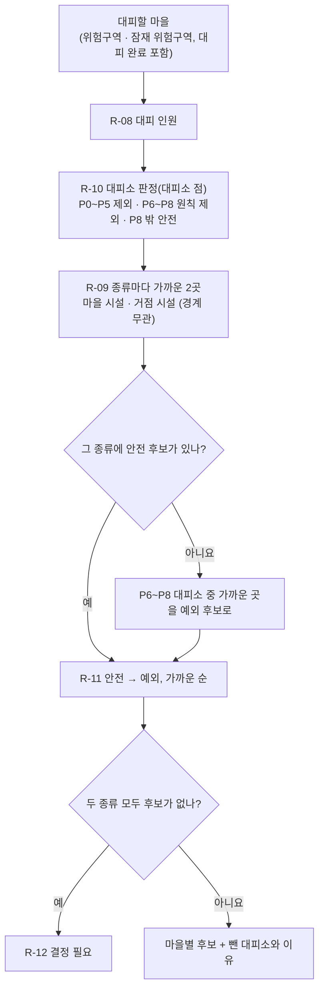
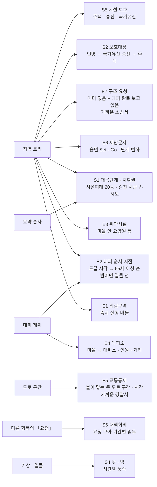

# 규칙 엔진 설계

[`LLM-입력-정리.md`](LLM-입력-정리.md)의 값을 규칙 엔진이 **어떤 데이터로 무엇을 계산·판정해서 LLM에 어떤 형태로 넘기는지** 정리합니다. LLM 입력 표를 한 행씩 같이 확인하면서 4절에 항목을 하나씩 채웁니다.

| 항목 | 내용 |
|---|---|
| 최종 갱신 | 2026-11-06 |
| 기준 | [`LLM-입력-정리.md`](LLM-입력-정리.md)(김지오, 10/27), [`DB-설계.md`](DB-설계.md), 「산불 재난」 위기관리 표준매뉴얼(2026.6) |
| 결정 이유 | 항목마다 왜 그렇게 정했는지(결정 질문 · 엔진 / LLM 나누기 · 결정 표)는 [`제안-만들기-흐름.md`](제안-만들기-흐름.md) |

## 1. 하는 일

```
① 데이터 ──▶ ② 계산(면적·겹침·풍속) ──▶ ③ 판정(매뉴얼 기준) ──▶ ④ LLM에 넘길 값
```

- 판정 기준은 매뉴얼에서 옮기고, 판정마다 근거 청크를 붙인다
- LLM은 판정을 바꾸지 않고, 근거 청크로 설명하는 문장만 쓴다
- 기준이 매뉴얼에 없으면 판정하지 않고 비운다(`withheld`)
- 제안서를 만들 때마다(예측 갱신·상황 정정) 처음부터 다시 계산한다. 계산으로 나오는 값은 DB에 칸을 늘리지 않는다

## 2. LLM에 넘기는 형식

항목마다 같은 형식이다. 같은 값이 `proposal_items.detail`에도 저장된다.

| 칸 | 뜻 |
|---|---|
| `finding` | 판정 한 줄 |
| `facts` | 문장에 쓸 값 |
| `targets` | 대상 마을·시설 |
| `categories` | 즉시·대기·협의·요청 |
| `withheld` | 기준·데이터가 없어 비운 칸 |
| `rule_basis` | 근거 청크(예: `SM-p072` = 표준매뉴얼 p.72) |

## 3. 계산 목록

여러 항목이 함께 쓰는 계산이다.

| ID | 계산 | 입력 | 출력 | 쓰는 곳 |
|---|---|---|---|---|
| C-01 | 면적 | 현재 화선(없으면 v0 발화점), P1~P8 | ha(`ST_Area` ÷ 10,000), Pn 끝 시각 = 0시 + n시간 | L-01, L-07 |
| C-02 | 걸친 행정구역 | 현재 화선·P5, `admin_areas`(전국 시도·시군구) | 걸친 시군구·시도 목록 | L-01 |
| C-03 | 주택 등 주요시설 동수 | 현재 화선·P5, `map_features`(`house`, GIS건물통합정보 단독·공동주택 점), 국가유산 | 피해 우려 = P5 안 점 수, 피해 발생 = 현재 화선 안 점 수(시행령 [별표 3] 비고 4: 주택 + 국가유산) | L-01, L-03 |
| C-04 | 기상 요약 | 화선 보고 시각 기상(기상청 API), `predictions.weather.hours[]` | 현재 풍향·풍속·기온·습도, 0~5시간 평균풍속, 0~8시간 최대 풍속과 시각, 8시간 뒤 풍향·풍속. 풍향은 16방위 말과 각도(°)를 함께 | L-01, L-05 |
| C-05 | 일출·일몰 | 기준점 위경도(현재 화선 안의 한 점, 없으면 발화점), 날짜(`base_at`) | 일출·일몰 시각, 0~8시간이 자정을 넘으면 다음 날 일출. 천문 공식으로 계산(API 불필요) | L-06, L-12 |
| C-06 | 진화자원 집계 | `resources`(대기 상태), `resource_bases`(위치·관할), 발화점 | 기지별 대기 대수와 종류, 발화점에서 직선거리, 관할·응원 구분(산불 시군구가 기지 관할에 들어 있으면 관할). 관할 전부 + 응원 가까운 순 5곳, 위치 모르는 기지는 각 묶음의 맨 뒤 | L-10 |
| C-07 | 마을 겹침(→ 확산 노출 엔진 R-02 · R-04) | 현재 화선, P1~P8, `villages.geom`, `facilities`(마을 안 취약시설) | 마을마다 현재 화선과 겹치는지, 처음 겹치는 P(n), 겹친 비율(= 겹친 면적 ÷ 마을 면적, 현재·P5·P8). 겹침 = 겹친 면적 > 0. 어느 것과도 안 겹치는 마을은 뺀다 | L-12 |

## 4. 항목별 정리

### L-01 지휘권자 (프롬프트 [인물] 칸 · S1 지휘권 인계)

**① 데이터**

| 값 | 값 종류 | 출처 |
|---|---|---|
| 읽는 사람 | 입력 | 로그인한 `users` |
| 현재 화선 / P5 | 입력 / 예측 결과 | `fire_perimeters`, `prediction_slices` |
| 현재 대응단계 | 계산(저장됨) | `incidents.current_stage` — 화선 보고·정정 때 아래 「대응단계」 판정으로 갱신 |
| 풍속 | 데이터 | `predictions.weather` |
| 시도·시군구 경계 | 데이터 | `admin_areas` |
| 마을 경계·주택 동수 | 데이터 | `villages.geom`·`houses_est` |

**② 계산:** C-01 면적, C-02 걸친 행정구역, C-03 주택 동수, C-04 풍속

**③ 판정**

| 판정 | 규칙 | 근거 |
|---|---|---|
| 대응단계 | ① 면적 10·100 ha ② 평균풍속 3·11 m/s ④ 시설피해 20동 — 하나라도 상위 기준이면 상위 단계. ③ 진화예상시간은 제외. **현재** = 화선 보고·정정 때 그 화선과 그 시각 풍속으로 판정해 `incidents.current_stage`에 저장, **P5** = 제안서를 만들 때 P5와 0~5시간 평균풍속으로 판정. 산림청장 공식 발령은 두지 않음 | `SM-p073` |
| 지휘권자 | 2개 이상 시도 → 산림청장 / 2개 이상 시군구 → 시·도지사 / 2단계 + 1,000 ha 이상 → 산림청장 / 2단계 → 시·도지사 / 그 밖 → 관할 시장·군수. **지금** = `current_stage` + 현재 화선, **곧** = P5 단계 + P5 | `SM-p072` |
| 인계 여부 | 읽는 사람 ≠ 지금 지휘권자 → **인계 검토** / 지금은 같고 곧 바뀜 → **인계 대비** / 그 밖 → 없음 | `SM-p072` |
| 이유 | 지휘권자를 정한 규칙: **걸친 지역**(2개 이상 시군구 · 시도) / **단계**(단계 표 · 2단계 + 1,000 ha). 걸친 지역이 우선 | `SM-p072` |

**④ LLM에 넘기는 값** (숫자는 예시)

```json
{
  "finding": "현재 1단계(8 ha)·1개 군 → 의성군수 지휘 / P5 2단계(150 ha) → 격상 시 경상북도지사 인계",
  "facts": {
    "reader": "의성군 통합지휘권자",
    "commander_now": "의성군수",
    "commander_next": "경상북도지사",
    "handover": "대비",
    "handover_reason": "단계",
    "stage_now": "1단계",
    "stage_p5": "2단계",
    "area_now_ha": 8,
    "area_p5_ha": 150,
    "sigungu_p5": ["의성군"]
  },
  "withheld": [],
  "rule_basis": ["SM-p072", "SM-p073"]
}
```

- L-01 [인물] 칸과 S1 항목이 이 값을 함께 쓴다(11/5 S6-a 지휘권 인계를 S1에 합침). 인계의 구분은 S1 구분 고정 표에서 정함
- MVP에서 판정하지 않는 것: 재난성 대형산불 우려(숫자 기준 없음), 국유림관리소장(국유림 구분 안 함)

### L-02 산불 기본 정보 (모든 항목 프롬프트 머리)

**① 데이터**

| 값 | 값 종류 | 출처 |
|---|---|---|
| 주소 | 입력 | `incidents.address` |
| 발생 일시 | 입력 | `incidents.started_at`(모르면 비어 있음) |
| 접수 일시 | 입력 | `incidents.reported_at` |
| 진행 상태 | 입력 | `incidents.status` |
| 읍면동·시군구 이름 | 데이터 | `incidents.admin_area_id` → `admin_areas`. 보고자가 찍은 발화 지점으로 자동 계산(주소 글자와 별개) |

**② 계산 · ③ 판정:** 없음. 산불명만 「시군구 + 읍면동 + 날짜」로 붙인다(날짜는 발생 일시, 없으면 접수 일시)

**④ LLM에 넘기는 값** (예시) — 항목별 형식이 아니라 모든 항목 프롬프트에 한 번 들어가는 머리 정보

```json
{
  "incident": {
    "name": "의성군 안평면 산불 (2025-03-22)",
    "sigungu": "의성군",
    "emd": "안평면",
    "address": "경북 의성군 안평면 괴산리 산61 일원",
    "started_at": "2025-03-22 11:24",
    "reported_at": "2025-03-22 11:25",
    "status": "진행 중"
  }
}
```

### L-03 현재 대응단계 (모든 항목 공통)

**① 데이터**

| 값 | 값 종류 | 출처 |
|---|---|---|
| 현재 대응단계 | 계산(저장됨) | `incidents.current_stage` — 화선 보고·정정 때 L-01 「대응단계」 판정으로 갱신 |
| 판정한 화선 | 입력 | `fire_perimeters` 현재 화선(버전·관측 시각) |

**② 계산 · ③ 판정:** 없음. 화선 보고 때 판정해 둔 값을 읽기만 한다. 단계를 그렇게 판정한 이유(면적·풍속·시설피해)와 P5 단계 비교는 S1에서 넘긴다

**④ LLM에 넘기는 값** (예시)

```json
{
  "current_stage": "확산대응 1단계",
  "current_stage_perimeter": "v2 (12:55)"
}
```

- 위기경보는 판정에 쓰는 곳이 없어 제외(11/6 DB에서도 뺌)

### L-04 제안서 정보 (모든 항목 공통)

**① 데이터**

| 값 | 값 종류 | 출처 |
|---|---|---|
| 제안서 버전 | 시스템 | `proposals.perimeter_version`.`seq` → 「v1.2」 |
| 생성 사유 | 시스템 | `proposals.trigger`: 예측 갱신 / 상황 정정 |
| 기준 화선 | 입력 | `predictions.perimeter_id` → `fire_perimeters`(버전·관측 시각) |
| 0시(`base_at`) | 시스템 | `predictions.base_at` = 기준 화선의 관측 시각. Pn의 시각 = 0시 + n시간 |

**② 계산 · ③ 판정:** 없음

**④ LLM에 넘기는 값** (예시)

```json
{
  "proposal": {
    "version": "v1.2",
    "trigger": "상황 정정",
    "base_perimeter": "v1 (11:55)",
    "base_at": "2025-03-22 11:55"
  }
}
```

### L-05 기상 (S1·S4·S7)

**① 데이터**

| 값 | 값 종류 | 출처 |
|---|---|---|
| 시간별 기상 9개(0시 ~ 8시간 뒤) | 데이터 | `predictions.weather.hours[]` — 운영: 기상청 단기예보 / 시연: 기상청 AWS 관측(`capston-data/검증용/기상/aws_hourly/by_case/UISEONG20250322.csv`, 가장 가까운 관측소) |

**② 계산:** C-04 기상 요약

| 값 | 계산 |
|---|---|
| 현재 풍향·풍속·기온·습도 | 0시 시각 값 |
| 0~5시간 평균풍속 | 0~5시간 풍속의 산술평균 |
| 최대 풍속과 시각 | 0~8시간 중 최대값과 그 시각 |
| 8시간 뒤 바람 | 마지막 시각 풍향(방위·각도)과 풍속. 바람이 약하면 풍향이 쉽게 흔들리므로 풍속을 같이 넘김(풍향 변화 확인용) |

**③ 판정:** 없음. 이 값으로 S1(평균풍속 3·11 m/s), S4(헬기 운용), S7(풍향 급변)을 각 항목에서 판정한다

**④ LLM에 넘기는 값** (예시: 3/22 단북 관측소 실제 관측, 0시 12:00) — 20시에 바람이 약해지며(0.9 m/s) 풍향이 북북서로 바뀜

```json
{
  "weather": {
    "now": { "wind_dir": "서", "wind_deg": 281, "wind_ms": 8.4, "temp_c": 21.9, "rh_pct": 26 },
    "avg_wind_0_5h_ms": 8.2,
    "max_wind": { "ms": 9.1, "at": "17:00" },
    "wind_8h": { "wind_dir": "북북서", "wind_deg": 339, "wind_ms": 0.9, "at": "20:00" }
  }
}
```

- 시연은 과거 날짜라 예보 대신 관측값을 쓴다. 그래서 「최대 풍속」은 시연에서는 관측 최대값
- 한계: 한 지점(가장 가까운 관측소) 기상을 예측 범위 전체에 쓴다

### L-06 일출·일몰 (S4·E2)

**① 데이터**

| 값 | 값 종류 | 출처 |
|---|---|---|
| 기준점 위경도 | 입력 | 현재 화선 안의 한 점(`ST_PointOnSurface`), 화선이 없으면 발화점. 기상 지점을 정하는 방법과 같음 |
| 날짜 | 시스템 | `predictions.base_at` |

**② 계산:** C-05 일출·일몰. 위치와 날짜만으로 천문 공식으로 계산하고 외부 데이터는 받지 않는다(데이터 자원 D-28)

**③ 판정:** 없음. 낮·밤 판단은 S4(헬기 운용)·E2(야간 도달 마을 사전 대피)·L-15(마을 야간 도달 여부)에서 한다

**④ LLM에 넘기는 값** (예시: 2025-03-22 의성 발화점 36.37°N 128.60°E, 계산값)

```json
{
  "sun": {
    "sunrise": "06:28",
    "sunset": "18:38",
    "next_sunrise": "06:26"
  }
}
```

### L-07 면적 (S1·S2)

**① 데이터**

| 값 | 값 종류 | 출처 |
|---|---|---|
| 현재 화선 | 입력 | `fire_perimeters` 최신 유효 행(없으면 v0 발화점 → 면적 0) |
| P1~P8 | 예측 결과 | `prediction_slices` n = 1~8 |
| 0시 | 시스템 | `predictions.base_at` |

**② 계산:** C-01 면적. 면적(ha) = `ST_Area` ÷ 10,000(EPSG:5179라 m²), Pn 끝 시각 = 0시 + n시간

**③ 판정:** 없음. 이 면적으로 S1(대응단계 10·100 ha · 지휘권 1,000 ha)을 판정한다

**④ LLM에 넘기는 값** (예시, 숫자는 예시값)

```json
{
  "area": {
    "now_ha": 8,
    "slices": [
      { "p": 1, "until": "13:55", "ha": 21 },
      { "p": 2, "until": "14:55", "ha": 40 },
      { "p": 3, "until": "15:55", "ha": 68 },
      { "p": 4, "until": "16:55", "ha": 105 },
      { "p": 5, "until": "17:55", "ha": 150 },
      { "p": 6, "until": "18:55", "ha": 190 },
      { "p": 7, "until": "19:55", "ha": 228 },
      { "p": 8, "until": "20:55", "ha": 260 }
    ]
  }
}
```

- P1~P8은 서버(`wfg-server` main) `spread/slices.py`가 ELMFIRE 도착 시간 래스터에서 1~8시간으로 잘라 만든다(`hourly(toa, hours=8)`). 홍준서 의성 예제의 1~5시간 등시선은 확인용 그림이라 서비스와 별개

### L-10 진화자원 (S3·S7·정정)

**① 데이터**

| 값 | 값 종류 | 출처 |
|---|---|---|
| 이 산불 투입 수 | 입력 | `incidents.situation.deployed` — 산림청 산불 상황 보고 양식(헬기·장비·인력, 합계와 기관·종류별) |
| 보유·대기 | 데이터 | `resources`(헬기·차량, 상태), `resource_bases`(위치·관할). 시연 헬기 20 · 차량 142(관할 37 + 응원 105) |
| 발화점 | 입력 | `incidents.ignition_point` (거리 기준점) |
| 산불 시군구 | 데이터 | `incidents.admin_area_id` → 상위 시군구 (관할·응원 구분) |

**② 계산:** C-06 진화자원 집계. 인력은 보유를 관리하지 않아 투입 수만 넘긴다

**③ 판정:** 없음. 자원과 응원 요청(요청 구분)은 S3, 인력 안전은 S7에서 판정한다. S6은 S3의 「요청」을 대책회의로 모은다. 「보유보다 많이 투입」 확인은 상황 정정 때 시스템이 한다(LLM 아님)

**④ LLM에 넘기는 값** (예시: 발화점 안평면 괴산리, 투입 수는 3/22 13:45 산림청 3보)

```json
{
  "resources": {
    "helicopter": {
      "deployed": { "total": 28, "forest": 8, "local": 17, "fire": 2, "military": 1 },
      "bases": [
        { "base": "안동산림항공관리소", "side": "관할", "km": 22.3, "available": 5, "detail": "S-64E 1 · KA-32T 3 · Bell-206 1" },
        { "base": "의성군 임차헬기", "side": "관할", "km": null, "available": 2, "detail": "임차 2" },
        { "base": "울진산림항공관리소", "side": "응원", "km": 89.2, "available": 3, "detail": "S-64E 1 · KA-32T 2" },
        { "base": "양산산림항공관리소", "side": "응원", "km": 106.2, "available": 5, "detail": "KA-32T 2 · Bell-206 3" }
      ]
    },
    "vehicle": {
      "deployed": { "total": 36, "forest_vehicle": 13, "fire_truck": 21, "other": 2 },
      "bases": [
        { "base": "의성소방서", "side": "관할", "km": 6.2, "available": 4, "detail": "펌프차 2 · 물탱크차 1 · 산불전문진화차 1" },
        { "base": "의성 119안전센터", "side": "관할", "km": 8.7, "available": 2, "detail": "펌프차 1 · 물탱크차 1" },
        { "base": "의성군 산불전문예방진화대", "side": "관할", "km": null, "available": 23, "detail": "산불진화차 23" },
        { "base": "일직119지역대(안동)", "side": "응원", "km": 13.1, "available": 1, "detail": "펌프차 1" },
        { "base": "군위 119안전센터", "side": "응원", "km": 18.0, "available": 2, "detail": "펌프차 2" }
      ]
    },
    "crew": {
      "deployed": { "total": 357, "special_crew": 187, "forest_officials": 113, "fire": 57 }
    }
  }
}
```

- 예시는 목록 일부만 적었다. 실제로는 관할 기지 전부 + 응원 가까운 순 5곳
- 위치를 모르는 기지(임차헬기·진화대)는 `km: null`로 각 묶음의 맨 뒤에 둔다

### L-12 ~ L-24 확산 노출 엔진 (+ L-03 · L-05 · L-07 대응단계)

예측한 불(현재 화선 · P1~P8)이 **어느 지역 · 어느 마을 · 어느 시설 · 어느 도로와 언제 겹치나**를 한 번에 계산하는 엔진이다. 김지오 표의 L-12(마을) · L-13(인구) · L-14(도달) · L-15(야간) · L-16(대피 상태) · L-17(행정구역) · L-18(주택) · L-19(취약시설) · L-20(국가유산) · L-21(송전) · L-22(군사시설) · L-23(대피소) · L-24(마을 → 대피소)를 따로 계산하지 않고 이 엔진 하나에서 낸다(11/3). 그 결과를 받아 L-03(현재 대응단계)도 이 엔진에서 판정하고, 대응단계에 필요한 L-05(기상) · L-07(면적)도 엔진 안 규칙(R-15 · R-16)으로 둔다(11/4)

- 다른 항목(L-01 ~ L-10)은 L 번호마다 ① 데이터 → ② 계산 → ③ 판정 → ④ LLM 값으로 정리했지만, 이 엔진은 규칙끼리 결과를 이어 쓰므로 **규칙(R-01 ~ R-19)마다** 정리하고 「L 번호로 보기」 표로 L 번호와 잇는다
- 근거 표기: 「p.」 = 표준매뉴얼 인쇄 쪽, 「백서 p.」 = 2025 의성산불백서 인쇄 쪽, 「[별표 3]」 = 산림재난방지법 시행령 산불 대응 단계 기준
- 결과는 6절 `context`의 블록(`admin_span` · `villages` · `protected_facilities` · `vulnerable_facilities` · `shelter_options` · `road_sections` · `facility_damage` · `stage` · `area` · `weather` · `mobilization_scope`)으로 넘긴다
- 이 결과로 만드는 제안 항목(S1 · S2 · S3 · E1 ~ E7)은 아래 「진화 항목」 · 「대피 항목」

#### 그림 — 데이터 → 규칙 → 결과

> **규칙 엔진 파이프라인 — 데이터에서 결과까지 한 줄기로 이어지는 층별 흐름도**
> 층마다 한 종류(데이터 / 규칙 / 결과)만 두고, 앞 결과가 다음 규칙의 입력이 된다. 결과에서 화살표를 거꾸로 따라가면 어떤 데이터와 규칙(R-번호 → 아래 근거 표)을 거쳤는지 보인다.

그림은 위에서 아래로 줄을 나눈다: **데이터 → 규칙 → 규칙 → 결과 → 규칙 → 결과**. 앞 결과(마을)가 다음 규칙(대피소)의 입력이 된다. 결과는 묶음마다 따로 있어 필요한 것만 LLM에 넘길 수 있다.

🟦 데이터 · 🟧 규칙(R-번호, 근거는 아래 표) · 🟩 결과(【 】 = 무엇에 관한 정보, 「→」 뒤 = 쓰는 제안) · 🟪 변환 층(엔진 안은 P 번호만, LLM에 넘길 때 시각으로 바꿈)



#### 규칙 번호 → 왜 이렇게 정했나

📖 = 「산불재난」 위기관리 표준매뉴얼(2026.6) 인쇄 쪽(「p.」) · 「백서 p.」 = 2025 의성산불백서 인쇄 쪽(PDF 쪽 − 13) · ⚠ = 매뉴얼에 없어 우리가 정한 것 · ⚙ = 계산 방법

| 번호 | 규칙 | 📖 매뉴얼 근거 | ⚠ 가정 · ⚙ 방법 |
|---|---|---|---|
| R-01 | 범위 준비: P0 = 현재 화선(없으면 발화점), P1~P8 누적 | p.75 「화선도달거리(위험구역 5시간, 잠재적 위험구역 8시간) 설정」 → 8시간까지 필요 · 화선 정보가 없으면 「인명피해 최소화를 위해 보수적으로 설정」 | ⚙ 누적이라 시간 띠는 안 만듦 |
| R-02 | 걸친 지역: 큰 단위 → 작은 단위, P8과 겹친 곳만 | p.72 「2개 이상 시·도 → 산림청장, 2개 이상 시·군·구 → 시·도지사 지휘」 → 걸친 시도·시군구 필요 · p.76 「대피명령은 마을 및 읍·면·동 단위로 지시」 → 리까지 필요 | ⚙ 사각형(`&&`) → 겹친 면적 > 0 · ⚠ 시군구 최소 겹침 면적 미정 · ⚠ 의성 밖은 시군구까지(데이터 범위) |
| R-03 | 대상 모으기: 취약시설·국가유산·변전소·송전선·군사시설 | p.62 「산불 중점 관리대상 지역·시설」: 주민 대피시설, 학교, 요양원 등 안전취약계층 거주시설, 전력시설, 산간지역 군부대 시설 · p.77 진화 우선순위 「① 인명 ② 국가기간산업시설·군사시설·국가유산 ③ 가옥 등 재산」 · p.75 「인근에 취약시설(요양원·장애인시설 등)이 있는 경우 포함」 · p.61 한전 「송전선로 주변 위험목 제거」 · p.114 「인명, 국가유산, 고압선 등 피해 여부 및 확대 가능성 판단」 · p.79 국가유산 「전문가 입회 … 안전지대로 이동 및 경찰관서에 경비 보호 요청」 · p.111 「국가유산·사찰, 주택 등 주요시설 보호」 · p.95 한전 「송전시설 보호 및 우회선로 확보」 | ⚠ 송전선은 선로 단위(한전 요청 단위) · ⚠ 군사시설 자료 없음 → 비움 |
| R-04 | 처음 닿는 n, 도달 시각 = 0시 + n | p.75 대피 기준이 「5시간 · 8시간」 시간 단위 → 몇 시간 뒤 닿는지가 필요 | ⚙ 반씩 나눠 찾기(최대 4번), 부모의 n부터 |
| R-05 | 대피 단계: 0 이미 닿음 · 1~5 즉시 실행 · 6~8 실행 대기 | p.75 「5시간 범위 내 도달 지역은 전 주민 즉시 대피(즉시실행)」 · 「5~8시간 … 대피 준비, 취약계층 사전대피(실행대기)」 · 「8시간 이후 지역은 대피지시 가능성 인지(준비)」 · p.76 주민대피 5단계 | — |
| R-06 | 밤 판정: 일몰 뒤 ~ 일출 전 도달 → 일몰 전 사전대피 | p.75 「야간에 위험구역이 포함된 경우, 일몰 전 사전대피 실시」 | ⚙ 일출·일몰은 계산(C-05) |
| R-07 | 현장 상태 반영 | p.76 「대피명령 실시」 · p.79 「대피하지 않은 주민 강제 대피 조치」 | 상황 정정으로 입력 |
| R-08 | 대피 인원: 즉시 = 인구, 대기 = 65세 이상, 대피 완료 = 0 | p.75 「전 주민 즉시 대피」 · 「취약계층은 사전대피」 · p.76 Set 단계 「고령자 등 안전취약계층 사전대피」 · p.79 「어린이·노인·장애인·환자 등 안전취약계층의 우선적인 대피」 | ⚠ 65세 이상 = 집계구로 추정(`pop65_est`) |
| R-09 | 후보 모으기: 대피소를 **마을 시설**(경로당)과 **거점 시설**(학교 · 체육관 · 공공 · 복지 · 휴양마을 · 면사무소)로 나누고, 종류마다 R-10을 통과한 대피소 중 마을에서 가까운 **2곳**. 리 · 읍면 · 시군 경계로 자르지 않음 (11/4 다시 정함) | 매뉴얼 p.66 「행정리별 대피장소」 · p.79 「마을회관, 학교 등」 · p.76 「시군구 경계를 넘으면 상호 대피소 사용」 · 실무매뉴얼(2017) 「1, 2후보지」 · 재해구호계획 수립지침(2025) 「최단거리」 · 김민석 · 이윤하(2026) 정적 지표 의존 비판 · 대피장소 위계 | ⚠ 「2곳」은 1 · 2후보지를 빌린 값 · ⚠ 모텔 11곳은 후보에서 뺌 · ⚠ 직선거리 |
| R-10 | 대피소 판정(대피소 건물 자리): P0~P5 안 **제외** · P6~P8 안 **원칙 제외**, 그 종류에 안전 후보가 없을 때만 **예외 후보** · P8 밖 **안전** (11/4 다시 정함) | 매뉴얼 p.75 5시간 = 위험구역 · 8시간 = 잠재 위험구역 · p.79 「산불로부터 안전한 … 대피장소」 · 재해구호계획 수립지침(2025) 「재해위험이 높은 지역의 시설은 원칙적으로 제외, 대체 가능 시설이 없는 경우 지정 가능」 · 김민석 · 이윤하(2026) 의성 대피장소 영향은 발송 5~10시간 뒤 | ⚠ 5 · 8시간 기준을 대피소 위치에 적용(해석) · 대피소가 있는 마을이 대피 중이어도 대피소 점이 밖이면 후보 · 8시간 선 바로 바깥 여유 거리는 두지 않음 |
| R-11 | 줄 세우기: 안전 → 예외, 그 안에서 **가까운 순**. 수용 인원은 순서에 쓰지 않고 보여 주기만. 사람을 나누지 않음 (11/4 다시 정함) | 재해구호계획 수립지침(2025) 「최단거리」 · 예외는 대체 시설이 없을 때만 | 1 km 거리대 · 동률이면 수용 큰 순은 뺌(근거 없음) |
| R-12 | 못 정함: 두 종류 모두 쓸 수 있는 대피소가 없으면 **결정 필요** (11/4 다시 정함) | 매뉴얼 p.66 대피장소는 행정리별로 미리 정해 둠 → 없으면 지금 정해야 함 | 「이미 닿음 → 긴급안전확보 + 구조 요청」은 지움(E2 · E7과 맞춤) |
| R-13 | 합계: 주택 + 국가유산 동수를 두 범위로 셈. 시설피해 우려 = P5 안, 피해 발생 = 현재 화선 안. 동수 → 우려 없음(0) · 1단계(1~19) · 2단계(20 이상) | 시행령 [별표 3] · p.73 시설피해 「주택 등 주요시설 20동 미만 / 이상 **피해 우려**」 · [별표 3] 비고 4 「주택 등 주요시설 = 주택과 산불상황관제시스템에 등재된 국가유산, 원자력발전소 등 국가 중요시설」 · p.75 5시간 범위 = 위험구역 · p.50 · p.80 「20동 이상 피해가 발생한 경우」 | ⚠ 「우려」의 시간 범위는 법령에 없음 → 위험구역(P5)으로 정함(11/3) · 주택 = GIS건물통합정보 주용도 단독·공동주택만(용도 없는 72%는 뺌) |
| R-14 | 취약시설 조치: 그 마을 단계를 따름. 이미 닿음·즉시 실행 → 즉시 대피 · 이송, 실행 대기 → 사전대피 · 이송 준비. 시설끼리 순위 없이 **시한**(마을 도달 시각, 밤이면 일몰 전)으로 (11/4) | p.76 「대피명령은 마을 및 읍·면·동 단위로 지시」 → 마을 단계를 따름 · p.75 「5시간 범위 내 … 전 주민 즉시 대피」 · 「5~8시간 … 취약계층은 사전대피」 · p.79 · p.84 「안전취약계층의 우선적인 대피 조치」 · p.89 보건복지부 「소관시설 재해약자 이송 준비」 · p.95 「… 안전지역으로 이송 조치」 | ⚠ 마을 밖 가까운 취약시설은 넣지 않음(p.75 「인근 취약시설 포함」은 MVP 제외) · 주야간보호는 `daytime_only`만 표시, 판단은 LLM · 정원 · 현원은 넘기지 않음(11/4) · 위기경보(경계 → 이송 준비, 심각 → 이송) 대신 구역으로 |
| R-15 | 면적: 현재 화선 · P1~P8 면적(ha) = `ST_Area` ÷ 10,000, Pn 끝 시각 = 0시 + n | 시행령 [별표 3] 「피해 면적(산불영향구역)」 10 · 100 ha · 매뉴얼 p.73 같은 표 · p.72 지휘권 1,000 ha | ⚙ 계산(위 L-07) · ⚠ 화선이 없으면 발화점이라 면적 0 |
| R-16 | 기상 요약: 현재 관측 풍향 · 풍속 · 기온 · 습도, 0~5시간 예보 평균풍속, 최대 풍속과 시각, 8시간 뒤 바람. 최대순간풍속은 데이터가 없어 비움 | 매뉴얼 p.73 「② 기상상황(평균풍속)」 3 · 11 m/s · p.75 화선도달거리 「최대순간풍속, 풍향 … 주요인자: 기온, 풍향, 상대습도」 · p.74 「최대순간풍속이 20 m/s 이상 지속될 것으로 예상되면 초고속 산불 확산 가능성 인지」 · p.78 「풍속이 잦아드는 시간대(일몰 이후, 일출 전) 집중 진화」 · 백서 p.312 · p.407 「평균풍속 중심 예측의 한계 → 최대순간풍속 기준 도입」 | ⚠ 「평균풍속」의 평균 구간이 매뉴얼에 없음 → 현재 = 관측값, P5 = 0~5시간 예보 산술평균으로 정함 · ⚠ 최대순간풍속은 MVP `withheld`(단기예보 · 시연 AWS 파일에 없음) |
| R-17 | 대응단계: 요소마다 단계(면적 · 평균풍속 · 시설피해 우려) → **하나라도 상위 기준이면 상위 단계**(초기 대응은 모두 낮을 때만). `decided_by` = 그 단계를 만든 요소. 현재(현재 화선 면적 · 현재 풍속) · 예측(P5 면적 · 0~5시간 평균풍속) 두 시점, 시설피해는 두 시점 모두 P5 안 동수(R-13) | **매뉴얼 p.13** 용어 정의 「초기대응: 산불 피해면적(산불영향구역)이 10 ha 미만**과** 시설피해 우려가 없는 산불」 · 「1단계: 피해면적 10~100 ha 미만**과** 주택 등 주요시설 20동 미만 피해가 우려되는 산불」 · 「2단계: 피해면적 100 ha 이상**과** 주택 등 주요시설 20동 이상의 피해가 우려되는 산불」 · **매뉴얼 p.73** 〈산불단계별 발령 판단 기준〉 표(① 피해면적 ② 기상상황(평균풍속) ③ 진화시간 ④ 시설피해) · 참고: 시행령 [별표 3] 비고 2 · 3은 상위 단계로 「발령할 수 있다」고 허용, 비고 4 「주택 등 주요 시설 = 주택 + 국가유산 …」 | ⚠ 「과」를 글자 그대로 AND로 읽으면 빈칸이 생김(예: 150 ha · 시설 0동 → 어느 단계에도 안 맞음) → 「초기는 모두 낮을 때만, 하나라도 높으면 그 단계」로 읽음 · ⚠ 진화예상시간은 MVP 제외(10/27) → `withheld` |
| R-18 | 동원 범위: 대응단계(R-17, 현재 · 5시간 뒤)마다 부를 수 있는 진화자원 범위. 지상 = 초기 「관할」 · 1단계 「관할 + 인접 시군(50% 이내)」 · 2단계 「관할 + 시 · 도 전체」, 공중 = 발화점에서 반경 50 km · 100 km · 전국 | **산림청고시 제2026-94호** 「산불 대응 단계별 진화자원 동원·협조 및 운영 요령」 **[별표]** 「산불 대응 단계별 진화자원 동원·협조 기준」(제5조 관련) · 제5조 ③ 「별표의 산불 대응 단계에 해당하는 진화자원 동원을 요청할 수 있고 … 협조를 요청할 수 있다」 · 매뉴얼 관련 규정 8) 같은 고시 | ⚙ 반경 기준점 = 발화점(고시 「산불발생지역으로부터 반경」) · ⚠ 「100% · 50% 이내」는 대수 상한이라 엔진은 대수를 정하지 않음 · 📥 **데이터 확보 필요**: 2단계 지상(경북 전체 시군 소방 · 진화대) · 공중(전국 산림청 · 지자체 임차 · 소방 · 군 · 경찰 헬기) — 모아서 넣는다(`withheld`로 보내지 않음) |
| R-19 | 도로 통제 구간: 큰 도로(고속도로 · 국도 · 지방도 · 시군도급) 조각 중 P0~P5와 겹치는 것을 **노선 번호(없으면 도로명)로 묶어 구간**을 만들고, 구간마다 닿는 시각 · 범위 안 길이 · 이름 · 가까운 경찰서를 붙임. 정렬과 요청 대상은 정하지 않음 (11/5) | 매뉴얼 p.79 「산불이 도로로 확산 시 도로 통제, 우회도로 지정·안내 및 도로 이용객 대피 조치」 · p.75 위험구역 5시간 · p.83 국토교통부(한국도로공사) 「고속도로, 국도, 지방도 등 교통통제 및 우회도로 지정(긴급 도로통제사항 발생시 경찰청과 협의 통제)」 · 경찰청 「산불발생지역 교통통제 및 주민대피 지원」 · p.89 「긴급 도로통제사항 발생시 즉시 통제」 · 백서 p.53 · p.218 · p.352 화선 접근 시 구간 단위 통제(의성경찰서 · 한국도로공사) | ⚠ 큰 도로만(농어촌도로 · 임도 뺌, D) · ⚠ P5까지만(잠재 위험구역 도로는 그쪽 주민의 대피 길) · ⚠ 노선 번호가 빠진 조각이 있어 한 구간이 두 줄로 나올 수 있음 · 📥 적재 때 OSM `ref` 유지 · 인근 시군 경찰서 추가 |

(아래 「규칙별 설명」에 R-01 ~ R-19, 「LLM에 넘기는 결과」에 JSON)

#### L 번호로 보기 — 김지오 표의 각 줄이 어디서 나오나

김지오 표(`LLM-입력-정리.md`)의 L-12 ~ L-24는 따로 계산하지 않고 위 엔진 하나에서 나온다. 줄마다 **어느 규칙이 만들고 · 어느 결과의 어느 칸에 들어가는지 · 바꾼 점**만 적는다

| L | 김지오 표 내용 | 만드는 규칙 · 데이터 | 결과 → 칸 | 바꾼 점 · 결정 |
|---|---|---|---|---|
| L-03 | 현재 대응단계 | R-17 ← R-15 · R-16 · R-13 | `stage` → `now` · `p5` (요소별 단계 · `stage` · `decided_by`) | **매뉴얼대로**(p.13 · p.73): 하나라도 상위 기준이면 상위 단계(11/4). 위기경보는 판정 안 함(11/6 DB에서도 뺌) |
| L-05 | 기상 | R-16 | `weather` → `now` · `avg_wind_0_5h_ms` · `max_wind` · `wind_8h` · `withheld` | 평균풍속: 현재 = 관측, P5 = 0~5시간 예보 평균 · 최대순간풍속은 데이터가 없어 `withheld`(11/4). 초고속 산불 판정은 나중에 |
| L-07 | 면적 | R-15 | `area` → `now_ha` · `slices[]`(`p` · `ha`) | 피해면적 = 현재 화선 폴리곤 면적, 화선이 없으면 초기 대응 · 시각(`until`)은 빼고 P 번호만(변환 층에서 필요하면 붙임, 11/4) |
| L-12 | 불이 닿는 마을(법정리), 단계 묶음 | R-02 걸친 리 → R-04 처음 닿는 n → R-05 단계 | `villages` → `burning` · `immediate` · `standby`, `id` · `emd` · `name` · `overlap` | 기준점 대신 **리 영역 겹침**(10/29). 사람이 사는 리면 영역에 닿는 순간 대상 |
| L-13 | 마을별 인구 · 고령자 · 유소년 · 장애인 | 데이터: `villages.population`(행안부 리별 주민등록) · `pop65_est`(리 인구 × 겹친 SGIS 집계구의 65세 이상 비율, 면적 가중) | `villages` → `population` · `pop65_est` | 0~14세(`pop0_14_est`)는 DB에만 두고 위험도(L-09)에서 씀 · 장애인은 리 단위 자료가 없어 MVP 제외(시설 입소자는 L-19 취약시설로) |
| L-14 | 도달 P · 도달 시각 · 위험구역 여부 | R-04 · R-05 · 변환 층 | `villages` → `first_p` · `arrival` · 단계 | 위험구역 = P1~P5, 잠재적 위험구역 = P6~P8(p.75) |
| L-15 | 야간 도달 여부 | R-06 | `villages` → `night` (일몰 시각은 `sun`) | — |
| L-16 | 대피 상태 | R-07 | `villages` → `evac_order` · `evacuated` | **부상 · 고립 뺌**(데이터 없음, 11/3) |
| L-17 | 걸친 시군구 · 시도 · 읍면 | R-02 | `admin_span` → 시도 → 시군구 → 읍면, `zone` · `lowest` | 시각 대신 **구간**(11/3) |
| L-18 | 범위 안 주택 수(동) | R-13 · 데이터: GIS건물통합정보 단독 · 공동주택 23,160동 | `facility_damage` → `at_risk_p5` · `damaged_now` | 「피해 우려」 = **P5 안**, 주택 + 국가유산([별표 3] 비고 4) · 작은 마을 예외(비고 3 단서)는 뺌(11/3) |
| L-19 | 취약시설 위치 · 정원 · 도달 | R-03 → R-14 | `vulnerable_facilities` → `action` · `village_stage` · `village_arrival` · `daytime_only` (정원 · 현원은 넘기지 않음, 11/4) | 단계는 **그 마을 단계를 따름** · 주야간보호는 `daytime_only`만 · 마을 밖 시설은 안 넣음(11/3) |
| L-20 | 국가유산 위치 · 도달 | R-03 · R-04 | `protected_facilities` → `kind: heritage` · `grade` · `zone` | 단계 · 기관 안 붙임, **구간만**(11/3) |
| L-21 | 송전선이 처음 걸리는 P | R-03 · R-04 | `protected_facilities` → `kind: power_line` · `zone` · `km_in_range` · `segments` | 철탑은 뺌(DB에는 둠) · 구간만(11/3) |
| L-22 | 군사시설 | — | `withheld` | 공개 자료 없음 |
| L-23 | 대피소 위치 · 수용 · P5 · P8 안 여부 | R-09 · R-10 · 데이터: 이재민 임시주거시설 + 2025 안내 대피장소 84곳 중 모텔 11곳을 뺀 73곳 | `shelter_options` → `village_sites` · `hub_sites` · `safety` · `capacity` · `km` · `excluded` | 대피소 점 위치로 판정 · 8시간 안 원칙 제외(안전 후보 없을 때만 예외) · 수용 모름 6곳 |
| L-24 | 마을 → 대피소 배정 · 이동 시간 · 수용 초과 | R-08 · R-11 · R-12 | `shelter_options` → `people` · 순서 · `decision_needed` | 배정 → **후보만**(마을 시설 · 거점 시설 각 2곳) · 이동 시간 → 직선거리 · 수용 초과 → 대피 인원과 수용 인원을 함께 보여 줌 (11/4) |

#### 규칙별 설명

규칙마다 같은 순서로 적는다: **하는 일 · 입력 · 출력 · 계산 · 📖 왜 이렇게(매뉴얼 근거) · ⚠ 가정 / ⚙ 방법**. 쪽은 「산불재난」 위기관리 표준매뉴얼(2026.6) 인쇄 쪽. 좌표는 모두 EPSG:5179(m)

##### R-01 범위 준비

> 판정에 쓸 불의 범위 9개(P0~P8)를 준비한다

| | |
|---|---|
| 입력 | 현재 화선(`fire_perimeters` 가장 최근 보고) · 발화점(`incidents`) · 예측 P1~P8(`prediction_slices`, ELMFIRE 도달 시간 `toa`를 1시간 단위로 자른 것) · 0시(`predictions.base_at`) |
| 출력 | P0 ~ P8 도형, Pn 끝 시각(= 0시 + n시간) |
| 계산 | 1. **P0** = 가장 최근 현재 화선. 보고된 화선이 없으면 발화점(점)<br/>2. **P1~P8** = 그 화선으로 돌린 예측에서 `toa ≤ n시간`인 곳. 이렇게 자르므로 저절로 **누적**(P0 ⊂ P1 ⊂ … ⊂ P8)<br/>3. Pn 끝 시각 = 0시 + n시간<br/>4. P8의 경계 사각형을 미리 잡아 둔다(R-02 빠른 거르기에 씀) |

**📖 왜 이렇게**

| 정한 것 | 이유 | 근거 |
|---|---|---|
| 8시간까지 본다 | 매뉴얼이 대피 범위를 5시간(위험구역) · 8시간(잠재적 위험구역)으로 나눔. 둘 다 가르려면 P8까지 필요 | p.75 「화선도달거리(위험구역: 5시간, 잠재적 위험구역: 8시간) 설정」 · 「지자체: 대피범위 설정·대피명령(5시간: 즉시실행, 8시간: 실행대기)」 |
| 1시간 간격 | 「몇 시에 닿나」를 시 단위로 말해야 대피 순서(E2)를 정할 수 있음. 5·8시간만 있으면 도달 시각을 모름 | p.75 (시간 단위 기준) |
| P0 = 현재 화선을 따로 둔다 | 이미 불이 닿은 곳은 즉시 대피가 아니라 「긴급안전확보」 단계라 구분해야 함 | p.76 주민대피 5단계 「즉시 대피 · 긴급안전확보」 |
| 화선이 없으면 발화점 | 정보가 없다고 멈추지 않고, 가장 확실한 위치에서 보수적으로 시작 | p.75 「화선 정보 미확보 시 … 인명피해 최소화를 위해 보수적으로 설정」 |

- ⚙ 시간 띠(Pn − P(n−1))는 만들지 않는다. 누적 범위에서 「처음 겹친 n」이 곧 「그 시간에 새로 닿음」이라 같은 답이 나오고 도형 계산만 는다. 시간마다 새로 번진 면적은 면적 차이(P2 − P1)로 구한다
- ⚠ P0가 발화점(점)이면 면적이 0이라, P0와의 겹침만 「닿는가(`ST_Intersects`)」로 본다

##### R-02 걸친 지역

> P8과 겹치는 시도 → 시군구 → 읍면 → 리를 위에서부터 찾는다

| | |
|---|---|
| 입력 | P0~P8(R-01) · `admin_areas`(시도·시군구·읍면, `level`·`parent_id`·`geom`) · `villages`(리, `admin_area_id` = 속한 읍면) |
| 출력 | 걸친 지역 트리(시도 → 시군구 → 읍면 → 리), 지역마다 처음 닿는 n(R-04 방법), 가장 아래까지 내려간 단계 |
| 계산 | 아래 표 1~8 |

**📖 왜 이렇게**

| 정한 것 | 이유 | 근거 |
|---|---|---|
| 시도·시군구를 센다 | 지휘권자가 걸친 시도·시군구 수로 바뀜 | p.72 「2개 이상의 시·도 → 산림청장, 2개 이상 시·군·구 → 시·도지사 지휘」 |
| 읍면·리까지 내려간다 | 대피명령 단위가 마을·읍면동 | p.76 「대피명령은 녹지형태와 지형을 고려하여 마을 및 읍·면·동 단위로 지시」 |
| 시군구 경계를 넘어도 본다 | 대피가 시군구를 넘으면 인근 자치단체와 협조 | p.76 「시군구 단위를 넘어설 경우 인근 자치단체와 협조체계」 |
| P8 기준으로 고른다 | P8 밖은 「대피지시 가능성 인지(준비)」 단계라 대피 판단 대상이 아님 | p.75 「(준비단계) 화선도달범위 8시간 이후 지역은 대피지시 가능성을 인지」 |

- ⚙ 위에서 아래로 내려가며 안 겹치는 지역은 버리므로 의성 182리를 매번 다 보지 않는다
- ⚙ 겹침 = 겹친 면적 > 0(경계선만 맞닿으면 아님)
- ⚠ 시군구 경계에 조금만 걸친 경우(예: 0.3 ha) 최소 겹침 면적을 둘지 미정(지휘권 판정이 흔들릴 수 있음)
- ⚠ 의성 밖은 읍면·리 데이터가 없어 시군구에서 멈춘다(데이터를 넣으면 코드 그대로 내려감)



###### 어떻게 계산하나

쓰는 테이블: `admin_areas`(시도·시군구·읍면, `level`·`parent_id`·`geom`), `villages`(리, `admin_area_id` = 속한 읍면). 좌표는 모두 EPSG:5179(m)

| 순서 | 무엇을 | 구하는 과정 | 예 (의성 3/22, 숫자는 예시) |
|---|---|---|---|
| 1 | 맨 위 후보 | `admin_areas`에서 `level = 'SIDO'`인 행 전부를 후보로 둔다 | 시도 17곳 |
| 2 | **빠른 거르기** | 후보의 경계 사각형이 P8의 경계 사각형과 겹치는지만 본다(`a.geom && P8`, 공간 인덱스라 빠름). 안 겹치면 버린다 | 17곳 → 경상북도·대구 2곳 |
| 3 | **정확히 겹치나** | 남은 후보마다 `ST_Area(ST_Intersection(a.geom, P8)) > 0`. 0이면 버린다(경계선만 닿은 경우) | 2곳 → 경상북도 1곳 |
| 4 | 처음 닿는 n | 남은 지역마다 P0~P8 중 처음 겹치는 n을 **반씩 나눠 찾기**로 구한다(R-04와 같은 방법). 맨 위는 n = 0부터 찾는다 | 경상북도 n = 0 |
| 5 | **한 단계 아래로** | 남은 지역의 자식을 새 후보로 둔다: 시도 → `parent_id`가 그 시도인 시군구, 시군구 → 그 시군구의 읍면, 읍면 → `villages.admin_area_id`가 그 읍면인 리 | 경북 시군구 22곳이 후보 |
| 6 | 2~4 반복 | 새 후보에 2·3·4를 다시 한다. 4는 **부모의 n부터** 찾는다(자식은 부모보다 먼저 닿을 수 없음) | 22곳 → 의성군(n 0) · 안동시(n 7) |
| 7 | **멈추기** | 자식 행이 DB에 없으면 그 지역에서 멈추고 「가장 아래 단계 = 시군구」로 표시한다 | 안동시: 읍면 데이터 없음 → 멈춤 |
| 8 | 끝까지 | 리까지 내려가면 끝. 다음 R-03(대상 모으기)은 **남은 읍면·리 안에서만** 찾는다 | 의성 18개 읍면 → 3곳(안평 13리 · 점곡 8리 · 단촌 9리) → 30리 중 겹치는 리만 |

- 한 번에 보는 후보 수: 시도 17 → 시군구 22 → 읍면 18 → 리 30. 의성 182리 전부를 매번 보지 않는다
- 시군구 경계에 **조금만 걸친 경우**(예: 0.3 ha)는 지휘권 판정을 흔들 수 있어, 시군구 단계에서만 최소 겹침 면적(예: 1 ha)을 둘지 정할 것(규칙 엔진 설계 C-02)



```sql
-- 2~3단계 예: P8과 겹치는 시군구 (부모 시도가 정해진 뒤)
SELECT a.id, a.name
FROM admin_areas a
JOIN prediction_slices s ON s.prediction_id = :pid AND s.n = 8
WHERE a.level = 'SIGUNGU'
  AND a.parent_id = :sido_id                        -- 5: 남은 부모의 자식만
  AND a.geom && s.geom                              -- 2: 사각형으로 빠르게 거름
  AND ST_Area(ST_Intersection(a.geom, s.geom)) > 0; -- 3: 정확히 겹치나
```

##### R-03 대상 모으기

> 걸친 지역 안에서 판정할 시설을 모은다

| | |
|---|---|
| 입력 | 걸친 리·시군구(R-02) · `facilities`(`vulnerable` 취약시설 · `heritage` 국가유산) · `map_features`(`substation` 변전소·발전소 · `power_line` 송전선) |
| 출력 | 리 아래: 취약시설 · 국가유산 · 변전소·발전소(점) / 시군구 아래: 송전선(선, 읍면 구간으로 자름) / 비운 것: 군사시설 |
| 계산 | 1. 취약시설 · 국가유산: `facilities.village_id` ∈ 걸친 리(공간 계산 없음)<br/>2. 변전소·발전소: `map_features` 점이 걸친 리 경계 안(`ST_Within`)<br/>3. 송전선: P8과 사각형 겹침(`&&`) → 실제로 걸침(`ST_Intersects`) → 걸친 읍면 경계로 잘라 구간(`ST_Intersection`)<br/>4. 군사시설: 자료가 없어 `withheld`에 적음 |

**📖 왜 이렇게**

| 정한 것 | 이유 | 근거 |
|---|---|---|
| 이 종류들을 모은다 | 매뉴얼이 산불 때 따로 챙기라고 한 시설 | p.62 「산불 관련 중점 관리대상 지역·시설」: 요양원 등 안전취약계층 거주시설 · 전력시설 · 산간지역 군부대 시설 |
| 취약시설 · 국가유산 · 송전 · 군사 | 진화 우선순위 ①·②에 해당 | p.77 「① 인명보호 ② 국가기간산업시설, 군사시설 및 국가유산의 보호 ③ 가옥 등 재산보호」 |
| 국가유산 · 고압선 | 현장에서 피해 여부를 판단해야 하는 대상 | p.114 「인명, 국가유산, 고압선 등 피해 여부 및 확대 가능성 판단」 |
| 송전선을 선로 단위로 | 한전이 선로 단위로 보호·우회 | p.95 「송전시설 보호 및 우회선로 확보」 |

- 대피소는 여기서 모으지 않는다. 불이 걸친 리 안만 보면 안전한 대피소를 못 찾으므로 아래 「대피소 후보」에서 따로 본다
- ⚠ 걸친 리 밖의 가까운 취약시설은 넣지 않는다(p.75 「인근에 취약시설이 있는 경우 포함」은 MVP 제외, 11/3)
- ⚠ 철탑(159기)은 넣지 않는다(송전선 구간과 같은 정보). DB `map_features`에는 그대로 둔다
- ⚠ 군사시설은 공개 자료가 없어 비운다



##### R-04 처음 닿는 n

> 대상마다 P0~P8 중 처음 겹치는 n과 도달 시각을 구한다

| | |
|---|---|
| 입력 | 대상(리 면 · 시설 점 · 송전선 구간) · P0~P8(R-01) · 부모의 n(읍면 → 리 → 시설) · 0시 |
| 출력 | `first_p`(0~8, 안 닿으면 없음) · `arrival`(= 0시 + n시간) · 얼마나(리: 겹친 비율 · 송전선: 범위 안 km) |
| 계산 | 1. **겹침 기준**: 면 = 겹친 면적 > 0 · 점 = 범위 안 · 선 = 걸친 길이 > 0<br/>2. **반씩 나눠 찾기**: 찾는 구간 = [부모의 n, 8]. 가운데 Pk와 겹치면 앞쪽 절반, 아니면 뒤쪽 절반 → 최대 4번<br/>3. P8과도 안 겹치면 「안 닿음」(시설 점에서 생길 수 있음)<br/>4. 도달 시각 = 0시 + n시간<br/>5. 리 겹친 비율 = 겹친 면적 ÷ 리 면적(이미 닿음 = P0 · 즉시 = P5 · 대기 = P8 기준) · 송전선 = `ST_Length(ST_Intersection(선, P8))`, 구간마다 n |

**📖 왜 이렇게**

| 정한 것 | 이유 | 근거 |
|---|---|---|
| 「처음 닿는 시간」을 구한다 | 대피 기준이 「몇 시간 안에 닿나」(5시간 · 8시간) | p.75 「5시간 범위 내 도달 지역」 · 「5~8시간 도달 범위 지역」 |
| 도달 시각을 붙인다 | 밤 판정(R-06)과 대피 순서(E2)에 씀 | p.75 「야간에 위험구역이 포함된 경우 일몰 전 사전대피」 |

- ⚙ 누적이라 한 번 겹치면 뒤도 모두 겹친다 → 이진 탐색으로 최대 4번(하나씩 보면 최대 9번)
- ⚙ 아래 단계는 위 단계보다 먼저 닿을 수 없다(리는 읍면 안) → 부모의 n부터 찾는다





##### R-05 대피 단계 (마을)

> 처음 닿는 n으로 마을의 대피 단계를 정한다

| | |
|---|---|
| 입력 | 마을의 `first_p`(R-04) |
| 출력 | `burning` · `immediate` · `standby` 묶음, 묶음 안 정렬 |
| 계산 | 1. n = 0 → `burning` 이미 닿음<br/>2. n = 1~5 → `immediate` 즉시 실행<br/>3. n = 6~8 → `standby` 실행 대기<br/>4. 묶음 안: 도달 시각 빠른 순 → 65세 이상 많은 순 |

**📖 왜 이렇게**

| 정한 것 | 이유 | 근거 |
|---|---|---|
| 1~5 = 즉시 실행 | 5시간 안에 닿으면 전 주민 즉시 대피 | p.75 「(즉시실행) 5시간 범위 내 도달 지역은 전 주민 즉시 대피」 |
| 6~8 = 실행 대기 | 5~8시간은 대피 준비, 취약계층만 먼저 | p.75 「(실행대기) 5~8시간 도달 범위 지역은 대피소 및 경로 확인, 비상용품 확보 등 대피 준비, 취약계층은 사전대피 실시」 |
| 0 = 이미 닿음을 따로 | 이미 불이 닿은 마을은 「긴급안전확보」까지 봐야 함 | p.76 주민대피 5단계 「즉시 대피 · 긴급안전확보(현 지점 안전확보)」 |
| 8시간 밖은 안 넘김 | 준비 단계는 「인지」뿐이라 대피 판단 대상이 아님 | p.75 「(준비단계) 8시간 이후 지역은 대피지시 가능성을 인지」 |
| 65세 이상 많은 순 | 안전취약계층 우선 | p.79 「어린이·노인·장애인·환자 등 안전취약계층의 우선적인 대피 조치」 |

- ⚠ 정렬 순서(도달 시각 → 65세 이상)는 매뉴얼 원칙을 따라 우리가 정한 것
- 보호 시설(국가유산·송전)에는 단계를 붙이지 않는다(주민대피 기준이라서, 아래 「보호 시설」)

##### R-06 밤 판정 (마을)

> 마을에 불이 밤에 닿는지 정한다

| | |
|---|---|
| 입력 | 마을의 `arrival`(R-04) · 일출·일몰(C-05: 기준점 위경도와 날짜로 천문 계산) |
| 출력 | `night`(참/거짓). 일몰 시각은 `sun` 블록으로 따로 넘김 |
| 계산 | 1. `night` = 도달 시각 ≥ 일몰 또는 도달 시각 < 다음 날 일출<br/>2. 0~8시간이 자정을 넘으면 다음 날 일출을 씀<br/>3. 이미 닿은 마을은 도달 시각 = 0시 |

**📖 왜 이렇게**

| 정한 것 | 이유 | 근거 |
|---|---|---|
| 밤에 닿는 마을을 표시 | 밤에 위험구역이 걸리면 해가 지기 전에 미리 대피 | p.75 「※ 야간에 위험구역이 포함된 경우, 일몰 전 사전대피 실시」 |

- 단계와 상관없이 `night` = 참이면 LLM은 「일몰(18:38) 전 사전대피」로 쓴다(실행 대기 마을도 해당)
- ⚙ 일출·일몰은 API 없이 천문 공식으로 계산

##### R-07 현장 상태 반영 (마을)

> 지휘권자가 정정한 대피명령 · 대피 완료를 마을에 붙인다

| | |
|---|---|
| 입력 | `incidents.situation.villages`(마을 id별 `evac_order` · `evacuated`, 상황 정정으로 바뀜) |
| 출력 | 걸친 마을마다 `evac_order` · `evacuated`(정정이 없으면 거짓) |
| 계산 | 1. 걸친 마을 id로 상황 값을 찾아 붙인다<br/>2. 걸친 마을이 아닌 곳의 상황 값은 넘기지 않는다 |

**📖 왜 이렇게**

| 정한 것 | 이유 | 근거 |
|---|---|---|
| 대피명령 여부 | 이미 명령한 마을에 같은 명령을 다시 제안하지 않기 위해 | p.76 「(대피명령) 화선도달거리 … 자료와 지역 상황을 고려하여 대피명령 실시」 |
| 대피 완료 여부 | 명령했는데 완료가 안 된 마을 = 미대피 주민 조치 대상(E3) · 대피 인원 0(R-08) | p.79 「대피하지 않은 주민 강제 대피 조치」 |

- ⚠ 부상·고립은 넣지 않는다(데이터 없음, 11/3)

##### 보호 시설 — 국가유산 · 송전 (R-03 · R-04)

사람이 없는 보호 대상(국가유산 · 송전선 · 변전소·발전소)은 **한 목록**으로 묶는다. 진화 우선순위에서 국가유산과 국가기간산업시설이 같은 ② 순위(p.77)이고, 쓰는 제안도 같다(S2 보호대상 · S5 시설 보호). 사람이 없으니 마을 단계를 따르지 않고 **자기 위치가 언제 범위에 드나**만 넘긴다. 「즉시 실행 · 실행 대기」는 주민대피 기준(p.75)이라 보호 시설에는 붙이지 않는다. 어느 기관에 알릴지(국가유산 → 국가유산청·경찰 p.79·p.90, 송전 → 한전 p.95)는 **LLM이 매뉴얼 청크를 보고** 쓴다

**① 데이터**

| 종류 `kind` | 의성 | 모양 | 붙는 속성 | 저장 위치 |
|---|---|---|---|---|
| `heritage` 국가유산 | 46곳 = 국보 1 · 보물 7 · 사적 1 · 천연기념물 3 · 국가민속 1 · 시도유형 15 · 시도민속 2 · 문화유산자료 16 | 점 | 등급 | `facilities` |
| `power_line` 송전선 | 10개(345 · 154 kV) | 선 | 전압 | `map_features` |
| `substation` 변전소·발전소 | 14곳(태양광 12) | 점 | 종류 | `map_features` |
| 군사시설 | 0(자료 없음) | — | — | — → `withheld` |

**② 계산**

| 규칙 | 점(국가유산 · 변전소) | 선(송전선) |
|---|---|---|
| R-03 모으기 | 걸친 리 안의 점(국가유산은 `village_id`, `map_features`는 리 경계 안 공간 조회) | P8과 걸치는 선 → 시군구 아래, 읍면 경계로 잘라 구간 |
| R-04 처음 닿는 n | 점이 처음 들어가는 n(그 리의 n부터) | 처음 걸리는 n · 범위 안 길이 `ST_Length(ST_Intersection)` |

**③ 묶기 · 이름**

- 정렬: 도달 시각 빠른 순(국가유산과 송전 사이에 우선을 두지 않음, p.77 같은 ② 순위)
- 철탑(159기)은 넣지 않는다. 송전선 위의 점이라 송전선 구간과 같은 정보이고, 매뉴얼도 「고압선」(p.114)·「송전시설·우회선로」(p.95)처럼 선로 단위로 말한다
- 이름 없는 것은 판정할 때 이름을 만든다(DB 설계 `map_features` 「이름 없는 것 부르기」): 송전선 = 전압 + 위험 구간 양 끝 마을 + 길이, 끝이 변전소면 변전소 이름 · 발전소 = 마을 + 종류
- ⚠ 국가유산은 등급과 상관없이 46곳 모두, 발전소(태양광)도 모두 넣는다(MVP). 줄일지는 나중에 정함

**④ LLM에 넘기는 값**

```json
"protected_facilities": [
  {"kind":"power_line","name":"154 kV 송전선 원당리~용연리 구간","voltage_kv":154,
   "zone":"p5","km_in_range":1.2,
   "segments":[{"emd":"안평면","km":0.8,"zone":"p5"},{"emd":"점곡면","km":0.4,"zone":"p5"}]},
  {"kind":"heritage","name":"○○사 대웅전","grade":"보물","village":"○○리","zone":"p5"}
],
"withheld": ["군사시설: 공개 자료 없음"]
```

- `zone` = 구간: `burning` 이미 화선 안(피해 여부 판단, p.114) · `p5` 위험구역(P1~P5) · `p8` 잠재적 위험구역(P6~P8). 시각은 넘기지 않는다(L-20 · L-21은 「도달 P」만 요구, 매뉴얼 판단 단위도 5시간 · 8시간 구간, 11/3)
- 국가유산은 매뉴얼 대응단계 「주택·국가유산 등 중요시설 20동」(p.73·p.80)에 들어가므로, R-13 합계의 시설피해 수에 화선 안 국가유산도 더한다

LLM 문장 예(기관은 LLM이 매뉴얼로 고름): 「154 kV 송전선 원당리~용연리 구간(1.2 km)이 위험구역(5시간 안) → 한전에 송전시설 보호·우회선로 확보 요청(p.95)」 · 「보물 ○○사 대웅전이 위험구역 안 → 국가유산청 전문가 입회 이동 조치, 경찰 경비 요청(p.79)」

##### 대피소 후보 — 「이 마을은 어느 대피소로 갈 수 있나」 (R-08 ~ R-12, 11/4 다시 정함)

대피소는 **대피명령의 「어디로」**다. 엔진은 마을마다 **갈 수 있는 대피소 후보를 골라 보여 주기만** 하고, 몇 명을 어디로 보낼지(배정)는 정하지 않는다. 최종 선택은 지휘권자. 고르는 과정은 **① 모으기(R-09) → ② 위험한 곳 빼기(R-10) → ③ 순서(R-11)**, 그래도 없으면 **④ 결정 필요(R-12)**.

**근거 문헌 (4개)**

| 기호 | 문헌 | 쓰는 내용 |
|---|---|---|
| [매] | 행정안전부 · 산림청, 「산불 재난」 위기관리 표준매뉴얼(2026.6) | p.66 · p.84 행정리별 대피장소 · p.75 5시간 위험구역 / 8시간 잠재 위험구역 · p.76 시군구 경계를 넘으면 상호 대피소 사용 · p.79 「산불로부터 안전한 … 마을회관, 학교 등」 |
| [실] | 산림청, 「산불재난」 위기대응 실무매뉴얼(2017) | 「마을별로 대피장소와 대피로 사전 선정」 · 「1, 2후보지」 |
| [구] | 행정안전부, 2025 재해구호계획 수립지침 p.57~59 | 「재해위험이 높은 지역의 시설은 원칙적으로 제외. 단, 대체 가능 시설이 없는 경우 지정 가능」 · 「최단거리에 있는 시설 제공」 · 1인당 2.6 ㎡ |
| [의] | 김민석 · 이윤하(2026), 한국화재소방학회 논문지 40(2) | 2025 의성 대피장소 33곳 중 39%가 10시간 안에 영향권, 영향은 문자 발송 5~10시간 뒤 → 장기 확산 고려 · 정적 지표(행정 구역) 의존 비판 · 대피장소 위계(긴급 대피 · 집결 / 체류) |

**후보지 = 이재민 임시주거시설 + 2025 실제 안내 대피장소 84곳 중 모텔 11곳을 뺀 73곳** (산불 대피소 전용 자료가 없어 임시로 씀)

| 종류 | 시설 | 성격 |
|---|---|---|
| **마을 시설** | 경로당 31 | 마을 안 작은 시설, 급히 모이는 곳 |
| **거점 시설** | 학교 18 · 공공·문화 11 · 복지·체육 8 · 휴양마을 3 · 면사무소 2 (42곳) | 큰 시설, 여러 마을이 머무는 곳 |
| (후보에서 뺌) | 모텔 11 | 대피보다 이재민 수습용. 매뉴얼 대피장소 예에 없고 2025년에도 안내 안 됨 |

**규칙**

- **R-08 대피 인원** — 위험구역(이미 닿음 · 즉시) = 인구, 잠재 위험구역 = 65세 이상, 대피 완료 = 0 (그대로)
- **R-09 모으기** — 종류마다 **R-10을 통과한 대피소 중 마을에서 가까운 2곳**. 리 · 읍면 · 시군 경계로 자르지 않고 거리만 본다
  - 마을 단위 ← [매] p.66 · [실] (A) · 두 종류 ← [매] p.79 · [의] 위계 (B) · 가까운 2곳 ← [구] 최단거리 · [실] 1 · 2후보지 (B) · 경계 무관 ← [매] p.76 · [의] (A + C)
- **R-10 위험한 곳 빼기** — **대피소 건물 자리**에 불이 닿는 시간(대피소 점에 R-04 적용)으로 판정
  - P0 ~ P5 안 → **제외**(예외 없음) ← [매] p.75 5시간 안 = 주민이 모두 떠나야 하는 위험구역 (A)
  - P6 ~ P8 안 → **원칙 제외**, 그 종류에 안전 후보가 하나도 없을 때만 **예외 후보**(`exception`) ← [구] 원칙 제외 + 단서 「대체 가능 시설이 없는 경우」 · [의] 영향은 발송 5~10시간 뒤 (A + C)
  - P8 밖 → **안전**(`safe`)
  - 마을이 위험구역이어도 대피소 점이 안전하면 후보 ← [매] p.79 대피는 「안전한 대피장소로」, 대표 예가 마을 안 마을회관 (B)
- **R-11 순서** — 안전 → 예외, 그 안에서 마을에서 가까운 순(직선거리). 수용 인원은 순서에 쓰지 않고 보여 주기만 ← [구] 최단거리 (B)
- **R-12 결정 필요** — 두 종류 모두 쓸 수 있는 대피소가 없으면 `decision_needed` ← [매] p.66 대피장소는 행정리별로 미리 정해 둠 → 없으면 지금 정해야 함



**계산**

| 순서 | 무엇을 | 어떻게 |
|---|---|---|
| 1 | 대피 인원 | R-08 |
| 2 | 대피소 판정 | 대피소 점마다 처음 닿는 P(R-04) → 제외 / 예외 가능 / 안전 |
| 3 | 거리 | 마을 대표점(리 영역 안 한 점) → 대피소 점 직선거리(km) |
| 4 | 고르기 | 종류마다 안전 대피소 가까운 2곳. 안전이 0곳이면 P6 ~ P8 대피소 가까운 곳을 예외 후보로(2곳까지) |
| 5 | 뺀 대피소 | 고른 후보보다 가까운데 빠진 대피소는 이유와 함께 `excluded`에 남김(2-5 「거른 것도 이유와 함께」) |
| 6 | 결정 필요 | 두 종류 모두 0곳이면 R-12 |

- 사람을 나누지 않는다. 대피 인원과 수용 인원을 함께 보여 주고, 모자란지 · 어디로 보낼지는 LLM 제안과 지휘권자가 정한다
- 수용 인원이 없는 6곳은 「모름」. 여러 마을이 같은 대피소를 후보로 가져도 따로 표시하지 않음(MVP)
- 데이터 범위: 지금은 의성 안 대피소만 있다. 인접 시군 대피소를 넣으면 경계 무관 규칙에 따라 그대로 후보가 된다
- **설계 변수(우리가 정한 값)**: 종류마다 「2곳」([실] 1 · 2후보지를 빌림) · 시설 나누기(모텔 제외, 휴양마을 · 면사무소 = 거점) · 직선거리(나중에 도로 거리) · 8시간 선 바로 바깥 여유 거리 없음([의]의 500 m · 1 km는 검증 안 된 값)
- 11/3까지의 설계(내 리 + 옆 리 → 다 빠지면 읍면 거점 · 6 ~ 8시간은 늘 주의 · 1 km 거리대 · 동률이면 수용 큰 순 · 이미 닿음 → 긴급안전확보)는 근거가 약해 11/4 바꿨다

##### 취약시설 조치 (R-14)

취약시설(요양원·요양병원·장애인시설 등)에 있는 사람은 스스로 걸어서 대피하기 어렵다. 그래서 마을 주민과 따로 「누구를 · 언제 · 어떻게 도와 옮길지」를 알려야 한다(E3). 대피명령이 마을 단위(p.76)이므로 **시설 단계는 시설 점이 아니라 그 마을 단계를 따른다.** 점 기준으로만 보면 「마을은 즉시 대피인데 안의 요양원은 안 닿음」이 나올 수 있기 때문이다

**① 데이터**

| 값 | 출처 | 예 (기쁨의집) |
|---|---|---|
| 이름 · 종류 | `facilities`(type = vulnerable), 의성 34곳 = 노인요양원 16 · 주야간보호 9 · 요양병원 5 · 병원 2 · 정신병원 1 · 장애인거주시설 1 | 노인요양원 |
| 정원 · 현원 | `capacity` · `attrs.occupancy` — DB에는 두지만 **LLM에 넘기지 않음**(11/4: 판정에 안 쓰이고 자료 기준일 숫자라 오늘과 다름) | 29 · 24 |
| 낮에만 운영 | `attrs.daytime_only`(주야간보호 9곳 = true) | false |
| 들어 있는 리 | `village_id` | 의성읍 후죽리 |
| 그 마을 결과 | ④ 마을(단계 · 도달 시각 · 밤) | — |

**② 계산**

| 규칙 | 하는 일 |
|---|---|
| R-03 | 걸친 리 안의 취약시설을 `village_id`로 모두 모음(마을 밖 시설은 안 봄) |
| R-04 | 시설 점이 처음 들어가는 n → 도달 시각(참고용, 그 리의 n부터 찾음) |

**③ 판정**

| 그 마을 단계 | 조치 `action` | 📖 근거 |
|---|---|---|
| 이미 닿음 · 즉시 실행 | `immediate_support` 즉시 대피 · 이송 | p.75 「5시간 범위 내 도달 지역은 전 주민 즉시 대피」 · p.79 · p.84 「안전취약계층의 우선적인 대피 조치」 · p.95 보건복지부 「소관시설 재해약자 안전지역으로 이송 조치」 |
| 실행 대기 | `pre_evacuation` 사전대피 · 이송 준비 | p.75 「5~8시간 … 취약계층은 사전대피 실시」 · p.89 보건복지부 「산불확산 정보에 따라 사전 대피 등 조치」 · 「소관시설 재해약자 이송 준비」 |

- **순위는 매기지 않는다**(11/4) — 시설마다 시한(그 마을 도달 시각, 밤에 닿으면 일몰 전)을 붙인다. 목록은 시한 순으로 나열만
- 매뉴얼의 이송 준비(경계) / 이송(심각)은 위기경보 단계 기준이지만, 위기경보는 판정하지 않으므로 **구역**(잠재 위험구역 / 위험구역)으로 대신한다
- 주야간보호(낮에만 운영)는 `daytime_only: true`만 붙인다. 운영 시간 자료가 없어 엔진이 「지금 비어 있음」을 판정하지 않고, LLM이 「야간이면 이용자 귀가 여부 확인」 정도로 쓴다
- 마을 밖 가까운 취약시설(p.75 「인근에 취약시설이 있는 경우 포함」)은 MVP에서 넣지 않는다(11/3 결정)

**④ LLM에 넘기는 값**

```json
"vulnerable_facilities": [
  {"name":"의성시온요양원","kind":"노인요양원","village":"도옥리","village_stage":"immediate","village_arrival":"14:55",
   "action":"immediate_support","daytime_only":false},
  {"name":"○○주야간보호","kind":"주야간보호","village":"구암리","village_stage":"standby","village_arrival":"18:55",
   "action":"pre_evacuation","daytime_only":true}
]
```

- 이 블록을 E3가 가져다 쓴다(「대피 항목」 E3)

##### 도로 통제 구간 (R-19, 11/5)

불이 도로로 번지면 그 도로를 막고, 돌아갈 길을 알리고, 도로 위 사람을 대피시켜야 한다(p.79). 실제 통제는 경찰 · 한국도로공사가 하고 통제 지점도 그쪽이 정한다(p.83 · 백서 p.218 「도로 통제는 경찰의 고유 권한」). 그래서 엔진은 **「어느 도로의 어느 구간에 언제 불이 닿나」까지만** 계산하고, 누구에게 요청할지는 LLM이 매뉴얼로 고른다(E5)

**① 데이터**

| 값 | 출처 |
|---|---|
| 큰 도로 조각 · 도로 등급 · 도로명 · 노선 번호 | `map_features`(kind = road): `highway` = `motorway` · `trunk` · `primary` · `secondary` · `tertiary`와 연결로(`_link`), `name`, `attrs.ref`(숫자만. 예: `912`, `5;28` = 두 노선이 겹친 구간) |
| 확산 범위 | P0 ~ P5 (R-01) |
| 구간 양 끝 마을 | `villages` 경계 |
| 경찰서 | `facilities`(type = POLICE) 중 **경찰서**만(지구대 · 파출소 · 치안센터 제외) |

**② 계산**

| 단계 | 하는 일 | PostGIS |
|---|---|---|
| 1 거르기 | 큰 도로 조각 중 P5 사각형과 겹치는 것만 | `geom && P5` |
| 2 겹침 · 시각 | 범위 안 길이 > 0이면 대상. 처음 겹치는 n(R-04 반씩 나눠 찾기) → 0 = 이미 닿음, 1~5 = 0시 + n | `ST_Intersects` · `ST_Length(ST_Intersection)` |
| 3 구간 묶기 | 같은 도로(노선 번호 → 없으면 도로명)에서 범위 안 조각 중 **끝이 맞닿은 것**을 한 줄로 붙이고, 끊긴 덩어리 하나 = 구간 하나. 구간 시각 = 가장 이른 시각, 길이 = 합 | `ST_LineMerge(ST_Union(ST_Intersection(geom, P5)))` → 덩어리로 나눔 |
| 4 이름 | 고속도로 = 도로명(서산영덕고속도로), 그 밖 = 「번호호선(도로명)」, 번호가 없으면 도로명 → 양 끝 마을. 뒤에 양 끝 마을 「○○리~○○리」. **노선과 양 끝 마을이 같은 구간은 하나로 합침**(상행 · 하행) | `ST_StartPoint` · `ST_EndPoint` + `villages` |
| 5 경찰서 | 구간에서 가장 가까운 경찰서 이름 · 거리 | `ORDER BY geom <-> 구간 LIMIT 1` |

구간 묶기 예 — 지방도 914호선이 OSM에서 7조각(A ~ G)이고 B · C · D와 F가 범위 안이면:

```
              ┌──── 위험 범위 ────┐          ┌─ 위험 범위 ─┐
  A ─── B ─── C ─── D ─── E ─── F ─── G
        └────── 구간 1 ──────┘   (범위 밖)   └─ 구간 2 ─┘
```

B + C + D = 구간 1(시각 = 셋 중 가장 이른 것), E에서 끊기고 F = 구간 2 → 7조각이 2구간이 된다

**③ 왜 이렇게 정했나**

| 정한 것 | 이유 | 등급 · 근거 |
|---|---|---|
| 큰 도로만 | 농어촌도로 · 임도 · 마을 안 길은 OSM에 빠진 것이 많아 믿기 어려움. 필요하면 나중에 | **D** |
| 이미 닿음(P0) | 도로로 확산 = 통제 + 도로 이용객 대피 | **A** p.79 |
| P1 ~ P5까지 | 통제는 통행을 막는 조치라 즉시 실행 범위(5시간)에 맞춤. 잠재 위험구역 도로까지 막으면 그쪽 주민의 대피 길이 막힐 수 있음. 백서에서도 화선이 다가올 때 막음 | **B** p.79 + p.75 · 백서 p.352 |
| 노선 번호로 묶기 | 한 노선에 도로명이 여러 개라 이름으로 묶으면 쪼개짐(912호선 = 의성사곡로 · 안신로 · 영남제일로 …). 통제하는 쪽도 노선으로 부름(백서 「5번 국도」 · 「지방도 914호」) | 계산 · 백서 p.53 · p.218 |
| 「번호호선(도로명)」 | `ref`에 숫자만 있어 2자리 번호가 국도인지 국가지원지방도인지 알 수 없음 | 계산 |
| 경찰서만 · 가까운 곳 | 통제를 정하는 곳은 경찰서. 의성 안은 의성경찰서(백서 p.218) | 계산 |

- **정렬하지 않는다** — 모두 통제 대상이고 어디부터 막을지는 사람이 정함. 닿는 시각은 값으로만 넘긴다
- **요청 대상(경찰서 / 한국도로공사)은 정하지 않는다** — 매뉴얼에서 도로공사도 국도 · 지방도까지 맡고 경찰과 협의함(p.83). LLM이 도로 등급을 보고 고른다
- 통제 지점 · 우회 경로는 정하지 않는다(도로 연결망 없음, 경찰 판단)
- ⚠ 노선 번호가 빠진 조각이 있어 한 구간이 두 줄로 나올 수 있음(MVP에서는 그대로)

**④ LLM에 넘기는 값** — 아래 「LLM에 넘기는 결과」 `road_sections`. 이 블록을 E5가 가져다 쓴다(「대피 항목」 E5)

##### R-13 합계 — 주택 등 주요시설 동수

> 대응단계의 시설피해 기준(「주택 등 주요시설 20동 피해 우려」)을 판정할 동수를 센다

| | |
|---|---|
| 입력 | 주택 점(`map_features` `house`, GIS건물통합정보 단독·공동주택 23,160동) · 국가유산 점(보호 시설, R-03) · P0 · P5(R-01) |
| 출력 | 시설피해 우려 동수(P5) · 피해 발생 동수(현재 화선) · 시설피해 단계 |
| 계산 | 1. **피해 우려** = P5 안에 든 주택 점 + 국가유산 점<br/>2. **피해 발생** = 현재 화선(P0) 안에 든 주택 점 + 국가유산 점<br/>3. 시설피해 단계: 피해 우려 0 → 우려 없음(초기) · 1~19 → 1단계 · 20 이상 → 2단계 |

**📖 왜 이렇게**

| 정한 것 | 이유 | 근거 |
|---|---|---|
| 주택 + 국가유산을 센다 | 법령이 「주택 등 주요시설」을 이렇게 정의 | 시행령 [별표 3] 비고 4 「주택과 산불상황관제시스템에 등재된 국가유산, 원자력발전소 등 국가 중요시설」 |
| 동(건물 수)으로 센다 | 기준 단위가 「동」 | [별표 3] · p.73 「주택 등 주요시설 20동」 |
| 「피해 우려」 = P5 안 | 아직 안 탄 시설의 위험을 보는 기준. 매뉴얼이 5시간 범위를 「위험구역」(전 주민 즉시 대피)으로 씀. P8은 시골에서 거의 늘 집이 걸려 늘 1단계가 됨 | [별표 3] 「20동 미만 / 이상 **피해 우려**」 · p.75 「화선도달거리(위험구역: 5시간 …)」 |
| 피해 발생은 따로 | 이미 화선 안의 시설은 「우려」가 아니라 「발생」이고, 위기경보·중수본 기준에 씀 | p.50 · p.80 「주택·국가유산 등 주요시설 20동 이상의 피해가 발생한 경우」 |

- ⚠ 주택은 주용도가 단독주택·공동주택인 건물만 센다. 의성 건물의 72%는 건축물대장과 연결되지 않아 용도가 없다(대부분 부속 창고로 보임)
- ⚠ 「우려」의 시간 범위는 법령에 없어 위험구역(P5)으로 정했다(11/3)
- [별표 3] 비고 3 단서(「산불발생 지역의 시설 전체 규모가 20동 미만이면 2단계 발령 가능」)는 「산불발생 지역」의 범위가 정해져 있지 않아 **넣지 않는다**(11/3). 필요하면 나중에 넣는다
- 평균풍속은 대형 산불 30건 관측에서도 71%가 3 m/s 미만, 11 m/s 이상은 거의 없음 → 실제로 단계를 올리는 것은 면적과 시설피해

**LLM에 넘기는 값**

```json
"facility_damage": {
  "at_risk_p5":   {"houses": 45, "heritage": 1, "total": 46, "stage": "확산대응 2단계"},
  "damaged_now":  {"houses": 3,  "heritage": 0, "total": 3},
  "rule_basis": ["시행령 별표 3", "SM-p073"]
}
```

- `stage` = 시설피해만 본 단계. 면적·바람과 합친 현재 단계는 L-03(`current_stage`)이 정한다
- 마을 수·인구·65세 이상 합계는 요약 문장용으로 필요하면 나중에 넣는다
- 시간표(몇 시에 무엇이 닿나)는 따로 만들지 않는다. 결과마다 도달 시각(`arrival`)을 붙여 두었기 때문(11/3)

##### R-15 면적 (L-07)

> 대응단계(R-17)와 S1 · S2가 쓰는 면적을 만든다. 계산은 위 L-07 · 3절 C-01

| | |
|---|---|
| 입력 | 현재 화선 · P1~P8 |
| 계산 | 면적(ha) = `ST_Area` ÷ 10,000 (EPSG:5179) · 현재 화선 면적 = **피해면적**, P1~P8 면적 |
| 출력 | 【면적】 `area` — 현재 화선 면적과 P1~P8 면적. **P 번호만 두고 시각은 붙이지 않음** |
| 📖 근거 | 매뉴얼 p.73 「① 피해면적(산불영향구역)」 10 · 100 ha · p.13 대형산불 「피해면적 100만 m² 이상」 · p.72 지휘권 1,000 ha |

- **피해면적 = 현재 화선 폴리곤 면적**(11/4)
- **화선이 아직 없으면 초기 대응으로 본다**(발화점만 있어 면적 0, 11/4)
- 시각(끝 시각 `until`)은 엔진 결과에 넣지 않는다. 필요하면 변환 층이 P 번호로 붙인다(지금은 붙이지 않음, 11/4)

```json
"area": {
  "now_ha": 8,
  "slices": [
    {"p": 1, "ha": 21}, {"p": 2, "ha": 40}, {"p": 3, "ha": 68}, {"p": 4, "ha": 105},
    {"p": 5, "ha": 150}, {"p": 6, "ha": 190}, {"p": 7, "ha": 228}, {"p": 8, "ha": 260}
  ]
}
```

##### R-16 기상 요약 (L-05)

> 대응단계(R-17)와 S1 · S4 · S7이 쓰는 바람을 만든다. 계산은 위 L-05 · 3절 C-04

| | |
|---|---|
| 입력 | 시간별 기상 9개(0시 ~ 8시간 뒤, `predictions.weather.hours[]`). 운영 = 기상청 단기예보 / 시연 = 기상청 AWS 관측(가장 가까운 관측소) |
| 계산 | 1. 현재 풍향 · 풍속 · 기온 · 습도 = 0시 값<br/>2. **0~5시간 평균풍속** = 0~5시간 풍속의 산술평균<br/>3. 최대 풍속과 시각 = 0~8시간 중 최대값(평균풍속의 최대)<br/>4. 8시간 뒤 바람 = 마지막 시각 풍향(16방위 + 각도)과 풍속<br/>5. 최대순간풍속 = 데이터가 없어 `withheld` |
| 출력 | 【기상】 `weather` |

**📖 매뉴얼에서 기상을 쓰는 곳** (원본 PDF 이미지로 확인, 인쇄 쪽)

| 쪽 | 원문 | 쓰는 값 | 우리 엔진 |
|---|---|---|---|
| **p.73** | 〈산불단계별 발령 판단 기준〉 「② 기상상황(평균풍속): 3 m/s 미만 / 3 ~ 11 m/s 미만 / 11 m/s 이상」 | 평균풍속 | ✅ R-17 대응단계 |
| p.75 | 「화선정보와 **최대순간풍속, 풍향** 등을 기반으로 화선도달거리(위험구역: 5시간, 잠재적 위험구역: 8시간) 설정」 · 「주요인자: 기온, 풍향, 상대습도, 지형(경사, 사면), 연료량」 · 화선 정보 미확보 시 「시간당 8.2 km(최대순간풍속 27.6 m/s) 수준」 | 최대순간풍속 · 풍향 · 기온 · 상대습도 | 확산 예측(ELMFIRE) 입력 쪽 일. 엔진은 기온 · 습도를 참고로만 넘김 |
| p.74 | 「인근에 산불이 발생한 상황에서, **최대순간풍속이 20 m/s 이상 지속될 것으로 예상되면 초고속 산불로의 확산 가능성이 높음을 인지**」 · 「방재기상정보시스템 활용」 → 대피 준비를 구역 → 지역 → 권역으로 | 최대순간풍속(예보) | ⬜ 나중에 (데이터 없음) |
| p.13 · p.17 | 「초고속 산불: 산불 발생 이후 최대순간풍속 20 m/s 이상의 강풍이 관측되고, 시속 5 km 이상의 속도로 확산하는 산불」 · 위기 유형 「풍속: 강한 풍속으로 인하여 산불진화 헬기 등 진화 장비의 사용이 어렵고 …」 | 최대순간풍속 · 강풍 | ⬜ 나중에 |
| p.78 | 「강풍 · 동시다발 산불로 효율적인 헬기 지원 · 운용이 어려운 경우 지상진화에 중점」 · 「**풍속이 잦아드는 시간대에 집중 진화(일몰 이후, 일출 전)**」 · 「강풍 해제에 따라 … 격납고 지역 풍속 등 기상 상태 파악」 | 강풍(수치 없음) · 풍속 변화 | S4에서 봄. 강풍의 수치 기준이 없어 엔진은 판정하지 않음 |
| p.91 | 「산불 피해면적, 풍속 등을 고려하여 대형산불로 확산 우려 시 … 발령」 | 풍속 | R-17과 같은 맥락 |

**📖 백서에서 바람을 다룬 곳** (2025 의성산불백서, 인쇄 쪽)

| 쪽 | 원문 요지 |
|---|---|
| p.312 | 「기존 **평균풍속 중심의 예측체계는 순간적인 풍속 변화와 돌풍을 충분히 반영하지 못하는 한계** … 향후 산불 확산 예측에는 **최대순간풍속 기준을 반영**하고, 일정 수준 이상의 순간풍속이 지속될 경우 **초고속 확산 위험 단계**로 판단할 수 있는 객관적 기준 마련이 필요 … 사전 대피 판단과 자원 배분 결정의 근거」 |
| p.407 | 경북 자체 분석: 「예측 정확도 부족: 평균풍속을 적용하여 급변하는 기상 반영에 한계」 → 「산불확산예측시스템에 평균풍속 대신 (최)대순간풍속 전면 활용」 · 「초고속 산불 기준 마련: **최대순간풍속 20 m/s 이상 지속 시 초고속 산불 가능성 인지** 기준 수립」 |
| p.34 | 「야간에는 풍속이 감소하는 일변화 경향을 보이나 … 바람이 밤새 유지되며 '주·야간 없는 강풍 환경'」 · 「순간 돌풍(Gust) … 비화」 |
| p.350 | 3/22 「13:45 화세 확대 및 **풍속 상승** → 산불 대응 2단계 발령」 |

**정한 것 (11/4)**

- 대응단계(R-17)에는 매뉴얼 p.73대로 **평균풍속**을 쓴다. ⚠ 평균 구간은 매뉴얼에 없어 현재 = 0시 관측값, P5 = 0~5시간 예보 산술평균으로 정함
- **최대순간풍속은 MVP에서 `withheld`**: 기상청 단기예보에 순간풍속이 없고, 시연용 AWS 파일(`검증용/기상/aws_hourly`)에도 풍향 · 풍속만 있다
- **나중에**: 순간풍속 데이터(AWS 관측 원자료)를 받으면 「**초고속 산불 가능성**」(최대순간풍속 20 m/s 이상 지속 예상) 판정을 엔진에 추가한다. 수치 기준이 있는 ② 기준 판정이다. 근거 매뉴얼 p.74 · p.13 · 백서 p.312 · p.407. 쓰는 곳 후보: 대피(E1 · E2 범위를 넓게) · S1 · S4. 김지오 표에는 아직 없는 항목
- 기온 · 습도는 판정에 쓰지 않고 참고로 넘긴다(p.75 확산 예측 주요인자)
- 「강풍이라 헬기 곤란」은 수치 기준이 없어 엔진이 판정하지 않는다(S4)
- 한계: 가장 가까운 관측소 한 지점의 기상을 예측 범위 전체에 쓴다

**LLM에 넘기는 값** (예시: 3/22 단북 관측소 관측, 0시 12:00)

```json
"weather": {
  "now": {"wind_dir": "서", "wind_deg": 281, "wind_ms": 8.4, "temp_c": 21.9, "rh_pct": 26},
  "avg_wind_0_5h_ms": 8.2,
  "max_wind": {"ms": 9.1, "at": "17:00"},
  "wind_8h": {"wind_dir": "북북서", "wind_deg": 339, "wind_ms": 0.9, "at": "20:00"},
  "withheld": ["최대순간풍속: 데이터 없음(단기예보 · 시연 AWS 파일에 없음)"],
  "rule_basis": ["SM-p073", "SM-p075"]
}
```

##### R-17 대응단계 (L-03)

> **매뉴얼대로** 세 요소(면적 · 평균풍속 · 시설피해)로 단계를 판정한다. 초기 대응은 모두 낮을 때만이고, **하나라도 상위 기준이면 상위 단계**다(11/4)

| | |
|---|---|
| 입력 | 【면적】 현재 화선 · P5 면적(R-15) · 【기상】 현재 풍속 · 0~5시간 평균풍속(R-16) · 시설피해 우려 = P5 안 주택 + 국가유산 동수(R-13) |
| 출력 | 【대응단계】 `stage` — 현재 · P5 두 시점의 요소별 단계, 단계, 그 단계를 만든 요소(`decided_by`) |
| 계산 | 1. 요소마다 단계: 면적 < 10 · 10~100 · ≥ 100 ha / 평균풍속 < 3 · 3~11 · ≥ 11 m/s / 시설피해 우려 0 · 1~19 · ≥ 20동 → 초기 대응 · 1단계 · 2단계<br/>2. **단계 = 세 요소 중 가장 높은 단계**<br/>3. `decided_by` = 그 단계에 해당하는 요소(여러 개면 모두)<br/>4. 두 시점: **현재** = 현재 화선 면적 · 현재 풍속 · 시설 → 화선 보고 · 정정 때 `incidents.current_stage`에 저장 / **예측** = P5 면적 · 0~5시간 평균풍속 · 시설(같은 P5 안 동수) → `proposals.predicted_stage`<br/>5. 진화예상시간은 `withheld` |

**📖 왜 이렇게** — 우리 서비스의 기준은 **표준매뉴얼**이다

| 정한 것 | 근거 |
|---|---|
| 세 요소의 경계값 | 매뉴얼 **p.73** 〈산불단계별 발령 판단 기준〉 표: ① 피해면적 10 · 100 ha ② 기상상황(평균풍속) 3 · 11 m/s ③ 진화시간(예상시간) 5 · 48시간 ④ 시설피해 「주택 등 주요시설 20동 미만 / 이상 피해 우려」 |
| 초기 대응은 모두 낮을 때만 | 매뉴얼 **p.13** 「초기대응: 산불 피해면적(산불영향구역)이 10 ha 미만**과** 시설피해 우려가 없는 산불」 → 하나라도 걸리면 초기가 아님 |
| 하나라도 상위면 상위 단계 | 매뉴얼 p.13 「1단계: 피해면적 10~100 ha 미만과 … 20동 미만 피해가 우려되는」 · 「2단계: 피해면적 100 ha 이상과 … 20동 이상의 피해가 우려되는」 · p.73 표가 요소를 나란히 기준으로 둠. 「과」를 글자 그대로 AND로 읽으면 빈칸이 생겨서(예: 150 ha · 위험한 집 0동 → 2단계도 1단계도 초기도 아님) 「가장 높은 요소」로 읽는다 |
| 시설 = 주택 + 국가유산 | 매뉴얼 p.50 · p.80 「주택 · 국가유산 등 주요시설」 · 시행령 [별표 3] 비고 4 「주택과 산불상황관제시스템에 등재된 국가유산 …」 |
| 법령과 부딪히지 않음 | 시행령 [별표 3] 비고 1 ~ 3은 「면적 기준, 바람 · 시설은 상위 단계로 **발령할 수 있다**」 → 매뉴얼대로 높은 쪽으로 판정해도 법령이 허용하는 범위 안(안전 쪽). 비고는 매뉴얼에는 실려 있지 않음(p.73 · p.74 확인) |

- ⚠ 진화예상시간은 MVP 제외(10/27) · 시행령 비고 3 단서(작은 마을 예외)는 뺌(11/3)
- 지휘권자(L-01)는 이 단계로 정해진다(2단계 → 시 · 도지사, 2단계 + 1,000 ha → 산림청장, p.72)
- S1이 이 결과로 구분을 붙인다: P5 단계가 현재 단계보다 높음 → **대기**(격상 대비)

**LLM에 넘기는 값**

```json
"stage": {
  "now": {"area_ha": 8, "wind_ms": 8.4, "facility": 46,
          "by_area": "초기 대응", "by_wind": "1단계", "by_facility": "2단계",
          "stage": "2단계", "decided_by": ["시설피해 우려 46동"]},
  "p5":  {"area_ha": 150, "wind_ms": 8.2, "facility": 46,
          "by_area": "2단계", "by_wind": "1단계", "by_facility": "2단계",
          "stage": "2단계", "decided_by": ["피해면적 150 ha", "시설피해 우려 46동"]},
  "withheld": ["진화예상시간: MVP 제외(10/27)"],
  "rule_basis": ["SM-p013", "SM-p073"]
}
```

##### R-18 동원 범위 (S3, 11/4)

> 대응단계마다 **어디까지의 진화자원을 부를 수 있나**를 판정해 S3(어떤 **자원**이 있나)가 쓴다. 11/5부터 S6은 동원 범위를 쓰지 않고 다른 항목의 「요청」을 모은다

**📖 근거** — 산림청고시 제2026-94호(2026. 8. 25. 제정) 「산불 대응 단계별 진화자원 동원·협조 및 운영 요령」 [별표] (국가법령정보센터 원문 · 별표 PDF 확인 11/4)

| 구분 | 초기 대응 | 확산 대응 1단계 | 확산 대응 2단계 |
|---|---|---|---|
| 지상 진화자원 | 해당 산림재난방지기관(지방산림청 또는 시 · 군 · 구) 소속 및 관할 구역 진화자원 **100% 이내** | 해당 기관 100% 이내 + **인접한** 산림재난방지기관 소속 및 관할 구역 진화자원 **50% 이내** | 해당 기관 100% 이내 + 해당 산림재난방지기관(**시 · 도**) 소속 및 관할 구역 진화자원 **100% 이내** |
| 공중 진화자원 | 산불발생지역으로부터 **반경 50 ㎞** 이내 | **반경 100 ㎞** 이내 | **전국** |

- 대상기관: 산림청, 지방자치단체, 군(軍), 소방청, 경찰청, 국립공원공단
- 비고 ② 산림청장은 관할 구역에도 불구하고 가까운 기관 진화자원 동원 요청 가능 · ③ 동원 요청 규모는 산불 상황에 따라 탄력적으로 조정 가능, 군 헬기는 군사작전에 제한 없는 범위에서 적극 지원
- 매뉴얼에는 이 고시 이름만 있음(관련 규정 8) · 「산불단계별 발령 및 단계별 진화 자원 동원」 p.109, OCR로만 확인). 비율 · 반경은 고시 별표에만 있음

**계산**

| 순서 | 무엇을 | 어떻게 |
|---|---|---|
| 1 | 단계 | R-17 `stage.now.stage` · `stage.p5.stage` |
| 2 | 지상 범위 | 초기 = 의성군(관할) · 1단계 = 의성군 + 인접 시군(`admin_areas.neighbor_ids`) · 2단계 = 경상북도 전체 |
| 3 | 공중 범위 | 발화점에서 기지까지 직선거리 ≤ 50 / 100 km, 2단계는 전국 |
| 4 | 기지 고르기 | 지상 기지 = `resource_bases.coverage`의 시군이 지상 범위 안 · 헬기 기지 = 기지 위치가 공중 범위 안(모든 헬기 같은 규칙) |

- **임차헬기 · 소방 항공대 위치 = 근거를 붙인 임시 위치(11/4)** — 계류장은 산림청 · 지자체에는 있지만 공개 자료가 없다. 시스템이 「위치가 있으면 이렇게 쓴다」를 보이려고 근거를 찾아 임시 위치를 넣었다(`assumed: true`, `basis`에 근거). 실제 운영에서는 산림청 데이터로 바꾼다

| 기지 | 임시 위치 | 근거 |
|---|---|---|
| 의성군 임차헬기(동부) · (서부) | 점곡면사무소 · 안계면 행정복지센터 | 경북매일 2026-10-28 「1200L급 임차 헬기 2대를 동·서부 권역에 각각 배치」 · 「점곡면과 안계면에는 이동식 저수조를 설치」 → 두 권역 대표 지점으로 가정 |
| 안동 · 예천 · 청송 · 영천 임차헬기 | 시청 · 군청 | 계류장 비공개 → 시군청으로 근사 |
| 경북 119 항공대 | 대구국제공항 | 「대구공항 주둔」 보도 |

- 위경도는 OSM Nominatim 조회(2026-11-04). 적재 파일은 `build_resources.py`가 만든다(기지 51 → 52, 의성 임차헬기를 동부 · 서부로 나눔)

- ⚠ 「100% · 50% 이내」는 **몇 대까지 부를 수 있나의 상한**이다. 엔진은 대수를 정하지 않고 범위 안 기지 · 대기 대수만 넘긴다
- 📥 **데이터 확보 필요 (11/4 결정)** — 지금 데이터는 지상이 의성 + 인접 시군(안동 · 구미 · 상주 · 영천 · 예천 · 청송 · 군위)뿐이고, 헬기가 산림청 · 지자체 임차 · 경북 119뿐이다. 구할 수 있는 자료라서 `withheld`로 보내지 않고 **모아서 채운다**
  - 지상: 경상북도 전체 시군의 소방서 · 119안전센터 · 지역대 · 산불전문예방진화대(2단계 「시 · 도 전체」)
  - 공중: 전국 산림항공관리소 헬기 · 지자체 임차헬기(계류장 위치 포함) · 시도 소방 항공대 · **군 헬기 · 경찰 헬기**(고시 대상기관 · 비고 ③ 「군 헬기 적극 지원」)
  - 채우기 전까지 엔진은 가진 데이터 범위 안 기지만 넘긴다

#### LLM에 넘기는 결과 (JSON)

##### 변환 층 — P 번호를 시각으로 (LLM에 넘기기 직전)

엔진(R-01 ~ R-14) 안에서는 **P 번호(`first_p` = 0~8)만** 들고 계산한다. LLM에 넘기기 직전에 **변환 층** 하나가 P 번호를 시각으로 바꿔 붙인다(11/3 결정)

- 엔진은 「몇 번째 P에서 겹치나」만 판단 → 시각 · 날짜 · 자정 처리를 모름 → 단순하고 테스트하기 쉬움
- 시각 계산은 변환 층 한 곳 → 0시(`base_at`)나 자정 규칙이 바뀌어도 한 곳만 고침
- 지도 · 시스템은 `first_p`를 그대로 쓰고, LLM에게만 시각을 붙여 줌
- 중복(같은 시각을 여러 곳에)은 LLM용 JSON에서만 생김. 엔진 결과에는 없음

**LLM에게 시각을 함께 주는 이유**: LLM은 표에서 값을 찾아 맞추기와 시각 계산(특히 자정 넘김)을 자주 틀린다. 값이 항목 바로 옆에 있으면 찾을 일도 계산할 일도 없고, 문장의 시각이 입력에 그대로 있는지 문자열 비교로 검증할 수 있다. 결과를 따로 넘겨도 혼자서 완결된다. 늘어나는 토큰은 수백 개로, 함께 넘기는 매뉴얼 청크보다 훨씬 작다

**변환 층이 하는 일**

1. 마을에 `arrival` = 0시 + `first_p`시간(자정을 넘으면 「다음 날 01:55」)
2. 다른 결과의 시각을 필요한 곳에 복사: 취약시설 ← 마을 시각(`village_arrival`), 대피소 ← 마을 시각(`arrival`)
3. 행정구역 · 보호 시설 · 송전 구간 · 대피소: `first_p` → `zone`(0 = `burning` · 1~5 = `p5` · 6~8 = `p8`). 시각은 붙이지 않음

**어디에 시각(`arrival`)이 들어가고, 어디는 구간(`zone`)만 들어가나** (11/3 결정)

원칙: 매뉴얼의 판단 단위는 시각이 아니라 **구간**(이미 닿음 · 5시간 · 8시간, p.75)이다. 시각은 **사람을 언제까지 옮겨야 하나**를 말해야 하는 곳에만 붙인다(L-14 「도달 시각」, E2 「도달 시각 순 · 대피 시점」)

| 결과 | 항목 | LLM에 넘기는 칸 | 쓰이는 문장 |
|---|---|---|---|
| 마을 `villages` | 리 | 단계(`burning` · `immediate` · `standby`) + **`arrival`** + `night` | 「도옥리 14:55 도달 예상, 즉시 대피」(E1 · E2) |
| 취약시설 `vulnerable_facilities` | 그 시설의 마을 | `village_stage` + **`village_arrival`** | 「의성시온요양원 14:55 전까지 차량 이송」(E3) |
| 대피소 `shelter_options` | 대피할 마을 | `stage` + **`arrival`** | 「비봉리 14:55 전 대피 완료」(E4) |
| | 대피소 | `zone`(`safe` · `p8`) | 「안평초교는 잠재적 위험구역 안, 주의」(E4) |
| 행정구역 `admin_span` | 시도 · 시군구 · 읍면 | `zone` | 「안동시도 잠재적 위험구역에 걸림」(S1 지휘권 · E6) |
| 보호 시설 `protected_facilities` | 국가유산 · 변전소 · 송전선 · 송전 구간 | `zone` | 「보물 ○○이 위험구역 안」(S2 · S5) |
| 면적 `area` | 현재 화선 · P1~P8 | `now_ha` · `slices[].p` · `ha` (시각 없음) | 「P5 기준 150 ha」(S1) |
| 시설피해 `facility_damage` | P5 안 · 지금 화선 안 동수 | 범위가 키 이름에 고정(`at_risk_p5` · `damaged_now`) | 「위험구역 안 주택 45동 피해 우려」(S1) |

- `zone`: `burning` 이미 화선 안 · `p5` 위험구역(P1~P5) · `p8` 잠재적 위험구역(P6~P8) · 대피소만 `safe`(P8 밖)
- `first_p`는 엔진 안과 시스템(정렬 · 판정 · 지도 P1~P8 띠)이 쓰고, LLM용 JSON에는 마을에만 남긴다


결과는 **묶음마다 따로** 넘길 수 있게 키를 나눈다. **LLM이 바로 쓰기 쉽게** 만들고 중복은 신경 쓰지 않는다: 도달 시각은 `first_p`(n)로 계산되지만 항목마다 `arrival`(시각)을 같이 붙이고, 다른 결과에 있는 마을 도달 시각도 필요한 곳에 다시 붙인다(11/3). 여기 적은 것이 기준 형식이고, 위 각 규칙의 예시는 이 형식을 따른다. 예시 숫자는 지어낸 값(0시 11:55, 일몰 18:38)

| 키 | 결과 | 만드는 규칙 | L 번호 | 상태 |
|---|---|---|---|---|
| `admin_span` | 행정구역 | R-02 · R-04 | L-17 | ✅ 정함 |
| `villages` | 마을 | R-04 · R-05 · R-06 · R-07 | L-12 ~ L-16 | ✅ 정함 |
| `protected_facilities` | 보호 시설 | R-03 · R-04 | L-20 · L-21 · L-22 | ✅ 정함 |
| `vulnerable_facilities` | 취약시설 | R-14 | L-19 | ✅ 정함 |
| `shelter_options` | 대피소 | R-08 ~ R-12 | L-23 · L-24 | ✅ 정함 (11/4 R-09 ~ R-12 다시 정함) |
| `facility_damage` | 합계(주택 등 주요시설 동수) | R-13 | L-18 | ✅ 정함 |
| `stage` | 대응단계 | R-17 | L-03 | ✅ 정함(11/4, 매뉴얼대로) |
| `area` | 면적 | R-15 | L-07 | ✅ 정함(11/4, P 번호만) |
| `weather` | 기상 | R-16 | L-05 | ✅ 정함(11/4) |

##### 행정구역 `admin_span`

```json
"admin_span": {
  "sido": [
    {"name": "경상북도", "zone": "burning",
     "sigungu": [
       {"name": "의성군", "zone": "burning", "lowest": "리",
        "emd": [
          {"name": "안평면", "zone": "burning"},
          {"name": "점곡면", "zone": "p5"}
        ]},
       {"name": "안동시", "zone": "p8", "lowest": "시군구"}
     ]}
  ]
}
```

| 칸 | 뜻 | 쓰는 곳 | |
|---|---|---|---|
| `sido` → `sigungu` → `emd` | P8과 겹친 지역만, 위에서 아래로 | — | |
| `zone` | 그 지역이 처음 걸리는 구간: `burning` 지금 화선이 걸침 · `p5` 위험구역(P1~P5) · `p8` 잠재적 위험구역(P6~P8) | 지휘권: 지금 걸침 = `burning`, P5 안 = `burning`·`p5`(L-01 · S1, p.72) · 재난문자 대상 읍면(E6) | |
| `lowest` | 데이터가 있어 내려간 가장 아래 단계(의성 = 리, 의성 밖 = 시군구) | 「안동시는 읍면 자료 없음」을 LLM이 알게 함 | |

- 리 목록은 여기 넣지 않는다(`villages`에 있음)
- 재난문자(E6)는 `emd`의 이름을 쓴다

##### 마을 `villages`

대피 단계별로 묶는다(매뉴얼 행동 단위 = E1 · E2 문장 단위)

```json
"villages": {
  "burning": [
    {"id": 1024, "emd": "안평면", "name": "괴산리", "first_p": 0, "arrival": "11:55",
     "night": false, "overlap": 0.12, "population": 150, "pop65_est": 85,
     "evac_order": true, "evacuated": false}
  ],
  "immediate": [
    {"id": 1029, "emd": "안평면", "name": "도옥리", "first_p": 3, "arrival": "14:55",
     "night": false, "overlap": 0.30, "population": 118, "pop65_est": 66,
     "evac_order": false, "evacuated": false}
  ],
  "standby": [
    {"id": 1040, "emd": "점곡면", "name": "구암리", "first_p": 7, "arrival": "18:55",
     "night": true, "overlap": 0.15, "population": 133, "pop65_est": 83,
     "evac_order": false, "evacuated": false}
  ]
}
```

| 칸 | 뜻 | 만드는 규칙 |
|---|---|---|
| `burning` · `immediate` · `standby` | 이미 닿음 · 즉시 실행(1~5시간) · 실행 대기(6~8시간). 묶음 안은 도달 시각 → 65세 이상 많은 순 | R-05 |
| `id` · `emd` · `name` | 리 id(시스템이 찾을 때) · 읍면 · 리 이름 | R-02 |
| `first_p` · `arrival` | 처음 닿는 n과 시각 | R-04 |
| `night` | 밤에 닿나 → 일몰 전 사전대피 | R-06 |
| `overlap` | 겹친 비율(이미 닿음 = P0, 즉시 = P5, 대기 = P8 기준). 순서 참고용 | R-04 |
| `population` · `pop65_est` | 인구 · 65세 이상 추정(DB 값 그대로) | — |
| `evac_order` · `evacuated` | 대피명령 · 대피 완료(상황 정정) | R-07 |

- 어느 P와도 겹치지 않는 마을은 넘기지 않는다
- L-13 처리(0~14세 · 장애인 제외)는 위 「L 번호로 보기」 참고
- 마을 안 취약시설은 여기 넣지 않고 `vulnerable_facilities`에 둔다(`village` 칸으로 이어짐). 결과를 묶음별로 따로 넘기기 위해서
- 부상·고립은 넣지 않는다(데이터 없음)

##### 보호 시설 `protected_facilities`

```json
"protected_facilities": [
  {"kind": "power_line", "name": "154 kV 송전선 원당리~용연리 구간", "voltage_kv": 154,
   "zone": "p5", "km_in_range": 1.2,
   "segments": [
     {"emd": "안평면", "km": 0.8, "zone": "p5"},
     {"emd": "점곡면", "km": 0.4, "zone": "p5"}
   ]},
  {"kind": "heritage", "name": "○○사 대웅전", "grade": "보물", "village": "○○리", "zone": "p5"},
  {"kind": "substation", "name": "팔성리 태양광 발전소", "village": "팔성리", "zone": "p8"}
],
"withheld": ["군사시설: 공개 자료 없음"]
```

| 칸 | 뜻 |
|---|---|
| `kind` | `heritage` 국가유산 · `power_line` 송전선 · `substation` 변전소·발전소 |
| `name` | 이름. 이름 없는 송전선·발전소는 판정할 때 만듦(전압 + 구간 양 끝 마을 / 마을 + 종류) |
| `grade` · `voltage_kv` | 국가유산 등급 · 송전 전압 |
| `village` | 점이 들어 있는 리(송전선은 `segments`의 읍면) |
| `zone` | 구간: `burning` 이미 화선 안(피해 여부 판단, p.114) · `p5` 위험구역(P1~P5) · `p8` 잠재적 위험구역(P6~P8) |
| `km_in_range` · `segments` | 송전선만: P8 안 길이, 읍면 구간별 길이 · 구간 |
| `withheld` | 자료가 없어 비운 것 |

- 단계(즉시 · 대기)는 붙이지 않는다(주민대피 기준이라서)
- 어느 기관에 알릴지는 넣지 않는다. LLM이 매뉴얼 청크로 쓴다(국가유산 → 국가유산청·경찰 p.79 · p.90, 송전 → 한전 p.95)
- 정렬: 이미 화선 안 → P5 → P8
- 시각은 넘기지 않는다(L-20 · L-21은 「도달 P」만 요구, 11/3)

##### 취약시설 `vulnerable_facilities`

```json
"vulnerable_facilities": [
  {"name": "의성시온요양원", "kind": "노인요양원", "village": "도옥리", "village_stage": "immediate", "village_arrival": "14:55",
   "action": "immediate_support", "daytime_only": false},
  {"name": "○○주야간보호", "kind": "주야간보호", "village": "구암리", "village_stage": "standby", "village_arrival": "18:55",
   "action": "pre_evacuation", "daytime_only": true}
]
```

| 칸 | 뜻 | 만드는 규칙 |
|---|---|---|
| `name` · `kind` | 이름 · 종류(노인요양원 · 주야간보호 · 요양병원 · 병원 · 정신병원 · 장애인거주시설) | R-03 |
| `village` · `village_stage` · `village_arrival` | 들어 있는 리, 그 마을의 대피 단계와 도달 시각(언제까지 옮겨야 하나) | R-04 · R-05 |
| `action` | `immediate_support` 즉시 대피 · 이송(마을이 이미 닿음·즉시) · `pre_evacuation` 사전대피 · 이송 준비(마을이 대기) | R-14 |
| `daytime_only` | 낮에만 운영(주야간보호). 판단은 LLM | — |

- 순위 없음. 즉시 → 사전대피로 묶고, 묶음 안은 도달 시각 순으로 나열만(11/4). 정원 · 현원은 넘기지 않음
- 걸친 리 밖의 시설은 넣지 않음

##### 대피소 `shelter_options`

```json
"shelter_options": [
  {"village": "도옥리", "emd": "안평면", "zone": "p5", "arrival": "14:55", "people": 118, "evacuated": false,
   "village_sites": [
     {"name": "○○마을회관", "kind": "경로당", "safety": "safe", "km": 1.6, "capacity": 60},
     {"name": "○○경로당", "kind": "경로당", "safety": "safe", "km": 2.1, "capacity": null}],
   "hub_sites": [
     {"name": "안평초등학교", "kind": "학교", "safety": "safe", "km": 2.4, "capacity": 109},
     {"name": "○○체육관", "kind": "복지·체육시설", "safety": "safe", "km": 9.8, "capacity": 1422}],
   "excluded": [{"name": "도옥경로당", "reason": "5시간 안에 불이 닿음"}]},
  {"village": "장국리", "emd": "○○면", "zone": "p5", "arrival": "15:55", "people": 60, "evacuated": false,
   "village_sites": [], "hub_sites": [], "decision_needed": "쓸 수 있는 대피소 없음"}
]
```

| 칸 | 뜻 | 만드는 규칙 |
|---|---|---|
| `village` · `zone` · `arrival` · `evacuated` | 대피할 마을, 구역, 도달 시각(시한), 대피 완료 여부 | R-04 · R-05 · L-16 |
| `people` | 대피 인원: 위험구역 = 인구, 잠재 = 65세 이상, 대피 완료 = 0 | R-08 |
| `village_sites` · `hub_sites` | 마을 시설 · 거점 시설 후보, 종류마다 가까운 2곳 | R-09 |
| `[].safety` | `safe` P8 밖 · `exception` P6~P8 안(안전 후보가 없을 때만). P0~P5 안은 후보가 될 수 없음 | R-10 |
| `[].km` · `[].capacity` | 마을 대표점에서 직선거리 · 수용 인원(1인당 2.6 ㎡, 없으면 `null` = 모름). 순서는 안전 → 예외, 가까운 순 | R-11 |
| `excluded` | 고른 후보보다 가까운데 빠진 대피소와 이유 | R-10 |
| `decision_needed` | 두 종류 모두 후보가 없을 때 | R-12 |

##### 도로 구간 `road_sections` (R-19)

```json
"road_sections": [
  {"road": "5호선(경북대로)", "ref": "5", "grade": "primary", "section": "○○리~○○리", "emd": "안평면",
   "zone": "p0", "arrival": "이미 닿음", "km": 1.2, "police": {"name": "의성경찰서", "km": 8.0}},
  {"road": "서산영덕고속도로", "ref": "30", "grade": "motorway", "section": "○○리~○○리", "emd": "안평면",
   "zone": "p5", "arrival": "14:00", "km": 3.1, "police": {"name": "의성경찰서", "km": 11.0}}
]
```

| 칸 | 뜻 | 만드는 규칙 |
|---|---|---|
| `road` · `ref` · `section` | 구간 이름(고속도로 = 도로명, 그 밖 = 번호호선(도로명)), 노선 번호, 양 끝 마을 | R-19 3 · 4 |
| `grade` | OSM 도로 등급(`motorway` · `trunk` · `primary` · `secondary` · `tertiary`) — LLM이 요청 대상을 고를 때 씀 | R-19 1 |
| `zone` · `arrival` | `p0` 이미 닿음 / `p5` 5시간 안, 구간에서 가장 이른 닿는 시각 | R-19 2 (R-04) |
| `km` | 범위 안 길이 | R-19 3 |
| `police` | 가장 가까운 경찰서 이름 · 거리 | R-19 5 |

- 정렬하지 않음 · 지도 강조용 도로 조각 id는 `targets`로

##### 시설피해 `facility_damage`

```json
"facility_damage": {
  "at_risk_p5":  {"houses": 45, "heritage": 1, "total": 46, "stage": "확산대응 2단계"},
  "damaged_now": {"houses": 3, "heritage": 0, "total": 3},
  "rule_basis": ["시행령 별표 3", "SM-p073"]
}
```

| 칸 | 뜻 | 쓰는 곳 |
|---|---|---|
| `at_risk_p5` | **피해 우려**: P5(5시간 안 위험구역) 안 주택 + 국가유산 동수와, 그 동수만 본 단계 | 대응단계 시설피해 기준(S1 · L-03) |
| `damaged_now` | **피해 발생**: 지금 화선 안에 이미 든 동수 | 위기경보 · 중수본 판단(p.50 · p.80) |

##### 동원 범위 `mobilization_scope` (R-18)

```json
"mobilization_scope": {
  "now": {"stage": "초기 대응", "ground": "의성군(관할)", "air_km": 50},
  "p5":  {"stage": "1단계", "ground": "의성군 + 인접 시군(50% 이내)", "air_km": 100},
  "rule_basis": ["NOTI-MOBL-t0-p2"]
}
```

- S3는 이 범위 안 **자원**(기지별 대기 헬기 · 소방차)을 고른다(S6은 쓰지 않음, 11/5)


#### 결과 → 어느 제안에 쓰이나



#### 결과 모양 (예시)

```
경상북도
└ 의성군 · 지금부터
   ├ 안평면 · 지금부터
   │  ├ 괴산리 · 이미 닿음 · 인구 150 (65세 이상 85) · 대피명령 ✔
   │  └ 도옥리 · 14:55 즉시 실행 · 인구 118 (65세 이상 66)
   │     └ 의성시온요양원 · 14:55 · 정원 29
   ├ 점곡면 · 4시간 뒤부터
   │  └ 구암리 · 18:55 실행 대기 · 밤 → 일몰(18:38) 전 사전대피
   │     └ 의성요양병원 · 18:55 · 병상 158
   └ 송전선 345 kV · 13:55부터 · 범위 안 4.2 km
      ├ 안평면 구간 2.1 km (13:55)
      └ 점곡면 구간 2.1 km (16:55)
└ 안동시 · 7시간 뒤부터 (읍면·리 데이터 없음)

비운 것: 군사시설(자료 없음), 주택 동수(아직 안 채움)
```

숫자는 예시(시설 이름은 실제 데이터).


### 진화 항목 (S1 ~ S7)

> 확산 노출 엔진의 결과(L, `context`)를 재료로 **제안 항목 하나**를 만든다. 김지오 표의 S 항목이 하나씩 여기 들어온다

**항목 공통 형식 (11/4)**

| 칸 | 누가 쓰나 | 내용 |
|---|---|---|
| `status` | 엔진 → LLM · 시스템 | 그 항목의 **상황 종류**. 항목마다 나올 수 있는 경우를 미리 다 나눠 둔다(② 기준 판정). LLM은 이 상황에 맞는 문장만 쓴다 |
| `finding` | 엔진 → LLM | 판정 한 줄. **`status`마다 정한 틀에 숫자 · 이름만 채운다**(아래 틀 규칙) |
| `facts` | 엔진 → LLM | 문장에 쓸 숫자 · 이름. L 결과에서 **이 항목에 필요한 값만 옮겨 담음**(LLM은 `facts` 숫자만 씀) |
| `withheld` | 엔진 → LLM | 기준 · 데이터가 없어 비운 것 |
| `rule_basis` | 엔진 → LLM · 근거 검색 | 근거 청크 ID. 매뉴얼 문장(누가 발령하나 등)은 `facts`에 옮기지 않고 청크로 넘김 |
| `targets` | 엔진 → **시스템** | 대상 마을 · 시설 id(지도 강조 · 상황 정정 연결 · 버전 비교). 이름은 `facts`에 있으므로 LLM에는 안 넘겨도 됨 |
| `categories` | 엔진 → **시스템**(화면 필터 · 건수 F-12, 변경 표시 F-14) | 즉시 · 대기 · 협의 · 요청. **지금은 항목마다 `status` → 구분 고정 표**로 붙인다(흔들리지 않게). LLM이 매뉴얼로 정하는 방식은 테스트 후보 |

- 항목은 **할 일이 없어도 만들 수 있다**(항목마다 정함). 만들지 않으면 그 버전에서 「빠진 항목」이 된다(F-14)

**`finding` 틀 규칙 (11/4)** — 엔진은 글을 짓지 않고 틀을 채운다

1. **틀은 `status`마다 하나.** 상황이 정해지면 틀도 정해진다
2. 빈칸 `{…}`에는 **`facts`에 있는 값만** 넣는다 → `finding`의 숫자는 늘 `facts`와 같다
3. 값이 0이거나 목록이 비면 **그 조각을 통째로 뺀다**(예: 「② 송전 0」을 쓰지 않음)
4. 짧은 요약체로 쓴다. 풀어 쓰는 문장은 LLM이 쓴다
5. 같은 상황이면 늘 같은 모양 → 테스트 · 「변경」 표시(F-14) 비교가 말투 때문에 흔들리지 않는다

**구분 기준 (B, 11/4 · 임시)** — 「지휘권자가 **지금 지시 · 실행**해야 하는 일인가」로 정한다. 매뉴얼 단계 이름(즉시실행 / 실행대기)을 그대로 옮기지 않는다. 예: 사전대피는 매뉴얼에서 「실행대기」 칸이지만 지금 내리는 지시라 **즉시**. 구분을 정하는 방식은 나중에 따로 다시 본다

| 구분 | 뜻 | 매뉴얼 예 |
|---|---|---|
| 즉시 | 지휘권자가 **지금 지시하거나 실행할** 일 | p.75 「(즉시실행) 5시간 범위 내 도달 지역은 전 주민 즉시 대피」 · 「취약계층은 사전대피 실시」 · 박스 「지자체: 대피범위 설정」 |
| 대기 | 지금 할 일은 아니고 **준비해 두고 상황을 지켜볼** 일 | p.75 「(실행대기) 5~8시간 도달 범위 … 대피소 및 경로 확인, 비상용품 확보 등 대피 준비」 |
| 협의 | 다른 권한자와 **협의해 정할** 일 | p.91 「발령권자(산림청장)는 산불현장 통합지휘본부와 협의 후 발령」 |
| 요청 | 다른 기관에 **요청할** 일 | p.78 「진화인력 · 장비 지원 요청」 · p.79 「경찰관서에 경비 보호 요청」 |

#### S1 대응단계 판단 · 격상 검토 · 지휘권 인계 (11/5)

> 지금 몇 단계인지, 5시간 뒤 상위 단계 기준에 닿는지, 그래서 **지휘권이 누구에게 넘어가는지**를 알린다. **늘 만든다**(대응단계는 지휘권자가 늘 보는 값, 11/4). S6-a(지휘권 인계)를 합쳤다(11/5)

**📖 근거**

| 출처 | 원문 요지 | S1에서 |
|---|---|---|
| 매뉴얼 p.73 · p.13 | 〈산불단계별 발령 판단 기준〉 ① 피해면적 ② 평균풍속 ③ 진화시간 ④ 시설피해 · 단계 정의 | 단계 판정(R-17) |
| 매뉴얼 p.91 (원본 확인) | 「산불 피해면적, 풍속 등을 고려하여 대형산불로 확산 우려 시 발령권자(산림청장)는 산불현장 통합지휘본부와 협의후 발령」 · 2단계 이상은 국가안보실 · 행정안전부와 사전협의 | **협의** |
| 매뉴얼 p.22 | 「산불대응단계 발령은 자체평가 및 산불현장 통합 지휘본부와 협의 후 발령」 | 〃 |
| 매뉴얼 p.72 (원본 확인) | 「산불 단계별 산불현장 통합지휘권자에게 지휘권 인계」 · 〈산불단계별 산불현장 통합지휘권자〉 표와 단서 ① 2개 이상 시 · 군 · 구 → 시 · 도지사 ② 2개 이상 시 · 도 → 산림청장 ③ 재난성 대형산불 우려 → 산림청장 | 지휘권자 · 인계(L-01). ③은 판정하지 않음 |

**① 재료**

| 값 | 어디서 |
|---|---|
| 현재 · P5 단계, 요소별 단계, `decided_by` | 【대응단계】 `stage` (R-17, L-03) |
| 현재 · P5 면적 | 【면적】 `area` (R-15, L-07) |
| 현재 풍속 · 0~5시간 평균풍속 | 【기상】 `weather` (R-16, L-05) |
| P5 안 주택 · 국가유산 동수 | 【합계】 `facility_damage` (R-13, L-18 · L-20) |
| 직전 제안서 현재 단계 | `proposals.judged_stage` (바로 앞 버전) |
| 읽는 사람 · 지금 · 곧 지휘권자 · 인계 여부 · 이유 | L-01 (걸친 시군구 · 시도는 R-02, L-17) |

**② 상황 판정 (`status`)**

| 현재 | P5 | `status` | 뜻 |
|---|---|---|---|
| 초기 | 초기 | `maintain` | 유지 |
| 1단계 | 1단계 | `maintain` | 유지 |
| 2단계 | 2단계 | `maintain` | 유지 |
| 초기 | 1 · 2단계 | `escalation_expected` | 5시간 안에 상위 단계 기준 도달 예상 |
| 1단계 | 2단계 | `escalation_expected` | 〃 |
| 1단계 | 초기 | `maintain` | P5가 더 낮음(바람이 약해지는 경우). 매뉴얼에 하향 기준이 없어 유지로 봄(⚠) |

**단계 변화 (`change`, 11/5)** — 이번 현재 단계를 직전 제안서의 현재 단계(`judged_stage`)와 비교한다

| 비교 | `type` |
|---|---|
| 직전 제안서 없음(첫 제안서) | `new` |
| 이번 > 직전 | `up` |
| 이번 = 직전 | `same` |
| 이번 < 직전(화선 정정 등) | `down` |

- 공식 단계를 저장하지 않아(11/2) 1단계 이상이면 제안서마다 「협의」가 반복되므로, **오를 때만 협의**를 붙이려고 둔다(E6 단계 변화와 같은 방식)

**③ 구분 고정 표 (`categories`)**

| 조건 | 구분 | 근거 |
|---|---|---|
| 현재 1단계 이상이고 `change` = `new` · `up` | **협의** (단계 발령 협의. 단계 때문에 지휘권자가 바뀌면 발령 뒤 인계) | p.91 · p.22 「통합지휘본부와 협의 후 발령」 |
| 인계 검토(읽는 사람 ≠ 지금 지휘권자)이고 이유가 **걸친 지역** | **즉시** (지금 인계) | p.72 단서 ① ② — 발령과 상관없이 정해짐 |
| `escalation_expected` 또는 인계 대비(곧 바뀜) | **대기** (격상 · 인계 대비) | p.75 「실행대기」와 같은 뜻으로 씀(⚠) |
| 위 어느 것도 아님 | **대기** (지켜봄) | ⚠ 구분이 하나 이상 필수라서 |

- 여러 조건이 함께 맞으면 모두 붙인다(예: 현재 1단계로 오름 + P5 2단계 → `["협의", "대기"]`)
- 인계 검토이고 이유가 **단계**이면 따로 줄을 두지 않는다 — 단계는 산림청장이 발령해야 바뀌므로 「협의」 줄을 따른다

**`finding` 틀**

| `status` | 틀 |
|---|---|
| `escalation_expected` | 「현재 기준 {현재 단계}({현재 근거}, 직전 {직전 단계}) · P5 기준 {P5 단계}({P5 근거}) → 5시간 안에 {P5 단계} 기준 도달 예상 · 지휘권자 {지금} → {곧}」 |
| `maintain` | 「현재 · P5 기준 모두 {단계}({현재 근거} → {P5 근거}, 직전 {직전 단계}) · 지휘권자 {지금}」 |

- `{근거}` = `decided_by`를 「 · 」로 이어 붙임(예: 「피해면적 150 ha · 시설피해 우려 46동」)
- `decided_by`가 비면(초기 대응) = 「피해면적 {면적} ha, 시설피해 우려 없음」
- 첫 제안서는 「직전 {직전 단계}」를 빼고, 지금 · 곧 지휘권자가 같으면 「→ {곧}」을 뺀다

**④ LLM에 넘기는 값**

예 1 — 현재 초기 → 1단계로 오름 · P5 2단계 · 격상되면 도지사

```json
{
  "id": "S1",
  "status": "escalation_expected",
  "finding": "현재 기준 1단계(피해면적 24 ha, 직전 초기 대응) · P5 기준 2단계(피해면적 150 ha) → 5시간 안에 2단계 기준 도달 예상 · 지휘권자 의성군수 → 경상북도지사",
  "facts": {
    "now": {"stage": "1단계", "area_ha": 24, "wind_ms": 2.1, "facility": 12,
            "by_area": "1단계", "by_wind": "초기 대응", "by_facility": "1단계", "decided_by": ["피해면적 24 ha", "시설피해 우려 12동"]},
    "p5":  {"stage": "2단계", "area_ha": 150, "wind_ms": 2.6, "facility": 12,
            "by_area": "2단계", "by_wind": "초기 대응", "by_facility": "1단계", "decided_by": ["피해면적 150 ha"]},
    "change": {"prev": "초기 대응", "type": "up"},
    "commander": {"reader": "의성군 통합지휘권자", "now": "의성군수", "next": "경상북도지사",
                  "handover": "대비", "reason": "단계"}
  },
  "targets": [],
  "categories": ["협의", "대기"],
  "withheld": ["진화예상시간: MVP 제외(10/27)"],
  "rule_basis": ["SM-p013", "SM-p073", "SM-p091", "SM-p022", "SM-p072"]
}
```

예 2 — 현재 · P5 모두 초기 대응, 직전과 같음

```json
{
  "id": "S1",
  "status": "maintain",
  "finding": "현재 · P5 기준 모두 초기 대응(피해면적 3 ha, 시설피해 우려 없음 → 피해면적 7 ha, 시설피해 우려 없음, 직전 초기 대응) · 지휘권자 의성군수",
  "facts": {
    "now": {"stage": "초기 대응", "area_ha": 3, "wind_ms": 1.8, "facility": 0, "decided_by": []},
    "p5":  {"stage": "초기 대응", "area_ha": 7, "wind_ms": 2.2, "facility": 0, "decided_by": []},
    "change": {"prev": "초기 대응", "type": "same"},
    "commander": {"reader": "의성군 통합지휘권자", "now": "의성군수", "next": "의성군수",
                  "handover": "없음", "reason": "단계"}
  },
  "targets": [],
  "categories": ["대기"],
  "withheld": ["진화예상시간: MVP 제외(10/27)"],
  "rule_basis": ["SM-p013", "SM-p073"]
}
```

- `targets`는 비운다(산불 전체에 대한 판정)
- `commander`는 L-01 값을 그대로 옮긴다. `reason` = 지휘권자를 정한 규칙(`걸친 지역` = 2개 이상 시군구 · 시도 / `단계` = 단계 표 · 2단계 + 1,000 ha)
- 2단계 사전협의 기관(국가안보실 · 행정안전부, p.91)은 `facts`에 넣지 않고 `rule_basis`(`SM-p091`) 청크로 넘긴다
- 판정하지 않는 것: 진화예상시간(S1-b, MVP 제외 10/27) · p.72 단서 ③ 「재난성 대형산불 우려」(규칙으로 적을 수 없음, 근거 청크로만) · 인계할 내용(매뉴얼에 없음 — 「피해상황 · 투입 자원 · 추가 피해 가능성」은 프로토타입 문구)
- ⚠ 전국 시군구 경계를 아직 적재하지 않아 「걸친 지역」은 의성 안에서만 판정된다(L-17)
- 다른 항목과 나누기: **S1 = 단계와 지휘권(누가 지휘하나)** / S3 = 우리 자원 투입 · 동원 범위 / S6 = 다른 항목의 요청을 모아 대책회의로

**LLM 문장 예**: 「현재 피해면적 24 ha로 직전 초기 대응에서 확산대응 1단계 기준으로 올랐습니다 [p.73]. 산림청장과 단계 발령을 협의하십시오 [p.91]. 5시간 뒤 피해면적이 150 ha로 2단계 기준에 닿을 수 있습니다. 2단계가 발령되면 지휘권이 경상북도지사에게 넘어가므로 인계를 준비하십시오 [p.72]. 진화예상시간은 판정하지 않았습니다.」

#### S2 진화 우선지역 · 보호대상 선정 (11/5)

> 5시간 안 범위(이미 닿음 + 위험구역)의 보호대상을 매뉴얼 p.77 **진화 우선순위 ① ~ ⑤로 묶어** 알린다. 새로 계산하지 않고 다른 결과에서 고른다. **같은 순위 안에서는 순서를 매기지 않고** 닿는 시각만 붙인다(11/5)

**📖 근거**

| 출처 | 원문 요지 | S2에서 |
|---|---|---|
| 매뉴얼 p.77 (원본 PDF 79쪽) | 「4) 지상 · 공중의 입체적인 진화활동 전개 — 가) 산불의 진화는 다음의 우선순위에 따라 진화하여야 함 — ① 인명보호, ② 국가기간산업시설, 군사시설 및 국가유산의 보호, ③ 가옥 등 재산보호, ④ 산림보호구역, 채종림, 시험림 등 중요 산림자원의 보호, ⑤ 그밖에 산림지역의 산불 확산 방지」 | 순위 ① ~ ⑤ · **즉시** |
| 매뉴얼 p.75 | 「화선도달거리(위험구역 5시간, 잠재적 위험구역 8시간) 설정」 | 범위 = 5시간 안 |

**① 재료** — 범위는 **5시간 안만**(이미 닿음 + P1~P5, 6~8시간은 넣지 않음, 11/4)

| p.77 순위 | 대상 | 어디서 | 데이터 |
|---|---|---|---|
| ① 인명보호 | 이미 닿음 · 5시간 안 마을(닿는 시각 · 대피명령 · 대피 완료) | 【마을】 `villages` `burning` · `p5` (R-05 · R-07, E1 · E2) | ✅ |
| | 그 마을 안 취약시설 | 【취약시설】 `vulnerable_facilities` (R-14, E3) | ✅ |
| ② 국가기간산업시설 · 국가유산 | 송전선(345 · 154 kV) · 변전소 · 국가유산(`zone` = `burning` · `p5`). **태양광 발전소는 뺌** | 【보호 시설】 `protected_facilities` (L-20 · L-21) | ✅ |
| ② 군사시설 | — | (L-22) | ❌ `withheld` |
| ③ 가옥 등 재산 | 5시간 안 주택, **마을별 동수** | `map_features` `house` 점을 리 코드(`code`)로 묶음 (R-13, L-18) | ✅ |
| ④ 중요 산림자원(산림보호구역 · 채종림 · 시험림) | — | L 번호 없음 | ❌ `withheld` |
| ⑤ 그밖에 산림 확산 방지 | 5시간 범위 면적 | 【면적】 `area` (R-15, L-07) | ✅ |

**② 상황 (`status`)** = 5시간 안에 있는 가장 높은 순위. **늘 만든다**(5시간 범위는 늘 있음)

| `status` | 뜻 |
|---|---|
| `life` | ① 인명 대상이 있음 |
| `infrastructure` | ①은 없고 ②가 있음 |
| `property` | ① · ②는 없고 ③ 주택만 있음 |
| `forest_only` | 보호 대상 없이 산림만 |

- 같은 순위 안 순서는 매기지 않는다 — 매뉴얼은 ① ~ ⑤ 순위만 정함. 마을은 닿는 시각, 시설은 구간(`burning` · `p5`)을 값으로만 붙인다(E2 · E5와 같은 방식, 11/5)

**③ 구분 고정 표**

| 조건 | 구분 | 근거 |
|---|---|---|
| ① ~ ③ 중 하나라도 있음 | **즉시** | p.77 「우선순위에 따라 진화**하여야 함**」 → 지휘권자가 지금 진화 배치에 적용 |
| `forest_only` | **대기** | ⚠ 보호 대상 없이 산림 확산 방지만 → 지켜봄 |

**`finding` 틀**

| `status` | 틀 |
|---|---|
| `life` · `infrastructure` · `property` | 「5시간 안 보호대상: ① 인명 마을 {n}곳 · 취약시설 {n}곳 ② 송전선 {n} · 변전소 {n} · 국가유산 {n} ③ 주택 {n}동({n}개 마을) ⑤ 산림 {ha} ha」 |
| `forest_only` | 「5시간 안 보호대상 없음 · 산림 {ha} ha 확산 방지」 |

- 0인 조각은 뺀다: 「취약시설 0곳」, 「변전소 0」 같은 조각과, 조각이 다 빠진 순위 번호(예: ②)도 통째로 뺀다
- 예: 「5시간 안 보호대상: ① 인명 마을 2곳 · 취약시설 1곳 ② 송전선 1 · 국가유산 1 ③ 주택 45동(2개 마을) ⑤ 산림 150 ha」

**④ LLM에 넘기는 값**

```json
{
  "id": "S2",
  "status": "life",
  "finding": "5시간 안 보호대상: ① 인명 마을 2곳 · 취약시설 1곳 ② 송전선 1 · 국가유산 1 ③ 주택 45동(2개 마을) ⑤ 산림 150 ha",
  "facts": {
    "life": {
      "villages": [
        {"name": "괴산리", "emd": "안평면", "zone": "burning", "arrival": "11:55", "evac_order": true, "evacuated": false},
        {"name": "도옥리", "emd": "안평면", "zone": "p5", "arrival": "14:55", "evac_order": true, "evacuated": true}
      ],
      "vulnerable": [{"name": "의성시온요양원", "village": "도옥리"}]
    },
    "infrastructure": [
      {"kind": "power_line", "name": "154 kV 송전선 원당리~용연리 구간", "zone": "p5"},
      {"kind": "heritage", "name": "○○사 대웅전", "grade": "보물", "zone": "p5"}
    ],
    "property": {"villages": [{"name": "도옥리", "houses": 30}, {"name": "괴산리", "houses": 15}], "total": 45},
    "forest": {"area_p5_ha": 150}
  },
  "targets": ["village:1024", "village:1029", "facility:55", "map_feature:power_line:3", "facility:78"],
  "categories": ["즉시"],
  "withheld": ["군사시설: 공개 자료 없음", "중요 산림자원(산림보호구역 · 채종림 · 시험림): 자료 없음"],
  "rule_basis": ["SM-p077", "SM-p075"]
}
```

- 인구는 넘기지 않는다 — 주민등록 인구는 실제로 남은 사람 수가 아님(E7과 같은 이유). 대신 마을마다 대피명령 · 대피 완료를 붙이고, 대피를 마친 마을도 빼지 않는다(11/5)
- 주택은 합계 대신 **마을별 동수** — 결정 질문이 「어디를」 먼저. 리 끝자락만 걸친 마을은 ①에 들지만 ③ 동수가 0이라 산림 쪽만 걸쳤음을 알 수 있다(11/5)
- 태양광 발전소는 ②에서 뺀다 — 의성 발전소 12곳이 모두 태양광이라 「국가기간산업시설」로 보기 어려움. S5에서도 MVP 제외(매뉴얼에 없음, 11/5)
- 「진화 우선**지역**」은 ① 마을 · ③ 주택 마을의 위치(읍면 · 리)로 LLM이 표현한다(예: 「안평면 괴산리 · 도옥리 쪽 우선」)
- 다른 항목과 나누기: **S2 = 무엇 · 어디를 먼저 지키나(순위)** / S3 = 진화자원을 얼마나 · 어디서 / S5 = 시설별 보호 조치(소방차 배치 · 한전 요청 등) / E = 대피

**LLM 문장 예**: 「진화 우선순위에 따라 ① 이미 불이 닿은 안평면 괴산리(대피 완료 보고 없음)와 14:55에 닿는 도옥리, 의성시온요양원 주변을 먼저 방어하고, ② 154 kV 송전선 원당리 ~ 용연리 구간과 보물 ○○사 대웅전, ③ 주택(도옥리 30동 · 괴산리 15동) 순으로 보호하십시오 [p.77]. 군사시설과 중요 산림자원은 자료가 없어 반영하지 않았습니다.」

#### S3 진화자원 현황 · 동원 범위 (11/6)

> **엔진은 「무엇이 이 산불에 투입돼 있고, 더 부를 수 있는 자원이 어디에 몇 대 있나」까지만** 알린다. 「몇 대를 어디에 넣을지」는 매뉴얼 · 고시 모두 기준이 없어 판단하지 않고 `withheld`로 알린다. LLM도 특정 자원을 「투입하라」고 쓰지 않는다(11/4 · 11/6). **늘 만든다**

**📖 근거**

| 출처 | 원문 요지 | S3에서 |
|---|---|---|
| 고시 제2026-94호 [별표] · 제5조 ③ | 단계별 동원 범위(R-18) · 별표 범위의 동원 · 협조 **요청** | 범위 안 기지 · 요청 구분 |
| 고시 [별표] 비고 ② | 「산림청장은 관할 구역에도 불구하고 가까운 기관 진화자원 동원 요청 가능」 | 가까운 순 · 범위 밖은 **협의** |
| 매뉴얼 p.78 (원본 확인) | 「산불 확산에 따라 **단계적 진화자원 투입**」 · 「(필요시) **인접 시 · 군, 시 · 도** 지역산불관리기관 및 유관기관은 진화자원 적극 동원」 | 단계가 오르면 범위 확대 |
| 매뉴얼 p.77 | 「지상진화대 신속한 투입」 · 「초기에 가용 진화헬기를 집중 투입(유관기관 헬기 포함)」 | 관할 자원은 바로 쓸 수 있음 |
| 매뉴얼 p.72 | 「가용 진화헬기는 초기에 집중 투입(신고 · 접수 시 2대 투입 원칙)」 — 문장 앞이 「도시지역 산불은 …」이라 적용 범위가 애매 | ⚠ 판정에 쓰지 않음, LLM이 근거 청크로만 |
| 매뉴얼 p.41 | 지상진화반 「진화구역 설정 및 진화전략도 작성」 · 「구역별 진화율 … 진화자원 재배치」 | 배치 · 재배치는 지휘권자 일(④ 결정) |

**엔진 역할 경계** — 일 종류 4가지(엔진-LLM 역할 나누기)

| 종류 | 하는 일 | 누가 |
|---|---|---|
| ① 계산 | **투입** = 이 산불에 연결된 자원(`deployed_incident_id`) · **부를 수 있음** = `status` 대기인 자원, 기지별 대수 · 발화점까지 거리 | 엔진 |
| ② 기준 판정 | 현재 · 5시간 뒤 단계의 **동원 범위**(R-18) → 범위 안 기지, **관할 / 응원** 구분 | 엔진 |
| ③ 기준 없는 판단 | **추가 투입 대수**, **배치 방향 · 구역** | ✗ → `withheld`. 배치 방향은 LLM이 S2 우선지역 · 매뉴얼 문구로 |
| ④ 결정 | 실제 투입 · 응원 요청 · 재배치 | 지휘권자 |

- **주 확산 방향(L-08)은 S3에서 뺀다** — 김지오 표의 「주 확산 방향 1순위 · 양 측면 2순위」는 배치 방향을 정하는 프로토타입 규칙이라 근거가 없음. L-08 정의는 S7-a(화선 전방 · 퇴로)에서 정한다
- 말: 「대기 중」 대신 「어디에 몇 대 **있다**」, 「**부를 수 있는** 자원」 — 「대기」는 자원 관리 용어라 지휘권자에게 어색함(11/6)

**① 재료**

| 값 | 어디서 | 데이터 |
|---|---|---|
| 동원 범위 | `mobilization_scope` (R-18) | ✅ |
| 기지 · 보유 자원 | `resource_bases` 51 · `resources` 162(헬기 20 · 차량 142) (L-10) | ✅ ⚠ 시연값 포함(임차 · 소방 헬기 위치는 근거 붙인 임시 위치) |
| 헬기 · 차량 투입 | `resources.status` = `DEPLOYED` + `deployed_incident_id` = 이 산불 (**A안, 11/6**) | 🟡 칸 추가 필요(DB 설계) · 시연은 적재 데이터에 투입 상태를 미리 넣음 |
| 인력 · 자원 데이터가 없는 헬기(군 · 경찰 등) 투입 수 | `incidents.situation.deployed` — 상황 정정 입력(산림청 상황 보고 양식) (L-10) | ✅ 입력 |
| 인력 보유 · 대기 | — | ❌ `withheld`(인력 위치 · 보유 자료 없음, 7주차 결정) |

- **A안(11/6)**: 관리자가 자원을 산불에 연결한다(F-31 자원 관리). 연결된 자원이 「투입」, `status` 대기인 자원이 「부를 수 있음」이다. 다른 산불에 나간 자원 · 정비 중인 자원은 자연스럽게 빠진다. 관리 화면의 상태 변경은 FastAPI 단계에서 만든다
- 관할 / 응원: 기지 `coverage`에 산불 시군구가 있으면 **관할**, 없으면 **응원**

**② 상황 (`status`)** — 늘 만든다

| `status` | 조건 | 뜻 |
|---|---|---|
| `scope_expands` | 5시간 뒤 단계의 동원 범위가 지금보다 넓음 | 격상 대비 — 새로 부를 수 있는 자원이 생김 |
| `available_in_scope` | 범위가 같고, 범위 안에 부를 수 있는 자원이 있음 | 지금 범위 안 자원으로 대응 |
| `none_in_scope` | 범위 안에 부를 수 있는 자원 없음 | 범위 밖 자원 · 상위 단계 검토 필요 |

**③ 구분 고정 표** — 「할 수 있는 일」의 종류

| 조건 | 구분 | 근거 |
|---|---|---|
| 관할에 부를 수 있는 자원 있음 | **즉시** (바로 쓸 수 있음) | p.77 「지상진화대 신속한 투입」 · 「초기에 가용 진화헬기 집중 투입」 |
| 범위 안 응원(관할 밖) 자원 있음 | **요청** | 고시 제5조 ③ 동원 · 협조 요청 · p.78 「인접 시 · 군, 시 · 도 진화자원 적극 동원」 |
| `scope_expands` | **대기** | p.78 「산불 확산에 따라 단계적 진화자원 투입」 → 격상에 대비해 준비 |
| `none_in_scope` | **협의** | 범위 밖은 상위 단계 발령(S1) · 산림청장 동원 요청(고시 비고 ②)이 필요해 지휘권자 혼자 못 정함(11/6) |

- 구분은 여러 개가 함께 붙을 수 있다(예: 즉시 + 요청)

**`finding` 틀**

| `status` | 틀 |
|---|---|
| `available_in_scope` | 「투입: 헬기 {n} · 차량 {n} · 인력 {n} / {현재 단계} 범위(지상 {지상 범위} · 공중 {km} km)에서 부를 수 있음: 헬기 {n} · 차량 {n}(관할 {n} · 응원 {n})」 |
| `scope_expands` | 「투입: 헬기 {n} · 차량 {n} · 인력 {n} / {현재 단계} → 5시간 뒤 {P5 단계}: 동원 범위 지상 {지상 범위} · 공중 {km} km로 확대 → 더 부를 수 있는 헬기 {n} · 차량 {n}」 |
| `none_in_scope` | 「투입: 헬기 {n} · 차량 {n} · 인력 {n} / {현재 단계} 범위 안 부를 수 있는 자원 없음」 |

- 0인 조각은 뺀다(S2와 같은 규칙)

**④ LLM에 넘기는 값** (숫자 · 이름은 예시)

```json
{
  "id": "S3",
  "status": "scope_expands",
  "finding": "투입: 헬기 3 · 차량 12 · 인력 85 / 초기 대응 → 5시간 뒤 1단계: 동원 범위 지상 의성군 + 인접 시군 · 공중 100 km로 확대 → 더 부를 수 있는 헬기 2 · 차량 8",
  "facts": {
    "deployed": {
      "resources": [
        {"kind": "helicopter", "base": "안동산림항공관리소", "count": 3},
        {"kind": "vehicle", "base": "의성소방서", "count": 8},
        {"kind": "vehicle", "base": "안동소방서", "count": 4}
      ],
      "crew": 85
    },
    "available_now": [
      {"base": "의성소방서", "jurisdiction": "관할", "km": 3.1, "vehicles": 6}
    ],
    "added_at_p5": [
      {"base": "안동소방서", "jurisdiction": "응원", "km": 24.5, "vehicles": 8},
      {"base": "경북 119 항공대", "jurisdiction": "응원", "km": 61.0, "helicopters": 2}
    ],
    "scope": {"now": {"stage": "초기 대응", "ground": "의성군", "air_km": 50},
              "p5": {"stage": "1단계", "ground": "의성군 + 인접 시군", "air_km": 100}}
  },
  "targets": ["resource_base:1", "resource_base:9", "resource_base:52"],
  "categories": ["즉시", "대기"],
  "withheld": ["추가 투입 대수 · 배치 구역: 산정 기준 없음", "진화 인력 대기 수: 자료 없음"],
  "rule_basis": ["NOTI-MOBL-t0-p2", "SM-p077", "SM-p078"]
}
```

- 기지 목록은 범위 안 기지를 **발화점에서 가까운 순**으로 놓고 거리(km)를 함께 넘긴다 — 고시 비고 ② 「가까운 기관」. 우선순위가 아니라 보여 주는 순서(11/6). 부를 수 있는 자원이 0인 기지는 뺀다
- 다른 항목과 나누기: **S2 = 무엇 · 어디를 먼저 지키나** / **S3 = 무엇이 투입돼 있고, 어디에 몇 대 있나** / S6 = 다른 항목의 요청을 모아 대책회의로 / S7-a = 투입 인력의 안전(화선 전방 · 퇴로)

**LLM 문장 예**: 「현재 헬기 3대(안동산림항공관리소) · 소방차 12대 · 인력 85명이 투입되어 있습니다. 지금 부를 수 있는 자원은 의성소방서에 소방차 6대(관할, 3 km)가 있습니다. 매뉴얼은 가용 헬기의 초기 집중 투입(p.77)과 확산에 따른 단계적 투입(p.78)을 정하고 있습니다. 5시간 안에 1단계 기준에 닿으면 안동소방서(소방차 8대, 24 km) · 경북 119 항공대(헬기 2대, 61 km) 등 인접 시군 자원까지 부를 수 있습니다(고시 별표). 추가 투입 대수와 배치는 판정하지 않았습니다.」

#### S4 진화 방식 · 시간대 전략 (11/5)

> 지금 낮인지 밤인지, 바람이 앞으로 어떻게 바뀌는지를 알려 **무엇으로(헬기 · 지상) 언제 집중해서 진화할지** 돕는다. **늘 만든다**. 헬기 운용 가능 여부 · 「바람이 잦아든다」는 수치 기준이 없어 판정하지 않는다(11/5)

**📖 근거**

| 출처 | 원문 요지 | S4에서 |
|---|---|---|
| 매뉴얼 p.78 (원본 확인) | 「5) 강풍 · 동시다발 산불로 효율적인 헬기 지원 · 운용이 어려운 경우 지상 인력과 진화장비에 의한 지상진화에 중점」 | 밤 → 지상진화 중심 |
| 매뉴얼 p.78 (원본 확인) | 「풍속이 잦아드는 시간대에 집중 진화(일몰 이후, 일출 전)」 · 「다) 강풍 해제에 따라 신속한 헬기 재투입 필요 조치 이행」 | 시간별 풍속 · 일몰 · 일출을 값으로 |
| 매뉴얼 p.74 (원본 확인) | 「라) 산불 확산이 예상되거나 야간산불 발생 시 '산불현장 지휘지원단'을 급파하여 산불현장 통합지휘본부 지원(필요시)」 | 판정 안 함, 근거 청크로만(산림청이 보냄) |
| 의성산불백서 p.313 | 「헬기 중심의 주간 진화체계는 야간 대응에 한계」 | 밤에는 헬기를 쓰기 어려움 |
| 야간산불 정의 `REG-ROLE-a2-p3` | 일몰 ~ 일출 | 밤 판정 |

**① 재료**

| 값 | 어디서 |
|---|---|
| 일몰 · 일출 | L-06 (기준점 위경도 + 날짜로 계산) |
| 시간별 풍향 · 풍속 0 ~ 8시간(9개), 최대 풍속과 시각 | 【기상】 `weather.hours` (R-16, L-05) |
| 헬기 운항 제한 기준(풍속 · 시정) | ❌ `withheld`(매뉴얼에 수치 없음) |
| 시정 · 기상특보 | ❌ `withheld`(D-27 · D-29 받지 않음) |

**② 상황 판정 (`status`)**

| `status` | 조건 | 뜻 | 등급 |
|---|---|---|---|
| `day` | 지금 낮이고 5시간 안에 일몰 없음 | 주간 진화 계속 | A (야간 정의) |
| `night_coming` | 지금 낮이고 5시간 안에 일몰 | 야간 진화 준비 | D (5시간 = 위험구역 범위에 맞춤) |
| `night` | 지금 밤(일몰 ~ 일출) | 지상진화 중심 · 풍속이 약한 시간 집중 진화 | A (야간 정의) + B (p.78 · 백서 p.313을 밤에 적용) |

- 풍속은 시간별 값을 그대로 넘긴다. 「잦아듦」 판정은 하지 않는다 — p.78에 수치 기준이 없음. 값을 주면 LLM이 「22시 이후 1 m/s대로 약해짐」처럼 실제 시각으로 쓴다(판정하되 숨기지 않는다)

**③ 구분 고정 표 (`categories`)**

| 조건 | 구분 | 근거 |
|---|---|---|
| `day` | **대기** (주간 진화 계속) | ⚠ 구분이 하나 이상 필수라서 |
| `night_coming` | **대기** (야간 진화 준비) | p.78 「일몰 이후 집중 진화」를 준비 |
| `night` | **즉시** (지상진화 중심 · 집중 진화) | p.78 · 백서 p.313 |

**`finding` 틀**

| `status` | 틀 |
|---|---|
| `day` · `night_coming` | 「지금 낮 · 일몰 {시각} · 일출 {시각} · 최대 풍속 {m/s}({시각})」 |
| `night` | 「지금 밤 · 일출 {시각} · 최대 풍속 {m/s}({시각})」 |

**④ LLM에 넘기는 값** (시각 · 숫자는 예시)

```json
{
  "id": "S4",
  "status": "night_coming",
  "finding": "지금 낮 · 일몰 18:38 · 일출 06:28 · 최대 풍속 7.1 m/s(16:00)",
  "facts": {
    "sun": {"sunset": "18:38", "sunrise": "06:28"},
    "wind": [
      {"time": "15:00", "dir": "서", "ms": 6.2},
      {"time": "16:00", "dir": "서", "ms": 7.1},
      {"time": "17:00", "dir": "서남서", "ms": 5.4},
      {"time": "18:00", "dir": "서남서", "ms": 3.0},
      {"time": "19:00", "dir": "남서", "ms": 2.2},
      {"time": "20:00", "dir": "남서", "ms": 1.8},
      {"time": "21:00", "dir": "남서", "ms": 1.5},
      {"time": "22:00", "dir": "남", "ms": 1.2},
      {"time": "23:00", "dir": "남", "ms": 1.1}
    ],
    "max": {"ms": 7.1, "time": "16:00"}
  },
  "targets": [],
  "categories": ["대기"],
  "withheld": ["헬기 운용 가능 여부: 풍속 · 시정 기준 없음", "시정 · 기상특보: 받지 않음"],
  "rule_basis": ["SM-p078", "SM-p074"]
}
```

- `targets`는 비운다(산불 전체에 대한 판정)
- 판정하지 않는 것: 헬기 운용 가능 여부(「강풍이면 지상진화」 p.78은 LLM이 매뉴얼 문구로만) · 지휘지원단(산림청이 보냄, p.74 청크로만) · 헬기 대수(S3)
- 다른 항목과 나누기: **S4 = 언제 · 무엇으로 진화하나** / S3 = 자원을 얼마나 · 어디서 / S7 = 투입 인력이 안전한가(둘 다 최대 풍속 시각을 쓰지만 결정이 다름)

**LLM 문장 예**: 「일몰이 18:38이므로 야간 진화로 전환할 준비를 하십시오. 밤에는 지상 인력과 진화장비 중심으로 진화하고 [p.78], 풍속이 1 m/s대로 약해지는 22시 이후와 일출(06:28) 전 시간대에 집중 진화하십시오 [p.78]. 헬기 운용 가능 여부는 기준이 없어 판정하지 않았습니다.」

#### S5 시설 보호 조치 (11/5)

> 불이 다가오는 **주택 · 송전 · 국가유산**을 어떻게 지키고 어느 기관에 요청할지 알린다. 무엇을 먼저 지킬지(순서)는 S2, 취약시설 이송은 E3. **8시간 안에 시설이 없으면 만들지 않는다**(「보호대상 없음」은 S2가 늘 알림, 11/5)

**📖 근거**

| 출처 | 원문 요지 | S5에서 |
|---|---|---|
| 매뉴얼 p.79 마) (원본 확인) | 「주택 등 보호대상 시설물 주변에 소방차 등 진화장비를 집중 배치하고 필요시 진화헬기를 투입하여 연접 산림에 물 뿌리기 조치」 | 주택 → **즉시** |
| 매뉴얼 p.79 다) (원본 확인) | 「국가유산은 관련 전문가 입회하에 필요한 조치 후 긴급 상황 시 안전지대로 이동 및 경찰관서에 경비 보호 요청」 | 국가유산 → **요청** |
| 매뉴얼 p.95 (원본 확인) | 기후에너지환경부(한국전력공사): 「송전시설 전류차단 및 우회선로 확보」 · 「송전선 피해 발생 시 응급복구팀 지원」 | 송전 · 변전 → **요청** |
| 매뉴얼 p.96 (원본 확인) | 국가유산청: 「국가유산보호구역 및 인근지역의 산불진화 지원」 · 「산불피해 예상지역 국가유산 위치정보 제공」 / 소방청: 「국가유산 등 주요시설 보호를 위한 예방 · 대응 활동 실시」 | 국가유산 요청 기관 |
| 매뉴얼 p.75 | 「화선도달거리(위험구역 5시간, 잠재적 위험구역 8시간) 설정」 | 5시간 = 지금 조치 · 6 ~ 8시간 = 준비 |

**① 재료**

| 값 | 어디서 | 범위 |
|---|---|---|
| 주택, 마을별 동수 | `map_features` `house` 점을 리 코드(`code`)로 묶음 (R-13, L-18 · S2와 같은 값) | 5시간 안만 |
| 송전선(345 · 154 kV) · 변전소 | 【보호 시설】 `protected_facilities` (R-03 · R-04, L-21) — 구간 이름 · 전압 · 범위 안 길이 | 8시간 안 |
| 국가유산 | 【보호 시설】 `protected_facilities` (L-20) — 이름 · 등급 | 8시간 안 |

- 넣지 않는 것: 태양광 발전소(매뉴얼에 없음, MVP 제외) · 취약시설(E3) · 철탑(L-21에서 넘기지 않기로 함)

**② 상황 판정 (`status`)**

| `status` | 조건 | 뜻 |
|---|---|---|
| `protect_needed` | 5시간 안(`burning` · `p5`)에 주택 · 송전 · 변전 · 국가유산 중 하나라도 있음 | 지금 보호 조치 · 요청 |
| `prepare_only` | 5시간 안에는 없고 6 ~ 8시간(`p8`)에만 송전 · 변전 · 국가유산 있음 | 요청 준비 |
| (만들지 않음) | 8시간 안에 시설 없음 | — |

**③ 구분 고정 표 (`categories`)**

| 조건 | 구분 | 근거 · 등급 |
|---|---|---|
| 5시간 안 주택 | **즉시** (진화장비 집중 배치 · 연접 산림 물 뿌리기) | p.79 마) **A** · 5시간 범위 **B**(p.75) |
| 5시간 안 송전 · 변전 · 국가유산 | **요청** (한전 · 국가유산청 · 경찰 · 소방) | p.79 다) · p.95 · p.96 **A** · 5시간 범위 **B** |
| 6 ~ 8시간에만 송전 · 변전 · 국가유산 | **대기** (요청 준비) | **B** p.75 잠재 위험구역 = 실행 대기. 우회선로 확보 · 전문가 입회 이동은 준비 시간이 걸림 |

- 여러 조건이 함께 맞으면 모두 붙인다. 주택은 6 ~ 8시간을 넣지 않는다(넣으면 마을이 너무 많아짐)
- **요청 기관은 엔진이 정하지 않는다** — 국가유산은 국가유산청 · 경찰 · 소방이 함께 나와(p.79 · p.96) LLM이 매뉴얼로 고른다(L-20과 같은 방식)

**`finding` 틀**

| `status` | 틀 |
|---|---|
| `protect_needed` | 「5시간 안: 주택 {n}동({n}개 마을) · 송전선 {n} · 변전소 {n} · 국가유산 {n} / 6 ~ 8시간: 송전선 {n} · 변전소 {n} · 국가유산 {n}」 |
| `prepare_only` | 「6 ~ 8시간: 송전선 {n} · 변전소 {n} · 국가유산 {n}」 |

- 0인 조각은 뺀다(S2와 같은 규칙)

**④ LLM에 넘기는 값** (이름 · 숫자는 예시)

```json
{
  "id": "S5",
  "status": "protect_needed",
  "finding": "5시간 안: 주택 45동(2개 마을) · 송전선 1 · 국가유산 1 / 6 ~ 8시간: 송전선 1",
  "facts": {
    "houses": {"villages": [{"name": "도옥리", "houses": 30}, {"name": "괴산리", "houses": 15}], "total": 45},
    "power": [
      {"kind": "power_line", "name": "154 kV 송전선 원당리~용연리 구간", "kv": 154, "zone": "p5", "km": 1.2},
      {"kind": "power_line", "name": "345 kV 송전선 구성리~학미리 구간", "kv": 345, "zone": "p8", "km": 0.8}
    ],
    "heritage": [{"name": "○○사 대웅전", "grade": "보물", "zone": "p5"}]
  },
  "targets": ["map_feature:power_line:3", "map_feature:power_line:7", "facility:78"],
  "categories": ["즉시", "요청", "대기"],
  "withheld": [],
  "rule_basis": ["SM-p079", "SM-p095", "SM-p096", "SM-p075"]
}
```

- 순위는 매기지 않는다(순서는 S2). 시설마다 구간만 붙인다
- 판정하지 않는 것: 필요한 소방차 수 · 배치 위치(기준 없음)
- 다른 항목과 나누기: S2 = 무엇을 먼저 지키나(순서) / **S5 = 어떻게 지키고 누구에게 요청하나(조치)** / E3 = 취약시설 이송 / S6 = 요청을 모아 대책회의로

**LLM 문장 예**: 「도옥리(30동) · 괴산리(15동) 주택 주변에 소방차 등 진화장비를 집중 배치하고, 필요하면 헬기로 연접 산림에 물을 뿌리십시오 [p.79]. 154 kV 송전선 원당리 ~ 용연리 구간(1.2 km)에 5시간 안에 불이 닿으므로 한국전력공사에 전류차단과 우회선로 확보를 요청하십시오 [p.95]. 보물 ○○사 대웅전은 국가유산청에 진화 지원을, 경찰에 경비 보호를 요청하십시오 [p.79 · p.96]. 345 kV 송전선 구성리 ~ 학미리 구간은 6 ~ 8시간 안에 닿을 수 있어 요청을 준비하십시오.」

#### S6 유관기관 동원 · 협조 요청 (11/5)

> 다른 항목에서 나온 **「요청」을 한곳에 모아**, 유관기관 대책회의에서 **기관별 임무를 나누게** 한다. 새로 계산하지 않고 새 기관 목록도 만들지 않는다. **요청이 없으면 만들지 않는다**. 지휘권 인계(옛 S6-a)는 S1, 동원 범위(R-18)는 S3(11/5)

**📖 근거**

| 출처 | 원문 요지 | S6에서 |
|---|---|---|
| 매뉴얼 p.22 (원본 확인) | 산불현장 통합지휘본부(지방자치단체장 또는 국유림관리소장): 「산불방지 유관기관 소속 공무원 또는 임직원을 소집하여 산불현장대책회의의 개최 및 기관별 임무 부여」 · 「산불진화와 관련하여 소방관서, 경찰관서, 군부대 등 산불 진화, 현장 통제 등에 필요한 장비 및 인력의 동원」 | 대책회의 · 임무 부여 = 지휘권자의 일 → **즉시** |
| 매뉴얼 p.73 (원본 확인) | 「나) 산불유관기관 대책회의를 통하여 기관별 임무 부여 및 수행 — 산불유관기관에 산불상황 전파 및 산불진화 참여 유도」 | 〃 |
| 매뉴얼 p.78 (원본 확인) | 「신속한 상황 전파 및 진화인력 · 장비 지원 요청」 | 요청을 모아 전달 |

- 매뉴얼은 「어느 기관에 무엇을」을 이 자리에서 정하지 않는다. 각 항목(E3 · E5 · E7 · S3 · S5)이 매뉴얼 근거로 이미 정한다

**① 재료** — 다른 항목의 결과뿐(새 데이터 없음)

| 모을 항목 | `what` (항목마다 고정) | 대상 | `near` |
|---|---|---|---|
| E3 | 취약시설 이송 | 시설 이름 | — |
| E5 | 도로 통제 | 도로 구간 | 가까운 경찰서(R-19) |
| E7 | 인명 수색 · 구조 | 마을 | 가까운 소방서 |
| S3 | 응원 진화자원 | 범위 안 응원 기지 | — |
| S5 | 송전 전류차단 · 우회선로 / 국가유산 보호 | 송전선 · 변전소 · 국가유산 이름 | — |

- 모으는 기준: 그 항목 `categories`에 **「요청」**이 있을 때만, 그 항목의 요청 대상을 그대로. 「대기」(요청 준비)는 모으지 않는다 — 대책회의는 지금 맡길 임무를 나누는 자리
- 경찰서 · 소방서는 관서 단위(지구대 · 파출소 · 119안전센터 넣지 않음) — 동원 · 협조 요청은 관서장에게 함(E5 · E7과 같은 기준)

**② 상황 판정 (`status`)**

| `status` | 조건 |
|---|---|
| `coordination_needed` | 「요청」이 붙은 항목이 하나 이상 |
| (만들지 않음) | 요청 없음 |

**③ 구분 고정 표 (`categories`)**

| 조건 | 구분 | 근거 · 등급 |
|---|---|---|
| `coordination_needed` | **즉시** (대책회의 개최 · 기관별 임무 부여) | p.22 · p.73 **A** — 통합지휘본부(지휘권자)가 지금 하는 일 |

**`finding` 틀**

| `status` | 틀 |
|---|---|
| `coordination_needed` | 「다른 기관에 요청할 일 {n}건: {항목} {what}({대상}) · …」 |

**④ LLM에 넘기는 값** (이름은 예시)

```json
{
  "id": "S6",
  "status": "coordination_needed",
  "finding": "다른 기관에 요청할 일 5건: E3 취약시설 이송(의성시온요양원) · E5 도로 통제(912호선(의성사곡로) 상화리~업리) · E7 인명 수색 · 구조(괴산리) · S3 응원 진화자원(안동소방서 · 경북 119 항공대) · S5 송전 전류차단 · 우회선로(154 kV 송전선 원당리~용연리 구간)",
  "facts": {
    "requests": [
      {"item": "E3", "what": "취약시설 이송", "targets": ["의성시온요양원"]},
      {"item": "E5", "what": "도로 통제", "targets": ["912호선(의성사곡로) 상화리~업리"], "near": "의성경찰서"},
      {"item": "E7", "what": "인명 수색 · 구조", "targets": ["괴산리"], "near": "의성소방서"},
      {"item": "S3", "what": "응원 진화자원", "targets": ["안동소방서", "경북 119 항공대"]},
      {"item": "S5", "what": "송전 전류차단 · 우회선로", "targets": ["154 kV 송전선 원당리~용연리 구간"]}
    ]
  },
  "targets": ["facility:55", "facility:12", "village:1024", "resource_base:9", "map_feature:power_line:3"],
  "categories": ["즉시"],
  "withheld": [],
  "rule_basis": ["SM-p022", "SM-p073", "SM-p078"]
}
```

- 순위는 매기지 않는다(항목 순서대로 둔다)
- **생성 순서**: S6 문장은 다른 항목 문장을 다 쓴 뒤 그 결과를 보고 쓴다 — S5처럼 기관을 LLM이 고르는 항목이 있어 카드끼리 기관 이름이 어긋날 수 있음(프롬프트 순서, 김지오와 맞춤)
- 다른 항목과 나누기: S1 = 지휘권 인계 / S3 = 동원 범위 · 응원 자원 / E3 · E5 · E7 · S5 = 기관별 요청 / **S6 = 그 요청을 모아 대책회의로**

**LLM 문장 예**: 「산불현장 대책회의를 열어 기관별 임무를 부여하십시오 [p.22 · p.73]. 의성경찰서에 912호선(의성사곡로) 상화리 ~ 업리 구간 통제를, 의성소방서에 괴산리 인명 수색 · 구조를, 한국전력공사에 154 kV 송전선 전류차단을, 보건복지부에 의성시온요양원 이송을 맡기고, 안동소방서 · 경북 119 항공대에 응원을 요청하십시오. 세부 내용은 각 항목 제안을 따르십시오.」

### 대피 항목 (E1 ~ E7)

> 진화 항목과 같은 공통 형식(위 「진화 항목」)을 쓴다

#### E1 위험구역 설정 (11/4)

> **E1 = 구역과 마을 명단까지.** 대피 인원 · 순서 · 시점(도달 시각 · 야간) · 대피 상태는 E2. 새 규칙 없이 R-04 · R-05의 마을 결과를 묶는다

**📖 근거** — 매뉴얼 **p.75** 「화선도달거리(위험구역 5시간, 잠재적 위험구역 8시간) 설정」 · 박스 「지자체: 대피범위 설정 · 대피명령(5시간: 즉시실행, 8시간: 실행대기)」 · 화선 정보가 없으면 「인명피해 최소화를 위해 보수적으로 설정」 / **p.76** 〈주민대피 5단계〉 「즉시 실행 = 5시간 기준 산불예측확산선 포함 권역 · 실행 대기 = 8시간 기준」, 「대피명령은 … 마을 및 읍 · 면 · 동 단위로 지시」 (원본 확인)

**① 재료**

| 값 | 어디서 | 데이터 |
|---|---|---|
| 마을 구간: 이미 닿음(P0) / 위험구역(P1 ~ P5) / 잠재 위험구역(P6 ~ P8) | `villages.stage` (R-04 · R-05, L-12 · L-14) | ✅ |
| 마을 이름 · 읍면 | `villages` | ✅ |

- **도달 시각은 넣지 않는다** — 기준이 구간(5 · 8시간)이라 구역에 드는지만 본다. 시각은 E2 · E3 · E5에서 쓴다
- **이미 닿은 마을도 위험구역**(5시간 안에 포함)으로 보고 `burning`으로 따로 표시한다. 그 마을에 무엇을 할지(긴급안전확보 등)는 E2 · E7
- 8시간 이후 지역(매뉴얼 「준비」)은 다루지 않는다
- 기준 등급: 5 · 8시간 구역 **A** · 이미 닿음도 위험구역 **A** · 마을 = 법정리 영역이 걸치면 전체 **B**(10/29) · 화선 없으면 발화점 **B** · 줄 순서(이미 닿음 → 위험 → 잠재, 구역 안은 읍면별) **B**(p.76)

**② 상황 (`status`)**

| `status` | 조건 |
|---|---|
| `risk_zone` | 위험구역 마을(이미 닿음 포함)이 하나라도 있음 |
| `potential_only` | 위험구역은 없고 잠재 위험구역만 있음 |
| — | 둘 다 없음 → **항목을 만들지 않음** |

**③ 구분 고정 표**

| 조건 | 구분 | 근거 |
|---|---|---|
| 위험구역 · 잠재 위험구역 마을 있음 | **즉시** | p.75 박스 「지자체: **대피범위 설정**」 — 설정은 지금 하는 일(구분 B 기준, 11/4) |

- 잠재 위험구역의 「준비 · 주시」(대피 준비)는 E2의 **대기**가 맡는다

**`finding` 틀**

| `status` | 틀 |
|---|---|
| `risk_zone` | 「위험구역 {n}곳: {읍면} {마을} …(이미 닿음 {마을}) / 잠재 위험구역 {n}곳: {읍면} {마을} …」 |
| `potential_only` | 「위험구역 없음 / 잠재 위험구역 {n}곳: {읍면} {마을} …」 |

- 0인 조각은 뺀다(잠재 위험구역이 없으면 뒷부분을 통째로 뺌)

**④ LLM에 넘기는 값** (이름은 예시)

```json
{
  "id": "E1",
  "status": "risk_zone",
  "finding": "위험구역 2곳: 안평면 괴산리 · 도옥리(이미 닿음 괴산리) / 잠재 위험구역 1곳: 점곡면 구암리",
  "facts": {
    "burning": [{"name": "괴산리", "emd": "안평면"}],
    "p5":      [{"name": "도옥리", "emd": "안평면"}],
    "p8":      [{"name": "구암리", "emd": "점곡면"}]
  },
  "targets": ["village:1024", "village:1029", "village:1101"],
  "categories": ["즉시"],
  "withheld": [],
  "rule_basis": ["SM-p075", "SM-p076"]
}
```

- 다른 항목과 나누기: **E1 = 어디가 위험구역인가** / E2 = 누구를 · 어떤 순서로 · 언제 내보내나 / E3 = 혼자 못 나오는 사람 / E7 = 불이 이미 닿았는데 대피 완료 보고가 없는 마을(소방 구조 요청)
- ✅ 리 끝자락만 화선에 닿아도 `burning`으로 둠(11/5 정함). 불이 마을 바로 앞까지 온 상태라 E2는 즉시 대피(11/4), E7은 대피 완료 보고가 없으면 구조 요청 대상. 주택 기준으로 좁히면 남은 사람을 놓칠 수 있음. p.76 5단계 「긴급안전확보(현 지점 안전확보)」에는 「화선이 닿으면」 같은 조건이 없음(이미 닿음 → 5단계는 B 해석)

**LLM 문장 예**: 「이미 불이 닿은 괴산리와 5시간 안에 닿는 도옥리(안평면)를 위험구역으로, 6 ~ 8시간 안인 점곡면 구암리를 잠재 위험구역으로 설정하십시오 [p.75].」

#### E2 대피 대상 · 순서 · 시점 (11/4)

> **E2 = 위험구역 · 잠재 위험구역 마을에 누구를(몇 명) 언제까지 내보내라고 명령하나.** 구역 설정은 E1, 혼자 못 나오는 사람은 E3, 불이 이미 닿았는데 대피 완료 보고가 없는 마을의 구조 요청은 E7. 새 규칙 없이 R-05 · R-06 · R-08의 마을 결과와 대피 상태(L-16)를 묶는다

**📖 근거** (원본 확인) — 매뉴얼 **p.75** 「(즉시실행) 5시간 범위 내 도달 지역은 전 주민 즉시 대피」 · 「(실행대기) 5~8시간 도달 범위 지역은 대피소 및 경로 확인, 비상용품 확보 등 대피 준비, 취약계층은 사전대피 실시」 · 박스 「※ 야간에 위험구역이 포함된 경우, 일몰 전 사전대피 실시」 / **p.76** 〈주민대피 5단계〉 ③ 사전 대피(고령자 등 안전취약계층) · ④ 즉시 대피 · ⑤ 긴급안전확보(현 지점 안전확보), 「대피명령은 … 마을 및 읍 · 면 · 동 단위로 지시」 / **p.79** 「안전취약계층의 우선적인 대피」

**① 재료**

| 값 | 어디서 | 데이터 |
|---|---|---|
| 마을 구역 · 도달 시각 | `villages` (R-04 · R-05, L-12 · L-14) | ✅ |
| 인구 · 65세 이상 | `villages.pop` · `pop65_est` (R-08, L-13) | ✅ 65세 이상은 집계구 추정 |
| 야간 도달 · 일몰 시각 | R-06 (L-06 · L-15) | ✅ |
| 대피명령 · 대피 완료 | `incidents.situation.villages`의 `evac_order` · `evacuated` (L-16, 상황 정정) | ✅ 입력 |

- 5시간 안(이미 닿음 포함) → **④ 즉시 대피, 전 주민**(A) · 6 ~ 8시간 → **③ 사전대피(65세 이상) + 대피 준비(일반 주민)**(A, 취약계층 = 65세 이상은 B)
- 밤에 닿으면 시한 = **일몰 전**(A, p.75)
- 이미 닿은 마을도 **④ 즉시 대피**. ⑤ 긴급안전확보는 제안하지 않는다(조건이 없고 현장 사람이 판단할 일)
- 마을끼리 **순위는 매기지 않는다** — 급한 정도는 시한으로 보여 주고, 목록은 시한 순으로 나열만 한다
- 명령 · 완료 마을은 **빼지 않고** `evac_order` · `evacuated`로 표시한다(B, 거른 것도 이유와 함께)

**② 상황 (`status`)**

| `status` | 조건 |
|---|---|
| `order_needed` | 대피명령이 안 된(`evac_order: false`) 위험구역 마을이 있음 |
| `pre_evac_only` | 위험구역은 모두 명령됨, 명령 안 된 잠재 위험구역 마을만 남음 |
| — | 모두 명령됨 → **항목을 만들지 않음** (명령 뒤 챙기기는 E3) |

**③ 구분 고정 표** (B 기준)

| 조건 | 구분 | 근거 |
|---|---|---|
| 명령 안 된 위험구역 마을 있음(대피명령) | **즉시** | p.75 「전 주민 즉시 대피」 |
| 명령 안 된 잠재 위험구역 마을의 65세 이상(사전대피) | **즉시** | p.75 「취약계층은 사전대피 실시」 — 지금 내리는 지시 |
| 명령 안 된 잠재 위험구역 마을의 일반 주민(대피 준비) | **대기** | p.75 「대피소 및 경로 확인, 비상용품 확보 등 대피 준비」 |

**`finding` 틀**

| `status` | 틀 |
|---|---|
| `order_needed` | 「즉시 대피 {n}곳 {인원}명: {마을}({시한}) … / 사전대피 {n}곳 고령자 {n}명 · 대피 준비 {인원}명: {마을}({시한}) …」 |
| `pre_evac_only` | 「사전대피 {n}곳 고령자 {n}명 · 대피 준비 {인원}명: {마을}({시한}) …」 |

- 명령 안 된 마을만 센다. 0인 조각은 뺀다. 야간이면 시한 = 「일몰 {시각} 전」

**④ LLM에 넘기는 값** (숫자 · 이름은 예시)

```json
{
  "id": "E2",
  "status": "order_needed",
  "finding": "즉시 대피 1곳 118명: 도옥리(14:55) / 사전대피 1곳 고령자 66명 · 대피 준비 140명: 구암리(일몰 18:38 전)",
  "facts": {
    "immediate": [
      {"name": "괴산리", "emd": "안평면", "people": 150, "by": "이미 닿음", "evac_order": true,  "evacuated": true},
      {"name": "도옥리", "emd": "안평면", "people": 118, "by": "14:55",   "evac_order": false, "evacuated": false}
    ],
    "pre_evac": [
      {"name": "구암리", "emd": "점곡면", "people": 140, "elderly": 66, "by": "일몰 18:38 전", "night": true, "evac_order": false, "evacuated": false}
    ],
    "sunset": "18:38"
  },
  "targets": ["village:1029", "village:1101"],
  "categories": ["즉시", "대기"],
  "withheld": ["장애인 · 어린이 등 다른 취약계층 인원: 자료 없음"],
  "rule_basis": ["SM-p075", "SM-p076", "SM-p079"]
}
```

- `targets`는 명령 안 된 마을만
- 다른 항목과 나누기: E1 = 어디가 위험구역인가 / **E2 = 누구를 언제까지 내보내나** / E3 = 혼자 못 나오는 사람 / E7 = 불이 이미 닿았는데 대피 완료 보고가 없는 마을(소방 구조 요청)
- 🧪 시도(테스트가 나쁠 때): 이미 닿은 마을에 `burning` 표시를 넘기고 ⑤ 긴급안전확보 전환 여부를 LLM이 판단

**LLM 문장 예**: 「14:55에 불이 닿는 도옥리(118명)에 마을 단위 대피명령을 즉시 내리십시오 [p.75 · p.76]. 괴산리는 대피 완료 보고가 있어 제외합니다. 잠재 위험구역 구암리는 고령자 66명을 지금 사전대피시키되 불이 밤에 닿으므로 일몰(18:38) 전에 마치고, 나머지 주민에게는 대피소 · 경로 확인 등 대피 준비를 안내하십시오 [p.75]. 장애인 · 어린이 인원은 자료가 없어 표시하지 않았습니다.」

#### E3 취약시설 조치 (11/4)

> **E3 = 위험구역 · 잠재 위험구역 안 취약시설(노인요양원 · 요양병원 · 병원 · 정신병원 · 주야간보호 · 장애인 거주시설)을 알려 주고, 시설마다 언제까지 어떻게 옮겨야 하는지.** 마을 주민 대피는 E2. 미대피 주민 조치는 MVP에서 다루지 않음. 새 규칙 없이 R-14의 `vulnerable_facilities`를 묶는다

**📖 근거** (원본 확인) — **p.62** 중점 관리대상 「요양원 등 안전취약계층 거주 시설」 · **p.66** 「산불 취약계층 대피체계 구축(1:1 담당제 등)」 · **p.75** 「(실행대기) … 취약계층은 사전대피」 · 「(즉시실행) … 전 주민 즉시 대피」 · **p.79 · p.84** 지자체 「안전취약계층의 우선적인 대피 조치」 · **p.89** 보건복지부 「소관 안전취약계층 거주 시설 거주자(이용자) 산불확산 정보에 따라 사전 대피 등 조치」 · 「소관시설 재해약자 이송 준비」 · **p.95** 보건복지부 「산불발생지역 소관시설 재해약자 안전지역으로 이송 조치」

**① 재료**

| 값 | 어디서 | 데이터 |
|---|---|---|
| 취약시설 이름 · 종류 · 마을 · 조치 · 낮에만 운영 | `vulnerable_facilities` (R-14, L-19) — 의성 34곳 | ✅ |
| 그 마을 도달 시각 · 야간 · 일몰 | `villages` · R-06 | ✅ |

- 시설은 **그 마을의 구역**을 따른다(B) · 위험구역 → 즉시 대피 · 이송(A) · 잠재 위험구역 → 사전대피 · 이송 준비(A) · 밤이면 시한 = 일몰 전(A)
- 순위 없음(시한으로) · 낮에만 운영은 표시만 · **정원 · 현원은 넘기지 않음**

**② 상황 (`status`)**

| `status` | 조건 |
|---|---|
| `facilities_at_risk` | 위험구역 · 잠재 위험구역 마을에 취약시설이 하나라도 있음 |
| — | 없음 → **항목을 만들지 않음** |

**③ 구분 고정 표** (B 기준)

| 할 일 | 구분 | 근거 |
|---|---|---|
| 범위 안 취약시설의 **우선 대피 지시** | **즉시** | p.79 · p.84 지자체 「안전취약계층의 우선적인 대피 조치」 |
| **보건복지부(시설 소관)에 이송 요청** | **요청** | p.89 · p.95 보건복지부 「소관시설 재해약자 이송 준비 · 이송 조치」 |

**`finding` 틀**

「즉시 대피 · 이송 {n}곳: {시설}({종류}, {마을}, {시한}) … / 사전대피 · 이송 준비 {n}곳: {시설}({종류}, {마을}, {시한}) …」 — 0인 조각은 뺀다

**④ LLM에 넘기는 값** (이름은 예시)

```json
{
  "id": "E3",
  "status": "facilities_at_risk",
  "finding": "즉시 대피 · 이송 2곳: 의성시온요양원(노인요양원, 도옥리, 14:55) · 의성제일요양병원(요양병원, 도옥리, 14:55) / 사전대피 · 이송 준비 1곳: ○○주야간보호센터(주야간보호, 구암리, 일몰 18:38 전)",
  "facts": {
    "immediate": [
      {"name": "의성시온요양원", "kind": "노인요양원", "village": "도옥리", "emd": "안평면", "by": "14:55", "daytime_only": false},
      {"name": "의성제일요양병원", "kind": "요양병원", "village": "도옥리", "emd": "안평면", "by": "14:55", "daytime_only": false}
    ],
    "pre_evac": [
      {"name": "○○주야간보호센터", "kind": "주야간보호", "village": "구암리", "emd": "점곡면", "by": "일몰 18:38 전", "daytime_only": true}
    ],
    "sunset": "18:38"
  },
  "targets": ["facility:55", "facility:57", "facility:61"],
  "categories": ["즉시", "요청"],
  "withheld": ["필요한 이송 차량 수: 산정 기준 없음"],
  "rule_basis": ["SM-p062", "SM-p075", "SM-p079", "SM-p084", "SM-p089", "SM-p095"]
}
```

- 요청 대상은 「소관 기관」이 아니라 **보건복지부(시설 소관)**로 쓴다
- 다른 항목과 나누기: E2 = 마을 주민(마을 단위 명령) / **E3 = 취약시설(시설 단위 이송)**

**LLM 문장 예**: 「위험구역 도옥리에 의성시온요양원(노인요양원)과 의성제일요양병원(요양병원)이 있습니다. 14:55 전에 대피를 마칠 수 있도록 두 시설의 우선 대피를 지시하고 [p.79], 보건복지부(시설 소관)에 거주자 이송을 요청하십시오 [p.95]. 잠재 위험구역 구암리의 ○○주야간보호센터(낮에만 운영)는 운영 중이면 일몰(18:38) 전에 사전대피와 이송 준비를 하십시오 [p.75 · p.89]. 필요한 이송 차량 수는 산정 기준이 없어 표시하지 않았습니다.」

#### E4 대피소 (11/4)

> **E4 = 대피해야 하는 마을마다 갈 수 있는 대피소 후보를 보여 주고, 후보가 없으면 「대피소를 정해야 한다」를 알린다.** 배정은 하지 않음. 새 규칙 없이 `shelter_options`(R-08 ~ R-12, ⑤)를 묶는다

**📖 근거** — [매] p.66 · p.75 · p.76 · p.79 · [실] 1 · 2후보지 · [구] 원칙 제외와 단서 · 최단거리 · [의] 의성 대피장소의 시공간적 안전성 (⑤ 근거 문헌 표)

**① 재료** — `shelter_options` 그대로(대상 마을 = 위험구역 · 잠재 위험구역, 대피 완료 마을 포함, 인원 0)

**② 상황 (`status`)**

| `status` | 조건 |
|---|---|
| `has_options` | 대상 마을 모두 후보가 있음 |
| `decision_needed` | 결정 필요 마을이 있음 |
| — | 대상 마을 없음 → **항목을 만들지 않음** |

**③ 구분 고정 표** (B 기준)

| 조건 | 구분 | 근거 |
|---|---|---|
| 위험구역 마을의 대피소 안내 | **즉시** | [매] p.76 「즉시 ○○으로 대피」 |
| 잠재 위험구역 마을의 대피소 확인 | **대기** | [매] p.75 「(실행대기) … 대피소 및 경로 확인」 |
| 결정 필요 마을 있음 | **즉시** | [매] p.66 대피장소는 미리 정해야 함 |
| 후보가 다른 시군 대피소 | **요청** | [매] p.76 인근 자치단체와 상호 대피소 사용 |

**`finding` 틀**

「{마을}({시한}, {인원}명): 마을 시설 {대피소}({km} km) · … / 거점 시설 {대피소}({km} km, 수용 {n}) · … / 결정 필요: {마을} …」 — 예외 후보는 「(예외)」, 0인 조각은 뺀다

**④ LLM에 넘기는 값**: `facts.villages` = `shelter_options`(「LLM에 넘기는 결과」) · `categories` = 위 표 · `withheld` = 「대피소 실제 개방 여부 · 지금 남은 수용: 실시간 자료 없음」 · `rule_basis` = `SM-p066` · `SM-p075` · `SM-p076` · `SM-p079`

- 다른 항목과 나누기: E2 = 누구를 언제까지 / **E4 = 어디로** / E3 = 취약시설 이송(보건복지부 요청)

**LLM 문장 예**: 「도옥리(14:55까지 대피, 118명) 주민은 가까운 ○○마을회관(1.6 km) 또는 ○○경로당(2.1 km)으로 먼저 모이고, 머물 곳으로는 안평초등학교(2.4 km, 수용 109명)나 ○○체육관(9.8 km, 수용 1,422명)을 쓸 수 있습니다 [p.79]. 도옥경로당은 5시간 안에 불이 닿아 대피소에서 제외했습니다 [p.75]. 장국리는 쓸 수 있는 대피소가 없어 대피소를 정해야 합니다 [p.66]. 대피소의 실제 개방 여부와 남은 수용 인원은 확인이 필요합니다.」

#### E5 대피 경로 · 교통통제 (11/5)

> **E5 = 불이 닿았거나 5시간 안에 닿을 큰 도로 구간을 알려 주고, 통제를 요청하게 한다.** 대피 경로는 고르지 않고, 어디서 막을지는 경찰 · 도로관리기관이 정한다. `road_sections`(R-19, 「도로 통제 구간」)를 묶는다

**📖 근거** (원본 확인) — **p.79** 「산불이 도로로 확산 시 도로 통제, 우회도로 지정·안내 및 도로 이용객 대피 조치」 · **p.75** 위험구역 5시간 · **p.83 · p.95** 국토교통부(한국도로공사) 「고속도로, 국도, 지방도 등 교통통제 및 우회도로 지정(긴급 도로통제사항 발생시 경찰청과 협의 통제)」 · 「도로 이용객 대피」 · **p.83 · p.89** 경찰청 「산불발생지역 교통통제 및 주민대피 지원」 · 「긴급 도로통제사항 발생시 즉시 통제」 · **백서 p.53 · p.218 · p.352** 화선 접근 시 구간 단위 통제, 「도로 통제는 경찰의 고유 권한」, 고속도로는 한국도로공사 · 고속도로순찰대

**① 재료** — `road_sections` 그대로(이미 닿은 구간 + 5시간 안 구간)

- 큰 도로만(D) · P5까지만(B) · 정렬 없음(닿는 시각은 값으로) · 요청 대상은 LLM이 고름 · withheld 없음

**② 상황 (`status`)**

| `status` | 조건 |
|---|---|
| `roads_at_risk` | P0 ~ P5 안에 큰 도로 구간이 하나라도 있음 |
| — | 없음 → **항목을 만들지 않음** |

**③ 구분 고정 표** (B 기준)

| 할 일 | 구분 | 근거 |
|---|---|---|
| 경찰서 · 한국도로공사에 **교통통제 · 우회도로 지정 · 도로 이용객 대피 요청** | **요청** | p.79 · p.83 · p.89 · p.95 |

**`finding` 틀**

「이미 닿은 구간: {도로} {구간} … / 5시간 안 구간: {도로} {구간}({닿는 시각}) …」 — 0인 조각은 뺀다

**④ LLM에 넘기는 값** (이름 · 숫자는 예시)

```json
{
  "id": "E5",
  "status": "roads_at_risk",
  "finding": "이미 닿은 구간: 5호선(경북대로) ○○리~○○리 / 5시간 안 구간: 서산영덕고속도로 ○○리~○○리(14:00)",
  "facts": {"roads": "road_sections 그대로"},
  "targets": ["map_feature:1021", "map_feature:1022", "facility:201"],
  "categories": ["요청"],
  "withheld": [],
  "rule_basis": ["SM-p075", "SM-p079", "SM-p083", "SM-p089", "SM-p095"]
}
```

- LLM이 할 일: `grade`를 보고 요청할 곳(경찰서 · 한국도로공사 · 둘 다)을 매뉴얼로 고른다. 통제 지점 · 우회 경로 · 순서는 쓰지 않는다
- 다른 항목과 나누기: E2 = 누구를 언제까지 / E4 = 어디로 / **E5 = 어느 도로를 막을지** — 대피 경로는 어느 항목도 고르지 않음(주민대피경로카드 자료 없음)

**LLM 문장 예**: 「5호선(경북대로) ○○리~○○리 구간은 이미 불이 닿았고, 서산영덕고속도로 ○○리~○○리 구간은 14:00에 닿습니다. 의성경찰서와 한국도로공사에 두 구간의 교통통제와 우회도로 지정, 도로 이용객 대피를 요청하십시오 [p.79 · p.83 · p.89].」

#### E6 재난문자 · 방송 전파 (11/5)

> **E6 = 불이 닿을 마을이 있는 읍면마다 Set / Go 단계를 판정하고, 직전 제안서보다 단계가 바뀐 읍면을 표시해 재난문자 · 방송 송출을 제안한다.** 문안은 쓰지 않는다(Go 문자에 들어갈 대피소는 사람이 E4 후보 중에서 정함). 새 R 규칙 없이 `villages`(R-05)를 읍면으로 묶고 직전 제안서와 비교한다

**📖 근거** (원본 확인) — **p.76** 주민대피 5단계 표(Set = 8시간 기준, Go = 5시간 기준) · 「"Set": 산불확산에 따라 대피명령이 내려질 수 있으니 사전준비하시기 바랍니다」 · 「"Go": 산불확산으로 즉시 ○○으로 대피하시기 바랍니다」 · 「대피명령은 … 마을 및 읍·면·동 단위로 지시」 · 「상황전파(지자체) … 재난문자 외에 … 다양한 재난정보 전달 매체 복합·활용」 · **p.78 · p.79** 「긴급재난문자 방송서비스(CBS) 문자메시지 및 재난문자 자막방송(DITS) 송출 요청」 · 「산불 발생 시, 산불 대피 권고 시, 산불 대피 명령 시 등 단계별로 송출」 · 「다만, 산불로 인한 인명 또는 민가피해 우려가 없는 경우에는 송출 요청을 생략할 수 있음」 · **백서 p.166** 「구체적인 대피 장소와 대상을 명시하여 재난 문자를 분리 송출」 · **백서 p.197** 과부하 → 「실질적 위험지역에만 문자를 선별 발송」

**① 재료**

| 값 | 어디서 | 데이터 |
|---|---|---|
| 마을 구역(이미 닿음 · 즉시 실행 · 실행 대기)과 읍면 | `villages` (R-05) · `admin_span` | ✅ |
| 직전 제안서의 읍면 단계 | 직전 `proposal_items`(E6)의 `facts.areas` | ✅ (새 입력 없음) |

| 규칙 | 내용 | 등급 |
|---|---|---|
| 읍면 단계 | 읍면 안에 이미 닿은 마을이나 5시간 안 마을이 하나라도 있으면 **Go**, 8시간 안 마을만 있으면 **Set** | A (p.76) + B (가장 높은 단계로 묶음) |
| 단위 | 읍면. 해당 마을 이름은 함께 넘김 | B (p.76 · 백서 p.166) |
| 발동 조건 | 8시간 안에 마을이 없으면 만들지 않음 | B (p.79 단서를 「마을 없음」으로 읽음) |
| 단계 변화 | 직전 제안서와 비교해 `new`(처음 들어옴) · `up`(Set → Go) · `same`. 첫 제안서는 모두 `new` | A (p.78 「단계별로 송출」) + C (백서 p.197) |

- 늘 지금 단계 **전체 목록**을 넘기고 바뀐 곳에 표시만 한다(바뀐 곳만 넘기면 지휘관이 직전 제안을 따르지 않았을 때 놓침) · 순위 없음
- 하지 않는 것: 문안 · 대피소 고르기 · Ready(산불 발생) 문자 · 해제 문자

**② 상황 (`status`)**

| `status` | 조건 |
|---|---|
| `changed` | 단계가 `new` 또는 `up`인 읍면이 있음 |
| `unchanged` | 모두 `same`(목록만) |
| — | 8시간 안에 마을이 없음 → **항목을 만들지 않음** |

**③ 구분 고정 표** (B 기준)

| 할 일 | 구분 | 근거 |
|---|---|---|
| 읍면에 Set · Go 단계 재난문자(CBS) · 자막방송(DITS) 송출, 마을방송 등 함께 활용 | **즉시** | p.76 「상황전파(지자체)」 · p.78 |

**`finding` 틀**

「Go: {읍면}({마을} …) · … / Set: {읍면}({마을} …) · … / 바뀐 곳: {읍면}({이전} → {지금}) · …」 — 0인 조각은 뺀다

**④ LLM에 넘기는 값** (이름은 예시)

```json
{
  "id": "E6",
  "status": "changed",
  "finding": "Go: 안평면(괴산리 · 도옥리) · 점곡면(구암리) / Set: 단촌면(○○리) / 바뀐 곳: 점곡면(Set → Go) · 단촌면(새로 Set)",
  "facts": {
    "areas": [
      {"sigungu": "의성군", "emd": "안평면", "stage": "go",  "villages": ["괴산리", "도옥리"], "change": "same", "prev": "go"},
      {"sigungu": "의성군", "emd": "점곡면", "stage": "go",  "villages": ["구암리"], "change": "up",   "prev": "set"},
      {"sigungu": "의성군", "emd": "단촌면", "stage": "set", "villages": ["○○리"],  "change": "new",  "prev": null}
    ]
  },
  "targets": ["admin_area:안평면", "admin_area:점곡면", "admin_area:단촌면"],
  "categories": ["즉시"],
  "withheld": ["실제 송출 여부: 기록 없음(직전 제안서 기준으로 비교)"],
  "rule_basis": ["SM-p076", "SM-p078", "SM-p079"]
}
```

- LLM이 할 일: 바뀐 읍면을 앞에 두고 송출을 제안, Go 읍면이면 「Go 문자에는 대피 장소가 들어가야 하니 대피소를 먼저 정하라」(p.76). 문안 · 대피소 이름은 쓰지 않는다
- 다른 항목과 나누기: E1 = 어디가 위험한가 / E2 = 누구에게 대피명령을 / E4 = 어디로 / **E6 = 어디에 어느 단계로 알릴까**

**LLM 문장 예**: 「점곡면(구암리)이 위험구역으로 올라왔고, 단촌면(○○리)이 새로 잠재 위험구역에 들었습니다. 점곡면에는 Go 단계, 단촌면에는 Set 단계 재난문자(CBS)와 자막방송(DITS) 송출을 요청하고, 마을방송 · 자동음성통보도 함께 쓰십시오 [p.76 · p.78]. 점곡면 Go 문자에는 대피 장소가 들어가야 하므로 대피소를 먼저 정하십시오 [p.76]. 안평면은 직전과 같은 Go 단계입니다.」

#### E7 인명구조 · 긴급구조 요청 (11/5)

> **E7 = 이미 불이 닿았는데 대피 완료 보고가 없는 마을을 찾아, 소방(긴급구조통제단)에 인명 수색 · 구조를 요청하게 한다.** 출동할 곳은 소방이 정한다. 새 R 규칙 없이 `villages.burning`(R-05)과 대피 상태(R-07, L-16)를 묶는다

**📖 근거** (원본 확인) — **p.21** 지역긴급구조통제단(소방본부장 또는 소방서장) 「지역별 긴급구조에 관한 사항의 총괄·조정 … 재난현장에서의 지휘·통제를 담당」 · 통합지원본부장은 「긴급구조 현장지휘에 협력」 · **p.90** 소방청 「인명구조, 구급 등 긴급구조대응태세 점검」 · 「필요시 긴급구조통제단 운영」 · **p.76** 주민대피 5단계 「긴급안전확보(현 지점 안전확보)」

**① 재료**

| 값 | 어디서 | 데이터 |
|---|---|---|
| 이미 불이 닿은 마을 · 닿은 시각 | `villages.burning` (R-05) | ✅ |
| 대피 완료 · 대피명령 여부 | `incidents.situation.villages` (R-07, L-16) | ✅ |
| 가까운 소방서 | `facilities` 소방 중 **소방서**만(119안전센터 · 지역대 제외) | ✅ (의성만) |
| 부상 · 고립 보고 | — | ✗ 입력 없음 → `withheld` |

| 규칙 | 내용 | 등급 |
|---|---|---|
| 대상 마을 | 이미 불이 닿은(P0) 마을만 | B (p.76 「긴급안전확보」 단계를 구조 대상으로 해석) |
| 계기 | 그중 대피 완료(`evacuated`)가 아닌 마을 | B (p.21 + 대피 완료 보고가 없으면 사람이 남아 있을 수 있다고 해석) |
| 가까운 소방서 | 마을에서 가장 가까운 소방서 이름 · 거리 | 계산 |

- 순위 없음 · **인구 · 취약시설은 넘기지 않음**(인구는 주민등록 숫자라 남은 사람 수가 아님, 취약시설은 E3)
- 하지 않는 것: 출동할 안전센터 고르기(119종합상황실 · 긴급구조통제단이 정함) · 구조 방법 · 부상 · 고립 판정

**② 상황 (`status`)**

| `status` | 조건 |
|---|---|
| `rescue_check` | 대피 완료 보고가 없는 이미 닿은 마을이 하나라도 있음 |
| — | 이미 닿은 마을이 없거나 모두 대피 완료 → **항목을 만들지 않음** |

**③ 구분 고정 표** (B 기준)

| 할 일 | 구분 | 근거 |
|---|---|---|
| 소방(긴급구조통제단)에 **인명 수색 · 구조 요청** | **요청** | p.21 · p.90 |

**`finding` 틀**

「대피 완료 보고 없는 이미 닿은 마을: {마을}({읍면}, {닿은 시각}) …」

**④ LLM에 넘기는 값** (이름 · 숫자는 예시)

```json
{
  "id": "E7",
  "status": "rescue_check",
  "finding": "대피 완료 보고 없는 이미 닿은 마을: 괴산리(안평면, 11:55)",
  "facts": {
    "villages": [
      {"name": "괴산리", "emd": "안평면", "arrival": "11:55", "evac_order": true,
       "fire_station": {"name": "의성소방서", "km": 9.5}}
    ]
  },
  "targets": ["village:1024", "facility:12"],
  "categories": ["요청"],
  "withheld": ["부상 · 고립 보고: 입력 없음"],
  "rule_basis": ["SM-p021", "SM-p076", "SM-p090"]
}
```

- LLM이 할 일: 소방(긴급구조통제단)에 인명 수색 · 구조 요청을 제안하고, 「이미 대피를 마쳤다면 대피 완료로 정정하라」를 덧붙인다. 「대피 완료 보고가 **없다**」로 쓰고 「사람이 남아 있다」고 단정하지 않는다
- 다른 항목과 나누기: E2 = 위험구역 마을 대피명령 / E3 = 취약시설 이송(E3에서 뺀 「미대피 주민 강제 대피」는 지자체 일, p.79) / **E7 = 불이 이미 닿은 마을의 구조 요청(소방)**
- ✅ 리 끝자락(산림)만 화선에 닿아도 대상으로 둠(11/5 정함). 불이 마을 바로 앞까지 왔으면 남은 사람에게 긴급한 구조가 필요함. 「화선 안에 주택이 있는 마을」로 좁히지 않음

**LLM 문장 예**: 「안평면 괴산리는 11:55에 불이 닿았는데 대피 완료 보고가 없습니다. 의성소방서(긴급구조통제단)에 인명 수색 · 구조를 요청하십시오 [p.21 · p.90]. 이미 대피를 마쳤다면 대피 완료로 정정하십시오. 부상 · 고립 보고는 입력되지 않아 반영하지 않았습니다.」

## 5. 정할 것

| 대상 | 정할 것 |
|---|---|
| C-02 | 시군구 경계에 조금만 걸친 경우의 최소 겹침 면적(구현할 때 정함, 기본 1 ha) |
| C-03 | ~~`houses_est`를 무엇으로 채울지~~ → GIS건물통합정보로 채움(11/3). 「피해 우려」 = P5 안으로 정함 |
| L-01 | ~~인계의 구분(즉시·대기·협의·요청) — S6-a를 볼 때 정함~~ → S1에서 정함(11/5): 인계 검토 + 걸친 지역 → 즉시 · 인계 검토 + 단계 → 협의(발령 뒤 인계) · 인계 대비 → 대기 |
| L-08 | 주 확산 방향의 정의 — **나중에 다시 정함**. ELMFIRE는 방향을 직접 내지 않음. 후보: P1~P8로 계산(현재 화선 중심 → P5 중심, 또는 불머리 방향) / 바람으로(풍향 + 180°). S3·S7에서 씀 |
| L-09 | 위험도 R과 4축 점수 — **제일 나중에 정함**([`위험도-정리.md`](위험도-정리.md)). 제안 문장에도 쓸지 함께 정함 |
| L-11 | 근거 청크를 LLM에 어떻게 넘기는지 — **나중에 다시 정함**. 규칙 엔진은 판정마다 근거 청크 ID(`rule_basis`)를 붙이고, 근거 검색(김지오)이 그 본문과 추가 검색 결과를 붙여 LLM에 [k] 번호로 넘기는 구조. 표준매뉴얼 청킹이 아직 안 됨 |
| L-03 | ~~위기경보(관심·주의·경계·심각)를 둘지 — 팀 논의~~ → **제외로 정함(11/6)**, DB 설계 1.3의 7번. 산림청 발령 값이고 기준이 지역 산불위험지수·회의 판단이라 규칙 엔진이 판정하기 어려움(표준매뉴얼 p.50). 판정에 쓰는 곳은 없음 |
| 확산 노출 | [별표 3] 비고 3 단서(산불발생 지역의 시설 전체가 20동 미만이면 2단계 가능) — 「산불발생 지역」 범위가 애매해 뺌. 필요하면 넣기 |
| 확산 노출 | 국가유산 등급 · 태양광 발전소를 줄일지(모텔 11곳은 대피소 후보에서 뺌, 11/4) |
| 확산 노출 | 데이터 적재: 대피소 종류(마을 시설 · 거점 시설) · `map_features`(`house`) · 도로 노선 번호(`attrs.ref`, OSM 원본에서 유지) · 인근 시군 경찰서 위치 · 전국 시도·시군구 경계. `villages.neighbor_ids`는 대피소 범위가 거리로 바뀌어 필요 없음(11/4) |
| R-18 | 동원 범위 데이터 모으기(`withheld`로 보내지 않음) — 경상북도 전체 시군 지상 진화자원, 전국 산림청 헬기 · 지자체 임차헬기 · 시도 소방 항공대 · 군 · 경찰 헬기 → `resource_bases` · `resources` |
| L-05 | 최대순간풍속 — 기상청 AWS 관측 원자료를 받으면 「20 m/s 이상 지속 예상 → 초고속 산불 가능성」 판정 추가(p.74 · 백서 p.407) |
| DB 설계 | ~~`DB-설계.md` 고치기: 대응단계 설명(「화선 안 주택 동수」 → 「P5 안 주택 + 국가유산 동수」), E5 교통통제 표(P0 ~ P5 · 순서 줄 삭제 · 경찰서만 · 노선 번호로 묶기)~~ → 고침(11/5). `road` 설명에 시군도급(`tertiary`)도 넣음 |

## 6. LLM에 넘기는 전체 형태

4절은 **항목별로 따로 넘길 때의 값**(그대로 유지)이고, 이 절은 **한 번에 묶어 넘길 때의 형태**다. 묶어서 보낼 때는 **공통 정보(`context`)는 한 번, 항목별 판정(`items`)은 항목마다** 넣어 중복을 없앤다. 4절을 한 행씩 정리할 때마다 여기도 함께 고친다.

- **`context`** = LLM 입력 표의 L-xx(공통·규칙 엔진 공통 판정). 제안서 하나에 한 번 계산한다. **뜻이 같은 값끼리 블록으로 묶고**, 블록마다 `used_by`(어느 항목에서 쓰는지)를 붙인다. 쓰이지 않는 것으로 드러나면 나중에 뺀다
- **`items`** = S1~S7·E1~E7. 2절 형식(`finding`·`facts`·`targets`·`categories`·`withheld`·`rule_basis`)이고, `facts`에는 그 항목에만 필요한 값을 넣는다
- LLM이 문장에 쓸 수 있는 숫자 = `context` + 항목의 `finding`·`facts` + 근거 청크

| `context` 블록 | 담는 것 | LLM 입력 | 확인 |
|---|---|---|---|
| `incident` | 산불 기본 정보 | L-02 | ✅ |
| `proposal` | 제안서 버전·생성 사유·기준 화선·0시 | L-04 | ✅ |
| `stage` | 지금·P5 대응단계, 요소별 단계와 단계를 정한 요소(`decided_by`) | L-03 (R-17, + L-01 판정) | ✅ 11/4 |
| `weather` | 현재 기상, 0~5시간 평균풍속, 최대 풍속, 8시간 뒤 바람 | L-05 | ✅ |
| `sun` | 일출·일몰, 다음 날 일출 | L-06 | ✅ |
| `area` | 현재 화선 면적, P1~P8 면적(시각은 변환 층에서) | L-07 (R-15) | ✅ 11/4 |
| `villages` | 불이 닿는 마을 목록: 대피 단계(이미 닿음·즉시 실행·실행 대기), 도달 시각, 밤 도달, 인구·65세 이상, 현장 상태(대피명령·대피 완료) | L-12 ~ L-16 | ✅ 11/3 (취약시설은 `vulnerable_facilities`로 뺌) |
| `resources` | 투입 수(산림청 보고 양식), 기지별 대기 자원(관할 전부 + 응원 가까운 5곳, 발화점 거리순) | L-10 | ✅ |
| `admin_span` | P8과 겹친 시도 → 시군구 → 읍면, 지역마다 구간(`zone`) | L-17 | ✅ 11/3 |
| `protected_facilities` | 보호 시설(국가유산 · 송전선 · 변전소·발전소), 구간(`zone`), 비운 것(군사시설) | L-20 · L-21 · L-22 | ✅ 11/3 |
| `vulnerable_facilities` | 걸친 리 안 취약시설, 조치(즉시 대피 · 이송 · 사전대피 · 이송 준비), 그 마을 도달 시각, 낮에만 운영. 정원 · 현원은 넘기지 않음 | L-19 (R-14) | ✅ 11/4 |
| `shelter_options` | 마을별 대피 인원과 대피소 후보(마을 시설 · 거점 시설 각 가까운 2곳, 뺀 대피소와 이유), 없으면 결정 필요 | L-23 · L-24 (R-08 ~ R-12) | ✅ 11/4 |
| `road_sections` | 불이 닿았거나 5시간 안에 닿을 큰 도로 구간(노선별), 닿는 시각 · 범위 안 길이 · 도로 등급 · 가까운 경찰서 | E5 (R-19) | ✅ 11/5 |
| `mobilization_scope` | 대응단계(지금 · P5)마다 부를 수 있는 진화자원 범위(지상 · 공중) | S3 (R-18) | ✅ 11/4 |
| `facility_damage` | 주택 + 국가유산 동수: 피해 우려(P5 안) · 피해 발생(화선 안) | L-18 | ✅ 11/3 |
| `commander` | 읽는 사람, 지금·곧 지휘권자, 인계 여부 | L-01 | ✅ |

```json
{
  "context": {
    "incident": {
      "name": "의성군 안평면 산불 (2025-03-22)",
      "sigungu": "의성군",
      "emd": "안평면",
      "address": "경북 의성군 안평면 괴산리 산61 일원",
      "started_at": "2025-03-22 11:24",
      "reported_at": "2025-03-22 11:25",
      "status": "진행 중",
      "used_by": ["전체"]
    },
    "proposal": {
      "version": "v1.2",
      "trigger": "상황 정정",
      "base_perimeter": "v1 (11:55)",
      "base_at": "2025-03-22 11:55",
      "used_by": ["전체"]
    },
    "stage": {
      "now": { "area_ha": 8, "wind_ms": 8.4, "facility": 46, "by_area": "초기 대응", "by_wind": "1단계", "by_facility": "2단계",
               "stage": "2단계", "decided_by": ["시설피해 우려 46동"] },
      "p5":  { "area_ha": 150, "wind_ms": 8.2, "facility": 46, "by_area": "2단계", "by_wind": "1단계", "by_facility": "2단계",
               "stage": "2단계", "decided_by": ["피해면적 150 ha", "시설피해 우려 46동"] },
      "withheld": ["진화예상시간: MVP 제외(10/27)"],
      "rule_basis": ["SM-p013", "SM-p073"],
      "used_by": ["S1", "S3", "L-01"]
    },
    "weather": {
      "now": { "wind_dir": "서", "wind_deg": 281, "wind_ms": 8.4, "temp_c": 21.9, "rh_pct": 26 },
      "avg_wind_0_5h_ms": 8.2,
      "max_wind": { "ms": 9.1, "at": "17:00" },
      "wind_8h": { "wind_dir": "북북서", "wind_deg": 339, "wind_ms": 0.9, "at": "20:00" },
      "withheld": ["최대순간풍속: 데이터 없음(단기예보 · 시연 AWS 파일에 없음)"],
      "rule_basis": ["SM-p073", "SM-p075"],
      "used_by": ["S1", "S4", "S7"]
    },
    "sun": {
      "sunrise": "06:28",
      "sunset": "18:38",
      "next_sunrise": "06:26",
      "used_by": ["S4", "E2", "L-15"]
    },
    "area": {
      "now_ha": 8,
      "slices": [
        { "p": 1, "ha": 21 }, { "p": 2, "ha": 40 }, { "p": 3, "ha": 68 }, { "p": 4, "ha": 105 },
        { "p": 5, "ha": 150 }, { "p": 6, "ha": 190 }, { "p": 7, "ha": 228 }, { "p": 8, "ha": 260 }
      ],
      "used_by": ["S1", "S2", "L-01"]
    },
    "admin_span": {
      "sido": [
        {"name": "경상북도", "zone": "burning",
         "sigungu": [
           {"name": "의성군", "zone": "burning", "lowest": "리",
            "emd": [{"name": "안평면", "zone": "burning"}, {"name": "점곡면", "zone": "p5"}]},
           {"name": "안동시", "zone": "p8", "lowest": "시군구"}
         ]}
      ],
      "used_by": ["S1", "E6", "L-01"]
    },
    "villages": {
      "burning":   [ { "id": 1024, "emd": "안평면", "name": "괴산리", "first_p": 0, "arrival": "11:55", "night": false, "population": 150, "pop65_est": 85, "evac_order": true, "evacuated": false } ],
      "immediate": [ { "id": 1029, "emd": "안평면", "name": "도옥리", "first_p": 3, "arrival": "14:55", "night": false, "population": 118, "pop65_est": 66, "evac_order": false, "evacuated": false } ],
      "standby":   [ { "id": 1040, "emd": "점곡면", "name": "구암리", "first_p": 7, "arrival": "18:55", "night": true, "population": 133, "pop65_est": 83, "evac_order": false, "evacuated": false } ],
      "used_by": ["E1", "E2", "E3", "E5", "E6", "E7", "S2", "S3", "S5"]
    },
    "protected_facilities": {
      "items": [
        { "kind": "power_line", "name": "154 kV 송전선 원당리~용연리 구간", "zone": "p5", "km_in_range": 1.2,
          "segments": [ { "emd": "안평면", "km": 0.8, "zone": "p5" }, { "emd": "점곡면", "km": 0.4, "zone": "p5" } ] },
        { "kind": "heritage", "name": "○○사 대웅전", "grade": "보물", "village": "○○리", "zone": "p5" }
      ],
      "withheld": ["군사시설: 공개 자료 없음"],
      "used_by": ["S2", "S5"]
    },
    "vulnerable_facilities": {
      "items": [
        { "name": "의성시온요양원", "kind": "노인요양원", "village": "도옥리", "village_stage": "immediate", "village_arrival": "14:55",
          "action": "immediate_support", "daytime_only": false }
      ],
      "used_by": ["E3", "S2", "S5"]
    },
    "shelter_options": {
      "items": [
        { "village": "도옥리", "emd": "안평면", "zone": "p5", "arrival": "14:55", "people": 118, "evacuated": false,
          "village_sites": [ { "name": "○○마을회관", "kind": "경로당", "safety": "safe", "km": 1.6, "capacity": 60 } ],
          "hub_sites": [ { "name": "안평초등학교", "kind": "학교", "safety": "safe", "km": 2.4, "capacity": 109 } ],
          "excluded": [ { "name": "도옥경로당", "reason": "5시간 안에 불이 닿음" } ] },
        { "village": "장국리", "emd": "○○면", "zone": "p5", "arrival": "15:55", "people": 60, "evacuated": false,
          "village_sites": [], "hub_sites": [], "decision_needed": "쓸 수 있는 대피소 없음" }
      ],
      "used_by": ["E4"]
    },
    "road_sections": {
      "items": [
        { "road": "5호선(경북대로)", "ref": "5", "grade": "primary", "section": "○○리~○○리", "emd": "안평면",
          "zone": "p0", "arrival": "이미 닿음", "km": 1.2, "police": { "name": "의성경찰서", "km": 8.0 } },
        { "road": "서산영덕고속도로", "ref": "30", "grade": "motorway", "section": "○○리~○○리", "emd": "안평면",
          "zone": "p5", "arrival": "14:00", "km": 3.1, "police": { "name": "의성경찰서", "km": 11.0 } }
      ],
      "used_by": ["E5"]
    },
    "facility_damage": {
      "at_risk_p5":  { "houses": 45, "heritage": 1, "total": 46, "stage": "확산대응 2단계" },
      "damaged_now": { "houses": 3, "heritage": 0, "total": 3 },
      "rule_basis": ["시행령 별표 3", "SM-p073"],
      "used_by": ["S1", "S2", "S5", "L-03"]
    },
    "resources": {
      "helicopter": { "deployed": { "total": 28 }, "bases": [ { "base": "안동산림항공관리소", "side": "관할", "km": 22.3, "available": 5 } ] },
      "vehicle":    { "deployed": { "total": 36 }, "bases": [ { "base": "의성소방서", "side": "관할", "km": 6.2, "available": 4 } ] },
      "crew":       { "deployed": { "total": 357 } },
      "used_by": ["S3", "S7"]
    },
    "mobilization_scope": {
      "now": { "stage": "초기 대응", "ground": "의성군(관할)", "air_km": 50 },
      "p5":  { "stage": "1단계", "ground": "의성군 + 인접 시군(50% 이내)", "air_km": 100 },
      "rule_basis": ["NOTI-MOBL-t0-p2"],
      "used_by": ["S3"]
    },
    "commander": {
      "reader": "의성군 통합지휘권자",
      "now": "의성군수",
      "next": "경상북도지사",
      "handover": "대비",
      "reason": "단계",
      "rule_basis": ["SM-p072"],
      "used_by": ["프롬프트 [인물]", "S1"]
    }
  },
  "items": []
}
```

- `used_by`는 김지오 LLM 입력 표의 「쓰는 곳」 칸을 따른다
- 목록인 결과(`protected_facilities` · `vulnerable_facilities` · `shelter_options` · `road_sections`)는 `items`로 감싸 `used_by`를 붙인다. 칸 뜻은 4절 「확산 노출 엔진 → LLM에 넘기는 결과」
- 시각(`arrival`)은 마을 · 취약시설의 마을 · 대피소의 마을 · 도로 구간에만 붙이고, 나머지는 구간(`zone`: `burning` · `p5` · `p8`)으로 넘긴다(변환 층, 11/3)
- `items`는 S·E 항목을 정리하면서 채운다
- 제안서마다 `context`를 함께 저장하면 AI 어시스턴트가 상황 전체를 다시 읽을 수 있다(LLM 입력 A-03). 저장 위치는 DB 설계에서 정한다(예: `proposals.context`)
