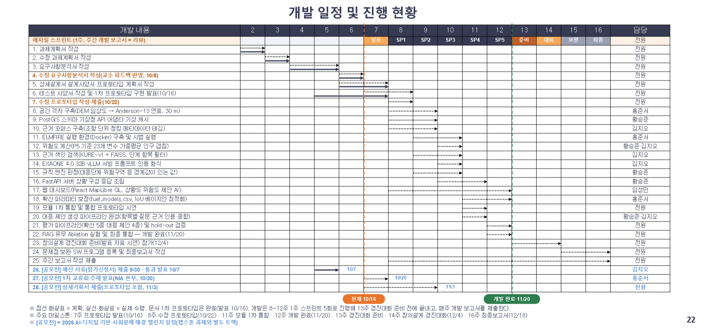

# 산불 대응 AI 의사결정 지원 시스템 — 과제계획서

> 산불 확산 예측과 표준매뉴얼 근거로 통합지휘권자의 진화·대피 판단을 지원하는 시스템  
> 2026학년도 2학기 캡스톤디자인 · 5조 산불조심하조 · 세종대학교 · 지도교수 문현준 교수 / 권기학 교수 · 2026년 10월 16일

| 구분 | 팀장 | 팀원 | 팀원 | 팀원 |
|---|---|---|---|---|
| 학번 | 20012642 | 21012030 | 21011874 | 21010560 |
| 성명 | 황승준 | 김지오 | 홍준서 | 임성민 |
| 학과 | 컴퓨터공학과 | 인공지능학과 | 컴퓨터공학과 | 소프트웨어학과 |
| 담당 | 총괄·백엔드<br>데이터·API·규칙 판정 | AI 아키텍트<br>RAG·생성·평가 | 백엔드<br>확산 예측·보정 | 프론트엔드<br>대시보드·시각화 |

## 목차

- [1. 개발 배경 및 중요성](#1-개발-배경-및-중요성)
  - [1.1 산불 피해 규모의 구조적 변화](#11-산불-피해-규모의-구조적-변화)
  - [1.2 산불 대응 프로세스와 핵심 문제](#12-산불-대응-프로세스와-핵심-문제)
- [2. 개발 목표](#2-개발-목표)
  - [2.1 통합 상황 인식 — 통합 상황도](#21-통합-상황-인식--통합-상황도)
  - [2.2 전문적 의사결정 지원 — AI 대응 제안과 근거 기반 AI](#22-전문적-의사결정-지원--ai-대응-제안과-근거-기반-ai)
  - [2.3 목표 항목과 목표치](#23-목표-항목과-목표치)
- [3. 차별성](#3-차별성)
  - [3.1 현행 산불 대응 체계](#31-현행-산불-대응-체계)
  - [3.2 본 과제의 차별점](#32-본-과제의-차별점)
- [4. 활용 데이터 및 활용 방안](#4-활용-데이터-및-활용-방안)
  - [4.1 활용 데이터 구성 — 어떤 데이터가 있나](#41-활용-데이터-구성--어떤-데이터가-있나)
  - [4.2 사전 분석에서 확인한 데이터 특성 — 데이터가 어떤 상태인가](#42-사전-분석에서-확인한-데이터-특성--데이터가-어떤-상태인가)
  - [4.3 활용 방안 — 그래서 각 데이터를 무엇에 쓰나](#43-활용-방안--그래서-각-데이터를-무엇에-쓰나)
- [5. 개발 방법 및 체계](#5-개발-방법-및-체계)
  - [5.1 전체 시스템 아키텍처](#51-전체-시스템-아키텍처)
  - [5.2 핵심 모델](#52-핵심-모델)
  - [5.3 표출](#53-표출)
  - [5.4 평가 지표](#54-평가-지표)
  - [5.5 개발환경](#55-개발환경)
- [6. 개발 추진 계획](#6-개발-추진-계획)
  - [6.1 팀 구성 및 역할 분담](#61-팀-구성-및-역할-분담)
  - [6.2 개발 방법론 및 일정](#62-개발-방법론-및-일정)
  - [6.3 협업 체계](#63-협업-체계)
- [7. 기대효과](#7-기대효과)
  - [7.1 주체별 기대효과](#71-주체별-기대효과)
  - [7.2 기술적 효과](#72-기술적-효과)
  - [7.3 팀 성장 목표](#73-팀-성장-목표)
- [참고문헌](#참고문헌)

## 1. 개발 배경 및 중요성

### 1.1 산불 피해 규모의 구조적 변화

국내 산불은 발생 건수보다 단일 사건의 피해 규모가 커지는 방향으로 바뀌고 있다. 2025년 산불은 459건으로 최근 10년 연평균(529건)보다 적었으나, 피해 면적은 105,099ha로 연평균의 약 7.3배에 이르렀다.[1] 특히 3월 경북 의성에서 시작된 영남권 산불은 안동·청송·영양·영덕으로 번지며 사망 30명·부상 43명[35], 재산피해 약 1조 818억 원[2]의 피해를 냈고, 사망자 28명 중 26명이 60대 이상 고령자였다.[36] 문제는 "얼마나 자주 발생하는가"에서 "발생한 산불이 얼마나 커지는가"로 옮겨 갔고, 커진 산불일수록 대응 판단의 속도가 피해를 좌우한다.

### 1.2 산불 대응 프로세스와 핵심 문제

산불이 발생하면 산림청뿐 아니라 지방자치단체·소방청·경찰·군 등 여러 기관이 진화, 인력·장비 투입, 시설물 보호, 구조·구급, 주민대피 지원을 나누어 맡고, 산불 규모와 범위에 따라 시장·군수·구청장, 시·도지사, 산림청장이 통합지휘를 맡는다.[6][31, p.23] 통합지휘권자는 산불의 진행 상황과 기상, 주변 마을과 시설, 투입된 자원과 추가로 동원할 수 있는 자원을 함께 파악해 진화자원 배치와 주민대피를 판단해야 한다. 본 과제는 현장 통합지휘를 맡는 시장·군수·구청장을 주 사용자인 **통합지휘권자**로 두고, 이 판단 과정의 두 가지 문제에 주목한다.

**첫째, 기관별로 분산된 대응 자원과 상황정보를 통합적으로 파악·활용하기 어렵다.** 국회입법조사처 산불대응연구TF는 공중진화와 지상진화가 따로 작전을 전개해 유기적인 진화작전이 곤란하고, 산림보호는 산림청이, 민가·시설물 보호는 소방청이 맡는 이원화된 체계라고 지적했으며[31, p.22·25], 기관별로 각기 운영하는 진화헬기의 통합 운용도 과제로 제시했다.[31] 이처럼 자원과 정보가 흩어져 있으면 지휘권자가 전체 상황을 한눈에 이해하고 진화·대피 판단에 연결하기 어렵다. 확산 예측 역시 별도 시스템에서 산출되어, 2025년 영남권 산불에서는 예측을 대응 판단에 반영하는 작업이 확산 속도를 따라가지 못했다.[3]

**둘째, 통합지휘권자의 산불 대응 전문성에 한계가 있다.** 표준매뉴얼은 현장 통합지휘와 주민대피 명령 권한을 시장·군수·구청장에게 둔다.[7, p.72·84] 그러나 TF 보고서는 산불 현장 경험이 거의 없는 지방자치단체장에게 지휘권이 주어져 대응에 많은 한계가 발생할 수 있다고 지적했다.[31, p.20] 진화 우선순위처럼 기준이 정해진 판단도 있지만, 어느 구역에 어떤 자원을 얼마나 투입하고 어느 마을을 언제 대피시킬지는 가용자원과 진행 상황을 종합해 해석하는 전문적 판단이 필요하며, 100쪽이 넘는 표준매뉴얼에서 맞는 조항을 찾아 적용하는 일도 긴급한 현장에서는 부담이 된다.[7]

따라서 본 과제는 분산된 자원과 상황정보를 하나의 상황도로 통합하고(문제 ①), 확산 예측과 표준매뉴얼 근거를 바탕으로 통합지휘권자에게 진화·대피 대응안을 제안하는(문제 ②) 시스템을 개발한다. AI는 정보와 대응 선택지, 그 근거를 제공하는 보조 수단이며, 최종 결정은 지휘권자가 내린다.

## 2. 개발 목표

본 과제의 최종 목표는 **통합지휘권자의 상황 파악과 전문적인 대응 판단을 지원**하는 것이다. 1장의 두 문제에 대응해 통합 상황 인식(문제 ①)과 전문적 의사결정 지원(문제 ②)을 목표로 두고, 이를 통합 상황도·AI 대응 제안·근거 기반 AI의 세 기능으로 구현한다. 사용자는 정보 확인 → 대응안 검토 → 근거 확인의 순서로 시스템을 쓰고, 최종 판단은 지휘권자가 내린다.

### 2.1 통합 상황 인식 — 통합 상황도

산불의 발화점과 상황 보고자가 입력한 실측 화선, 1시간 간격의 확산 예측 범위(P1\~P8), 주변 마을·주요 시설·도로·유관기관, 진화자원(헬기·인력·차량)의 대기·투입·정비 현황을 하나의 지도에서 확인하는 통합 상황도를 개발한다. 확산 예측은 물리 기반 확산 모델(ELMFIRE)로 산출하고, 5시간 예측 범위(P5)를 기준으로 그 산불의 위험도(1.00\~5.00)를 4요인(기상·지형·연료·인프라) 점수와 함께 제시한다. 흩어진 정보를 찾는 시간을 줄이고, 현재 상황과 동원 가능한 자원을 연결해 파악하도록 돕는다.

### 2.2 전문적 의사결정 지원 — AI 대응 제안과 근거 기반 AI

**AI 대응 제안.** 확산 예측과 현재 상황을 종합해 통합지휘권자가 검토할 진화·대피 대응안을 제안서 한 부로 만든다. 제안서는 표준매뉴얼에서 정리한 진화 7개(S1\~S7)·대피 7개(E1\~E7) 판단 항목으로 나뉘며, 항목마다 판정 결과·대상·실행 구분(즉시·대기·협의·요청)·지휘권자 권한(직접·협의·요청)을 제시한다. 지휘권자가 확산 예측을 다시 실행하거나 AI 어시스턴트로 상황 변화를 정정하면 새 버전(예: v1.1 → v1.2)을 만들고, 직전 버전과 달라진 내용을 표시한다.

**근거 기반 AI.** 대응 제안과 AI 답변의 문장마다 「산불 재난」 위기관리 표준매뉴얼과 관련 법령의 근거를 번호로 달고, 문서·쪽수·조항과 요약을 함께 보여주며 원문 문서를 연결한다. 대응단계·위험구역·대피소 배정처럼 근거 문서에 경계값·수치가 있는 값은 규칙 엔진이 판정하고 언어모델은 이를 바꾸지 않는다. 근거로 확인되지 않는 수량·문장은 화면에 내보내지 않고 해당 칸에 「근거가 부족하여 표시하지 않았습니다」라는 안내만 보이며, 그 사실은 이벤트 로그에 「근거 부족」으로 남긴다. 지휘권자는 제안과 근거를 함께 검토해 현장 적용 여부를 판단한다.

### 2.3 목표 항목과 목표치

목표는 개발을 통해 달성하고 검증할 항목으로 정한다. 정량 목표는 5.4의 자동 평가 지표(확산 예측 5종·대응 제안 4종)로 측정하고, 정성 목표는 기능 구현과 시연·프로토타입 검증으로 확인한다. 하한은 국내 물리 모형 검증치와 유사 연구값에서 가져온 최소 기준이며, 아직 측정하지 않은 상황 파악 시간 단축이나 피해 감소 효과는 성과로 표현하지 않는다.

**[표 2-1] 목표 항목과 목표치**

| 구분 | 목표 항목 | 목표치 | 설정 근거 |
|---|---|---|---|
| 정량 | 확산 — F2(탐지 중심, 핵심) | ≥ 0.805 | 국립산림과학원 과정 기반 모형 검증치(국내 산불 35건)[34] |
|  | 확산 — IoU · 정밀도 | ≥ 0.582 · ≥ 0.599 | 같은 검증[34], FARSITE 사례 IoU 0.535\~0.616[27][40] |
|  | 확산 — 재현율 · F1 | ≥ 0.956 · ≥ 0.699 | 같은 검증[34] (5.4) |
|  | 제안 — 근거 충실도 · 질의 관련도 | ≥ 0.79 · ≥ 0.82 | 재난·공공 RAG 연구 대표값의 하위 25%[37], RAGAS[29] |
|  | 제안 — 순위 정밀도@K · 확보율@K | ≥ 0.82 · ≥ 0.80 | 같은 방식[38], 확보율은 K 선택 기준 (5.4) |
| 정성 | 통합 상황도 | 발화점·실측 화선·P1\~P8·시설·진화자원·위험도를 한 지도에서 확인 | 문제 ① 대응, 프로토타입 검증(UC 15개 통과) |
|  | 판단 항목별 제안 | 진화·대피 14개 항목별 판정·권한·근거, 정정 시 새 버전 | 문제 ② 대응, 표준매뉴얼 항목 체계(5.2.2) |
|  | 근거 추적 | 모든 제안 문장에서 문서·쪽수·조항·요약 확인, 근거 없는 내용 비표시 | 문제 ② 대응, 인용 형식(ALCE)[24] |

## 3. 차별성

### 3.1 현행 산불 대응 체계

우리나라 산불 대응은 예방부터 확산 예측까지 단계별 국가 시스템을 갖추고 있고, 정부는 AI 기반 확산 예측 사업도 시작했다.

**[표 3-1] 현행 국가 산불 시스템**

| 단계 | 시스템 | 제공 기능 | 본 과제와의 관계 |
|---|---|---|---|
| 예방(발화 전) | 국가산불위험예보시스템[4] | 산불위험지수 예보(100m 격자, 시·군·구 1시간 간격) | 발화 전 단계로 범위 밖 |
| 상황 파악 | 국가산불정보시스템[5] | 실시간 산불 위치·현황 모니터링 | 발화 정보 입력의 참고 출처 |
| 자원 관제 | 산불상황관제시스템(산림청)[31] | 전국 산불 상황에 따른 인력·장비 등 대응 자원 파악·분배 | 전국 단위 관제. 본 과제는 한 산불 현장의 자원 현황을 예측·제안과 한 화면에 결합 |
| 확산 예측(발화 후) | 산불확산예측시스템(국립산림과학원)[3] | 시간대별 확산 속도·방향, 주요 시설 도달 시간 | 본 과제는 ELMFIRE로 자체 예측하되 대응 판단 단계에 초점 |
| 확산 예측(2026 착수) | AI 기반 산불·연무 확산 예측 사업[8] | 확산 방향·속도 예측, 주민 대피 경로·진화 투입 경로 제시 | 예측·경로 산출까지. 판단 항목별 제안·근거 부기는 미포함 |

발화 전에는 국가산불위험예보시스템이 산불위험지수를 예보하고[4], 발화 후에는 산불확산예측시스템이 시간대별 확산 속도·방향과 주요 시설 도달 시간을 산출한다.[3] 그러나 예측 결과, 기관별 진화자원, 주변 마을·시설 정보는 서로 다른 시스템과 기관에 흩어져 있어, 통합지휘권자가 한 화면에서 함께 보고 판단에 쓰기 어렵다.[31]

대응 규칙도 문서로 존재한다. 「산림재난방지법 시행령」은 피해면적·평균풍속·예상 진화시간·주요시설 피해 우려를 기준으로 초기대응·확산대응 1단계·2단계를 구분하고, 산불이 둘 이상 시·군·구나 시·도에 걸치면 시·도지사 또는 산림청장이 통합지휘하도록 정한다(「산림재난방지법」 제34조).[6] 「산불 재난」 위기관리 표준매뉴얼은 대응단계별 기관 임무와 통합지휘본부장의 진화·대피 조치를 규정한다.[7] 즉 "어떤 상황에서 무엇을 해야 하는가"의 기준은 이미 갖추어져 있다.

비어 있는 것은 예측도, 규칙도 아니다. 예측과 현재 상황을 이 기준에 대입해 "지금 어느 구역에 자원을 집중하고 어느 마을을 먼저 대피시킬 것인가"라는 판단으로 옮기는 단계다. 이 판단은 지휘권자와 소수 전문 인력의 경험에 의존하며, 2025년 3월 영남권 산불에서는 위험 예보가 적중했음에도 예측을 대응으로 옮기는 작업이 확산 속도를 따라가지 못했다.[3]

정부도 이 공백을 인식하고 있다. 정부는 2026년 산불 확산 방향·속도를 예측하고 주민 대피 경로와 진화 인력·장비 투입 경로까지 제시하는 'AI 기반 산불·연무 확산 예측' 사업에 착수했다.[8] 다만 이 사업의 목표는 예측과 경로 산출에 있고, 통합지휘권자의 판단 항목별로 대응안을 만들고 표준매뉴얼 근거를 붙이는 단계는 포함하지 않는다.

### 3.2 본 과제의 차별점

본 과제는 예측 기술을 새로 제안하지 않는다. 예측 결과와 흩어진 상황정보를 통합지휘권자의 판단으로 연결하고, 그 과정에서 AI가 만드는 위험을 통제하는 데 차별점이 있다.

**첫째, 통합 상황도와 판단 항목별 제안.** 확산 예측(P1\~P8)·마을과 시설·진화자원 현황을 한 지도에 모으고, 이를 표준매뉴얼의 진화 7개·대피 7개 판단 항목에 대입해 통합지휘권자 한 사람을 위한 제안서로 만든다. 항목마다 실행 구분(즉시·대기·협의·요청)과 지휘권자의 권한(직접·협의·요청)을 함께 표시해, 바로 지시할 일과 협의·요청이 필요한 일을 구분한다.

**둘째, 근거 추적과 판단 경로 통제.** 기존 발행물에는 근거 조항 표기가 없고 범용 LLM은 근거 자체가 없다. 본 과제는 제안과 답변의 문장마다 표준매뉴얼·법령의 쪽수·조항과 요약을 연결하고[9], 대응단계·위험구역·대피소 배정처럼 근거 문서에 경계값·수치가 있는 판정 값은 규칙 엔진이 계산해 언어모델이 바꾸지 못하게 한다. 근거로 확인되지 않는 수량·답변은 출력하지 않고 「근거가 부족하여 표시하지 않았습니다」로 알리며, 이벤트 로그에 「근거 부족」을 남긴다.

**[표 3-2] 기존 국가 시스템 · 범용 LLM · 본 과제 비교**

| 항목 | 기존 국가 시스템 | 범용 LLM 질의응답 | 본 과제 |
|---|---|---|---|
| 상황 통합 | 시스템·기관별 분산 | 없음 | 통합 상황도(예측·시설·진화자원) |
| 대응안 생성 | 회차별 발행(수작업) | 자동 · 근거 없음 | 자동 · 규칙 판정 + 근거 인용 |
| 산출 단위 | 발행물당 진화·대피 2종 | 구분 없음 | 판단 항목 14개(진화 7 · 대피 7) |
| 근거 추적 | 조항 표기 없음 | 불가 | 문서·쪽수·조항 + 요약(원문 연결) |
| 생성문 통제 | 표기 없음 | 없음 | 판정 값 고정 + 근거 없는 내용 비표시·로그 기록 |
| 상황 변화 반영 | 다음 회차 발행 | 대화 문맥 한정 | 예측 재실행·상황 정정 시 새 버전 생성 |

## 4. 활용 데이터 및 활용 방안

### 4.1 활용 데이터 구성 — 어떤 데이터가 있나

본 과제의 자료는 쓰임에 따라 세 갈래로 나뉜다.

**[표 4-1] 활용 데이터의 세 갈래**

| 구분 | 자료 |
|---|---|
| 학습·검증용 | AI Hub 「산불 확산 위험 대응방안 추론 데이터」[10] — 실제 산불 101건, 원천·라벨 각 246,789쌍(개방분) |
| 운영 입력용 | 기상청 단기예보[11] · DEM 30m[12] · 임상도 1:5,000[13] · 행정경계[22] · 마을·시설·대피소·도로 · SGIS 성·연령별 인구(행정동) · 상황 보고자 입력(발화점·신고자 정보·실측 화선) · 진화자원 데이터 |
| 근거 코퍼스용 | 「산불 재난」 위기관리 표준매뉴얼(2026.6 일부개정)[7] · 산불진화기관 임무·역할 규정(예규)[32] · 산림재난방지법·시행령·시행규칙 등 법령[14] |

AI Hub 데이터셋은 실제 산불 사건의 조건에 대한 계층적 추론 경로와 대응방안을 질의응답 형식으로 담는다. 질의자는 진압대원·구조요원·공무원·시민 네 유형으로 구분되어 있으나, 본 과제는 통합지휘권자 한 사람을 위한 제안서를 만들므로 질의자 유형은 쓰지 않고 최종 소실 경계와 위험도 기준만 활용한다(4.3).

### 4.2 사전 분석에서 확인한 데이터 특성 — 데이터가 어떤 상태인가

공개 샘플로 시작하여 전체 데이터(산불 101건) 확보 후 재측정하였다. 데이터를 실제로 열어 확인한 특성은 다음과 같다.

**[표 4-2] 사전 분석에서 확인한 특성**

| \# | 확인된 특성 | 실측 |
|---|---|---|
| ① | fire_spread_track이 사건당 하나의 폐곡선이며 전 시점 동일. 시간에 따른 이력이 아니라 최종 소실 경계다 | 시계열 0건 |
| ② | 화재 강도·화선 길이·지속 시간·영향 면적이 전 시점 동일한 사후 확정값이다 | 4개 변수 |
| ③ | 라벨에 source·reference 계열 필드가 없다 (「조건→추론→답변」 구조) | 필드 1,821개 중 0개 |
| ④ | 저작도구에 위험도 기준(기상·지형·연료·인프라 25변수 가중합, 합 1.00)이 정의되어 있다 | 25변수, 인프라 축 포함 |
| ⑤ | 배포 라벨의 위험도·추론값이 조건과 무관하게 채워져 있다 | 기준과 4.7% 일치, 조건 상관 r=0.059 |

이 특성들이 각 데이터를 무엇에 쓸 수 있고 쓸 수 없는지를 가른다. ①은 시간별 확산을 데이터로 배울 수 없음을, ②는 화세 변수를 위험도에 넣으면 정답 누출이 됨을, ③은 답변의 근거를 데이터셋 안에서 확인할 수 없음을 뜻한다. 반면 ④는 근거 있는 위험도 산정 체계가 존재함을, ⑤는 그 체계로 채웠어야 할 라벨값이 정작 조건을 따르지 않았음을 보여준다.

### 4.3 활용 방안 — 그래서 각 데이터를 무엇에 쓰나

4.2의 특성에 따라 각 데이터의 쓰임을 정한다. 공통점은 **AI Hub 데이터를 "학습용"이 아니라 "보정·계승용"으로 쓴다**는 것이다. 시계열이 없고(①) 위험도 라벨이 부실해(⑤) 값을 학습할 수 없으므로, 확산은 물리 모델을 실측 경계로 보정하고 위험도는 기준 체계만 이어받는다.

**[표 4-3] 데이터별 활용 방안**

| 데이터 | 무엇에 쓰나 |
|---|---|
| AI Hub 최종 소실 경계 | 확산 모델을 한국 조건에 맞추는 보정·검증의 정답으로 사용 (특성 ①) |
| AI Hub 위험도 기준 | 위험도 기준표의 변수·구간·가중치를 계승해 P5 범위 위험도 산출에 사용(23개 변수, 특성 ④⑤) |
| 운영 입력(기상·지형·연료·인프라) | 발화 지점 주변의 실시간 조건을 구성하는 예측 입력, 위험구역 마을·시설 판정, P5 위험도의 변수 값에 사용 |
| 상황 보고자 입력(발화점·실측 화선) | 확산 예측의 발화 정보와 초기 연소 영역으로 사용 |
| 진화자원 데이터 | 진화자원 현황(대기·투입·정비) 표시와 자원 배분 판정(S3·S7)의 입력으로 사용 |
| 표준매뉴얼·법령 | 진화·대피 제안 문장과 AI 답변의 인용 근거로 사용 (특성 ③) |

## 5. 개발 방법 및 체계

### 5.1 전체 시스템 아키텍처

![[그림 5-1] 시스템 개요도](images/fig_01.png)

<p align="center"><b>[그림 5-1] 시스템 개요도</b></p>

본 시스템은 인터페이스·서버·데이터 세 계층으로 구성한다(그림 5-1). 인터페이스는 통합지휘권자·열람자·상황 보고자·전산 관리자가 권한에 맞는 화면으로 산불 정보를 입력하고 통합 상황도·대응 제안서·근거 패널·어시스턴트 대화를 쓰는 웹 대시보드(React·MapLibre GL)다. 서버는 요청·대화를 받아(①) 인증·권한을 확인하고 상황을 구성한 뒤, 산불 예측 모델(물리 엔진 ELMFIRE)로 확산을 예측하고(②) 규칙 엔진이 경계값·수치가 있는 값을 판정하며(③) 상황판단 에이전트가 판정 값과 근거로 대응을 판단·작성한 결과를(④) 응답으로 조립해(⑤) 확산 폴리곤·위험도와 대응 제안서·AI 답변을 화면에 돌려준다(⑥·⑦). 어시스턴트 에이전트는 질의응답과 상황 정정을 맡고, 확인된 정정은 규칙 판정부터 다시 실행한다. 데이터 계층은 실시간으로 받는 기상 예보와 운영 전에 구축하는 공간 DB·파라미터·진화자원 데이터·근거 색인(KURE-v1·FAISS)을 공급하고, 입력·예측·정정·관리 이벤트를 로그로 남긴다.

### 5.2 핵심 모델

본 시스템은 **① 산불이 어디까지·얼마나 위험하게 번질지 예측하는 모델(5.2.1)**과, 그 예측과 현재 상황을 받아 **② 통합지휘권자에게 진화·대피 대응안을 제안하는 모델(5.2.2)**로 구성된다. 각 모델은 4장의 데이터를 자신의 입력으로 구축하는 절차를 함께 포함한다. 시스템의 중심은 **의사결정**이며, 예측 산출물은 규칙 판정을 거쳐 제안서의 판단 항목으로 연결된다(그림 5-2).

![[그림 5-2] 예측 산출물과 의사결정·통합지휘권자 제안의 연결](images/fig_02.png)

<p align="center"><b>[그림 5-2] 예측 산출물과 의사결정·통합지휘권자 제안의 연결</b></p>

#### 5.2.1 산불 예측 모델

산불 예측 모델은 확산 예측(ELMFIRE)과 산불 위험도 계산 두 부분으로 구성된다. 4장의 운영 입력 자료를 30m 격자로 정합한 조건(기상·지형·연료·인프라)과 상황 보고자가 입력한 발화점·실측 화선을 입력받아, 불이 1시간 간격으로 어디까지 번질지(P1\~P8) 예측하고 5시간 예측 범위(P5)를 기준으로 그 산불의 위험도를 산출한다.

```text
[입력] 운영 입력 격자 (기상·지형·연료·인프라) + 발화점·실측 화선
    ↓
[B] 확산 예측 (ELMFIRE)
    출력: 1시간 누적 확산 폴리곤 P1~P8 → 위험구역(P5) / 잠재 위험구역(P8), 확산속도(ha/h), 화선 강도(kW/m)
    ↓
[C] 산불 위험도 계산
    위험도 (1.00~5.00) — P5 범위 23개 변수 가중평균 (AI Hub 위험도 기준표 계승)
    예측 1회마다 1개 계산, 4요인(기상·지형·연료·인프라) 점수 함께 표시
```

#### 5.2.1.1 확산 예측 — ELMFIRE

**모델 선택 근거.** 두 대안을 검토하였다. 첫째, 딥러닝 기반 확산 예측은 발화부터 진압까지의 시계열 확산 경계가 필요하나 국내 공개 데이터에 없다(4.2 ①). 따라서 지도학습이 불가능하다. 둘째, 물리 기반 오픈소스로 FARSITE와 ELMFIRE를 비교한 결과는 다음과 같다.

**[표 5-1] FARSITE와 ELMFIRE 비교**

| 항목 | FARSITE | ELMFIRE |
|---|---|---|
| 격자별 확산속도 | Rothermel 표면화 모델 | Rothermel 표면화 모델 (동일) |
| 2차원 확산 방향 | Anderson 타원형 형상 모델 | Anderson 타원형 형상 모델 (동일) |
| 화선 전파 방식 | Huygens (경계점 이동) | 레벨셋 방정식 (격자 함수 경계) |
| 공식 배포 | FlamMap[15] 통합 (Windows 전용) | 공식 GitHub + Docker[16] |
| 연료 파라미터 제어 | 소스 수정 필요 | fuel_models.csv 외부 파일로 제어 |
| IoU 보정 루프 | 구현 어려움 | CSV 교체 → 재실행으로 가능 |
| 래스터 파이프라인 통합 | 경계점 좌표 별도 관리 | 격자 단위, GeoTIFF와 통합 자연스러움 |

본 과제는 Linux 서버 기반 자동화 파이프라인 환경이며 과거 산불 소실 경계를 이용한 IoU 기반 파라미터 보정이 필요하므로 **ELMFIRE를 채택**한다(Lautenberger[16], C. 2013, \*Fire Safety Journal\* 62, 289–298).

**알고리즘 구성.** ELMFIRE는 세 단계로 확산을 계산한다.

1. **Rothermel 표면화 확산 모델** — 연료 하중·깊이·입경, 풍속, 경사로부터 격자별 최대 확산속도 R(m/min) 산출 (Rothermel 1972, USDA INT-115).[17]

2. **Anderson(1983)[18] 타원형 형상 모델** — 풍속 기반 장단축비로 2차원 확산 방향 결정 (USDA INT-305).

3. **레벨셋 방정식** — 격자 함수 φ=0 경계를 시간 전진하여 화선 위치 추적.

**구현 절차.** 확산 예측은 다음 세 단계로 구현한다.

1. **입력 격자 구축.** ELMFIRE는 확산 지역 전체의 지형·연료를 격자로 요구하지만, 데이터셋은 지점 한 곳의 값만 제공한다. 따라서 4장 운영 입력 자료(임상도·DEM·기상·인프라)를 30m 격자로 정합해 입력을 구성하며, 임상도는 표준 연료 코드(Anderson-13)로 변환한다. 상황 보고자가 실측 화선을 입력한 경우에는 이를 초기 연소 영역으로 두고 그 시점부터 확산을 계산한다. ELMFIRE 엔진 자체는 수정하지 않는다.

2. **파라미터 보정.** 연료 파라미터는 외부 파일(fuel_models.csv)로 분리되어 엔진 수정 없이 교체·재실행할 수 있다. AI Hub 각 사건의 최종 소실 경계(fire_spread_track)를 정답으로 삼아 임상 유형별 계수를 보정한다: 파라미터 설정 → ELMFIRE 실행 → 최종 소실 경계 추출 → 실측 경계와 IoU 계산 → IoU 수렴까지 반복(베이지안 최적화).

3. **출력.** 격자 단위 GeoTIFF 래스터(도달시각 toa, 화선 강도 flin, 화염 길이)를 출력하고, 도달시각을 1시간 간격으로 잘라 누적 확산 폴리곤 P1\~P8을 만든다. P5는 위험구역(5시간 이내 도달), P8은 잠재 위험구역(8시간 이내 도달)으로 대피 판정에 쓰고, 확산속도 V(ha/h)와 화선 강도 I(kW/m, 진화 가능 여부 판단)를 함께 파생한다.

#### 5.2.1.2 산불 위험도

확산 예측을 실행할 때마다 그 산불이 얼마나 위험한지를 하나의 숫자로 계산해 초기 의사결정(자원 투입·대피·진압)을 뒷받침한다. 위험도는 해당 산불의 위험 정도를 나타내는 독립 지표로, 산불위험지수나 대응단계 같은 다른 체계에 매핑하지 않는다.

**계산 방식.** 4장에서 확인한 저작도구 「위험도 기준」(4.2 ④·⑤)의 변수 구간과 가중치를 계산 규칙으로 계승한다. 25개 변수 중 구간이 겹치는 경사도_down과 숫자 기준이 없는 도로 접근성을 빼 23개 변수를 쓰며, 가중치 합은 0.94(기상 0.372·지형 0.287·연료 0.266·인프라 0.074)다. 변수 값은 발화 지점 한 격자가 아니라 5시간 누적 예측 범위(P5)와 겹친 격자에서 겹침 면적 비율로 가중해 1\~5 등급으로 바꾸고, 취약계층 수는 P5와 겹친 행정동의 65세 이상·0\~14세 인구(SGIS)를 면적 비율로 합산하며, 소방서 거리는 예측마다 측정한다. 표준매뉴얼은 화선 도달 5시간 이내를 전 주민 즉시 대피 기준으로 두므로(p.75) P5를 기준 범위로 삼았다.[7]

```text
위험도 = Σ(가중치 × 변수 등급) ÷ Σ가중치   (1.00~5.00, 소수 둘째 자리)
```

**기준 범위를 P5로 둔 이유.** 발화 시점의 정적 조건만으로는 최종 규모를 예측할 수 없다. 101개 사건 분석에서 발화 지점 조건으로 계산한 위험도와 최종 피해면적의 상관은 Spearman ρ=0.264(약함)에 그쳤고, 강릉 산불(2022.3, 4,190ha)은 하위 20%였음에도 대형으로 확대되었다. 대형화가 이후 불이 번지는 과정에서 비롯되므로, 위험도도 확산 예측 범위(P5) 위에서 계산해 불이 번지는 쪽의 연료·지형·마을을 반영한다. 조건과 확산 거동을 함께 보는 접근은 캐나다 CFFDRS가 기상 기반 잠재 위험 지수(FWI)[19]와 연료·지형 기반 확산 거동 예측(FBP)[20]을 함께 운영하고, BC주 산불청이 확산속도를 대피령·인력 배치 결정에 쓰는 데서도 확인된다.[21]

**처리 규칙.** 위험도는 다음 규칙으로 계산·표시한다.

1. 예측 1회마다 위험도 1개를 계산해 이전 값을 새 값으로 바꾸고, 일부 변수가 결측이면 남은 가중치로 나눠 계산하며 결측 목록을 함께 남긴다.

2. 두 산불의 P5가 겹치면 같은 산불로 보고 합집합 폴리곤으로 한 번만 계산한다(겹친 구역 인원을 두 번 세지 않음). 화면에는 등급 이름 없이 숫자와 4요인 점수만 보이고, 예측 전·종료된 산불에서는 표시하지 않는다.

#### 5.2.2 대응 제안 생성 모델

예측 결과(5.2.1)와 현재 상황(진화자원·대피 현황·상황 정정)을 입력받아, 통합지휘권자에게 진화·대피 대응안을 표준매뉴얼 근거와 함께 제안하는 모델이다. 근거 문서에 경계값·수치가 있는 값(대응단계·위험구역·대피소 배정 등)은 규칙 엔진이 판정하고, 언어모델(EXAONE 4.0 32B)은 그 판정 값을 바꾸지 않은 채 상황 데이터와 검색한 근거로 대응을 판단해 제안 문장과 답변을 작성한다(혼합 구조). 언어모델은 한 모델 위에 역할 프롬프트로 나눈 에이전트 2개로 쓴다. 상황판단 에이전트는 제안서를 만들고(A1 질문 작성·A2 근거 인용 판단·A3 항목 간 충돌 검사·A4 종합), 어시스턴트 에이전트는 질의응답과 상황 정정 해석을 맡는다.

**근거 코퍼스 구축.** 생성 근거와 검증 근거를 서로 다른 출처에서 확보하기 위해, 코퍼스는 데이터셋과 무관한 원문(4장 근거 코퍼스용)으로 모은다. 중심 문서는 「산불 재난」 위기관리 표준매뉴얼(2026.6 일부개정)[7]이며, 정부 부처 안에서 열람되는 자료이므로 산림청에 요청해 본문을 확보하였다(부록·비상연락망은 보안상 제외). 여기에 산불진화기관 예규[32]와 관련 법령[14]을 더한다. 각 문서를 OCR 후 사람이 검수하고 절·표 행·조문 단위(약 400자)로 나눠 문서명·쪽수·조항·대응단계·판단 항목 메타데이터를 태깅하며, 한국어 임베딩(KURE-v1)으로 FAISS 벡터 색인을 만든다. 청크 원문과 메타데이터는 SQLite에 두고, 근거 창에는 해당 부분의 요약과 원문 문서 연결을 보인다. 색인은 로컬에서만 만든다.

#### 5.2.2.1 판단 항목 체계

제안서는 통합지휘권자 한 사람을 위한 것이다. 판단 항목은 표준매뉴얼에서 통합지휘본부장의 진화·대피 조치로 규정된 내용을 진화 7개(S1\~S7)·대피 7개(E1\~E7)로 묶어 정했다. 항목마다 규칙 판정 기준과 제안 내용, 지휘권자의 권한, 근거 쪽수를 둔다. 발동 조건을 만족하지 않는 항목은 「해당 없음」으로 접는다.

**[표 5-2] 진화·대피 판단 항목과 판정 기준**

| 구분 | 코드 | 판단 항목 | 판정 기준(규칙) | 제안 내용 | 권한 | 근거 쪽 |
|---|---|---|---|---|---|---|
| 진화 | S1 | 대응단계 판단·격상 검토 | 4요소(피해면적·평균풍속·예상 진화시간·시설피해) 중 가장 높은 단계 | 권고 단계, 공식 단계보다 높으면 격상 검토 | 협의 | 13·22·73 |
|  | S2 | 진화 우선지역·보호대상 선정 | 보호대상 ∩ P5, 등급·도달 순 정렬 | 인명 → 기간시설·국가유산 → 재산 → 산림 순 우선지역 | 직접 | 41·77·118 |
|  | S3 | 진화자원 투입·배분·재배치 | 진화구역 분할, 자원 부족분, 헬기 운용 가능 | 구역 우선순위와 배분 방향(수량 산식 없음 → 수량 비표시) | 직접 | 41·72·77\~78 |
|  | S4 | 진화 방식·시간대 전략 | 풍속·시정 임계, 일몰·일출 시각 | 지상·항공 진화 전환, 일몰 후·일출 전 집중 진화 | 직접 | 78 |
|  | S5 | 시설 보호 조치 | 주택·국가유산·송전시설 ∩ P5 | 소방차 집중 배치·예비 살수, 한전 전류 차단 요청 | 직접·요청 | 79·95·119 |
|  | S6 | 유관기관 동원·협조 요청 | 걸친 시·군·구 수, 자원 부족분 | 요청 기관·자원, 지휘권 인계 안내 | 직접·요청 | 22·72·78·92 |
|  | S7 | 진화인력 안전·투입 관리 | 인력 ∩ P5, 퇴로 유무, 풍향 급변 | 안전 확인, 퇴로 확보, 철수 | 직접 | 77\~78·118 |
| 대피 | E1 | 위험구역 설정 | 도달 5시간 이내(P5) / 8시간 이내(P8) | 위험구역(즉시)·잠재 위험구역(대기) 마을 | 직접 | 74\~76·81 |
|  | E2 | 대피 대상·순서·시점 결정 | 도달 순, 취약계층 우선, 야간 포함 여부, 대피 완료 제외 | 마을별 대피 순서와 즉시·대기·사전 시점 | 직접 | 75\~76·79·84 |
|  | E3 | 취약시설·미대피 주민 조치 | 취약시설 ∩ P8, 명령 대상 − 대피 완료 | 시설 별도 이송, 미대피 주민 강제 대피 | 직접 | 75·84·90·96 |
|  | E4 | 대피소 배정·분산 | 안전 대피소, 수용 인원, 도로 이동시간 | 마을별 대피소 배정, 초과분 분산 | 직접 | 34·65 |
|  | E5 | 대피 경로·교통통제 | 대피로 ∩ P5, 대피로 ∩ 진입로 | 위험 구간 우회, 경찰 교통통제 요청 | 요청 | 65·119 |
|  | E6 | 재난문자·방송 전파 제안 | 읍·면 ∩ P8, 대피명령 상태 | 송출 단계(발생·권고·명령)와 대상 지역 | 직접 | 78\~79 |
|  | E7 | 인명구조·긴급구조 요청 | 탈출 도로가 모두 잘린 마을·인력 | 구조 대상과 요청 기관(소방) | 요청 | 21·119 |

※ **권한** 직접 = 통합지휘권자가 직접 지시, 협의 = 상급 기관(산림청 등)과 협의, 요청 = 다른 기관에 요청. 실행 구분(즉시·대기·협의·요청)은 버전마다 판정 결과에 따라 붙는다. 근거 쪽은 「산불 재난」 위기관리 표준매뉴얼(2026.6 일부개정)[7] 기준이며, ∩는 공간 중첩을 뜻한다.

#### 5.2.2.2 규칙 판정

근거 문서에 경계값·수치가 있는 판정 값은 LLM이 아니라 규칙으로 계산한다. 규칙은 예측 산출물(P1\~P8)과 상황 값(진화자원 데이터, 대피 완료 등 정정 내용)을 표준매뉴얼·법령 기준에 대입하며, 주요 규칙은 다음과 같다.

- **대응단계(S1)**는 산림재난방지법 시행령 별표 3[6]의 네 요소(피해면적·평균풍속·예상 진화시간·주요시설 피해 우려)를 5.2.1 예측값에 각각 적용해 가장 높은 단계를 권고 단계로 둔다. 공식 발령 주체는 산림청장(법 제32조)이므로 권고 단계는 공식 단계와 구분해 표기하고, 권고 단계가 공식 단계보다 높으면 **"격상 검토"**를 협의 항목으로 제안한다.

- **위험구역·대피(E1\~E2)**는 마을·시설 위치와 확산 폴리곤을 중첩해 계산한다. P5(5시간 이내 도달)에 드는 마을은 위험구역(즉시), P8(8시간 이내)에만 드는 마을은 잠재 위험구역(대기)으로 나누고, 도달 시각이 이른 순서에 취약계층·야간 여부를 반영해 대피 순서와 시점을 정한다. 대피 완료로 정정된 마을은 대상에서 뺀다. 확산 폴리곤이 행정경계 GIS[22]에서 둘 이상 시·군·구에 걸치면 법 제34조에 따라 지휘권 인계 안내를 S6에 넣는다.

- 진화자원(S3·S7)은 전산 관리자가 관리하는 진화자원 데이터와 상황 정정으로 반영된 투입·대기·정비 상태를 입력으로, 진화구역 우선순위와 자원 부족분·헬기 운용 가능 여부를 판정한다. 표준매뉴얼에 수량 산식이 없으므로 투입 수량은 출력하지 않고 해당 칸에 「근거가 부족하여 표시하지 않았습니다」를 보이며, 이벤트 로그에 「근거 부족」을 남긴다. 유관기관 동원(S6)은 예규 별표 1[32]의 대응단계별 기관 임무를 요청 대상으로 쓴다.

규칙이 정하지 않는 판단(어느 구역에 어떤 자원을 우선할지, 어떤 순서로 알릴지 등)은 상황판단 에이전트가 판정 값과 검색 근거로 작성하되, 근거가 없는 문장·수량은 내보내지 않는다.

#### 5.2.2.3 처리 파이프라인 (규칙 판정 + RAG)

![[그림 5-3] 대응 제안 생성 파이프라인 (규칙 판정 + RAG)](images/fig_03.png)

<p align="center"><b>[그림 5-3] 대응 제안 생성 파이프라인 (규칙 판정 + RAG)</b></p>

**[표 5-3] RAG 구성요소와 근거**

| 구성요소 | 선택 | 근거 |
|---|---|---|
| 임베딩·검색 | KURE-v1 임베딩 + FAISS(IndexFlatIP, 내적 유사도)로 상위 K개를 가져온다. 검색 전 대응단계·판단 항목 메타데이터로 후보 제한 | 한국어 검색 벤치마크 MTEB-ko-retrieval에서 KURE-v1 평균 nDCG@10 0.7616로 상위. 공개 모델(MIT)[23] |
| 투입 청크 수 K | K = 3·5·7·10을 개발용 시나리오에서 비교해, 필요 근거 확보율@K ≥ 0.80인 K 중 (충실도 + 관련도) ÷ 2가 가장 높은 K를 쓴다(차이 0.01 이내면 작은 K). 근거가 없는 수량·문장·답변은 출력하지 않고 「근거가 부족하여 표시하지 않았습니다」 안내, 이벤트 로그에 「근거 부족」 기록 | 인용 생성 벤치마크 ALCE 기본 설정(5개 문단)[24], 재난 QA 벤치마크 DisastQA(정답 1 + 방해 4)[25]를 참고해 5를 중심으로 비교 범위를 둠 |
| 생성기 | EXAONE 4.0 32B[26] 4비트, 에이전트 2개: 상황판단(A1 질문 작성 · A2 근거 인용 판단 · A3 항목 간 충돌 검사 · A4 종합) · 어시스턴트(질의응답 · 상황 정정 해석), temperature 0 | 추론·비추론 모드 통합 국내 공개 모델 (선정 사유 5.5) |
| 인용 형식 | 청크를 [1]\~[K]로 넣고 각 문장 끝에 근거 청크 번호를 명시, 근거 창에 문서명·쪽수·조항·요약을 보이고 원문 문서를 연결 | ALCE 인용 프롬프트 형식(문단 번호 대괄호 인용)과 동일. 인용 타당성은 5.4 제안 근거 충실도로 평가 |

#### 5.2.2.4 제안서 생성 절차와 출력

제안서는 버전 단위로 만든다. 버전 이름은 v(화선 버전).(대응 생성 순번)으로, 실측 화선 v1을 기준으로 한 첫 제안이 v1.1, 상황 정정 뒤가 v1.2, 새 실측 화선 v2를 보고받아 다시 예측하면 v2.1이 된다. 새 버전은 ① 통합지휘권자가 확산 예측을 실행할 때(새 실측 화선이 보고되면 「재예측 필요」가 표시되며, 자동 갱신은 하지 않음), ② 지휘권자가 AI 어시스턴트로 상황을 정정하고 확인했을 때(재예측 없이 제안만 다시 생성) 만든다. 한 버전은 규칙 판정으로 발동 항목을 정한 뒤, 항목마다 A1이 상황에 맞춘 질문을 만들고 A2가 검색된 근거를 인용해 대응을 판단·작성하며, A3가 항목 간 충돌(예: 대피로와 진화차량 진입로 겹침)을 내부에서 검사하고 A4가 제안서 머리와 요약을 종합하는 순서로 만든다. 모든 호출은 temperature 0으로 고정하고, 문체는 격식체 하십시오체로 통일한다.

**[표 5-4] 제안서 구성**

| 구분 | 내용 | 산출 방식 |
|---|---|---|
| 머리 | 버전·생성 시각·계기(예측 갱신·상황 정정)·기준 실측 화선, 공식 단계와 판정 단계(높으면 격상 검토 권고), 위험구역·잠재 위험구역 마을 수, 위험도, 직전 버전 대비 변경 요약 | 규칙 판정 값 그대로 기재 + A4 종합 |
| 진화 제안 | S1\~S7 중 발동 항목: 판정 결과·대상·실행 구분(즉시·대기·협의·요청)·권한·제안 문장 | 규칙 판정 → A1 질문 → 근거 검색 → A2 판단·작성 (A3 충돌 검사는 내부 검증, 화면 비표시) |
| 대피 제안 | E1\~E7 중 발동 항목: 위험구역 마을, 대피 순서·시점, 대피소 배정, 교통통제·재난문자·긴급구조 제안 | 규칙 판정 → A1 질문 → 근거 검색 → A2 판단·작성 |
| 근거 | 인용 번호별 문서명·쪽수·조항과 요약(원문 문서 연결). 근거가 없는 칸은 「근거가 부족하여 표시하지 않았습니다」 | 검색 결과 메타데이터 + SQLite 청크 |
| 이력 | 버전별 생성 이력과 직전 버전 대비 달라진 항목(빠진 말·새로 생긴 말 강조), 이벤트 로그(읽기 전용, 근거 부족 기록 포함) | 버전 저장·비교, 이벤트 로그 |

근거는 제안 문장 끝의 번호 [k]로 인용하고, 번호를 누르면 문서명·쪽수·조항과 요약을 근거 창에 표시하며 원문 문서를 연결한다. AI 어시스턴트의 질의응답도 같은 검색·인용 경로를 쓰되 상황과 제안은 바꾸지 않는다. 빠른 질문 6개와 제안 카드의 「이 항목 질문」을 지원하며, 상황 변화 입력은 한 문장 속 변화를 모두 해석해 확인 카드로 보여 주고 지휘권자가 확인한 경우에만 저장되어 새 버전을 만든다. 근거가 없어 출력하지 않은 칸과 답변은 버전·항목·칸·사유와 함께 이벤트 로그에 「근거 부족」으로 기록되어 상단 「이벤트 로그」 창에서 확인할 수 있다.

### 5.3 표출

사용자 화면은 권한에 따라 다르다. 통합지휘권자(조작)는 모든 기능을 쓰고, 열람자(열람)는 통합 상황도·발생·접수 정보·산불 위험도를 읽기 전용으로 보며(대응 제안·AI 어시스턴트는 보지 않음), 상황 보고자(보고)는 지도와 상황 입력 판에서 발화 정보·신고자 정보·실측 화선을 보고하고, 전산 관리자(관리)는 계정과 진화자원 데이터를 관리한다. 통합지휘권자의 화면은 지도 중심의 한 화면으로 구성한다.

- 통합 상황도(5.2.1 출력) — 위성영상 지도 위에 발화점·실측 화선과 1시간 간격 확산 범위(P1\~P8, 시간별 재생)를 겹치고, 위험구역(P5)은 붉은 면, 잠재 위험구역(P8)은 점선으로 표시한다. 예측·인구·시설·도로 레이어 묶음은 버튼의 색 견본이 범례가 되며, 상단 「진화자원」 창에서 대기·투입·정비 상태를 골라 본다. 산불 위험도는 지도 오른쪽 위 네모에 숫자(1.00\~5.00)와 구간 색으로 보이고, 누르면 4요인 점수와 23개 변수 표가 열린다.

- 대응 제안(5.2.2 출력) — 왼쪽 고정 창의 산불현황·대응제안 두 탭 중 대응제안 탭에서 진화·대피 항목을 카드(항목명 + 실행 구분 + 제안 문장)로 나열한다. 카드를 펼치면 판정 이유·대상·권한·근거 목록이 보이고 지도에 대상 마을·시설이 강조되며, 근거 번호를 누르면 근거 창이 제안 목록 옆에 열린다. 제안서 버전 이력과 「변경」 태그로 직전 버전과 비교하고, 상단 「이벤트 로그」에서 근거 부족을 포함한 기록을 본다. 오른쪽 아래 AI 어시스턴트에서 질의응답과 상황 정정을 한다.

- 실패·비활성 안내 — 외부 연동이 실패하면 상단 시스템 알림과 해당 칸 경고를 띄우고 이전 결과를 지우지 않으며(기상은 마지막 수신값을 흐리게 표시), 종료된 산불처럼 쓸 수 없는 버튼 옆에는 이유를 작은 글씨로 표시한다.

화면 구성과 흐름은 2025년 3월 22일 의성 산불을 바탕으로 재구성한 8시간 시나리오(실제·가상 데이터 구분)로 만든 프로토타입에서 먼저 검증하였다(그림 5-4). 프로토타입은 설치 없이 열리는 정적 웹(HTML·JavaScript, MapLibre GL JS)으로, 판정·버전·이력·권한·입력 검사는 실제로 계산하고 확산 모델과 AI 문장은 정해 둔 값으로 연출하였다. 유스케이스 15개의 기본·대안·예외 흐름과 추가 시나리오를 직접 조작해 점검했고, 처음 점검(10/11)에서 찾은 결함 4건·개선 7건을 고친 뒤(10/13) 15개 모두 통과하였다. 연출 부분은 본 개발 스프린트(6.2)에서 실제 모듈로 바꾼다.

![[그림 5-4] 프로토타입 화면 — 통합지휘권자 기준(확산 예측 후)](images/fig_04.jpeg)

<p align="center"><b>[그림 5-4] 프로토타입 화면 — 통합지휘권자 기준(확산 예측 후)</b></p>

### 5.4 평가 지표

평가는 자동 지표로 채점하며(LLM-as-a-Judge), 결과는 대리 지표로 보고하고 현장 유효성을 입증한 것으로 쓰지 않는다. 확산 예측은 보정에 쓰지 않은 hold-out 산불 사건으로, 대응 제안은 K 선택(개발용)에 쓰지 않은 시험용 시나리오로 평가한다. 대응 제안의 평가 단위는 시나리오 시점 × 진화 S1\~S7·대피 E1\~E7 항목 1건(항목 질문·상위 K 청크·제안 문장·정답 답변)이다. 표준매뉴얼을 외부로 보내지 않도록 채점은 로컬 EXAONE 4.0 32B가 맡고, 사람은 매뉴얼 쪽수를 근거로 정답 답변만 작성한다. 같은 모델이 생성·채점하는 자기 채점 편향은 한계로 밝힌다.

**[표 5-5] 평가 지표**

| 대상 | 지표 | 채점 방식 | 근거 |
|---|---|---|---|
| 확산 예측(5.2.1) | IoU·정밀도·재현율·F1·F2(핵심) | P8 예측 영역과 AI Hub 실측 최종 소실 경계로 TP·FP·FN을 구해 hold-out 사건 평균으로 판정. 연료 파라미터 보정은 IoU로 | 국립산림과학원 설명서의 확산 예측 지표 체계(표 10)[34], FARSITE 검증[27] |
| 대응 제안(5.2.2) — 검색 | 근거 순위 정밀도@K, 필요 근거 확보율@K | 팀이 매뉴얼 쪽수로 미리 쓴 정답 답변을 기준으로 청크마다 LLM 판정, K = 3·5·7·10 비교 | RAGAS 검색 지표[29][39], 재난 검색 벤치마크의 LLM 관련성 판정[28] |
| 대응 제안(5.2.2) — 생성 | 제안 근거 충실도, 제안 질의 관련도 | RAGAS v0.4.3 한국어 프롬프트로 로컬 EXAONE이 채점(정답 불필요), 채점 실패율·95% 신뢰구간 함께 보고 | RAGAS: 충실도 = 답변 주장 중 문맥에서 추론되는 비율, 관련도 = 답변 역생성 질문과 원질의 유사도. 사람 판단 일치율 0.95·0.78[29] |

**[표 5-6] 하한선과 설정 근거**

| 지표 | 목표 | 근거 |
|---|---|---|
| IoU · 정밀도 · 재현율 · F1 · F2 | ≥ 0.582 · 0.599 · 0.956 · 0.699 · 0.805 | 국립산림과학원이 국내 산불 35건(화선 335개)으로 검증한 과정 기반(물리) 모형의 성능(설명서 p.45 표 11)[34]. 같은 물리 계열인 본 과제 모형이 이보다 낮으면 기존 모형보다 못하다는 뜻. FARSITE 사례 IoU 0.535\~0.616·F2 0.802\~0.826[27][40]. 같은 검증의 AI 모형(IoU 0.671·F2 0.840)은 목표 참고값 |
| 제안 근거 충실도 | ≥ 0.79 | 재난·공공 분야 RAG 연구 11편 대표값의 하위 25%(중앙값 0.845). 제안 속 주장의 약 80% 이상이 매뉴얼로 뒷받침돼야 함. 예: 자연재해 대응 권고 0.87[37] |
| 제안 질의 관련도 | ≥ 0.82 | 10편 하위 25%(중앙값 0.85). 단순 벡터 검색·4비트 로컬 모델인 구성을 고려해 중앙값 대신 하위 25%를 최소 기준으로 둠 |
| 근거 순위 정밀도@K · 필요 근거 확보율@K | ≥ 0.82 · ≥ 0.80 | 7편·6편 하위 25%(중앙값 0.87·0.90). 예: 비상대응계획·법규 0.87[38]. 확보율 ≥ 0.80은 K를 고르는 문턱 조건 |

※ Ablation 실험: RAG 유무 두 조건을 같은 질의·사건으로 비교해 근거 검색의 기여를 정량화한다. 하한은 최소 기준이며 유사 연구 중앙값을 목표로 두고, 1차 실행 결과로 다시 확인한다. 근거 부족으로 비운 칸은 4개 지표 평균에서 빼고 건수만 따로 적으며, 대응 제안 하한의 근거 연구 12편 목록은 요구사항분석서 참고문헌에 둔다.

### 5.5 개발환경

개발환경은 GPU 서버·서비스 서버·개발 PC 세 축으로 나뉜다. 시뮬레이션·모델 추론·검색은 GPU 서버 한 대에서 모두 처리하고, 서비스 서버(AWS)는 대시보드 배포와 API 게이트웨이만 맡아 GPU 비용을 발생시키지 않는다. 표준매뉴얼과 상황 데이터는 내부 GPU 서버에만 두며, 언어모델은 국내 공개 모델만 쓰고 상용 LLM API는 호출하지 않는다. 본 개발에 앞선 프로토타입은 서버 없이 열리는 정적 웹으로 만들어 화면과 흐름을 검증하였다.

**[표 5-7] 서버·운영체제**

| 구분 | 사양 | 용도 |
|---|---|---|
| GPU 서버 | NVIDIA RTX A6000 48GB · <br>할당 디스크 100GB | ELMFIRE 시뮬레이션·파라미터 보정, EXAONE 4.0 32B 추론(vLLM), KURE-v1 임베딩·근거 색인, PostGIS |
| 서비스 서버 | AWS  · 운영체제 | 웹 대시보드 정적 배포, API 게이트웨이(GPU 서버 FastAPI로 프록시) |
| 개발 PC | Linux | 프론트엔드·백엔드 개발, 원격(SSH) 접속으로 GPU 서버 작업 |

**[표 5-8] 언어·프레임워크·라이브러리**

| 계층 | 기술 | 버전·비고 |
|---|---|---|
| 인터페이스 | React, MapLibre GL, GeoJSON | — |
| API 서버 | Python, FastAPI, JWT 인증 | Python |
| 확산 예측 | ELMFIRE(레벨셋, Rothermel·Anderson) | ELMFIRE1.1 · Docker |
| 위험도·대응 판정 | 규칙 엔진(Python): 저작도구 위험도 기준표(25변수) 이식, 진화·대피 판정 규칙(S1\~S7·E1\~E7) | — |
| 공간 처리 | PostGIS, GDAL, rasterio, GeoPandas, Shapely | PostgreSQL·PostGIS · QGIS |
| 근거 검색 | KURE-v1(임베딩), 메타데이터 필터(대응단계·판단 항목) | FAISS · SQLite(청크) |
| 제안 생성·AI 어시스턴트 | EXAONE 4.0 32B 4비트(추론·비추론 모드), 에이전트 2개(상황판단·어시스턴트), vLLM | — |
| 프로토타입(검증용) | HTML·CSS·JavaScript 정적 웹, MapLibre GL JS, SGIS 경계·OSM 시설 | GitHub Pages · 로컬 정적 서버 |

※ **언어모델 선정 사유.** 생성기는 EXAONE 4.0 32B(LG AI연구원)를 4비트 양자화하여 vLLM으로 서빙한다. 첫째, 본 과제가 근거로 다루는 「산불 재난」 위기관리 표준매뉴얼은 정부 부처 안에서 열람되는 자료로, 외부 팀은 산림청에 요청해 받아야 하는 문서다. 이러한 문서는 외부 API로 내보내지 않고 내부 서버에서 처리해야 하며, 정부가 도입할 때는 국외 모델보다 국내 기업이 개발·공개한 모델이 이후의 갱신과 수정 대응에 유리하므로 국내 공개 모델로 한정하였다. 둘째, 32B는 A6000 48GB 한 장에 4비트 양자화로 적재하여 KURE-v1 임베딩과 색인을 같은 서버에 함께 상주시킬 수 있는 규모다. 실행 조건(양자화 형식, 문맥 길이, 동시 요청 수)은 구현 단계에서 측정해 고정 기록한다. 셋째, 추론·비추론 모드를 하나의 모델로 제공해 질문 작성·종합(비추론)과 근거 인용 답변·충돌 검사(추론)를 모델 교체 없이 처리할 수 있다.

## 6. 개발 추진 계획

### 6.1 팀 구성 및 역할 분담

본 팀은 백엔드 2명(컴퓨터공학과), 프론트엔드 1명(소프트웨어학과), 인공지능 1명(인공지능학과)으로 구성되며, 역할은 5.1 구성도의 처리 순서(①\~⑨)를 따라 나누고 각 팀원이 인공지능 관련 작업 지점을 최소 하나씩 맡도록 배분하였다. 황승준(팀장)은 프로젝트 총괄과 산출물 문서 취합을 맡고, 서버 응답(GeoJSON·위험도·제안서) 규격을 정의해 모듈 통합을 조율하며, FastAPI 서버(인증·권한·이벤트 로그)와 진화·대피 판정 규칙을 구현해 법령·표준매뉴얼 조문과 대조해 검증한다. 김지오는 인공지능 파이프라인 전체를 설계하고 모델(EXAONE 4.0 32B·KURE-v1)을 선정하며, 저작도구 위험도 기준표 분석, 표준매뉴얼의 쪽·조항 단위 청킹과 메타데이터 설계, A1\~A4 프롬프트와 인용 형식, Ablation 실험을 맡는다. 홍준서는 임상도를 Anderson-13 연료 코드로 변환하는 입력 격자와 ELMFIRE Docker 환경을 구축하고, 실측 화선을 초기 연소 영역으로 받는 확산 실행과 P1\~P8 폴리곤 파생, 베이지안 최적화 기반 파라미터 보정과 hold-out 검증을 맡는다. 임성민은 대시보드 UI/UX를 설계하고, 권한별 화면·통합 상황도(P1\~P8 시간별 재생, 레이어, 진화자원 창, 위험도)·대응 제안 탭과 근거 패널·AI 어시스턴트 화면을 구현해 서버 응답 명세에 맞춰 연동한다. 담당별 수행 주차는 6.2, 협업 방식은 6.3, 개인별 도달 목표는 7.3에 둔다.

### 6.2 개발 방법론 및 일정

문서 산출물은 수업 절차(계획 → 요구 분석 → 프로토타입 → 구현 → 검증, CBD)를 따르고, 개발 운영은 애자일로 한다. AI 성능(확산 지표·RAGAS)은 실험 전에 알 수 없고 확산·규칙·RAG·대시보드 4개 모듈을 병렬로 만들기 때문에, 1주 스프린트로 매주 측정·통합하고 교수·산림청·팀 회의 피드백을 다음 스프린트 백로그에 바로 반영한다. 프로토타입 단계에서 이미 6회(9/26\~10/13) 반복했으며, 본 개발은 8\~12주차 스프린트 5회(SP1\~SP5)로 진행해 13주차 경진대회 준비 전에 끝낸다(표 6-1). 스프린트마다 월요일에 백로그에서 이번 주 목표를 정하고, 개발·모듈별 단위 시험 후 금요일 주간 개발 보고서·면담으로 리뷰한 뒤 회고하고 백로그를 갱신한다.

**[표 6-1] 애자일 스프린트 계획**

| 스프린트 | 주차(시작) | 목표 |
|---|---|---|
| 발표 | 7주(10/12\~) | 프로토타입 발표(10/16) |
| SP1 | 8주(10/19\~) | 수정 프로토타입 제출(10/22) · 공간 격자 · DB 스키마 · 근거 코퍼스 |
| SP2 | 9주(10/26\~) | ELMFIRE 실행 환경 · 근거 색인 · 규칙 엔진 |
| SP3 | 10주(11/2\~) | 위험도 계산 · EXAONE 서빙 · FastAPI 서버 |
| SP4 | 11주(11/9\~) | 모듈 1차 통합 · 제안 생성 파이프라인 · 확산 보정 |
| SP5 | 12주(11/16\~) | 평가 · Ablation 실험 · 최종 통합 → 개발 완료(11/20) |
| 준비 · 대회 | 13\~14주(11/23\~) | 경진대회 준비(발표 자료·시연, 개발 없음) · 창의설계 경진대회(12/4) |
| 보완 · 최종 | 15\~16주(12/7\~) | 문제점 보완 · SW 프로그램 등록 · 최종보고서(12/18) |

개발 항목은 문서 산출물 7개, 개발 15개, 대회·마무리 3개와 공모전 3개 등 28개로 나누어 수행 주차와 담당을 배정하였다(표 6-2). 첫 행은 주차별 스프린트이고, 가로축은 수업 주차(2주차\~16주차), 담당은 오른쪽 열이다. 점선 화살표(┈▶)는 계획, 실선 화살표(━▶)는 실제 수행 기간이며, 계획 기간의 칸은 회색으로 칠한다. 문서 산출물과 1차 프로토타입은 실제 수행을 실선으로 덧그렸다.

**[표 6-2] 개발 일정 간트 차트**



> 간트 차트는 프로토타입 보고서 22쪽과 같은 일정표입니다. 점선 화살표 = 계획, 실선 화살표 = 실제 수행, [공모전] 행은 캡스톤과 별도 트랙입니다.

※ 범례: ┈┈▶ 계획(계획서 작성 시점), ━━▶ 실제 수행(진행하며 덧그림). 두 화살표는 같은 칸에 위·아래로 병기한다.

※ 주요 마일스톤 : 7주차 프로토타입 발표(10/16), 8주차 수정 프로토타입(10/22), 11주차 모듈 1차 통합, 12주차 개발 완료(11/20), 13주차 경진대회 준비, 14주차 창의설계 경진대회(12/4), 16주차 최종보고서 제출(12/18). 「현재」는 10/16 기준이다.

※ 위 일정은 진행 상황에 따라 약간의 변동이 있을 수 있으며, 변동 시 실선 화살표와 Jira 보드로 실제 수행 기간을 기록한다.

아울러 본 과제는 자연재난 분야의 서비스 개발에 해당하여 과학기술정보통신부가 주최하는 「2026 AI·디지털 기반 사회문제 해결 챌린지」에 캡스톤 과제와 별도 트랙으로 참가하고 있다(예선 서류 통과 10/7, 1차 교류회 10/20, 상세기획서 11/3). 이 일정은 표 6-2의 [공모전] 행에 함께 표시한다.[30]

### 6.3 협업 체계

문서·데이터·코드를 각각 하나의 저장소에 모아 두고, 회의는 정해진 요일에 대면으로 한다. 도구는 이미 개설하여 운영 중이다.

**[표 6-3] 협업 도구와 운영 방식**

| 구분 | 도구 | 운영 방식 |
|---|---|---|
| 문서 공유 | Confluence | 팀 워크스페이스를 생성하여 제안서·설계서·회의록·주간 보고서 등 모든 문서를 페이지 트리로 관리한다. 문서의 최신본은 Confluence에만 두고, 제출본은 여기서 내보낸다. |
| 일정·이슈 관리 | Jira | 표 6-2의 행을 에픽으로, 세부 항목과 주 단위 작업을 이슈로 등록한다. 담당·기한·상태를 이슈에 기록하고, 매주 월요일 회의에서 스프린트 목표를 정하며 금요일 주간 개발 보고서로 리뷰한 뒤 실제 수행 기간을 간트 차트의 실선으로 옮긴다. |
| 수집 데이터 공유 | Google Drive | 팀 공용 Google 계정을 생성하여 회사 계정처럼 공유한다. 드라이브에 문서, 학습·보정용 데이터(AI Hub 원천·라벨, 격자 원자료), 라벨링 데이터를 폴더별로 두고 버전은 파일명에 날짜로 표기한다. 대용량 원천은 GPU 서버에 두고 드라이브에는 경로만 기록한다. |
| 코드 관리 | GitHub Organization | frontend·backend·docs 세 저장소로 나누어 관리한다. 기능 단위 브랜치에서 작업하고 Pull Request로 병합하며, 병합 전 담당 외 1인이 리뷰한다. |
| 대면 회의 | 주 2회, 월·금<br>(3시간) | 월요일은 주간 계획과 Jira 보드 점검, 금요일은 산출물 시연과 기술 공유 세션(인공지능학과 팀원 운영)에 쓴다. 회의록은 당일 Confluence에 올린다. |
| 비대면 회의 | Discord | 팀장이 필요에 따라 소집한다. 화면 공유로 코드·화면을 함께 보며 진행하고, 결정 사항은 Confluence 회의록으로 옮긴다. |

## 7. 기대효과

본 장의 기대효과는 1장에서 정의한 두 문제, 즉 기관별로 분산된 자원·상황정보를 통합적으로 파악·활용하기 어려운 문제와 통합지휘권자의 산불 대응 전문성 한계가 시스템으로 보완될 때 기대되는 변화로 서술한다. 아직 측정하지 않은 개선 수치는 성과로 제시하지 않고, 5.4의 지표로 검증할 목표와 구분한다. 주체별 효과는 7.1, 기술적 효과는 7.2, 팀의 성장 목표는 7.3에 둔다.

### 7.1 주체별 기대효과

시스템의 직접 사용자는 통합지휘권자이지만, 같은 상황도와 제안서를 공유하는 주체들에게도 효과가 이어질 것으로 기대한다.

**[표 7-1] 주체별 기대효과**

| 주체 | 기대효과 | 관련 기능 |
|---|---|---|
| 통합지휘권자<br>(시장·군수·구청장) | 흩어진 예측·시설·자원 정보를 한 화면에서 파악하고, 판단 항목별 대응안과 근거를 함께 검토해 신속하고 근거 있는 진화·대피 결정을 내리도록 지원 | 통합 상황도, AI 대응 제안, 근거 패널 |
| 지자체 실무자·<br>상황 보고자 | 발화 정보·실측 화선을 입력하면 예측과 제안이 함께 갱신되어, 회차별 상황 정리·보고 작업의 부담을 덜 수 있음 | 산불 정보 입력, 제안 이력 |
| 산림청 | 열람 권한으로 같은 통합 상황도·발생 정보·산불 위험도를 보며 상급 지휘·자원 지원을 판단하고, 지휘권 인계 때 같은 상황 자료로 공유 | 열람 화면, 지휘권 인계 안내(S6) |
| 유관기관<br>(소방·경찰·군 등) | 협의·요청 항목(교통통제, 헬기 지원, 긴급구조 등)이 근거와 함께 정리되어 요청 내용과 사유가 분명해짐 | 실행 구분·권한 표시, 근거 인용 |
| 지역 주민(간접) | 위험구역 판정과 대피 순서·시점, 대피소 배정 판단이 앞당겨질 경우 대피 지연 위험을 줄이는 데 기여 | 대피 제안(E1\~E7) |

또한 본 과제는 정부의 AI 기반 산불 확산 예측 사업[8]이 다루지 않는 '예측 이후의 대응 판단' 단계를 통제된 형태로 자동화하는 AX 실증 사례이며, 수요 주체별로 다음과 같은 확장 경로를 갖는다.

**[표 7-2] 수요 주체별 확장 경로**

| 구분 | 내용 |
|---|---|
| B2G | 지방자치단체·산림청·소방관서 대상. 물리 모델·규칙 엔진·국내 공개 언어모델 조합이라 상용 API 없이 GPU 서버 한 대로 운용하고, 입력이 공공 개방자료와 정부 내부 열람 자료(법령·매뉴얼)로 구성되어 데이터 구입 비용이 없다. 지휘권자가 바뀌어도 같은 근거로 상황을 재해석하는 표준 도구가 된다.[31] |
| B2B | 근거 코퍼스와 판정 규칙만 교체하면 산사태·화학사고·태풍 등 다른 재난 유형으로 구조를 이전할 수 있다. 법령·매뉴얼을 조항 단위로 색인·인용하는 모듈은 규정 기반 판단이 필요한 영역으로 확장 가능한 자산이다. |

### 7.2 기술적 효과

- 물리 기반 확산 시뮬레이션(ELMFIRE[16]), 위험도·대응 판정 규칙, 검색 증강 생성(KURE-v1[23] + FAISS + EXAONE[26])이라는 성격이 다른 기술들을 하나의 파이프라인으로 결합한 사례를 만든다.

- 시계열 확산 라벨이 없는 문제를 물리 모델과 연료 파라미터 보정(최종 소실 경계 IoU)으로 푸는 접근은, 정답 데이터 확보가 어려운 재난·안전 도메인에 일반적으로 적용할 수 있는 방법론이다.

- 언어모델 위험을 구조로 통제한다. 확산 경계·위험도·대응단계·위험구역은 언어모델을 경유하지 않게 경로를 분리하고, 생성 근거(표준매뉴얼·법령)와 보정·검증 근거(AI Hub 실측 경계)를 서로 다른 출처로 두어, 언어모델은 확정된 값을 바꾸지 않고 검색된 조항을 근거로 판단·서술하는 역할로 한정한다.

- 확산 예측 5종(IoU·정밀도·재현율·F1·F2)을 국내 물리 모형 검증치와, 대응 제안 4종(RAGAS[29] 충실도·질의 관련도·근거 순위 정밀도@K·필요 근거 확보율@K)을 유사 연구 하한과 대조하고 RAG 유무를 Ablation 실험으로 비교하며, 채점 LLM도 로컬 EXAONE으로 두는 평가 체계는, 사람 채점과 외부 API 사용이 제한된 도메인에서 언어모델 적용의 신뢰성을 검증하는 구체적 사례가 된다.

### 7.3 팀 성장 목표

팀원 전원은 이번 과제를 인공지능 기술을 실제 시스템에 적용해 보는 학습과 실습의 기회로 삼는다. 길러야 할 역량을 기술·협업·기획·운영 네 가지로 두고, 역량별 핵심 작업과 종료 시점의 도달 상태를 다음과 같이 정한다.

**[표 7-3] 공통 성장 목표**

| 역량 | 핵심 작업 | 종료 시점의 도달 상태 |
|---|---|---|
| 기술 | 물리 모델·규칙 엔진·RAG 생성을 한 파이프라인으로 연결하고, 담당 모듈의 원리와 한계를 발표·코드 리뷰한다. | 전원이 적용된 인공지능 기술을 스스로 설명하고, 맡지 않은 모듈의 입출력과 실패 조건을 말할 수 있다. |
| 협업 | 인터페이스 명세(API·GeoJSON·제안서 JSON)를 먼저 합의하고 1주 스프린트로 각자 구현한 뒤 11주차에 1차 통합한다. | 통합 시 수정 없이 결합되는 경험을 한 번 이상 갖는다. |
| 기획 | 데이터 특성에서 출발해 활용 방안을 정하고, 설계 선택마다 논문·규정 근거를 붙이며 요구사항 분석서·설계서·테스트계획서를 작성한다. | 기능마다 "왜 이 방식인가"와 범위를 줄인 결정(LoRA 보류[33], 통합지휘권자 1인 제안서로 전환, 조건 변경 시뮬레이션 제외)의 이유를 근거와 함께 답할 수 있다. |
| 운영 | 계획과 실적을 대조하며 일정을 관리하고, 12주차까지 개발을 끝내며, GPU 서버·AWS를 예산 안에서 직접 운용한다. | 주요 마일스톤을 모두 기한 안에 제출한다. |

개인별 도달 목표는 다음과 같다.

- **황승준** : PostGIS 공간 데이터와 FastAPI 서버(인증·권한·이벤트 로그) 통합을 직접 설계·운영하고, 진화·대피 판정 규칙을 법령·표준매뉴얼 조문과 대조해 검증한다.

- **김지오** : 국내 공개 언어모델 서빙부터 근거 검색·인용 생성(A1\~A4)·자동 평가까지 RAG 파이프라인 전 구간을 정량 지표로 마무리한다.

- **홍준서** : 확산 모델의 입력 구축·실행·실측 경계 기반 파라미터 보정을 끝까지 맡아 확산 예측 하한(F2 ≥ 0.805 등 5종)을 넘긴다.

- **임성민** : 지리 정보 시각화(MapLibre GL)와 권한별 대시보드·제안서·AI 어시스턴트 인터페이스 설계 경험을 쌓고, 서버 응답 명세에 맞춘 프론트엔드 연동을 완성한다.

## 참고문헌

[1] 산림청, 「산불발생현황」 통계, 분야별산림정보. https://www.forest.go.kr/kfsweb/kfi/kfs/frfr/selectFrfrStats.do?mn=AR04_01_03 (2026.9.8. 확인)  
[2] 매일신문, 「인명 183명·재산 1조818억원…영남권 산불 피해 '역대 최악'」(2025.6.29), 중앙재난안전대책본부 피해 확정 집계. https://www.imaeil.com/page/view/2025062914194912660 (2026.9.16. 확인)  
[3] YTN, 「'산불 예보' 적중했지만 '확산 예측 시스템' 역부족」(2025.4.9). https://m.science.ytn.co.kr/program/view_today.php?key=202504091114479947 (2026.9.16. 확인)  
[4] 국가산불위험예보시스템. https://forestfire.nifos.go.kr/ (2026.9.16. 확인)  
[5] 국가산불정보시스템. https://fd.forest.go.kr/ffas/ (2026.9.16. 확인)  
[6] 산림재난방지법 시행령 별표 3(대응단계) 및 산림재난방지법 제34조(통합지휘, 2026.2.1 시행). https://www.law.go.kr (2026.9.16. 확인)  
[7] 「산불 재난」 위기관리 표준매뉴얼(일부개정), 산림청, 2026.6. (본문, 산림청 제공)  
[8] 뉴스핌, 「산불 대피로 찾고 반복 민원 미리 잡는다…AI로 '선제 행정'」(2026.9.15). https://www.newspim.com/news/view/20260915000178 (2026.9.16. 확인)  
[9] 국가법령정보 공동활용(조항호목 단위 조회). https://open.law.go.kr/LSO/openApi/guideList.do (2026.9.16. 확인)  
[10] AI Hub, 「산불 확산 위험 대응방안 추론 데이터」(데이터셋 71921). https://aihub.or.kr/aihubdata/data/view.do?currMenu=115&topMenu=100&dataSetSn=71921 (2026.9.16. 확인)  
[11] 기상청 단기예보 조회서비스(공공데이터포털). https://www.data.go.kr/data/15084084/openapi.do (2026.9.16. 확인)  
[12] 국토지리정보원, 수치표고모델(DEM 30m)(공공데이터포털). https://www.data.go.kr/data/15059920/fileData.do (2026.9.16. 확인)  
[13] 산림청, 임상도 1:5,000(공공데이터포털). https://www.data.go.kr/data/15093362/fileData.do (2026.9.16. 확인)  
[14] 국가법령정보센터(산림재난방지법 및 시행령·시행규칙, 재난 및 안전관리 기본법, 긴급구조대응활동 및 현장지휘에 관한 규칙 등); 산불 국민행동요령. https://www.law.go.kr (2026.9.16. 확인)  
[15] FlamMap/FARSITE, USDA Forest Service. https://research.fs.usda.gov/firelab/products/dataandtools/flammap (2026.9.16. 확인)  
[16] C. Lautenberger, "ELMFIRE", Fire Safety Journal 62 (2013), 289–298; 공식 저장소 https://github.com/lautenberger/elmfire (2026.9.16. 확인)  
[17] R. C. Rothermel, "A mathematical model for predicting fire spread in wildland fuels", USDA Forest Service Research Paper INT-115 (1972).  
[18] H. E. Anderson, "Predicting wind-driven wildland fire size and shape", USDA Forest Service Research Paper INT-305 (1983).  
[19] Natural Resources Canada, "Canadian Fire Weather Index (FWI) System". https://natural-resources.canada.ca/forests-forestry/wildland-fires/canada-fire-weather-index-system (2026.9.16. 확인)  
[20] Natural Resources Canada, "Canadian Fire Behaviour Prediction (FBP) System". https://natural-resources.canada.ca/forests-forestry/wildland-fires/canada-fire-behaviour-prediction-system (2026.9.16. 확인)  
[21] BC Wildfire Service, "Forecasting fire behaviour". https://blog.gov.bc.ca/bcwildfire/forecasting-fire-behaviour/ (2026.9.16. 확인)  
[22] 행정구역 경계(행정경계) 공간정보(공공데이터포털). https://www.data.go.kr/data/15129688/fileData.do (2026.9.16. 확인)  
[23] NLP&AI Lab(고려대), "KURE-v1"(한국어 검색 임베딩). https://huggingface.co/nlpai-lab/KURE-v1 (2026.9.16. 확인)  
[24] T. Gao et al., "Enabling Large Language Models to Generate Text with Citations"(ALCE), EMNLP 2023. https://arxiv.org/abs/2305.14627 (2026.9.16. 확인)  
[25] "DisastQA: A Comprehensive Benchmark for Evaluating Question Answering in Disaster Management", ACL Findings 2026. https://arxiv.org/abs/2601.03670 (2026.9.16. 확인)  
[26] LG AI Research, "EXAONE 4.0: Unified Large Language Models Integrating Non-reasoning and Reasoning Modes"(2025). https://arxiv.org/abs/2507.11407 (2026.9.16. 확인)  
[27] S. J. Price, M. J. Germino, "Modeling of fire spread in sagebrush steppe using FARSITE: an approach to improving input data and simulation accuracy", Fire Ecology 18, 23 (2022). doi:10.1186/s42408-022-00147-2  
[28] K. Yin et al., "DisastIR: A Comprehensive Information Retrieval Benchmark for Disaster Management"(2025). https://arxiv.org/abs/2505.15856 (2026.9.16. 확인)  
[29] S. Es et al., "RAGAs: Automated Evaluation of Retrieval Augmented Generation", EACL 2024. https://arxiv.org/abs/2309.15217 (2026.9.16. 확인)  
[30] 과학기술정보통신부·한국지능정보사회진흥원(NIA), 「2026 AI·디지털 기반 사회문제 해결 챌린지」 개최(2026.8.21). https://www.ddaily.co.kr/page/view/2026082117224681565 (2026.9.17. 확인)  
[31] 배재현·유제범(국회입법조사처 산불대응연구TF), 「산불 대응 및 지휘체계의 현황과 개선과제」, NARS 현안분석 제355호, 2025.6.27. https://nsp.nanet.go.kr/plan/subject/detail.do?nationalPlanControlNo=PLAN0000053690 (2026.9.17. 확인)  
[32] 산림청 외 6개 부처, 「산불진화기관의 임무와 역할에 관한 규정」(산림청예규 제733호, 2026.8.25. 개정), 제6조·제14조·제17조, 별표 1. https://www.law.go.kr/LSW/admRulLsInfoP.do?admRulSeq=2100000284258 (2026.9.17. 확인)  
[33] O. Ovadia, M. Brief, M. Mishaeli, O. Elisha, "Fine-Tuning or Retrieval? Comparing Knowledge Injection in LLMs", EMNLP 2024, Table 2. https://aclanthology.org/2024.emnlp-main.15 (2026.9.17. 확인)  
[34] 국립산림과학원, 「AI 기반 산불확산예측 알고리즘 설명서」, 연구자료 제1207호, 2026.6, p.45 표 10·11.  
[35] 경향신문, 「영남 산불 사망 30명·부상 43명, 피해 면적 482㎢…의성 재발화 진화 중」(2025.3.29), 중앙재난안전대책본부 집계.  
[36] 한국경제, 「[단독] '최악의 산불' 사망자 28명 중 26명, 거동 힘든 노인이었다」(2025.3.28), 경상북도 등 지자체 집계.  
[37] T. Chernysheva et al., "Application of large language models for generating recommendations during natural hazards", Artificial Societies 21(2) (2026). doi:10.18254/S207751800037532-4  
[38] B. Ma et al., "A tailings dam safety question answering framework integrating a knowledge graph with retrieval augmented generation", Scientific Reports (2026). doi:10.1038/s41598-026-68988-4  
[39] RAGAS 공식 문서 v0.4.3. https://docs.ragas.io (2026.10.8. 확인)  
[40] R. Jahdi et al., "Calibration of FARSITE simulator in northern Iranian forests", Natural Hazards and Earth System Sciences 15, 443–459 (2015). doi:10.5194/nhess-15-443-2015  
※ 본 계획서 작성에는 생성형 AI(Claude 등)를 활용했으며, 모든 내용은 팀이 검토·확정했다.
