# 산불 대응 AI 의사결정 지원 시스템 — 요구사항 분석서

> 산불 확산 예측과 표준매뉴얼 근거 기반 진화·대피 대응 제안  
> 5조 산불조심하조 · 황승준(팀장) 김지오 홍준서 임성민 · 세종대학교 2026학년도 2학기 캡스톤디자인 · 지도 교수 권기학 교수, 문현준 교수 · 2026.10.16

> 본문의 「N쪽」은 원본 PPTX(117쪽)의 쪽 번호이며, 각 절 제목 옆에 해당 쪽을 적었습니다.

## 목차

- [01. 프로젝트 개요](#01-프로젝트-개요)
- [02. 시스템 기술서](#02-시스템-기술서)
- [03. 유스케이스 다이어그램](#03-유스케이스-다이어그램)
- [04. 시퀀스 다이어그램](#04-시퀀스-다이어그램)
- [05. 클래스 다이어그램](#05-클래스-다이어그램)
- [06. 관계형 데이터베이스](#06-관계형-데이터베이스)
- [07. 비기능 요구사항](#07-비기능-요구사항)
- [08. 요구사항 추적표](#08-요구사항-추적표)
- [참고문헌](#참고문헌)

## 01. 프로젝트 개요

### 프로젝트 설명 (3쪽)

산불 발생 직후부터 진화·대피 판단이 이어지는 8시간 안팎의 대응 과정에서, 산불현장 **통합지휘권자(시장·군수·구청장)**에게 통합 상황도와 판단 항목별 대응 제안서를 표준매뉴얼 근거와 함께 제공하는 웹 대시보드입니다.

| 단계 | 구성 | 역할 |
|---|---|---|
| 확산 예측 | 물리 엔진 · ELMFIRE | 1시간 간격으로 8시간까지 확산 범위를 산출 |
| 판정 | 규칙 엔진 · Rule-Based | 근거 문서에 경계값·수치가 있는 값만 판정(대응단계·위험구역 등) |
| 제안서·답변 작성 | LLM 에이전트 2개 · EXAONE 4.0 32B | 판정 값과 검색 근거로 제안을 판단·작성, 조항 인용 |
| 출력 A | 대응 제안서 | 진화 7 · 대피 7 판단 항목별 대응안 |
| 출력 B | AI 답변 | 조항을 인용한 질의응답 · 상황 정정 |

- **정의** — 산불은 법령상 사회재난. 재난관리주관기관은 산림청, 현장 통합지휘와 주민대피 명령권자는 시장·군수·구청장 (재난안전법 시행령 별표 1의3 · 산림재난방지법 제34조)
- **범위** — 시간: 초기대응 \~ 확산대응 1·2단계 · 지역: 경상북도 우선, 시연은 2025년 의성 산불 · 공간: 8시간 도달권 안의 마을·시설·도로·대피소 · 판단 범위: 진화 7개 · 대피 7개 판단 항목

### 현재 문제점 (4쪽)

**대형 산불에서는 판단의 속도가 인명 피해를 좌우합니다**

| 지표 | 값 | 기준 |
|---|---|---|
| 2025년 3월 의성발 영남권 산불 인명 피해 | 사망 30명 · 부상 43명 | 2025.3.29 기준 |
| 사망자 가운데 60대 이상 고령자 | 28명 중 26명 | 2025.3.28 기준 |
| 영남권 산불 재산피해 | 약 1조 818억 원 | 피해 확정 집계 |

- **문제 ① 기관별로 분산된 자원·상황정보** — 공중진화와 지상진화, 산림청과 소방청이 따로 움직이는 이원화 체계. 확산 예측은 별도 시스템에서 산출되어 대응 판단 반영이 늦어짐 (국회입법조사처 산불대응연구TF 2025.6 · YTN 2025.4.9)
- **문제 ② 통합지휘권자의 전문성 한계** — 산불 현장 경험이 거의 없는 지자체장에게 지휘권이 주어짐. 100쪽 넘는 표준매뉴얼에서 맞는 조항을 찾아 적용해야 함 (국회입법조사처 산불대응연구TF 2025.6 · 「산불 재난」 위기관리 표준매뉴얼)

**비어 있는 것은 예측도 규칙도 아닙니다**

| 구분 | 현황 | 비고 |
|---|---|---|
| 확산 예측 | 있음 | 산불확산예측시스템 등 국가 시스템 |
| 대응 규칙 | 있음 | 산림재난방지법 시행령 · 표준매뉴얼 |
| 판단 항목별 대응안 + 근거 | 비어 있음 → 본 과제 | 「지금 무엇을 결정해야 하는가」를 근거와 함께 제시하는 단계 |

> 출처: 중앙재난안전대책본부 집계(경향신문 2025.3.29, 매일신문 2025.6.29) · 경상북도 등 지자체 집계(한국경제 2025.3.28)

### 주요 기능 (5쪽)

| 순서 | 기능 | 내용 |
|---|---|---|
| 01 정보 확인 | 통합 상황도 | 실측 화선·확산 예측을 한 지도에 표시, 마을·시설·기상·진화자원을 함께 확인 |
| 02 대응안 검토 | AI 대응 제안 | 진화 7 · 대피 7 판단 항목별 대응안, 상황이 바뀌면 새 버전 자동 생성 |
| 03 근거 확인 | 근거 기반 AI | 문장마다 문서·쪽수·조항 근거 부기, AI 질의응답 · 대화 기반 상황 정정 |
| 최종 판단 | 통합지휘권자 | AI는 초안, 결정은 사람 |

권한별 화면 — **상황 보고자** 산불 정보 입력 · **전산 관리자** 진화자원 데이터·계정 관리 · **열람자** 읽기 전용 열람

| 차별점 | 기존 국가 시스템 | 범용 LLM 질의응답 | 본 과제 |
|---|---|---|---|
| 상황 통합 | 시스템·기관별 분산 | 없음 | 통합 상황도 (예측·시설·진화자원) |
| 대응안 생성 | 회차별 발행 (수작업) | 자동 · 근거 없음 | 자동 · 규칙 판정 + 근거 인용 |
| 근거 추적 | 조항 표기 없음 | 불가 | 문서·쪽수·조항 + 요약 |
| 환각 방지 | 표기 없음 | 없음 | 판정 값은 규칙 엔진이 산출 · 근거 없는 내용은 미출력 |
| 상황 변화 반영 | 다음 회차 발행 | 대화 문맥 한정 | 예측 갱신·상황 정정 시 새 버전 생성 |

### 목표 및 기대 효과 (6쪽)

- **목표 ① 통합 상황 인식 (문제 ① 대응)** — 산불 위치·확산 예측·주변 시설·기상·진화자원을 하나의 지도에서 확인
- **목표 ② 전문적 의사결정 지원 (문제 ② 대응)** — 예측과 현재 상황을 표준매뉴얼 판단 항목에 대입해 대응안을 근거와 함께 제안
- **운영 원칙** — AI는 근거 있는 초안을 제시하고, 최종 결정은 통합지휘권자가 내립니다

| 구분 | As-Is (현행) | To-Be (본 서비스) |
|---|---|---|
| 상황 파악 | 정보가 시스템·기관별로 분산 | 통합 상황도 한 지도에서 확인, 보고·재예측 때마다 갱신 |
| 판단 근거 | 100쪽 넘는 매뉴얼을 직접 찾아 확인 | 판단 항목 14개별 제안과 근거를 자동 제시 |
| 대응안 작성 | 회차별 수작업 발행, 조항 표기 없음 | 예측 갱신·상황 정정마다 새 버전 자동 생성 |
| AI 활용 | 범용 LLM은 근거 없이 생성 | 조항을 인용해 답변, 판정 값은 규칙 엔진이 고정 |
| 보안·운용 | 상용 API는 자료 유출 우려 | 국내 공개 모델을 내부 서버에서 운용 |

**주체별 기대 효과** (측정한 수치가 아니라 시나리오 비교로 확인할 대상)

| 주체 | 기대 효과 |
|---|---|
| 통합지휘권자 (시장·군수·구청장) | 근거와 함께 검토해 신속한 결정에 도움이 될 수 있음 |
| 지자체 실무자 (상황 보고자·전산 관리자) | 보고한 화선으로 재예측·제안이 이어져 보고 부담이 줄 수 있음 |
| 산림청·유관기관 (소방·경찰·군 등) | 같은 상황도를 보며 지원 여부를 판단할 수 있음 |
| 지역 주민 (간접 효과) | 대피 판단이 앞당겨지면 대피 지연 위험을 줄일 수 있음 |

### 시스템 구성도 — 물리 엔진 · 규칙 엔진 · LLM 에이전트 2개, 인터페이스 / 서버 / 데이터 3계층 (7쪽)

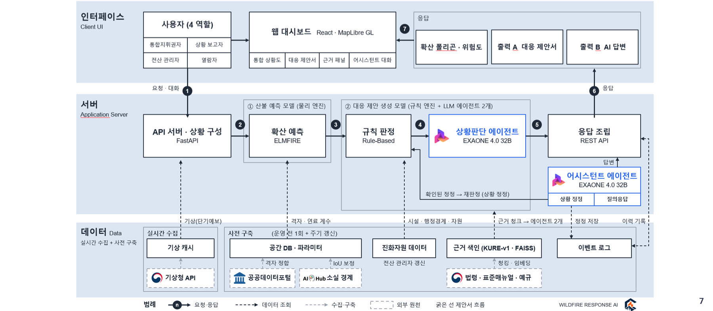

### 개발 일정 및 진행 현황 (8쪽)

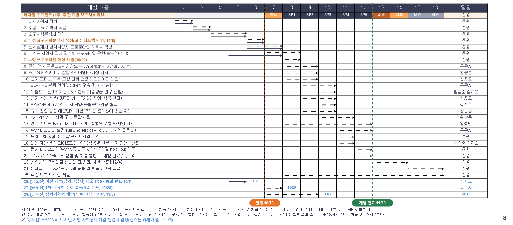

## 02. 시스템 기술서

### 절차 기술 (9쪽)

본 시스템은 산불 확산 예측 결과를 「산불 재난」 위기관리 표준매뉴얼 근거와 연결해, 산불현장 통합지휘권자에게 지금 해야 할 진화·대피 조치를 제안하는 의사결정 지원 웹 시스템이다. 최근 산불은 발생 건수가 줄어도 한 번의 피해가 커지고 있으나, 기존 국가 시스템은 확산 예측과 위험도를 제공할 뿐 그 결과를 어떤 대응 행동으로 옮길지는 소수 인력이 119쪽 분량의 매뉴얼을 찾아 가며 수작업으로 판단하고 있다.

이를 해결하기 위해 시스템은 ① 현장에서 입력된 발화 정보·실측 화선과 기상으로 1시간 간격 확산 범위를 예측하고, ② 규칙 엔진이 예측 결과로 대응단계·위험구역·대피소 배정처럼 근거 문서에 경계값·수치가 있는 판정 값을 계산한 뒤, ③ 국내 LLM(EXAONE 4.0 32B)이 그 판정 값과 상황 데이터를 넘겨받아 진화 7개(S1\~S7)·대피 7개(E1\~E7) 항목의 대응을 판단해 제안 문장을 만들고 RAG로 검색한 매뉴얼 근거를 인용하며, ④ 통합지휘권자가 AI 어시스턴트로 제안 이유와 근거를 묻거나 대피 완료 같은 상황 변화를 알려 제안을 다시 받게 한다. 경계값이 있는 수치 판정은 규칙이 맡고 LLM은 그 값을 바꾸지 못하며, 제안 문장마다 근거를 붙여 근거 없는 판단을 만들지 않도록 한다.

사용자는 네 가지 권한으로 나뉜다. 통합지휘권자는 초기대응·확산대응 1단계에서 통합지휘본부장이자 주민대피 명령권자인 시장·군수·구청장이다(p.72, p.84). 확산대응 2단계로 격상되면 지휘권 인계를 안내한다(S6). 확산 예측을 실행해 대응 제안을 만들고, 위험도와 제안·근거를 검토하며, AI 어시스턴트에 질문하거나 상황을 정정하고, 진화가 끝나면 발화 종료 처리를 한다. 열람자는 유관기관·상급 본부 담당자로 통합 상황도와 발생·접수 정보, 산불 위험도를 읽기 전용으로 본다. 상황 보고자는 초기 발화 위치·일시·신고자 정보와 진행 중인 실측 화선을 폴리곤으로 입력하고, 전산 관리자는 평시에 계정·권한과 진화자원 데이터를 관리한다. 로그인에 5회 연속 실패해 잠긴 계정은 전산 관리자만 잠금 해제하며, 해제 시 실패 횟수를 0으로 초기화한다.

시스템 측 참여자는 확산예측 모듈(ELMFIRE), AI 모델(EXAONE + KURE-v1 근거 검색), 기상청 API·공공데이터(단기예보, 위성영상·지도 타일, SGIS 경계, 마을·시설·대피소·도로)다. 확산예측 모듈이 최신 실측 화선(없으면 발화점)에서 30 m 격자의 지형·연료와 기상으로 누적 확산 범위 P1\~P8을 만들면, 시스템은 이를 공간 DB에 저장해 지도 표시·위험도 계산·규칙 판정·제안 생성에 함께 쓴다. 로그인·로그아웃·입력·예측·제안·정정·종료·계정 및 자원 변경 이벤트는 추가 전용 이벤트 로그에 기록되고, 상단 「이벤트 로그」 창에서 시각·구분·내용·사용자 기준으로 읽기 전용 열람한다.

업무 절차는 다음과 같다. 상황 보고자가 발화 정보와 실측 화선을 입력하면 통합지휘권자와 열람자는 통합 상황도에서 확산 범위, 주요 시설의 위치, 진화자원을 확인한다. 통합지휘권자가 확산 예측을 실행하면 시스템은 예측을 저장한 뒤 곧바로 진화·대피 제안서를 만든다. 제안은 즉시·대기·협의·요청으로 구분되며 모든 문장 끝에 근거 번호가 붙는다. 예측이 갱신되거나 상황 정정이 확정되면 새 버전(예: v1.1 → v1.2)이 생기고 바뀐 항목이 표시되며, 진화가 끝나면 통합지휘권자가 발화 종료 처리를 한다. 종료 후에는 발화 정보 수정, 예측 실행, 상황 정정, 제안 재생성을 차단하고 기존 제안은 이력으로만 열람한다.

이로써 예측과 대응 사이의 수작업 공백을 줄이고 판단 근거를 조항 단위로 추적할 수 있는 투명한 의사결정 환경을 제공한다. 시스템은 권고만 하며, 대응단계 발령과 대피명령 같은 최종 결정은 통합지휘권자가 내린다.

### 업무 절차 흐름 (10쪽)

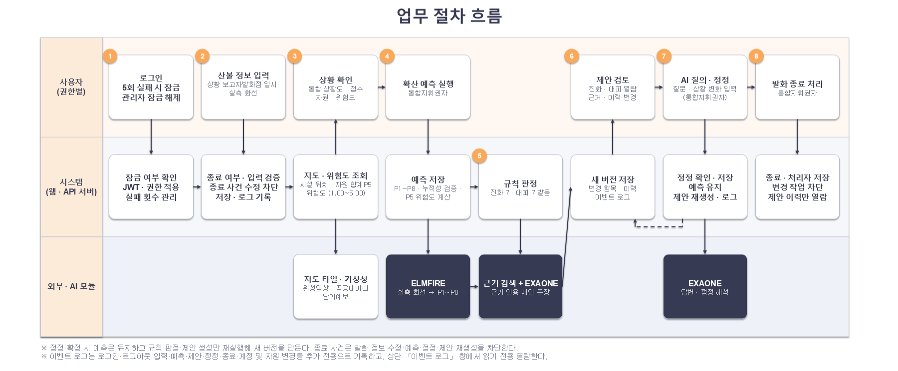

> ※ 정정 확정 시 예측은 유지하고 규칙 판정·제안 생성만 재실행해 새 버전을 만든다. 종료 사건은 발화 정보 수정·예측·정정·제안 재생성을 차단한다.  
> ※ 이벤트 로그는 로그인·로그아웃·입력·예측·제안·정정·종료·계정 및 자원 변경을 추가 전용으로 기록하고, 상단 「이벤트 로그」 창에서 읽기 전용 열람한다.

### 기능 목록 (1/3) — 인증 · 상황 보고 · 상황 파악 · 확산 예측 (11쪽)

| 번호 | 기능 | 설명 | 사용자 | 관련 UC |
|---|---|---|---|---|
| **인증·권한 (1개)** | | | | |
| F-01 | 로그인·계정·권한 관리 | 발급받은 계정으로 로그인해 권한에 맞는 화면에 진입하고, 전산 관리자가 계정을 발급·회수하며 조작(통합지휘권자)·열람(열람자)·보고(상황 보고자) 권한을 구분한다(전산 관리자 계정은 사전 발급) | 통합지휘권자·열람자·상황 보고자 ·전산 관리자 | UC-AUTH-01, UC-ADMIN-01 |
| **상황 보고 (1개)** | | | | |
| F-02 | 산불 상황 보고(발화 정보·실측 화선) | 초기 산불의 발화 위치·발생 일시·신고 내용·신고자 정보·접수 시각·접수 기관을 입력하고, 실측 화선(지금 타고 있는 범위를 그린 폴리곤)을 입력한다. 처음 받은 보고가 화선 v1이며, 초기대응에서는 생략할 수 있다 | 상황 보고자 | UC-REPORT-01 |
| **상황 파악 (6개)** | | | | |
| F-03 | 발화 종료 처리 | 진화가 끝나면 산불을 종료 상태로 전환한다. 종료 후 보고·예측·정정을 막는다 | 통합지휘권자 | UC-SIT-01 |
| F-04 | 산불 발생·접수 정보 조회 | 발생 장소·신고 내용·신고자·접수 기록·진행 상태와 기상을 확인한다 | 통합지휘권자·열람자 ·상황 보고자 | UC-SIT-02 |
| F-05 | 통합 상황도 | 발화점·실측 화선·1시간 간격 확산 예측(P1\~P8, 시간 재생)·주변 대상을 지도에서 함께 확인한다. 위험구역(P5)·잠재 위험구역(P8)을 강조한다 | 통합지휘권자·열람자 | UC-SIT-03 |
| F-06 | 지도 레이어 선택 | 예측·인구·시설·도로 묶음의 표시를 켜거나 끈다(버튼의 색 견본이 범례) | 통합지휘권자·열람자 | UC-SIT-03 |
| F-07 | 주요 시설 지도 표시 | 마을·담수지·유관기관 등 우선순위 요소의 위치를 지도에 표시한다 (발화점 거리는 표시하지 않음) | 통합지휘권자·열람자 | UC-SIT-03 |
| F-08 | 가용 현황 확인 | 헬기·인력·차량 현황을 대기·투입·정비 체크박스로 골라 보고, 합계는 선택한 상태만 표시한다 | 통합지휘권자·열람자 | UC-SIT-03 |
| **확산 예측 (2개)** | | | | |
| F-09 | 확산 예측 실행·갱신 | 통합지휘권자가 실행할 때 최신 실측 화선(없으면 발화점) 기준으로 확산 예측을 실행하고, 그 결과로 진화·대피 대응 제안을 생성한다 | 통합지휘권자 | UC-PRED-01 |
| F-10 | 산불 위험도 조회 | 예측마다 P5 기준 위험도(1.00\~5.00)와 요인 점수를 산불별로 확인한다(예측 전·종료 시 숨김) | 통합지휘권자·열람자 | UC-PRED-02 |

### 기능 목록 (2/3) — 대응 제안 (공통 · 진화) (12쪽)

| 번호 | 기능 | 설명 | 사용자 | 관련 UC |
|---|---|---|---|---|
| **대응 제안 — 공통 (4개)** | | | | |
| F-11 | 대응 제안 생성·갱신·상세 조회 | 현재 상황에 맞는 제안을 생성하고, 판정 이유·대상·권한을 확인한다. 매뉴얼 근거가 없는 제안은 넣지 않는다 | 통합지휘권자 | UC-PRED-01, UC-PROP-01, UC-PROP-02 |
| F-12 | 제안 분류 | 진화·대피, 그리고 즉시·대기·협의·요청별로 제안을 정리해 보여준다 | 통합지휘권자 | UC-PROP-01, UC-PROP-02 |
| F-13 | 대응 근거 조회 | 제안·답변에 연결된 매뉴얼의 문서·쪽수·조항·요약을 확인하고, 관련 원문 문서를 연결해 연다 | 통합지휘권자 | UC-PROP-03 |
| F-14 | 제안 이력·변경사항 조회 | 제안 생성 이력(버전 v1.1 → v1.2 …)과 이전 제안에서 달라진 내용을 '변경' 태그와 팝업으로 확인한다 | 통합지휘권자 | UC-PROP-04 |
| **대응 제안 — 진화 S1\~S7 (7개)** | | | | |
| F-15 | 대응단계 판단·격상 검토 (S1) | 현재 위험에 맞는 대응단계와 격상 필요성을 제안한다 | 통합지휘권자 | UC-PRED-01, UC-PROP-01 |
| F-16 | 진화 우선지역·보호대상 선정 (S2) | 인명·주요시설·재산 등의 보호 우선순위를 제안한다 | 통합지휘권자 | UC-PRED-01, UC-PROP-01 |
| F-17 | 진화자원 투입·배분·재배치 (S3) | 헬기·인력·차량을 우선 투입할 구역과 재배치 방향을 제안한다 | 통합지휘권자 | UC-PRED-01, UC-PROP-01 |
| F-18 | 진화 방식·시간대 전략 (S4) | 기상과 주야간에 맞는 지상·항공 진화 전략을 제안한다 | 통합지휘권자 | UC-PRED-01, UC-PROP-01 |
| F-19 | 시설 보호 조치 (S5) | 주택·국가유산·전력시설 등에 필요한 보호 조치를 제안한다 | 통합지휘권자 | UC-PRED-01, UC-PROP-01 |
| F-20 | 유관기관 동원·협조 요청 (S6) | 지원이 필요한 기관·자원과 지휘권 인계 필요성을 안내한다 | 통합지휘권자 | UC-PRED-01, UC-PROP-01 |
| F-21 | 진화인력 안전·투입 관리 (S7) | 인력 위치·퇴로·위험 조건에 따른 안전 확인과 철수를 제안한다 | 통합지휘권자 | UC-PRED-01, UC-PROP-01 |

### 기능 목록 (3/3) — 대응 제안 (대피) · 질의응답 · 평시 관리 · 시스템 (13쪽)

| 번호 | 기능 | 설명 | 사용자 | 관련 UC |
|---|---|---|---|---|
| **대응 제안 — 대피 E1\~E7 (7개)** | | | | |
| F-22 | 위험구역 설정 (E1) | 위험구역과 잠재 위험구역에 포함되는 마을을 구분한다 | 통합지휘권자 | UC-PRED-01, UC-PROP-02 |
| F-23 | 대피 대상·순서·시점 결정 (E2) | 위험도와 취약계층을 고려한 대피 대상·순서·시점을 제안한다 | 통합지휘권자 | UC-PRED-01, UC-PROP-02 |
| F-24 | 취약시설·미대피 주민 조치 (E3) | 취약시설 이송과 미대피 주민에 대한 추가 조치를 제안한다 | 통합지휘권자 | UC-PRED-01, UC-PROP-02 |
| F-25 | 대피소 배정·분산 (E4) | 주민에게 적합한 대피소를 배정하고 수용 초과 시 분산을 제안한다 | 통합지휘권자 | UC-PRED-01, UC-PROP-02 |
| F-26 | 대피 경로·교통통제 (E5) | 위험 경로와 진화차량 진입로의 충돌을 확인하고 통제를 제안한다 | 통합지휘권자 | UC-PRED-01, UC-PROP-02 |
| F-27 | 재난문자·방송 전파 제안 (E6) | 대피 단계에 맞는 안내 지역과 문자·방송 송출을 제안한다 | 통합지휘권자 | UC-PRED-01, UC-PROP-02 |
| F-28 | 인명구조·긴급구조 요청 (E7) | 고립·부상·미대피 상황에 필요한 구조 대상과 요청 기관을 제안한다 | 통합지휘권자 | UC-PRED-01, UC-PROP-02 |
| **질의응답 (2개)** | | | | |
| F-29 | AI 질의응답 | 현재 상황·대응 제안·근거를 빠른 질문·「이 항목 질문」·자유 질문으로 묻는다(상황·제안 불변). 상황 변화 입력은 정정 확인 카드로 넘긴다(UC-QA-02) | 통합지휘권자 | UC-QA-01 |
| F-30 | AI 상황 정정 요청 | AI 어시스턴트에 상황 변화(대피 완료·자원 투입 등)를 입력하면 한 문장 속 변화를 모두 해석해 확인 후 저장하고, 대응 제안을 다시 생성한다 | 통합지휘권자 | UC-QA-02 |
| **평시 관리 (1개)** | | | | |
| F-31 | 진화자원 데이터 관리 | 전산 관리자가 보유 헬기·차량·인력 등 진화자원 데이터를 등록·수정·삭제한다(투입 중인 자원은 삭제할 수 없음) | 전산 관리자 | UC-ADMIN-02 |
| **시스템 (1개)** | | | | |
| F-32 | 이벤트 로그 | 로그인·로그아웃·입력·예측·제안·정정·종료·계정 및 자원 변경·근거 부족 이벤트를 추가 전용으로 기록하고, 상단 「이벤트 로그」 창에서 읽기 전용으로 열람한다 | 시스템 (열람: 통합지휘권자) | UC-PROP-04 |

## 03. 유스케이스 다이어그램

### 1. 액터 정의 (15쪽)

| 액터 | 종류 | 설명 | 사용하는 유스케이스 |
|---|---|---|---|
| 통합지휘권자 | 사람 (주 액터) | 산불 현장의 지휘권을 가진 시장·군수·구청장. 예측을 돌리고, 제안을 검토하고, AI에 묻고 상황을 정정하고, 산불을 종료한다. 발화 정보를 직접 입력하지 않는다(상황 보고자 담당) | AUTH-01, SIT-01, SIT-02, SIT-03, PRED-01, PRED-02, PROP-01\~04, QA-01, QA-02 |
| 열람자 | 사람 | 유관기관·상급 본부 담당자. 통합지휘권자와 같은 발생·접수 정보·통합 상황도·산불 위험도를 보기만 한다(예측 실행·제안 열람은 하지 않음). | AUTH-01, SIT-02, SIT-03, PRED-02 |
| 상황 보고자 | 사람 (입력 전담) | 현장 상황을 시스템에 보고하는 단 하나의 역할을 맡은 사람. ① 산불 최초 보고: 발화 위치·발생 날짜·시각·신고 내용·신고자 정보·접수 시각 ② 1시간마다 실측 화선(지금 타고 있는 범위를 그린 폴리곤) 보고, 초기대응에서는 생략 가능. 예측 실행·제안 열람·정정은 하지 않는다. 전용 화면(지도 + 상황 입력 판)을 쓰며, 계정 권한은 보고 | REPORT-01, AUTH-01, SIT-02 |
| 전산 관리자 | 사람 (평시) | 개발자가 아니라 전산 시스템을 관리하는 사람. 계정 발급·회수와 진화자원 데이터 관리 | AUTH-01, ADMIN-01, ADMIN-02 |
| 확산예측 모듈 | 시스템 | 실측 화선(없으면 발화점)·기상·지형·연료로 1시간 간격 누적 확산 범위 P1\~P8을 계산 | PRED-01 |
| AI 모델 | 시스템 | 시스템이 넘겨준 규칙 엔진 판정 값과 확산 범위 안 마을·시설·자원 데이터, 검색한 표준매뉴얼 근거로 진화·대피를 판단해 제안 문장·답변을 쓰고(판정 값은 바꾸지 않음), 정정 입력을 해석. | PRED-01, QA-01, QA-02 |
| 기상청 API·공공데이터 | 시스템 | 풍향·풍속·습도 등 기상과 마을·시설·도로·지형 공간 데이터 제공 | SIT-03, PRED-02 (PRED-01에서도 기상 사용) |

> ※ 사람 액터 4 · 시스템 액터 3. 계정은 전산 관리자가 발급하며, 권한은 조작(통합지휘권자) · 열람(열람자) · 보고(상황 보고자) · 관리(전산 관리자)로 구분한다.

### 2. 다이어그램 (16쪽)

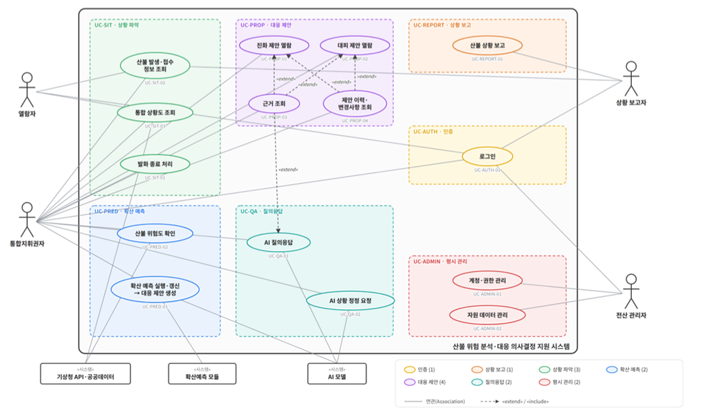

**주요 흐름**

- **① 평시 준비** — 전산 관리자가 계정을 발급하고(ADMIN-01) 진화자원 데이터를 등록한다(ADMIN-02)
- **② 상황 개시** — 상황 보고자가 로그인해(AUTH-01) 발화 정보와 실측 화선을 보고하고(REPORT-01), 통합지휘권자가 발생·접수 정보(SIT-02)와 통합 상황도(SIT-03)를 확인한다
- **③ 예측 → 제안** — 확산 예측을 실행하면 P5 위험도와 제안서가 생성된다(PRED-01). 위험도를 확인하고(PRED-02) 진화·대피 제안을 열람하며(PROP-01·02) 근거를 조회한다(PROP-03 «extend»)
- **④ 질의 → 정정** — AI 어시스턴트에 묻고(QA-01), 상황 변화를 정정하면 제안서가 다시 생성된다(QA-02). 변경 내용은 이력에서 확인한다(PROP-04 «extend»)
- **⑤ 1시간 갱신** — 새 실측 화선이 보고되면(REPORT-01) 「재예측 필요」가 표시되고 「다시 예측」으로 새 버전을 만든다(PRED-01) — 진화 완료까지 반복
- **⑥ 종료** — 진화가 끝나면 산불을 종료 상태로 바꾼다(SIT-01)

> ※ 유스케이스 다이어그램 그림은 생성형 AI를 활용하여 제작하였습니다.

### 3. 식별자 목록 (1/2) (17쪽)

| 식별자 | 유스케이스 명 | 주요 액터(or 시스템) | 설명 | 관계 |
|---|---|---|---|---|
| **UC-AUTH — 인증 (1개)** | | | | |
| UC-AUTH-01 | 로그인 | 통합지휘권자, 열람자, 상황 보고자, 전산 관리자 | 발급받은 아이디·비밀번호 입력 후 JWT 발급 및 권한별 첫 화면 이동 | — |
| **UC-REPORT — 상황 보고 (1개)** | | | | |
| UC-REPORT-01 | 산불 상황 보고 | 상황 보고자 | 발화 위치·일시·신고 내용·신고자 정보·접수 기관 입력 후 실측 화선을 폴리곤으로 제출 (처음 받은 보고가 v1, 1시간마다 새 버전, 초기대응에서는 생략 가능) | — |
| **UC-SIT — 상황 파악 (3개)** | | | | |
| UC-SIT-01 | 발화 종료 처리 | 통합지휘권자 | 진화가 끝난 산불을 종료 상태로 전환하고 보고·예측·정정 입력 차단 | — |
| UC-SIT-02 | 산불 발생·접수 정보 조회 | 통합지휘권자, 열람자, 상황 보고자 | 산불 목록에서 선택해 발생 장소·신고 내용·접수 시각·진행 상태 확인 | — |
| UC-SIT-03 | 통합 상황도 조회 | 통합지휘권자, 열람자 / 기상청 API·공공데이터 | 발화점·실측 화선·확산 예측 P1\~P8(시간 재생, P5·P8 강조) 위에 시설·레이어·진화자원 현황(대기·투입·정비 선택)을 겹쳐 조회 | — |
| **UC-PRED — 확산 예측 (2개)** | | | | |
| UC-PRED-01 | 확산 예측 실행·갱신 → 대응 제안 생성 | 통합지휘권자 / 확산예측 모듈, AI 모델 | 최신 실측 화선(없으면 발화점) 기준으로 P1\~P8을 예측하고 P5 위험도를 계산한 뒤 진화 7·대피 7 제안서를 새 버전(v화선 버전.순번)으로 생성 | — |
| UC-PRED-02 | 산불 위험도 확인 | 통합지휘권자, 열람자 / 기상청 API·공공데이터 | 예측마다 P5 범위로 계산한 위험도(1.00\~5.00)·요인 점수를 산불별로 확인(열람자도 열람), P5가 겹친 산불은 하나로 묶어 계산 | — |

### 3. 식별자 목록 (2/2) (18쪽)

| 식별자 | 유스케이스 명 | 주요 액터(or 시스템) | 설명 | 관계 |
|---|---|---|---|---|
| **UC-PROP — 대응 제안 (4개)** | | | | |
| UC-PROP-01 | 진화 제안 열람 (S1\~S7) | 통합지휘권자 | 진화 7항목을 즉시·대기·협의·요청별로 나열하고, 항목을 클릭해 판정 이유·대상·권한을 펼치고 지도에서 대상 위치를 확인 | — |
| UC-PROP-02 | 대피 제안 열람 (E1\~E7) | 통합지휘권자 | 대피 7항목을 즉시·대기·협의·요청별로 나열하고, 항목을 클릭해 판정 이유·대상·권한을 펼치고 지도에서 대상 위치를 확인 | — |
| UC-PROP-03 | 근거 조회 | 통합지휘권자 | 제안 문장·AI 답변의 근거 번호 [k]를 눌러 표준매뉴얼 문서·쪽수·조항·요약 확인(원문 문서 연결) | Extend UC-PROP-01, UC-PROP-02, UC-QA-01 |
| UC-PROP-04 | 제안 이력·변경사항 조회 | 통합지휘권자 | 제안서 버전별 이력 조회 및 '변경' 태그 항목의 직전 버전 대비 변경 내용 팝업 확인, 이벤트 로그 읽기 전용 열람 | Extend UC-PROP-01, UC-PROP-02 |
| **UC-QA — 질의응답 (2개)** | | | | |
| UC-QA-01 | AI 질의응답 | 통합지휘권자 / AI 모델 | 상황·제안·근거를 자연어·빠른 질문·「이 항목 질문」으로 묻고 근거 번호가 붙은 답 확인 (상황·제안 불변) | — |
| UC-QA-02 | AI 상황 정정 요청 | 통합지휘권자 / AI 모델 | 대피 완료·자원 투입 등 상황 변화를 확인 후 저장하고, 예측은 유지한 채 제안서 재생성 | Extend UC-QA-01 (상황 변화 입력 시) |
| **UC-ADMIN — 평시 관리 (2개)** | | | | |
| UC-ADMIN-01 | 계정·권한 관리 | 전산 관리자 | 사용자 계정 발급·회수 및 조작·열람·보고 권한 지정(회수·삭제·권한 변경은 확인 후 처리) | — |
| UC-ADMIN-02 | 진화자원 데이터 관리 | 전산 관리자 | 보유 헬기·차량·인력 데이터 등록·수정·삭제 | — |

### 4. 시나리오 – 로그인 (19쪽)

**UC-AUTH-01 로그인**

| 항목 | 내용 |
|---|---|
| 개요 | 사용자가 전산 관리자에게 발급받은 계정으로 인증하고, 권한(조작·열람·보고·관리)에 맞는 첫 화면으로 들어간다. 회원가입은 없다 |
| 액터 | 통합지휘권자, 열람자, 상황 보고자, 전산 관리자 |
| 시작 조건 | 전산 관리자가 계정과 권한을 미리 발급해 두었다 (UC-ADMIN-01) |
| 기본 흐름 | 1. 사용자가 로그인 화면에서 사용자 구분(통합지휘권자·열람자·상황 보고자·전산 관리자)을 고르고 발급받은 아이디·비밀번호를 입력한 뒤 「로그인」을 누른다. 2. 시스템이 계정의 잠금 여부를 먼저 확인하고, 계정 정보와 비밀번호를 대조해 인증하며, 선택한 구분이 계정 권한과 일치하는지와 계정이 회수되지 않았는지 확인한다. 3. 시스템이 계정에 지정된 권한을 담은 JWT(로그인 상태와 권한을 증명하는 서명된 토큰)를 발급해 세션에 적용한다. 4. 시스템이 권한별 첫 화면을 띄운다 — 통합지휘권자·열람자는 진행 중 산불의 통합 상황도, 상황 보고자는 상황 입력 화면(지도 + 상황 입력 판), 전산 관리자는 계정·진화자원 데이터 관리 화면. |
| 대안 흐름 | A1. 유효한 토큰이 남아 있을 시 → 로그인 없이 권한별 첫 화면으로 바로 진입 A2. 「로그아웃」을 누를 시 → 세션 토큰과 작성 중이던 입력 상태(지도 표식·그리던 화선)를 지우고 로그인 화면으로 돌아감 |
| 예외 흐름 | E1. 아이디·비밀번호가 맞지 않거나 선택한 구분이 계정 권한과 다르면 시스템이 "아이디 또는 비밀번호가 올바르지 않습니다"를 표시하고 실패 횟수를 1 올린 뒤 다시 입력받는다. E2. 회수된 계정이면 시스템이 로그인을 막고 전산 관리자에게 문의하라고 안내한다. E3. 5회 연속 실패하면 시스템이 계정을 잠그고 "계정이 잠겼습니다. 전산 관리자에게 문의하세요"를 표시한다. 잠긴 계정은 전산 관리자가 잠금 해제한다(UC-ADMIN-01). |
| 종료 조건 | JWT가 발급되어 권한이 적용된 세션이 만들어지고, 권한에 맞는 첫 화면이 표시된다 |

### 4. 시나리오 – 산불 상황 보고 (20쪽)

**UC-REPORT-01 산불 상황 보고**

| 항목 | 내용 |
|---|---|
| 개요 | 상황 보고자가 산불을 처음 보고할 때 발화 위치·발생 날짜·시각·신고 내용·신고자 정보·접수 시각·접수 기관을 입력해 산불 사건을 시작하고, 이후 1시간마다 실측 화선(지금 타고 있는 범위를 그린 폴리곤)을 보고한다. 이 실측 화선이 재예측·제안 재생성의 출발점이며, 초기대응처럼 아직 화선이 없으면 발화점에서 예측한다. |
| 액터 | 상황 보고자 |
| 시작 조건 | 상황 보고자가 '보고' 권한 계정으로 로그인한 상태 (UC-AUTH-01) |
| 기본 흐름 | 1. 상황 보고자가 상황 입력 화면(지도 + 상황 입력 판)에서 「새 산불 보고」를 누른다. 2. 상황 보고자가 지도에 발화 지점을 찍고(또는 경도·위도 입력) 발생 일시·신고 접수 일시(필수)·신고 내용과 신고자 정보(신고 기관명·성명·연락처, 선택)를 입력하고, 기관별 접수 기록(접수 기관·접수 시각·접수 경로)을 추가한다. 3. 상황 보고자가 지금 타고 있는 범위를 실측 화선 폴리곤으로 그려 제출한다(초기대응에서 화선이 없으면 생략 가능). 4. 시스템이 입력값을 검증하고 산불을 '접수' 상태로 생성해 발화 정보를 저장한다. 처음 받은 보고를 화선 v1로 저장하고(화선이 없으면 발화점 기준), 실측 화선이 처음 저장되는 시점에 상태를 '진행 중'으로 바꾼다. 5. 시스템이 발생·접수 정보(UC-SIT-02)와 통합 상황도(UC-SIT-03)에 새 산불의 발화점과 실측 화선을 표시하고, 새 실측 화선이면 통합지휘권자 화면의 「다시 예측」 버튼 옆과 산불현황에 「재예측 필요」를 표시한다. |
| 대안 흐름 | A1. 1시간 주기 보고 시 → 직전 실측 화선을 불러와 수정 후 새 버전(v2, v3…)으로 제출 A2. 잘못 보고한 실측 화선 정정 시 → 수정본을 다시 제출, 이전 버전은 '정정됨'으로 보존 |
| 예외 흐름 | E1. 입력한 산불 정보(발화 지점·시각·연락처 형식·실측 화선)가 올바르지 않으면 시스템이 제출을 막고 잘못된 항목을 표시한다. E2. 종료 처리된 산불에는 시스템이 보고를 받지 않는다(UC-SIT-01). |
| 종료 조건 | 산불 사건이 '접수' 또는 '진행 중'(실측 화선이 처음 저장되면 진행 중)으로 존재하고, 발화 정보와 최신 실측 화선(버전 포함)이 저장되어 상황판·예측의 입력으로 쓰인다 |

### 4. 시나리오 – 산불 발생·접수 정보 조회 (21쪽)

**UC-SIT-02 산불 발생·접수 정보 조회**

| 항목 | 내용 |
|---|---|
| 개요 | 사용자가 예측이 아닌 지금 상황 — 어디서 났고, 누가 언제 신고했고, 지금 어떤 상태인지 — 를 확인한다 |
| 액터 | 통합지휘권자, 열람자, 상황 보고자 |
| 시작 조건 | 로그인 상태, 상황 보고자가 산불을 1건 이상 보고함 (UC-REPORT-01) |
| 기본 흐름 | 1. 사용자가 화면 왼쪽 「산불」 날개를 눌러 산불 목록을 펼친다. 2. 시스템이 접수·진행 중인 산불 목록(발생 장소·발생 시각·진행 상태)을 보여준다. 3. 사용자가 목록에서 산불을 고른다. 4. 시스템이 산불현황 탭에 발생 장소·신고 내용·신고자(모르면 「미확인」)·기관별 접수 기록과 진행 상태(접수 / 진행 중, 최신 실측 화선 버전·면적, 5h·8h 예측 면적), 기상(발표·수신 시각 포함)을 표시하고, 지도를 해당 산불 위치로 이동해 보여준다. |
| 대안 흐름 | A1. 목록 보기를 「종료」로 바꿀 시 → 종료 처리된 산불 목록 표시 A2. 상황 보고자일 시 → 「실측 화선 보고」 버튼으로 UC-REPORT-01(A1) 진행 |
| 예외 흐름 | E1. 접수·진행 중인 산불이 없으면 시스템이 "진행 중인 산불이 없습니다"를 표시한다. |
| 종료 조건 | 선택한 산불의 발생·접수 정보와 진행 상태가 표시된다 |

### 4. 시나리오 – 통합 상황도 조회 (22쪽)

**UC-SIT-03 통합 상황도 조회**

| 항목 | 내용 |
|---|---|
| 개요 | 지도 한 장 위에 발화점·실측 화선·확산 폴리곤(예상 확산 범위 도형)과 마을·시설·진화자원을 겹쳐, "불이 어디까지 오고 그 안에 무엇이 있는지"를 본다. |
| 액터 | 통합지휘권자, 열람자 / 기상청 API·공공데이터 |
| 시작 조건 | 로그인 상태, 등록된 산불 1건 이상 |
| 기본 흐름 | 1. 사용자가 통합 상황도를 연다(로그인 후 첫 화면 또는 UC-SIT-02에서 산불 선택). 2. 시스템이 공공데이터 기반 지도 위에 발화점과 상황 보고자가 입력한 실측 화선을 그린다. 예측 결과가 있으면 1시간 간격 확산 범위 P1\~P8을 겹치고, 위험구역(P5, 5시간 내 도달 범위, 붉은 면)과 잠재 위험구역(P8, 8시간 내, 점선)을 구분해 강조한다. 3. 시스템이 마을·담수지·유관기관 등 주요 시설 위치를 아이콘으로 표시한다(발화점과의 거리는 표시하지 않음). 4. 사용자가 레이어 버튼으로 예측·인구·시설·도로 묶음을 켜고 끄면 시스템이 즉시 지도에 반영한다. 버튼의 색 견본이 지도 범례이며, 마우스를 올리면 의미를 보여준다. 5. 사용자가 시간 재생(t = 1 … 8, 속도 1×·2×·4×)을 누르면 시스템이 해당 시점의 확산 범위 P(t)를 채우고 도달한 마을을 강조한다. 6. 사용자가 「진화자원」 패널을 열면 시스템이 진화자원 데이터(UC-ADMIN-02)를 바탕으로 헬기·인력·차량 현황을 표시한다. 대기·투입·정비 상태 체크박스(처음에는 모두 선택)로 고르며, 합계는 선택한 상태만 표시한다. |
| 대안 흐름 | A1. 예측 전일 시 → 발화점·실측 화선·시설만 표시 (P1\~P8 없음) A2. 종료된 산불일 시 → 예측 범위(P1\~P8) 없이 발화점과 보고된 실측 화선만 표시 |
| 예외 흐름 | E1. 공공데이터·기상 데이터 호출에 실패하면 시스템이 그 칸에 경고를 띄우고 마지막으로 받은 값을 흐리게 수신 시각과 함께 표시한다. |
| 종료 조건 | 실측 화선·예측 범위(P1\~P8), 주요 시설, 진화자원 현황이 겹쳐진 상황도가 표시된다 |

### 4. 시나리오 – 산불 위험도 확인 (23쪽)

**UC-PRED-02 산불 위험도 확인**

| 항목 | 내용 |
|---|---|
| 개요 | 통합지휘권자와 열람자가 해당 산불이 얼마나 위험한지(위험도, 1.00\~5.00)를 확인해 예측과 함께 판단 재료로 쓴다. 위험도는 확산 예측 1회마다 P5(5시간 누적 예측 범위) 안의 23개 변수를 가중평균한 독립 지표이며, 산불위험지수·대응단계 등 다른 체계에 매핑하지 않는다 |
| 액터 | 통합지휘권자, 열람자 / 기상청 API·공공데이터 |
| 시작 조건 | 통합지휘권자 또는 열람자로 로그인, 확산 예측이 1회 이상 실행된 상태 (UC-PRED-01) |
| 기본 흐름 | 1. 확산 예측이 저장되면(UC-PRED-01) 시스템이 산불마다 P5 폴리곤을 꺼내고, 다른 산불의 P5와 겹치면 동일 산불로 묶어 합집합 폴리곤을 만든다. 2. 시스템이 P5와 겹친 격자의 기상·지형·연료 값을 겹침 면적 비율로 가중해 1\~5 등급으로 바꾸고, 겹친 행정동의 65세 이상·0\~14세 인구(SGIS)를 합산해 취약계층 수를, 최근 화선에서 가장 가까운 소방서까지 거리를 구한다. 3. 시스템이 23개 변수의 가중평균으로 위험도와 기상·지형·연료·인프라 요인 점수를 계산하고, 이전 예측의 값을 새 값으로 바꿔 저장한다. 4. 시스템이 지도 오른쪽 위 네모에 위험도를 소수 둘째 자리 숫자와 구간 색(4·3·2 기준, 등급 이름 없음)으로 표시하고, 누르면 상세 팝업과 「요소별 지표」(23개 변수 표)를 연다. |
| 대안 흐름 | A1. 예측 전이거나 산불을 고르지 않은 경우 → 위험도 네모를 표시하지 않음 A2. P5가 겹쳐 묶인 산불일 시 → 먼저 신고된 산불 1건으로 묶어 위험도 1개 계산, P5 겹침 구역 보라색 표시 A3. 종료된 산불일 시 → 위험도 네모를 표시하지 않음 |
| 예외 흐름 | E1. P5 폴리곤이나 필수 변수를 구하지 못하면 시스템이 위험도 네모에 경고 아이콘과 「—」를 표시하고 다음 예측 때 다시 계산한다. E2. 일부 변수만 결측이면 시스템이 결측 변수를 빼고 남은 가중치로 나눠 계산하고, 요소별 지표에 「가져오지 못함」으로 표시한다. E3. 예측에 쓴 기상 값이 최신이 아니면 시스템이 기상 수신 시각을 함께 표시한다. |
| 종료 조건 | 산불(폴리곤)마다 최신 예측의 P5 위험도와 요인 점수가 저장·표시된다 |

### 4. 시나리오 – 확산 예측 실행·갱신 → 대응 제안(진화, 대피) 생성 (24쪽)

**UC-PRED-01 확산 예측 실행·갱신 → 대응 제안(진화, 대피) 생성**

| 항목 | 내용 |
|---|---|
| 개요 | 최신 실측 화선(없으면 발화점)을 시작점으로 1시간 간격 누적 확산 범위 P1\~P8을 예측하고, 그 결과로 진화 7항목·대피 7항목 대응 제안서를 새 버전으로 만든다. 재예측은 통합지휘권자가 버튼을 누를 때만 실행되며, 누른 시점의 최신 실측 화선·기상·자원 상태를 기준으로 한다(자동 실행 없음) |
| 액터 | 통합지휘권자 / 확산예측 모듈, AI 모델 (기상은 기상청 API) |
| 시작 조건 | 통합지휘권자로 로그인, 상황 보고자가 발화 정보를 입력함(실측 화선은 없어도 됨) (UC-REPORT-01) |
| 기본 흐름 | 1. 통합지휘권자가 상황도에서 최신 실측 화선을 확인하고 「확산 예측 실행」을 누른다. 결과가 이미 있으면 버튼은 「다시 예측」으로 표시되며, 새 실측 화선이 보고되면 버튼 옆에 「재예측 필요」와 화선 버전이 표시된다. 2. 시스템이 최신 실측 화선·발화 정보, 기상청 API의 풍향·풍속·습도, 진화자원 가용 현황을 모아 입력을 검증한다. 3. 확산예측 모듈이 최신 실측 화선(없으면 발화점)을 기준으로 확산 범위를 예측하고(진행률 표시), 시스템이 1시간 간격 누적 범위 P1\~P8을 저장해 상황도에 그리며 위험구역(P5)·잠재 위험구역(P8)을 강조하고, P5 범위로 위험도를 계산해 저장한다(UC-PRED-02). 4. 규칙 엔진이 근거 문서에 경계값·수치가 있는 값(대응단계·위험구역·대피소 배정 등)을 판정하고, 시스템이 그 판정 값과 P5·P8 안에 드는 마을·시설·대피소·도로 목록, 진화자원 가용 현황을 모아 AI 모델에 넘긴다. 5. AI 모델이 넘겨받은 판정 값(바꾸지 않음)과 데이터, 검색한 표준매뉴얼 근거로 진화 S1\~S7(불을 끄는 데 필요한 7가지 제안)·대피 E1\~E7(주민 대피에 필요한 7가지 제안)을 판단해 제안 문장을 쓰고, 문장 끝에 근거 번호 [k]를 붙인다. 매뉴얼 근거를 찾지 못한 제안은 제안서에 넣지 않는다. 6. 시스템이 제안을 즉시·대기·협의·요청으로 분류해 새 버전(v화선 버전.대응 생성 순번, 예: v1.1)으로 저장하고, 직전 버전과 달라진 항목에 '변경' 태그를 붙이며, 이벤트 로그에 "제안서 v1.1 생성"을 기록한다. 7. 시스템이 제안 생성 완료를 알리고 대응 제안 화면을 새 버전으로 갱신한다. |
| 대안 흐름 | A1. 첫 실행 시 → '변경' 태그 없이 v1.1(화선 v1 기준 첫 제안)로 저장 A2. 기상·자원 조건만 바뀐 경우 → 「다시 예측」으로 새 버전 생성 |
| 예외 흐름 | E1. 예측 실행 중 다시 누르면 시스템이 버튼을 비활성화해 중복 실행을 막는다. E2. 확산예측 모듈이 실패하면 시스템이 "예측에 실패했습니다"를 상단 시스템 알림과 버튼 옆 경고로 안내하고 직전 예측·제안서를 그대로 유지한다. E3. 예측은 성공했으나 제안 생성에 실패하면 시스템이 새 예측을 확정하지 않고 직전 예측·제안서 묶음을 그대로 유지하며 실패를 안내한다. E4. 종료된 산불이면 시스템이 버튼을 비활성화하고 버튼 옆에 「종료된 산불은 예측할 수 없습니다」를 작은 글씨로 표시한다. |
| 종료 조건 | 새 예측(P1\~P8)·P5 위험도와 새 버전의 대응 제안서가 저장·표시된다 |

### 4. 시나리오 – 진화 제안 열람 (S1~S7) (25쪽)

**UC-PROP-01 진화 제안 열람 (S1\~S7)**

| 항목 | 내용 |
|---|---|
| 개요 | "불을 어떻게 끌 것인가" — 대응단계(S1)·보호대상(S2)·자원 배분(S3)·진화 전략(S4)·시설 보호(S5)·유관기관(S6)·인력 안전(S7) 7항목을 분류별로 항목 상세와 함께 확인한다 |
| 액터 | 통합지휘권자 |
| 시작 조건 | 통합지휘권자로 로그인, 대응 제안서 버전이 1개 이상 있음 (UC-PRED-01) |
| 기본 흐름 | 1. 사용자가 「대응 제안」 탭에서 「진화」를 고른다. 2. 시스템이 제안서 버전(예: v1.1)·생성 시각·계기·기준 실측 화선·공식 단계·판정 단계를 표시하고, S1 판정 단계가 공식 단계보다 높으면 상단에 격상 검토 권고 배너를 띄운다. 3. 시스템이 S1\~S7 항목을 즉시·대기·협의·요청 분류로 묶어 나열하고, 항목마다 제안 문장을 보여주고, 항목을 클릭하면 판정 이유·대상·권한·근거 목록을 펼쳐 보여주고, 지도에서 대상 마을·시설을 하늘색 고리로 강조한다. 4. 사용자가 문장 끝 [k]를 누르면 근거 조회(UC-PROP-03)로, '변경' 태그를 누르면 변경 내용 조회(UC-PROP-04)로, 「이 항목 질문」을 누르면 그 항목을 지정한 AI 질의응답(UC-QA-01)으로 넘어간다. |
| 대안 흐름 | A1. 종료된 산불일 시 → 마지막 버전 제안서를 조회 전용으로 표시 |
| 예외 흐름 | E1. 제안서가 없으면 시스템이 "확산 예측을 실행하면 제안이 생성됩니다"를 안내한다. |
| 종료 조건 | 진화 제안서가 항목 상세와 함께 표시된다 |

### 4. 시나리오 – 대피 제안 열람 (E1~E7) (26쪽)

**UC-PROP-02 대피 제안 열람 (E1\~E7)**

| 항목 | 내용 |
|---|---|
| 개요 | "주민을 어떻게 피신시킬 것인가" — 위험구역 마을(E1)·대피 순서·시점(E2)·취약시설(E3)·대피소(E4)·대피 경로(E5)·재난문자(E6)·인명구조(E7) 7항목을 분류별로 항목 상세와 함께 확인한다 |
| 액터 | 통합지휘권자 |
| 시작 조건 | 통합지휘권자로 로그인, 대응 제안서 버전이 1개 이상 있음 (UC-PRED-01) |
| 기본 흐름 | 1. 사용자가 「대응 제안」 탭에서 「대피」를 고른다. 2. 시스템이 제안서 버전(예: v1.1)·생성 시각·기준 실측 화선과 구분별 건수(즉시·대기·협의·요청)를 표시한다. 3. 시스템이 E1\~E7 항목을 즉시·대기·협의·요청 분류로 묶어 나열하고, 항목마다 제안 문장을 보여주고, 항목을 클릭하면 판정 이유·대상·권한·근거 목록을 펼쳐 보여주고, 지도에서 대상 마을·시설을 하늘색 고리로 강조한다. 4. 사용자가 문장 끝 [k]를 누르면 근거 조회(UC-PROP-03)로, '변경' 태그를 누르면 변경 내용 조회(UC-PROP-04)로, 「이 항목 질문」을 누르면 그 항목을 지정한 AI 질의응답(UC-QA-01)으로 넘어간다. |
| 대안 흐름 | A1. 종료된 산불일 시 → 마지막 버전 제안서를 조회 전용으로 표시 |
| 예외 흐름 | E1. 제안서가 없으면 시스템이 "확산 예측을 실행하면 제안이 생성됩니다"를 안내한다. |
| 종료 조건 | 대피 제안서가 항목 상세와 함께 표시된다 |

### 4. 시나리오 – 근거 조회 (27쪽)

**UC-PROP-03 근거 조회**

| 항목 | 내용 |
|---|---|
| 개요 | 제안 문장이나 AI 답변 끝의 [k]를 눌러, 그 문장이 표준매뉴얼의 어느 문서·쪽수·조항에 근거했는지 확인한다. «extend»: UC-PROP-01·02·QA-01에서 [k]를 누른 경우에만 동작 |
| 액터 | 통합지휘권자 |
| 시작 조건 | [k]가 붙은 제안 문장 또는 AI 답변이 화면에 있음 |
| 기본 흐름 | 1. 사용자가 제안 문장(또는 AI 답변) 끝의 [k]를 누른다. 2. 시스템이 근거 창을 고정 창 바로 옆(지도 위)에 열어 제안 목록과 나란히 보이게 하고, 맨 위에 해당 문장을 다시 보여준다. 3. 시스템이 그 문장에 연결된 근거 목록(문서명·쪽수·조항·요약 설명)을 나열하고, 누른 번호를 강조한다. 4. 시스템은 해당 부분의 요약을 표시하고, 관련 매뉴얼 원문 문서는 연결해 열람할 수 있게 한다. |
| 대안 흐름 | — |
| 예외 흐름 | E1. 근거 청크를 불러오지 못하면 시스템이 "근거를 불러올 수 없습니다"를 안내하고 근거 창을 닫는다. |
| 종료 조건 | 선택한 문장의 매뉴얼 근거(문서·쪽수·조항·요약)가 확인된다 |

### 4. 시나리오 – AI 질의응답 (28쪽)

**UC-QA-01 AI 질의응답**

| 항목 | 내용 |
|---|---|
| 개요 | 통합지휘권자가 현재 상황·대응 제안·근거를 자연어나 빠른 질문으로 묻고 근거 번호가 붙은 답을 받는다. |
| 액터 | 통합지휘권자 / AI 모델 |
| 시작 조건 | 통합지휘권자로 로그인, 등록된 산불 1건 이상 |
| 기본 흐름 | 1. 통합지휘권자가 화면 우측 하단의 「AI 어시스턴트」를 연다. 2. 시스템이 빠른 질문 6개(대피 순서 이유·헬기 운용 가능 여부·격상 기준·대피소 수용 초과 시 대안·추가 투입 헬기 대수·현재 위험도)를 보여준다. 3. 통합지휘권자가 질문을 입력하거나 빠른 질문을 누른다. 4. 시스템이 최신 실측 화선·P5·P8 안의 마을·시설 목록·최신 버전 제안과, 질문과 관련된 표준매뉴얼 근거를 검색해 AI 모델에 넘긴다. 5. AI 모델이 검색된 근거 범위 안에서 답을 쓰고 문장 끝에 [k]를 붙인다. 6. 시스템이 답을 대화 창에 표시한다. 상황 값과 제안서는 그대로다. |
| 대안 흐름 | A1. 답의 [k]를 누를 시 → 근거 조회(UC-PROP-03)로 확장 A2. 대응제안 카드의 「이 항목 질문」으로 들어올 시 → 그 항목의 제안·근거·상황 값을 붙여 질문하고, 답도 그 항목 기준으로 작성 |
| 예외 흐름 | E1. 질문과 관련된 매뉴얼 근거를 찾지 못하면 AI 모델이 「…근거가 부족하여 표시하지 않았습니다」로 답하고 추측하지 않으며, 이벤트 로그에 「근거 부족」을 남긴다. E2. 입력이 질문이 아니라 상황 변화 보고로 판별되면 시스템이 바로 반영하지 않고 입력 내용을 정정 확인 카드로 넘긴다(UC-QA-02 «extend», 확인 전에는 저장하지 않음). |
| 종료 조건 | 질문과 답이 대화 창에 남는다. 상황·제안은 바뀌지 않는다 |

### 4. 시나리오 – AI 상황 정정 요청 (29쪽)

**UC-QA-02 AI 상황 정정 요청**

| 항목 | 내용 |
|---|---|
| 개요 | 통합지휘권자가 현장에서 바뀐 사실(대피 완료·자원 투입 등)을 AI 어시스턴트에 말로 입력하면, 시스템이 변경안을 확인받아 저장하고, 예측은 그대로 둔 채 대응 제안만 다시 만들어 달라진 항목을 보여준다. |
| 액터 | 통합지휘권자 / AI 모델 |
| 시작 조건 | 통합지휘권자로 로그인, 대응 제안서 버전이 1개 이상 있음 |
| 기본 흐름 | 1. 통합지휘권자가 AI 어시스턴트의 「상황 정정」에서 상황 변화를 입력한다 — 예: "○○리 대피 완료". 2. AI 모델이 입력을 해석해 변경안(대상: ○○리 / 항목: 대피 상태 / 이전: 대피 중 → 이후: 대피 완료)으로 정리한다. 한 문장에 변화가 여럿이면 모두 해석하고, 「추가」는 현재 값에 더한다(예: 헬기 4대 → 6대). 3. 시스템이 변경안 전부를 확인 카드로 보여주고, 해석하지 못한 부분은 따로 안내한다. 확인 전에는 아무것도 저장하지 않는다. 4. 통합지휘권자가 「확인」을 누르면 시스템이 바뀐 상황 값을 저장하고 이벤트 로그에 "상황 정정: ○○리 대피 완료"를 기록한다. 5. 시스템이 기존 예측(P1\~P8)은 그대로 두고, 규칙 엔진이 정정 값을 반영해 판정 값을 다시 계산하며, 시스템이 그 판정 값과 상황 데이터를 AI 모델에 다시 넘기고, AI 모델이 판단·제안 문장을 다시 써서 새 버전을 저장한다. 6. 시스템이 대화 창에 "제안서 새 버전(예: v1.1 → v1.2) 생성"을 알리고, 대응 제안 화면에서 달라진 항목(예: E2 대피 대상에서 ○○리 제외)에 '변경' 태그를 붙인다. |
| 대안 흐름 | A1. 「취소」를 누를 시 → 아무것도 저장하지 않음 |
| 예외 흐름 | E1. 입력한 대상(마을명 등)이 데이터에 없거나 해석할 수 없으면 시스템이 대상을 다시 입력해 달라고 안내한다. E2. 제안 재생성에 실패하면 시스템이 저장된 상황 값은 유지하고 직전 버전을 그대로 보여주며 실패를 안내한다. E3. 입력한 값이 가용 범위를 넘으면(예: 보유 수량보다 많은 투입) 시스템이 "가용 범위 초과, 기록 불가"로 거부하고 아무것도 저장하지 않는다. E4. 종료된 산불이면 시스템이 정정을 받지 않고 그 이유를 안내한다. |
| 종료 조건 | 정정된 상황 값과 새 버전의 대응 제안서가 저장된다. 예측 폴리곤은 바뀌지 않는다 |

### 4. 시나리오 – 제안 이력·변경사항 조회 (30쪽)

**UC-PROP-04 제안 이력·변경사항 조회**

| 항목 | 내용 |
|---|---|
| 개요 | 제안서가 버전별로 쌓인 이력을 보고, 직전 버전에서 무엇이 달라졌는지 확인한다. 변경은 서술형 비교가 아니라 새 문서 + '변경' 태그 + 팝업 방식이다. |
| 액터 | 통합지휘권자 |
| 시작 조건 | 통합지휘권자로 로그인, 제안서 버전이 2개 이상 있음 |
| 기본 흐름 | 1. 사용자가 대응제안 탭 아래 「제안서 버전 이력」을 펼친다. 2. 시스템이 버전 목록(버전 번호·생성 시각·기준 실측 화선 버전·생성 계기[폴리곤 갱신에 따른 재예측 / AI 상황 정정]·구분 건수·변경 건수)을 최신순으로 보여준다. 3. 사용자가 이전 버전의 「보기」를 누르면 시스템이 그 버전의 제안서 전체를 "이전 버전" 표시와 함께 보여준다. 4. 사용자가 최신 버전으로 돌아와 '변경' 태그가 붙은 항목을 누른다. 5. 시스템이 팝업으로 직전 버전 대비 바뀐 내용(이전 문장 → 이후 문장, 빠진 말은 빨간 취소선·새로 생긴 말은 초록 형광)을 보여준다. 바뀌지 않은 항목에는 아무 표시도 하지 않는다. 6. 사용자가 상단 「이벤트 로그」를 열면 시스템이 로그인·입력·예측·제안·정정·종료·관리·근거 부족 이벤트를 시각·구분·내용·사용자 기준으로 읽기 전용으로 보여준다. |
| 대안 흐름 | — |
| 예외 흐름 | E1. 버전이 하나뿐이면 시스템이 "비교할 이전 버전이 없습니다"를 안내한다. |
| 종료 조건 | 선택한 버전과 변경 내용, 이벤트 로그가 표시된다 |

### 4. 시나리오 – 발화 종료 처리 (31쪽)

**UC-SIT-01 발화 종료 처리**

| 항목 | 내용 |
|---|---|
| 개요 | 진화가 끝난 산불을 통합지휘권자가 종료 상태로 바꿔 사건을 닫는다 |
| 액터 | 통합지휘권자 |
| 시작 조건 | 통합지휘권자로 로그인, 종료할 산불이 '진행 중' 상태 |
| 기본 흐름 | 1. 진화가 끝나면 통합지휘권자가 산불현황 탭(UC-SIT-02)에서 해당 산불을 고른다. 2. 통합지휘권자가 「종료 처리」를 누른다. 3. 시스템이 "종료하면 상황 보고·예측 실행·상황 정정이 막힙니다" 확인 창을 띄우고, 통합지휘권자가 「확인」을 누른다. 4. 시스템이 산불 상태를 "종료"로 바꾸고 종료 시각·처리자를 저장하며 이벤트 로그에 "산불 종료"를 기록한다. 5. 시스템이 해당 산불을 진행 중 목록에서 빼 종료 목록으로 옮기고, 이후 상황 보고(UC-REPORT-01)·예측 실행·상황 정정을 비활성화하고, 비활성 버튼 옆에 이유(예: 「종료된 산불은 예측할 수 없습니다」)를 작은 글씨로 표시한다. |
| 대안 흐름 | A1. 확인 창에서 「취소」를 누를 시 → "진행 중" 상태 유지 |
| 예외 흐름 | E1. 이미 종료된 산불이면 시스템이 「종료 처리」 버튼을 표시하지 않는다. |
| 종료 조건 | "종료" 상태와 종료 시각이 저장되고, 제안서·이력은 조회만 가능하다 |

### 4. 시나리오 – 계정·권한 관리 (32쪽)

**UC-ADMIN-01 계정·권한 관리**

| 항목 | 내용 |
|---|---|
| 개요 | 전산 관리자가 평시에 사용자 계정을 발급·회수하고, 조작(통합지휘권자)·열람(열람자)·보고(상황 보고자) 권한을 나눈다. 회원가입이 없으므로 모든 계정은 여기서만 생기며, 전산 관리자 계정(관리 권한)은 시스템 설치 시 사전 발급한다 |
| 액터 | 전산 관리자 |
| 시작 조건 | 전산 관리자로 로그인 |
| 기본 흐름 | 1. 전산 관리자가 「계정 관리」 화면을 연다. 2. 시스템이 발급된 계정 목록(아이디·이름·소속·권한·상태)을 보여준다. 3. 전산 관리자가 「계정 발급」을 누르고 이름·소속·권한을 입력한다. 4. 시스템이 아이디를 자동 생성해 중복을 검사하고 계정을 저장한 뒤 초기 비밀번호를 발급한다(시연용 프로토타입의 편의 방식). 5. 계정을 거둘 때 전산 관리자가 대상 계정의 「회수」를 누르고 확인 창에서 확인하면 시스템이 계정을 비활성화하고, 이후 그 계정의 로그인을 막는다(UC-AUTH-01 E2). |
| 대안 흐름 | A1. 기존 계정의 권한을 바꿀 시 → 확인 창을 거쳐 저장 즉시 새 권한 적용(로그인 중인 세션 포함) A2. 비밀번호를 잊은 계정 → 「재발급」으로 초기 비밀번호를 다시 발급 A3. 잠긴 계정 → 「잠금 해제」로 잠금을 풀고 실패 횟수를 0으로 초기화(UC-AUTH-01 E3) A4. 더 쓰지 않는 계정 → 확인 창을 거쳐 「삭제」(로그인 중인 자기 계정은 삭제 불가) |
| 예외 흐름 | E1. 이름·소속·권한 중 빈 값이 있으면 시스템이 발급을 막고 빠진 칸을 표시한다. E2. 마지막 남은 통합지휘권자 계정은 회수·삭제·권한 변경을 막고 그 이유를 표시한다. |
| 종료 조건 | 계정·권한이 저장되어 로그인에 쓰인다 |

### 4. 시나리오 – 진화자원 데이터 관리 (33쪽)

**UC-ADMIN-02 진화자원 데이터 관리**

| 항목 | 내용 |
|---|---|
| 개요 | 전산 관리자가 보유 헬기·차량·인력 데이터를 등록·수정·삭제한다. |
| 액터 | 전산 관리자 |
| 시작 조건 | 전산 관리자로 로그인 |
| 기본 흐름 | 1. 전산 관리자가 「진화자원 데이터 관리」 화면을 연다. 2. 시스템이 자원 목록(구분[헬기·차량·인력]·소속·수량·호출부호[자원별 무전 식별명, 예: 산림 101호]·배치 위치[평소 대기 장소, 예: ○○ 산림항공관리소]·상태[투입·대기·정비])을 보여준다. 3. 전산 관리자가 새 자원을 등록하거나 기존 자원의 값을 고치거나 삭제한다. 4. 시스템이 필수 값(구분·명칭(호출부호)·소속·수량)을 검사하고 저장한다. 5. 시스템이 저장된 값을 이후 통합 상황도의 진화자원 현황과 다음 대응 제안 생성(S3·S6)의 입력으로 쓴다. |
| 대안 흐름 | — |
| 예외 흐름 | E1. 필수 값이 빠지면 시스템이 저장을 막고 빠진 칸을 표시한다. E2. 산불에 투입 중인 자원은 시스템이 삭제를 막는다. |
| 종료 조건 | 진화자원 데이터가 저장되어 재난 시 조회·제안에 쓰인다 |

## 04. 시퀀스 다이어그램

### 로그인  (UC-AUTH-01) (35쪽)

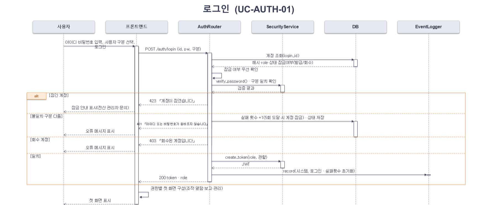

### 산불 상황 보고  (UC-REPORT-01) (36쪽)

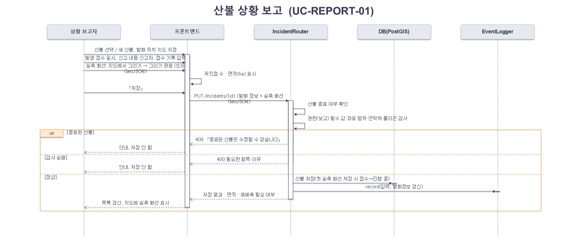

### 발화 종료 처리  (UC-SIT-01) (37쪽)

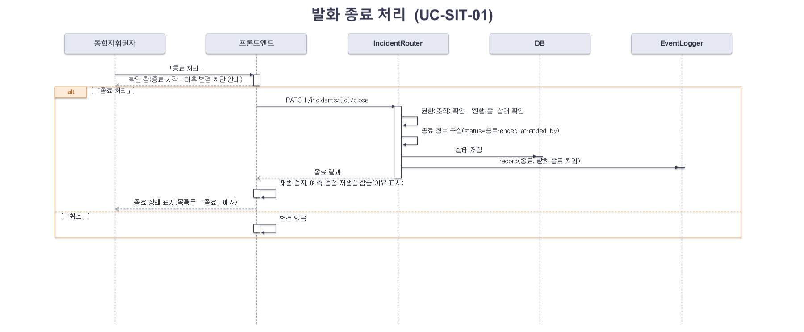

### 산불 발생·접수 정보 조회  (UC-SIT-02) (38쪽)

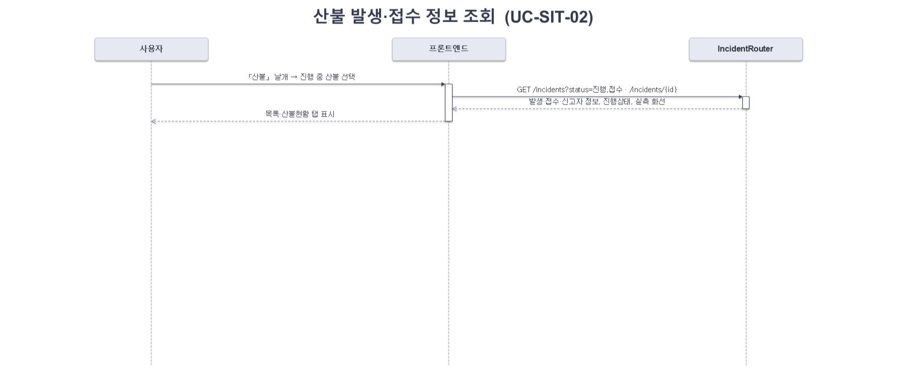

### 통합 상황도 조회  (UC-SIT-03) (39쪽)

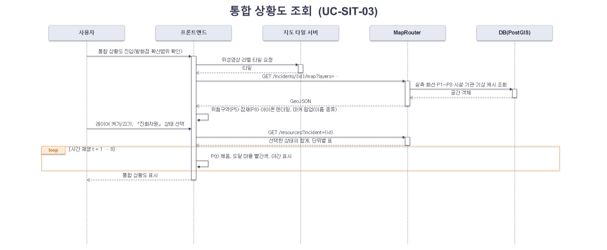

### 확산 예측 실행 · 갱신 ①  (UC-PRED-01) (40쪽)

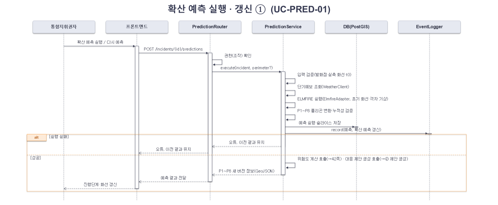

### 확산 예측 → 대응 제안(진화 · 대피) 생성 ②  (UC-PRED-01) (41쪽)

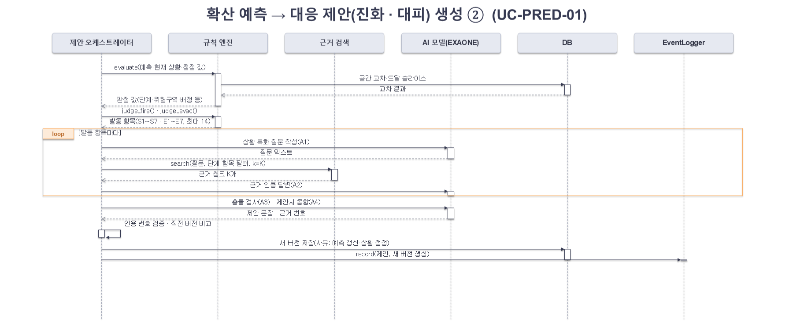

### 산불 위험도 확인  (UC-PRED-02) (42쪽)

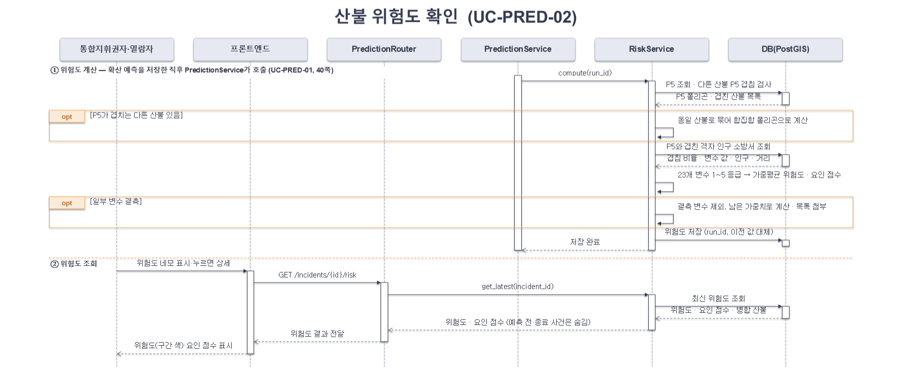

### 진화 제안 열람 · 근거 조회 · 이력·변경사항 조회  (UC-PROP-01) (43쪽)

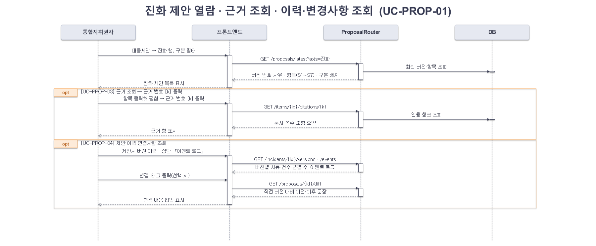

### 대피 제안 열람 · 근거 조회 · 이력·변경사항 조회  (UC-PROP-02) (44쪽)

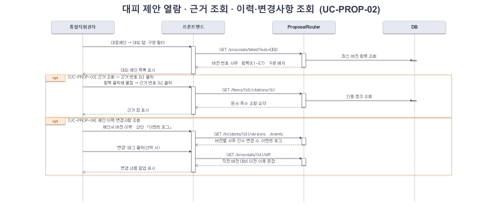

### AI 질의응답  (UC-QA-01) (45쪽)

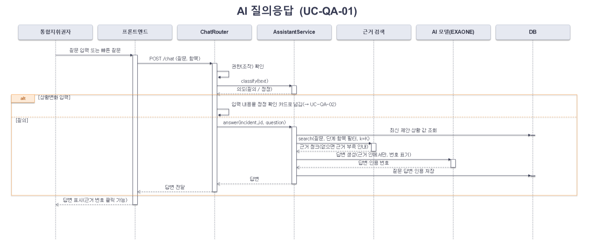

### AI 상황 정정 요청  (UC-QA-02) (46쪽)

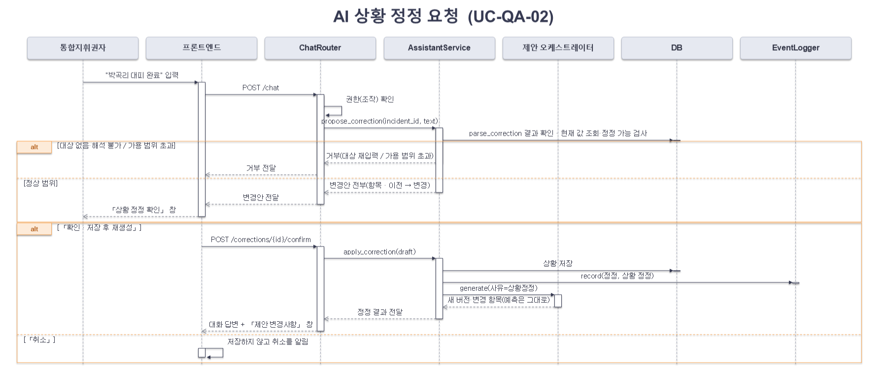

### 계정·권한 관리  (UC-ADMIN-01) (47쪽)

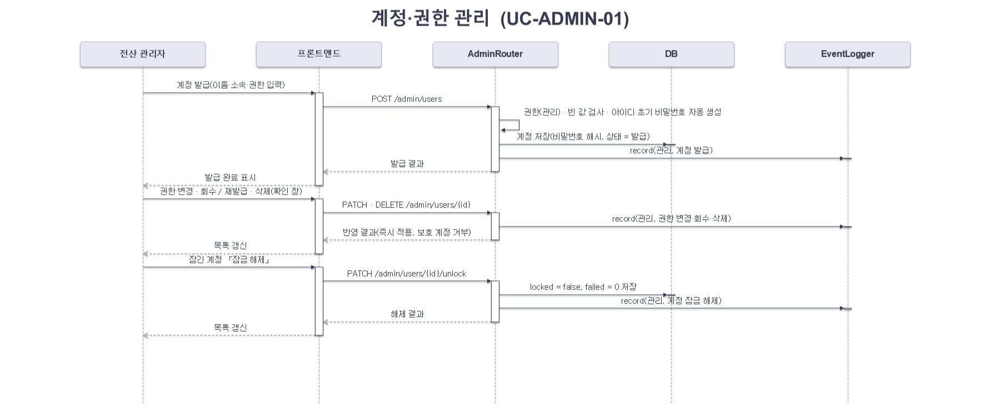

### 진화자원 데이터 관리  (UC-ADMIN-02) (48쪽)

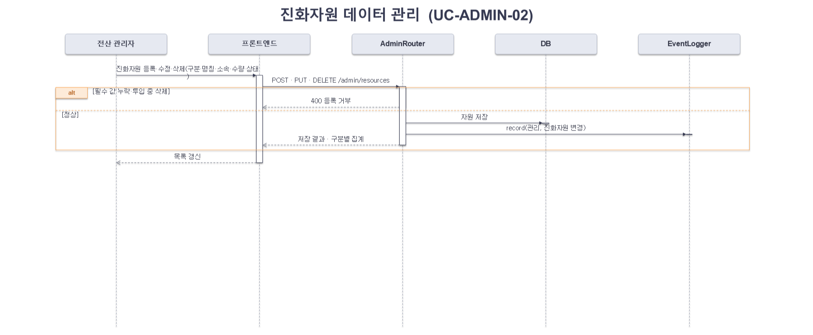

## 05. 클래스 다이어그램

### 1. 속성 정의 – 도메인 엔티티 (설계) (50쪽)

**User 클래스  사용자(계정)**

| 속성명 | 가시성 | 자료형 | 크기 | NULLABLE | 기본값 | 설명 |
|---|---|---|---|---|---|---|
| id | Public | int | - | NOT NULL | auto | 사용자 고유 식별자 (PK) |
| login_id | Public | str | 50 | NOT NULL | N/A | 로그인 아이디 (UNIQUE, 예: cmd01) |
| password_hash | Private | str | 255 | NOT NULL | N/A | bcrypt 해시 비밀번호 |
| name | Public | str | 50 | NOT NULL | N/A | 이름 (소속·직무 포함, 예: 열람자 1(유관기관)) |
| role | Public | RoleEnum | - | NOT NULL | VIEWER | 권한 (COMMANDER 조작 · VIEWER 열람 · REPORTER 보고 · ADMIN 관리) |
| sigungu_code | Public | str | 5 | NOT NULL | N/A | 관할 시·군·구 코드 |
| status | Public | AccountEnum | - | NOT NULL | 발급 | 계정 상태 (발급 / 회수, 회수 시 로그인 차단) |
| failed_count | Private | int | - | NOT NULL | 0 | 연속 로그인 실패 횟수 (5회 잠금) |
| locked | Public | bool | - | NOT NULL | False | 계정 잠금 여부 (5회 연속 실패 시 true, 관리자 해제 시 false) |
| issued_at | Public | date | - | NOT NULL | today() | 발급일 |

### 1. 속성 정의 – 도메인 엔티티 (설계) (51쪽)

**Incident 클래스  산불 사건(발화·접수·진행상태)**

| 속성명 | 가시성 | 자료형 | 크기 | NULLABLE | 기본값 | 설명 |
|---|---|---|---|---|---|---|
| id | Public | str | 20 | NOT NULL | N/A | 사건 식별자 (PK, 예: F-2025-0322-01) |
| name | Public | str | 100 | NOT NULL | N/A | 산불명 (예: 의성 안평면 산불) |
| addr | Public | str | 200 | NOT NULL | N/A | 발생 장소(주소) |
| ignition_geom | Public | Point | - | NOT NULL | N/A | 발화 위치 (EPSG:4326) |
| started_at | Public | datetime | - | NULLABLE | N/A | 발생 일시 (접수 단계에서는 NULL 가능) |
| reported_at | Public | datetime | - | NOT NULL | N/A | 신고 접수 일시 |
| report_text | Public | str | 300 | NULLABLE | N/A | 신고 내용 |
| reporter_info | Public | JSON | - | NULLABLE | N/A | 신고자 정보 (신고 기관명·성명·연락처, 규정 제6조제1항제1호, 모르면 미확인) |
| reported_by | Public | int | - | NOT NULL | N/A | 입력한 상황 보고자 (FK → users.id) |
| official_stage | Public | StageEnum | - | NOT NULL | 초기대응 | 공식 대응단계 (초기대응·확산대응1·확산대응2) |
| alert_level | Public | str | 10 | NOT NULL | 관심 | 위기경보 수준 (관심·주의·경계·심각) |
| status | Public | StatusEnum | - | NOT NULL | 접수 | 진행상태 (접수 / 진행 중 / 종료, 실측 화선이 처음 저장되면 접수 → 진행 중) |
| expected_hours | Public | float | - | NULLABLE | N/A | 예상 진화시간 (h, 상황 정정으로 입력) |
| ended_at | Public | datetime | - | NULLABLE | N/A | 종료(진화 완료) 일시 |
| ended_by | Public | int | - | NULLABLE | N/A | 종료 처리한 통합지휘권자 (FK → users.id) |

**FirePerimeter 클래스  실측 화선(관측 폴리곤)**

| 속성명 | 가시성 | 자료형 | 크기 | NULLABLE | 기본값 | 설명 |
|---|---|---|---|---|---|---|
| id | Public | int | - | NOT NULL | auto | 화선 식별자 (PK) |
| incident_id | Public | str | 20 | NOT NULL | N/A | 사건 ID (FK → incidents.id) |
| observed_at | Public | datetime | - | NOT NULL | N/A | 입력(관측) 시각 |
| version_no | Public | int | - | NOT NULL | 1 | 화선 버전 (사건별 1, 2, 3 …, 처음 받은 보고가 v1) |
| status | Public | PerimStatusEnum | - | NOT NULL | 유효 | 상태 (유효 / 정정됨, 정정 시 이전 버전은 '정정됨'으로 보존) |
| geom | Public | Polygon | - | NOT NULL | N/A | 실측 연소 범위 (EPSG:5179) |
| area_ha | Public | float | - | NOT NULL | N/A | 면적 (ha) |
| source | Public | str | 20 | NOT NULL | N/A | 입력 방식 (지도 그리기 / GeoJSON) |
| reported_by | Public | int | - | NOT NULL | N/A | 입력자 (FK → users.id) |

### 1. 속성 정의 – 도메인 엔티티 (설계) (52쪽)

IntakeRecord 클래스  기관별 접수 기록(상황 보고자가 산불 상황 보고 때 입력)

| 속성명 | 가시성 | 자료형 | 크기 | NULLABLE | 기본값 | 설명 |
|---|---|---|---|---|---|---|
| id | Public | int | - | NOT NULL | auto | 접수 기록 식별자 (PK) |
| incident_id | Public | str | 20 | NOT NULL | N/A | 사건 ID (FK → incidents.id) |
| org_name | Public | str | 100 | NOT NULL | N/A | 접수 기관명 |
| received_at | Public | datetime | - | NOT NULL | N/A | 접수 시각 |
| channel | Public | str | 30 | NULLABLE | N/A | 접수 경로 (119, 산림청 신고 등) |

**WeatherSnapshot 클래스  기상 수집값(캐시)**

| 속성명 | 가시성 | 자료형 | 크기 | NULLABLE | 기본값 | 설명 |
|---|---|---|---|---|---|---|
| id | Public | int | - | NOT NULL | auto | 기상 기록 식별자 (PK) |
| incident_id | Public | str | 20 | NOT NULL | N/A | 사건 ID (FK → incidents.id) |
| valid_at | Public | datetime | - | NOT NULL | N/A | 예보·관측 기준 시각 |
| wind_speed | Public | float | - | NOT NULL | N/A | 풍속 (m/s) |
| wind_dir | Public | int | - | NOT NULL | N/A | 풍향 (°, 불어오는 방향) |
| humidity | Public | int | - | NULLABLE | N/A | 상대습도 (%) |
| visibility | Public | int | - | NULLABLE | N/A | 시정 (m) |

### 1. 속성 정의 – 도메인 엔티티 (설계) (53쪽)

**RiskAssessment 클래스  산불 위험도**

| 속성명 | 가시성 | 자료형 | 크기 | NULLABLE | 기본값 | 설명 |
|---|---|---|---|---|---|---|
| id | Public | int | - | NOT NULL | auto | 위험도 식별자 (PK) |
| incident_id | Public | str | 20 | NOT NULL | N/A | 사건 ID (FK → incidents.id) |
| run_id | Public | int | - | NOT NULL | N/A | 계산에 쓴 확산 예측 (FK → prediction_runs.id, 예측 1회마다 1개) |
| score | Public | float | - | NOT NULL | N/A | 위험도 1.00\~5.00 = Σ(가중치 × 변수 등급) ÷ Σ가중치 (P5 범위 23개 변수, 소수 둘째 자리) |
| merged_ids | Public | JSON | - | NULLABLE | N/A | P5가 겹쳐 합집합으로 함께 계산한 산불 ID 목록 (없으면 NULL) |
| weather_score | Public | float | - | NOT NULL | N/A | 기상 요인 점수 1\~5 (가중치 0.372) |
| terrain_score | Public | float | - | NOT NULL | N/A | 지형 요인 점수 1\~5 (가중치 0.287, 경사도_down 제외) |
| fuel_score | Public | float | - | NOT NULL | N/A | 연료 요인 점수 1\~5 (가중치 0.266) |
| infra_score | Public | float | - | NOT NULL | N/A | 인프라 요인 점수 1\~5 (가중치 0.074, 취약계층 수·소방서 거리) |
| missing_vars | Public | JSON | - | NULLABLE | N/A | 결측 변수 목록 (남은 가중치로 나눠 계산) |
| computed_at | Public | datetime | - | NOT NULL | now() | 계산 일시 |

**Resource 클래스  진화자원(평시 진화자원 데이터 + 투입 상태)**

| 속성명 | 가시성 | 자료형 | 크기 | NULLABLE | 기본값 | 설명 |
|---|---|---|---|---|---|---|
| id | Public | int | - | NOT NULL | auto | 자원 식별자 (PK) |
| kind | Public | KindEnum | - | NOT NULL | N/A | 구분 (헬기 / 차량 / 인력) |
| name | Public | str | 50 | NOT NULL | N/A | 명칭·호출부호 (예: KFS-H01, 산불전문진화대 1조) |
| org | Public | str | 50 | NOT NULL | N/A | 소속 (산림항공본부·의성군·소방서 등) |
| qty | Public | int | - | NOT NULL | 1 | 수량 (인력은 명, 헬기·차량은 1) |
| status | Public | ResStatusEnum | - | NOT NULL | 대기 | 상태 (투입 / 대기 / 정비) |
| incident_id | Public | str | 20 | NULLABLE | N/A | 투입된 산불 (FK → incidents.id, 미투입 NULL) |
| position | Public | Point | - | NULLABLE | N/A | 진화조 위치 (인력 투입 시) |
| updated_at | Public | datetime | - | NOT NULL | now() | 최근 변경 시각 |

### 1. 속성 정의 – 도메인 엔티티 (설계) (54쪽)

**Village 클래스  마을(행정리) — 정적 레이어**

| 속성명 | 가시성 | 자료형 | 크기 | NULLABLE | 기본값 | 설명 |
|---|---|---|---|---|---|---|
| id | Public | str | 20 | NOT NULL | N/A | 마을 식별자 (PK) |
| name | Public | str | 50 | NOT NULL | N/A | 마을 이름 |
| emd_code | Public | str | 10 | NOT NULL | N/A | 읍·면·동 코드 |
| geom | Public | Geometry | - | NOT NULL | N/A | 마을 경계(면) 또는 중심점 |
| population | Public | int | - | NOT NULL | 0 | 인구 |
| households | Public | int | - | NOT NULL | 0 | 가구 수 |
| elderly | Public | int | - | NOT NULL | 0 | 고령자 수 (안전취약계층) |
| disabled | Public | int | - | NOT NULL | 0 | 장애인 수 (안전취약계층) |

**Facility 클래스  주요 시설 — 정적 레이어**

| 속성명 | 가시성 | 자료형 | 크기 | NULLABLE | 기본값 | 설명 |
|---|---|---|---|---|---|---|
| id | Public | str | 20 | NOT NULL | N/A | 시설 식별자 (PK) |
| name | Public | str | 100 | NOT NULL | N/A | 시설명 |
| type | Public | FacilityEnum | - | NOT NULL | N/A | 대피소·취약시설·국가유산·담수지·송전시설·소방서·파출소 등 |
| grade | Public | int | - | NULLABLE | N/A | 보호 등급 1\~5 (표준매뉴얼 p.77 진화 우선순위) |
| capacity | Public | int | - | NULLABLE | N/A | 수용 인원 (대피소·취약시설) |
| emd_code | Public | str | 10 | NOT NULL | N/A | 읍·면·동 코드 |
| geom | Public | Geometry | - | NOT NULL | N/A | 위치(점) 또는 선형(송전선) |

### 1. 속성 정의 – 도메인 엔티티 (설계) (55쪽)

**PredictionRun 클래스  확산 예측 실행**

| 속성명 | 가시성 | 자료형 | 크기 | NULLABLE | 기본값 | 설명 |
|---|---|---|---|---|---|---|
| id | Public | int | - | NOT NULL | auto | 예측 실행 식별자 (PK) |
| incident_id | Public | str | 20 | NOT NULL | N/A | 사건 ID (FK → incidents.id) |
| t0 | Public | datetime | - | NOT NULL | N/A | 예측 기준 시각 |
| perimeter_id | Public | int | - | NULLABLE | N/A | 초기 연소 범위 (FK → fire_perimeters.id, NULL이면 발화점) |
| wind_speed | Public | float | - | NOT NULL | N/A | 입력 풍속 (m/s, 기상청 예보) |
| wind_dir | Public | int | - | NOT NULL | N/A | 입력 풍향 (°) |
| status | Public | RunStatusEnum | - | NOT NULL | RUNNING | 실행 상태 (RUNNING·DONE·FAILED) |
| requested_by | Public | int | - | NOT NULL | N/A | 실행한 통합지휘권자 (FK → users.id) |

**SpreadSlice 클래스  시간별 확산 범위**

| 속성명 | 가시성 | 자료형 | 크기 | NULLABLE | 기본값 | 설명 |
|---|---|---|---|---|---|---|
| id | Public | int | - | NOT NULL | auto | 슬라이스 식별자 (PK) |
| run_id | Public | int | - | NOT NULL | N/A | 예측 실행 ID (FK → prediction_runs.id) |
| t_hours | Public | int | - | NOT NULL | N/A | 경과 시간 1\~8 (P1\~P8) |
| geom | Public | Polygon | - | NOT NULL | N/A | 누적 확산 범위 (EPSG:5179) |
| area_ha | Public | float | - | NOT NULL | N/A | 면적 (ha) |

### 1. 속성 정의 – 도메인 엔티티 (설계) (56쪽)

**SituationCorrection 클래스  상황 정정 기록**

| 속성명 | 가시성 | 자료형 | 크기 | NULLABLE | 기본값 | 설명 |
|---|---|---|---|---|---|---|
| id | Public | int | - | NOT NULL | auto | 정정 식별자 (PK) |
| incident_id | Public | str | 20 | NOT NULL | N/A | 사건 ID (FK → incidents.id) |
| user_id | Public | int | - | NOT NULL | N/A | 정정한 통합지휘권자 (FK → users.id) |
| message_id | Public | int | - | NOT NULL | N/A | 정정 요청 발화 (FK → chat_messages.id) |
| target_type | Public | TargetEnum | - | NOT NULL | N/A | VILLAGE(대피 완료·부상/고립) · RESOURCE(투입 수) · INCIDENT(예상 진화시간·단계·경보) · ORDER(대피명령·재난문자) |
| target_id | Public | str | 20 | NULLABLE | N/A | 대상 식별자 (마을·자원 구분 등) |
| item | Public | str | 30 | NOT NULL | N/A | 정정 항목명 (예: 대피 상태) |
| before_value | Public | str | 30 | NULLABLE | N/A | 이전 값 |
| after_value | Public | str | 30 | NOT NULL | N/A | 변경 값 |
| confirmed_at | Public | datetime | - | NOT NULL | now() | 「확인 · 저장 후 재생성」 시각 |

**Proposal 클래스  대응 제안서(버전)**

| 속성명 | 가시성 | 자료형 | 크기 | NULLABLE | 기본값 | 설명 |
|---|---|---|---|---|---|---|
| id | Public | int | - | NOT NULL | auto | 제안서 식별자 (PK) |
| incident_id | Public | str | 20 | NOT NULL | N/A | 사건 ID (FK → incidents.id) |
| run_id | Public | int | - | NOT NULL | N/A | 근거 예측 (FK → prediction_runs.id) |
| version_no | Public | str | 10 | NOT NULL | N/A | 버전 (v화선 버전.대응 생성 순번, 예: v1.1 → 정정 v1.2 → 새 화선 재예측 v2.1) |
| reason | Public | ReasonEnum | - | NOT NULL | N/A | 생성 사유 (예측 갱신 / 상황 정정) |
| correction_id | Public | int | - | NULLABLE | N/A | 상황 정정 버전이면 정정 기록 (FK → situation_corrections.id) |
| official_stage | Public | StageEnum | - | NOT NULL | N/A | 생성 시점 공식 대응단계 |
| rec_stage | Public | StageEnum | - | NOT NULL | N/A | 규칙 판정 대응단계 |
| stage_up | Public | bool | - | NOT NULL | False | 격상 검토 권고 여부 |
| created_at | Public | datetime | - | NOT NULL | now() | 생성 일시 |

### 1. 속성 정의 – 도메인 엔티티 (설계) (57쪽)

ProposalItem 클래스  제안 항목(진화 S1\~S7 · 대피 E1\~E7)

| 속성명 | 가시성 | 자료형 | 크기 | NULLABLE | 기본값 | 설명 |
|---|---|---|---|---|---|---|
| id | Public | int | - | NOT NULL | auto | 항목 식별자 (PK) |
| proposal_id | Public | int | - | NOT NULL | N/A | 제안서 ID (FK → proposals.id) |
| item_code | Public | str | 3 | NOT NULL | N/A | 항목 코드 (S1\~S7, E1\~E7) |
| axis | Public | AxisEnum | - | NOT NULL | N/A | 대분류 (진화 / 대피) |
| categories | Public | JSON | - | NOT NULL | N/A | 구분 (즉시·대기·협의·요청) |
| finding | Public | str | 500 | NOT NULL | N/A | 판정 값 (규칙 엔진 결과) |
| text | Public | str | 1000 | NOT NULL | N/A | 제안 문장 (문장 끝 근거 번호 [k] 포함) |
| targets | Public | JSON | - | NULLABLE | N/A | 대상 (마을·시설·경로) |
| conflicts | Public | JSON | - | NULLABLE | N/A | 충돌 내용과 해소 방법 (내부 검증용, 화면에 표시하지 않음) |
| authority | Public | str | 20 | NOT NULL | N/A | 권한 (직접·협의·요청) |
| changed | Public | bool | - | NOT NULL | False | 직전 버전 대비 변경 여부 |

**EvidenceChunk 클래스  근거 청크(표준매뉴얼·법령)**

| 속성명 | 가시성 | 자료형 | 크기 | NULLABLE | 기본값 | 설명 |
|---|---|---|---|---|---|---|
| chunk_id | Public | str | 30 | NOT NULL | N/A | 청크 식별자 (PK, 예: SM-p073-t01-r02) |
| doc_name | Public | str | 100 | NOT NULL | N/A | 문서명 |
| page | Public | str | 10 | NULLABLE | N/A | 쪽수 |
| section | Public | str | 100 | NULLABLE | N/A | 절·조항 |
| tags | Public | JSON | - | NULLABLE | N/A | 연결 항목 (S1\~E7) |
| stage | Public | JSON | - | NULLABLE | N/A | 적용 대응단계 |
| text | Public | text | - | NOT NULL | N/A | 청크 본문 (약 400자) |

### 1. 속성 정의 – 도메인 엔티티 (설계) (58쪽)

**Citation 클래스  근거 인용**

| 속성명 | 가시성 | 자료형 | 크기 | NULLABLE | 기본값 | 설명 |
|---|---|---|---|---|---|---|
| id | Public | int | - | NOT NULL | auto | 인용 식별자 (PK) |
| item_id | Public | int | - | NULLABLE | N/A | 제안 항목 (FK → proposal_items.id) |
| message_id | Public | int | - | NULLABLE | N/A | AI 답변 (FK → chat_messages.id) |
| k | Public | int | - | NOT NULL | N/A | 문장 속 근거 번호 |
| chunk_id | Public | str | 30 | NOT NULL | N/A | 근거 청크 (FK → evidence_chunks.chunk_id) |
| score | Public | float | - | NULLABLE | N/A | 검색 유사도 |

**ChatMessage 클래스  AI 어시스턴트 메시지(질의·정정)**

| 속성명 | 가시성 | 자료형 | 크기 | NULLABLE | 기본값 | 설명 |
|---|---|---|---|---|---|---|
| id | Public | int | - | NOT NULL | auto | 메시지 식별자 (PK) |
| incident_id | Public | str | 20 | NOT NULL | N/A | 사건 ID (FK → incidents.id) |
| user_id | Public | int | - | NOT NULL | N/A | 질문자 (FK → users.id) |
| proposal_id | Public | int | - | NULLABLE | N/A | 질문 시점 제안서 (FK → proposals.id) |
| item_code | Public | str | 3 | NULLABLE | N/A | 대화 맥락 항목 (S1\~E7) |
| sender | Public | SenderEnum | - | NOT NULL | N/A | 발신자 (USER / AI) |
| intent | Public | IntentEnum | - | NOT NULL | QA | 의도 (QA 질의 / CORRECTION 상황 정정) |
| content | Public | text | - | NOT NULL | N/A | 질문·답변 내용 |
| created_at | Public | datetime | - | NOT NULL | now() | 작성 일시 |

### 1. 속성 정의 – 도메인 엔티티 (설계) (59쪽)

EventLog 클래스  이벤트 로그(추가 전용, 상단 「이벤트 로그」 창에서 열람)

| 속성명 | 가시성 | 자료형 | 크기 | NULLABLE | 기본값 | 설명 |
|---|---|---|---|---|---|---|
| id | Public | int | - | NOT NULL | auto | 로그 식별자 (PK) |
| incident_id | Public | str | 20 | NULLABLE | N/A | 관련 사건 (FK → incidents.id, 로그인·관리 이벤트는 NULL) |
| user_id | Public | int | - | NULLABLE | N/A | 행위자 (FK → users.id) |
| category | Public | EventEnum | - | NOT NULL | N/A | 구분 (시스템·입력·예측·제안·정정·종료·관리·근거 부족) |
| content | Public | str | 300 | NOT NULL | N/A | 내용 (예: 대응 제안 v1.2 생성(상황 정정) · 변경 1건) |
| created_at | Public | datetime | - | NOT NULL | now() | 발생 시각 |

### 2. 오퍼레이션 정의 – 논리 컴포넌트 (설계) (60쪽)

**AuthRouter 클래스  &lt;Router&gt;**

| 오퍼레이션명 | 가시성 | 파라미터 | 반환타입 | 설명 |
|---|---|---|---|---|
| login | Public | login_id, password, role | Token | 계정 검증 후 JWT 발급 (권한 클레임 포함) |
| logout | Public | token | void | 세션 토큰 폐기 |
| me | Public | token | User | 현재 사용자·권한 조회 |

**SecurityService 클래스  &lt;Service&gt;**

| 오퍼레이션명 | 가시성 | 파라미터 | 반환타입 | 설명 |
|---|---|---|---|---|
| verify_password | Public | plain, hashed | bool | bcrypt 해시 비교 |
| create_token | Public | user | str | JWT 생성 (role, sigungu_code, 만료 30분) |
| require_role | Public | user, roles | void | 권한 검사, 불일치 시 403 (모든 Router가 호출) |

**AdminRouter 클래스  &lt;Router&gt;**

| 오퍼레이션명 | 가시성 | 파라미터 | 반환타입 | 설명 |
|---|---|---|---|---|
| list_users | Public | - | list\~User\~ | 계정 표와 발급·회수·권한별 집계 |
| issue_user | Public | name, role | User | 계정 발급 (이름·소속·권한 입력, 아이디·초기 비밀번호는 시스템 생성) |
| set_role | Public | user_id, role | User | 권한 변경 (확인 후 즉시 반영, 마지막 통합지휘권자 보호) |
| revoke_user | Public | user_id, revoke | User | 회수 / 재발급 |
| unlock_user | Public | user_id | User | 계정 잠금 해제 (locked=false, failed_count=0) |
| delete_user | Public | user_id | void | 계정 삭제 (확인 후, 자기 계정·마지막 통합지휘권자 거부) |
| save_resource | Public | resource | Resource | 진화자원 등록·수정 (명칭 필수) |
| delete_resource | Public | resource_id | void | 진화자원 삭제 (투입 중 자원 거부) |

**IncidentRouter 클래스  &lt;Router&gt;**

| 오퍼레이션명 | 가시성 | 파라미터 | 반환타입 | 설명 |
|---|---|---|---|---|
| list_incidents | Public | status | list\~Incident\~ | 진행 중·접수 산불 목록 (종료 포함 선택) |
| get_incident | Public | incident_id | Incident | 발생·접수 정보·진행상태·실측 화선 |
| save_incident | Public | incident, geojson? | Incident | 발화 정보·신고자 정보·실측 화선 저장 (상황 보고자) |
| close_incident | Public | incident_id | Incident | 발화 종료 처리 (통합지휘권자) |

### 2. 오퍼레이션 정의 – 논리 컴포넌트 (설계) (61쪽)

**MapRouter 클래스  &lt;Router&gt;**

| 오퍼레이션명 | 가시성 | 파라미터 | 반환타입 | 설명 |
|---|---|---|---|---|
| get_layers | Public | incident_id, layers | GeoJSON | 실측 화선·P1\~P8·마을·시설·기관 레이어 |
| get_resources | Public | incident_id, statuses | ResourceSummary | 선택한 상태(대기·투입·정비)의 합계, 단위별 표 |

**PredictionRouter 클래스  &lt;Router&gt;**

| 오퍼레이션명 | 가시성 | 파라미터 | 반환타입 | 설명 |
|---|---|---|---|---|
| run | Public | incident_id | PredictionRun | 확산 예측 실행 → 제안 생성 (PredictionService에 위임) |
| get_slices | Public | run_id | list\~SpreadSlice\~ | P1\~P8 확산 범위 GeoJSON (시간 재생) |
| get_risk | Public | incident_id | RiskAssessment | 산불 위험도 조회 (RiskService.get_latest에 위임) |

**RiskService 클래스  &lt;Service&gt;**

| 오퍼레이션명 | 가시성 | 파라미터 | 반환타입 | 설명 |
|---|---|---|---|---|
| compute | Public | run_id | RiskAssessment | P5 폴리곤(겹치면 합집합)으로 23개 변수 가중평균 → 위험도 1.00\~5.00·요인 점수 저장 |
| get_latest | Public | incident_id | RiskAssessment | 산불의 최신 예측 위험도 조회 (예측 전·종료 사건은 표시하지 않음) |

**PredictionService 클래스  &lt;Service&gt;**

| 오퍼레이션명 | 가시성 | 파라미터 | 반환타입 | 설명 |
|---|---|---|---|---|
| execute | Public | incident, perimeter? | PredictionRun | 기상 조회 → ELMFIRE 실행 → P1\~P8 변환·저장 → RiskService.compute() → generate() 호출 |

**ElmfireAdapter 클래스  &lt;External System&gt;**

| 오퍼레이션명 | 가시성 | 파라미터 | 반환타입 | 설명 |
|---|---|---|---|---|
| prepare | Public | ignition \| perimeter, weather, grid | InputDeck | 초기 연소 범위·30 m 격자·기상 입력 구성 |
| execute | Public | input_deck | Raster | Docker로 ELMFIRE 실행 → 도달 시각(TOA) 래스터 |
| to_slices | Public | raster, t0 | list\~Polygon\~ | 1시간 간격 누적 폴리곤 변환·누적성 검증 |

**WeatherClient 클래스  &lt;External System&gt;**

| 오퍼레이션명 | 가시성 | 파라미터 | 반환타입 | 설명 |
|---|---|---|---|---|
| get_forecast | Public | lat, lng, t0 | WeatherSnapshot | 기상청 단기예보 조회·캐시 |

### 2. 오퍼레이션 정의 – 논리 컴포넌트 (설계) (62쪽)

**ProposalOrchestrator 클래스  &lt;Service&gt;**

| 오퍼레이션명 | 가시성 | 파라미터 | 반환타입 | 설명 |
|---|---|---|---|---|
| generate | Public | run_id, reason, correction_id? | Proposal | 규칙 판정 → AI 진화·대피 판단·문장 생성(근거 인용) → 새 버전 저장(사유 2종: 예측 갱신·상황 정정) |
| diff | Public | prev_id, cur_id | list\~ItemDiff\~ | 직전 버전 대비 바뀐 항목 |

**RuleEngine 클래스  &lt;Service&gt;**

| 오퍼레이션명 | 가시성 | 파라미터 | 반환타입 | 설명 |
|---|---|---|---|---|
| evaluate | Public | run, incident, corrections | RuleResult | 근거 문서에 경계값·수치가 있는 값만 판정: 대응단계·위험구역(P5/P8)·대피소 배정·도달 시각·면적 (정정 값 반영) |
| judge_fire | Public | rules | list\~ItemDraft\~ | 진화 7항목 발동·판정 (S1\~S7) |
| judge_evac | Public | rules | list\~ItemDraft\~ | 대피 7항목 발동·판정 (E1\~E7) |

**Retriever 클래스  &lt;Service&gt;**

| 오퍼레이션명 | 가시성 | 파라미터 | 반환타입 | 설명 |
|---|---|---|---|---|
| search | Public | query, filters, k | list\~EvidenceChunk\~ | KURE-v1 임베딩 + FAISS 검색, 단계·항목 필터, 상위 K개(K = 3·5·7·10 비교로 선택) |

**LLMClient 클래스  &lt;External System&gt;**

| 오퍼레이션명 | 가시성 | 파라미터 | 반환타입 | 설명 |
|---|---|---|---|---|
| write_questions | Public | item, rules | list\~str\~ | 항목별 상황 특화 질문 작성 (A1) |
| answer | Public | question, chunks | Answer | 근거 청크만 인용한 답변 (A2) |
| check_conflicts | Public | answers | list\~Conflict\~ | 항목 간 충돌 검사 (A3) |
| synthesize | Public | answers, rules | ProposalDraft | 제안 문장 종합 (A4), temperature 0 |
| parse_correction | Public | text | CorrectionDraft | 상황 변화 문장 → 대상·새 값 (JSON 스키마) |

### 2. 오퍼레이션 정의 – 논리 컴포넌트 (설계) (63쪽)

**ProposalRouter 클래스  &lt;Router&gt;**

| 오퍼레이션명 | 가시성 | 파라미터 | 반환타입 | 설명 |
|---|---|---|---|---|
| get_latest | Public | incident_id, axis, category | Proposal | 최신 버전 진화/대피·구분별 조회 |
| get_citation | Public | item_id, k | EvidenceChunk | 근거 번호의 청크 조회 |
| list_versions | Public | incident_id | list\~Proposal\~ | 버전 생성 이력 (사유·건수·변경 수) |
| get_diff | Public | proposal_id | list\~ItemDiff\~ | 직전 버전 대비 이전·이후 문장 |
| list_events | Public | incident_id | list\~EventLog\~ | 이벤트 로그 (상단 「이벤트 로그」 창, 읽기 전용) |

**ChatRouter 클래스  &lt;Router&gt;**

| 오퍼레이션명 | 가시성 | 파라미터 | 반환타입 | 설명 |
|---|---|---|---|---|
| ask | Public | incident_id, text, item_code? | ChatMessage | 질문·상황 변화 입력 (AssistantService에 위임) |
| quick_questions | Public | incident_id | list\~str\~ | 빠른 질문 6개 |
| confirm_correction | Public | draft_id | Proposal | 「확인 · 저장 후 재생성」 |

**AssistantService 클래스  &lt;Service&gt;**

| 오퍼레이션명 | 가시성 | 파라미터 | 반환타입 | 설명 |
|---|---|---|---|---|
| classify | Public | text | IntentEnum | 질의(QA) / 상황 정정(CORRECTION) 구분 |
| answer | Public | incident_id, question, item_code? | ChatMessage | 상황·제안 값 + 근거 검색 → 답변·인용 검증 → 저장 |
| propose_correction | Public | incident_id, text | CorrectionDraft | 정정 대상·현재 값·새 값 확인 카드 생성 |
| apply_correction | Public | draft | Proposal | 정정 저장 → generate(reason = 상황 정정) |

**EventLogger 클래스  &lt;Service&gt;**

| 오퍼레이션명 | 가시성 | 파라미터 | 반환타입 | 설명 |
|---|---|---|---|---|
| record | Public | event_type, user?, incident?, detail | void | 이벤트 로그 추가 (수정·삭제 없음) |

### 3. 관계 정보 – 도메인 엔티티 (64쪽)

| 이름 | 유형 | 관련 클래스 | 다중성 | 비율 |
|---|---|---|---|---|
| Incident | 합성 (Composition) | IntakeRecord · WeatherSnapshot · RiskAssessment | Incident(1) — 각 기록(N) | 1:N |
| Incident | 합성 (Composition) | FirePerimeter | Incident(1) — FirePerimeter(N) (관측 시각별) | 1:N |
| Incident | 합성 (Composition) | PredictionRun · Proposal | Incident(1) — PredictionRun(N), Proposal(N) | 1:N |
| Incident | 합성 (Composition) | SituationCorrection · ChatMessage | Incident(1) — SituationCorrection(N), ChatMessage(N) | 1:N |
| Incident | 연관 (Association) | Resource | Incident(0..1) — Resource(N) (투입된 자원) | 1:N |
| FirePerimeter | 연관 (Association) | PredictionRun | FirePerimeter(0..1) — PredictionRun(N) (초기 연소 범위) | 1:N |
| PredictionRun | 합성 (Composition) | SpreadSlice | PredictionRun(1) — SpreadSlice(8) | 1:8 |
| PredictionRun | 연관 (Association) | Proposal | PredictionRun(1) — Proposal(N) (예측 갱신 버전 + 정정 버전) | 1:N |
| PredictionRun | 연관 (Association) | RiskAssessment | PredictionRun(1) — RiskAssessment(0..1) (예측마다 P5 위험도 1개) | 1:1 |
| SituationCorrection | 연관 (Association) | Proposal | SituationCorrection(1) — Proposal(0..1) | 1:1 |
| Proposal | 합성 (Composition) | ProposalItem | Proposal(1) — ProposalItem(≤14) | 1:N |
| ProposalItem · ChatMessage | 합성 (Composition) | Citation | ProposalItem(1)·ChatMessage(1) — Citation(N) | 1:N |
| EvidenceChunk | 연관 (Association) | Citation | EvidenceChunk(1) — Citation(N) | 1:N |
| User | 연관 (Association) | EventLog · ChatMessage · PredictionRun 등 | User(1) — 각 기록(N) (행위자) | 1:N |
| Village, Facility | 연관 (Association) | SpreadSlice · FirePerimeter | 공간 교차(ST_Intersects)로만 연결 | N:M |

### 3. 관계 정보 – 논리 컴포넌트 (65쪽)

| 이름 | 유형 | 관련 클래스 | 설명 |
|---|---|---|---|
| AuthRouter | 의존 (Dependency) | SecurityService, User, EventLogger | login() → verify_password() · create_token(), 로그인 성공 시 이벤트 기록 |
| AdminRouter | 의존 (Dependency) | SecurityService, EventLogger, User, Resource | require_role(ADMIN) 후 계정·자원 저장, 변경 기록 |
| IncidentRouter | 의존 (Dependency) | EventLogger, Incident, FirePerimeter | 발화 정보·실측 화선 저장, 종료 처리 후 이벤트 기록 |
| MapRouter | 의존 (Dependency) | Village, Facility, Resource, FirePerimeter | 저장소 조회 전용 |
| ProposalRouter | 의존 (Dependency) | ProposalOrchestrator, Proposal, EventLog | 이력·이벤트 조회 (조회 전용) |
| PredictionRouter | 의존 (Dependency) | PredictionService, RiskService | run() · get_risk() 위임 |
| RiskService | 의존 (Dependency) | SpreadSlice, RiskAssessment | P5 폴리곤·예측 기상·격자·인구 레이어로 위험도 계산·저장 |
| PredictionService | 의존 (Dependency) | ElmfireAdapter, WeatherClient, RiskService, ProposalOrchestrator | 예측 저장 후 compute() · generate() 호출 |
| ProposalOrchestrator | 의존 (Dependency) | RuleEngine, Retriever, LLMClient, EventLogger | 판정 → 검색 → 생성 순서 제어, 새 버전 기록 |
| ChatRouter | 의존 (Dependency) | AssistantService | ask() · confirm_correction() 위임 |
| AssistantService | 의존 (Dependency) | Retriever, LLMClient, ProposalOrchestrator, EventLogger | 답변 생성 / 정정 저장 → 제안 재생성 |

### 4. 다이어그램 – 도메인 엔티티 (66쪽)

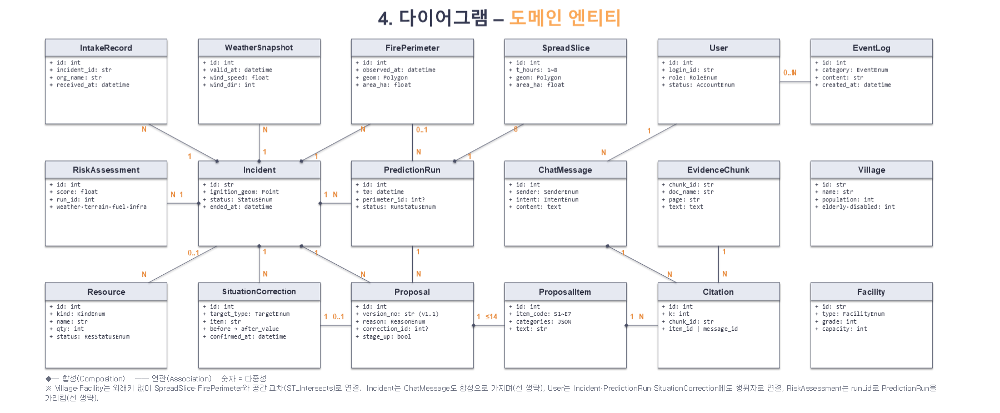

### 4. 다이어그램 – 논리 컴포넌트 (의존 관계) (67쪽)

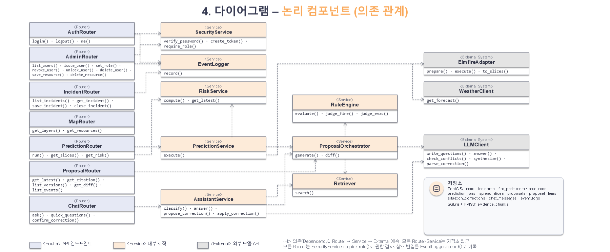

## 06. 관계형 데이터베이스

### 1. 관계 정의 (69쪽)

| 이름 | 유형 | 관련 테이블 | 다중성 | 설명 |
|---|---|---|---|---|
| incidents | 합성 | intake_records, weather_snapshots, risk_assessments, fire_perimeters | incidents(1) → \*(N) | 사건별 기록. 사건은 삭제하지 않고 종료(status = 종료) 처리 |
| incidents | 합성 | prediction_runs, proposals, situation_corrections, chat_messages | incidents(1) → \*(N) | 사건별 예측·제안·정정·대화 이력 보존 |
| fire_perimeters | 연관 | prediction_runs | perimeter_id → id (0..1 : N) | 예측의 초기 연소 범위. NULL이면 발화점에서 시작 |
| prediction_runs | 합성 | spread_slices | prediction_runs(1) → spread_slices(8) | UNIQUE(run_id, t_hours), 누적성 P(t) ⊇ P(t−1) |
| prediction_runs | 연관 | proposals | prediction_runs(1) → proposals(N) | 예측 갱신 버전 + 같은 예측의 상황 정정 버전. 제안 있는 예측은 삭제 제한(RESTRICT) |
| prediction_runs | 연관 | risk_assessments | prediction_runs(1) → risk_assessments(0..1) | 예측마다 P5 위험도 1개(UNIQUE run_id). 화면은 산불별 최신 값만 표시 |
| situation_corrections | 연관 | proposals | proposals.correction_id → id (0..1 : 1) | 상황 정정으로 생성된 버전은 정정 기록을 가리킴 |
| proposals | 합성 | proposal_items | proposals(1) → proposal_items(≤14) | UNIQUE(proposal_id, item_code). 제안서는 수정하지 않고 새 버전 추가 |
| proposal_items / chat_messages | 합성 | citations | item(1)·message(1) → citations(N) | item_id와 message_id 중 하나만 값을 가짐 (CHECK) |
| evidence_chunks | 연관 | citations | evidence_chunks(1) → citations(N) | 인용된 청크는 삭제 제한(RESTRICT). 색인 재구축 시 chunk_id 유지 |
| resources | 연관 | incidents | resources.incident_id → id (N : 0..1) | 평시 진화자원 데이터(전산 관리자 관리). 투입 중 자원은 삭제 제한 |
| users | 연관 | incidents, prediction_runs, chat_messages, situation_corrections, event_logs | users(1) → \*(N) | 입력자·종료자·실행자·질문자·정정자 기록. 회수(status=회수) 또는 잠금(locked=true) 시 로그인 차단 |
| event_logs | 연관 | incidents, users | incident_id·user_id NULL 허용 | 로그인·관리 이벤트는 사건 없이 기록. 추가만 하고 수정·삭제 없음, 상단 「이벤트 로그」 창에서 읽기 전용 조회 |
| villages, facilities | 공간 연관 | spread_slices, fire_perimeters | ST_Intersects(geom, slice.geom) | 외래키 없이 공간 교차로 도달 슬라이스 계산 (GiST 인덱스) |

### 2. 정적 모델링 – 예시 데이터 (의성 2025-03-22 시나리오) (70쪽)

**users**

| id | login_id | password_hash | name | role | sigungu_code | status | failed_count | locked | issued_at |
|---|---|---|---|---|---|---|---|---|---|
| 1 | cmd01 | (bcrypt 해시) | 통합지휘권자 1 | COMMANDER | 37520 | 발급 | 0 | False | 2025-03-02 |
| 2 | view01 | (bcrypt 해시) | 열람자 1(유관기관) | VIEWER | 37520 | 발급 | 0 | False | 2025-03-02 |
| 3 | view02 | (bcrypt 해시) | 열람자 2(상급 본부) | VIEWER | 37520 | 회수 | 0 | False | 2025-01-15 |
| 4 | rep01 | (bcrypt 해시) | 상황 보고자 1(현장) | REPORTER | 37520 | 발급 | 0 | False | 2025-03-02 |
| 5 | admin01 | (bcrypt 해시) | 전산 관리자 | ADMIN | 37520 | 발급 | 0 | False | 2025-01-02 |

**incidents**

| id | name | addr | ignition_geom | started_at | reported_at | report_text | reported_by | status | official_stage | alert_level | expected_hours | ended_at | ended_by |
|---|---|---|---|---|---|---|---|---|---|---|---|---|---|
| F-2025-0322-01 | 의성 안평면 산불 | 의성군 안평면 괴산리 산 12 | POINT(128.6023 36.3657) | 03-22 11:24 | 03-22 11:25 | 야산 연기·불길 목격 | 4 (rep01) | 진행 중 | 초기대응 | 주의 | 8 | NULL | NULL |
| F-2025-0322-02 | 의성 사곡면 산불(가상) | 의성군 사곡면(가상) | POINT(128.7520 36.3410) | NULL | 03-22 11:52 | 인근 연기 신고(가상) | 4 (rep01) | 접수 | 초기대응 | 주의 | NULL | NULL | NULL |
| F-2025-0321-01 | 의성 점곡면 산불(가상) | 의성군 점곡면(가상) | POINT(128.7250 36.4330) | 03-21 13:05 | 03-21 13:10 | 화재 신고(가상) | 4 (rep01) | 종료 | 초기대응 | 관심 | 6 | 2025-03-21 18:40 | 1 (cmd01) |

intake_records

**incidents.reporter_info (신고자 정보)**

| id | incident_id | org_name | received_at | channel |
|---|---|---|---|---|
| 1 | F-2025-0322-01 | 의성군(119 공동대응) | 11:25 | 119 신고 |
| 2 | F-2025-0322-01 | 경북도 산림재난상황실 | 11:31 | 상황 전파 |
| 3 | F-2025-0322-01 | 남부지방산림청 | 11:34 | 상황 전파 |
| 4 | F-2025-0322-01 | 산림청 중앙산림재난상황실 | 11:38 | 상황 전파 |

| incident_id | reporter_info (신고 기관명 · 성명 · 연락처) |
|---|---|
| F-2025-0322-01 | 의성군(가상) · ○○○ · 010-\*\*\*\*-\*\*\*\* |
| F-2025-0322-02 | 미확인 |
| F-2025-0321-01 | 미확인 |

> ※ 좌표·발생 시각·접수 경로·마을 좌표는 실제(보도·OSM·SGIS), 실측 화선·사곡면·점곡면 산불·계정·인구·자원·수용 인원·위험도 요인 점수는 목업과 같은 시연용 가상값입니다.

### 2. 정적 모델링 – 예시 데이터 (의성 2025-03-22 시나리오) (71쪽)

**fire_perimeters**

| id | incident_id | observed_at | version_no | status | area_ha | source | reported_by |
|---|---|---|---|---|---|---|---|
| 1 | F-2025-0322-01 | 2025-03-22 11:55 | 1 | 유효 | 12.7 | 지도 그리기 | 4 (rep01) |

**weather_snapshots**

| id | incident_id | valid_at | wind_speed | wind_dir | humidity | visibility |
|---|---|---|---|---|---|---|
| 1 | F-2025-0322-01 | 12:00 | 5.6 | 240 | 24 | 8000 |
| 2 | F-2025-0322-01 | 13:00 | 6.4 | 240 | 21 | 6000 |
| 3 | F-2025-0322-01 | 15:00 | 7.8 | 250 | 18 | 3000 |

**risk_assessments**

| id | incident_id | run_id | score | weather | terrain | fuel | infra | merged_ids |
|---|---|---|---|---|---|---|---|---|
| 1 | F-2025-0322-01 | 1 | 3.81 | 4.2 | 3.6 | 3.9 | 2.4 | NULL |

> ※ 좌표·발생 시각·접수 경로·마을 좌표는 실제(보도·OSM·SGIS), 실측 화선·사곡면·점곡면 산불·계정·인구·자원·수용 인원·위험도 요인 점수는 목업과 같은 시연용 가상값입니다.

> ※ score = Σ(축 가중치 × 축 점수) ÷ 0.94 = (0.35 × 4.2 + 0.27 × 3.6 + 0.25 × 3.9 + 0.07 × 2.4) ÷ 0.94 = 3.81 (P5 기준, 축 점수는 시연용 가상값)

### 2. 정적 모델링 – 예시 데이터 (의성 2025-03-22 시나리오) (72쪽)

**resources**

| id | kind | name | org | qty | status | incident_id |
|---|---|---|---|---|---|---|
| 1 | 헬기 | KFS-H01 | 산림항공본부(안동) | 1 | 투입 | F-2025-0322-01 |
| 5 | 헬기 | KFS-A01 | 산림항공본부(안동) | 1 | 대기 | NULL |
| 11 | 헬기 | KFS-M01 | 산림항공본부(안동) | 1 | 정비 | NULL |
| 12 | 인력 | 산불전문진화대 1조 | 의성군 | 20 | 투입 | F-2025-0322-01 |
| 18 | 차량 | 의성 펌프 1 | 의성소방서 | 1 | 투입 | F-2025-0322-01 |

**villages**

| id | name | emd_code | population | households | elderly | disabled |
|---|---|---|---|---|---|---|
| goesan | 괴산리 | 안평면 | 84 | 47 | 46 | 3 |
| bakgok | 박곡리 | 안평면 | 138 | 74 | 71 | 6 |
| seoktap | 석탑리 | 안평면 | 76 | 42 | 41 | 3 |
| bangha | 방하리 | 단촌면 | 143 | 78 | 79 | 6 |
| hahwa | 하화리 | 단촌면 | 131 | 71 | 70 | 5 |

> ※ 좌표·발생 시각·접수 경로·마을 좌표는 실제(보도·OSM·SGIS), 실측 화선·사곡면·점곡면 산불·계정·인구·자원·수용 인원·위험도 요인 점수는 목업과 같은 시연용 가상값입니다.

### 2. 정적 모델링 – 예시 데이터 (의성 2025-03-22 시나리오) (73쪽)

**facilities**

| id | name | type | grade | capacity |
|---|---|---|---|---|
| sh1 | 의성 실내체육관 | 대피소 | NULL | 500 |
| sh2 | 안평면사무소 | 대피소 | NULL | 150 |
| care1 | 요양병원(가상) | 취약시설 | 1 | 70 |
| temple1 | 운람사 | 국가유산·사찰 | 2 | NULL |
| pl1 | 송전선(가상) | 송전시설 | 2 | NULL |

**prediction_runs**

| id | incident_id | t0 | perimeter_id | wind_speed | wind_dir | status | requested_by |
|---|---|---|---|---|---|---|---|
| 1 | F-2025-0322-01 | 2025-03-22 12:00 | 1 | 5.6 | 240 | DONE | 1 (cmd01) |

**spread_slices**

| id | run_id | t_hours | area_ha |
|---|---|---|---|
| 1 | 1 | 1 | 64 |
| 3 | 1 | 3 | 573 |
| 5 | 1 | 5 | 1,593 |
| 8 | 1 | 8 | 4,077 |

> ※ 좌표·발생 시각·접수 경로·마을 좌표는 실제(보도·OSM·SGIS), 실측 화선·사곡면·점곡면 산불·계정·인구·자원·수용 인원·위험도 요인 점수는 목업과 같은 시연용 가상값입니다.

### 2. 정적 모델링 – 예시 데이터 (의성 2025-03-22 시나리오) (74쪽)

**situation_corrections**

| id | incident_id | user_id | message_id | target_type | target_id | item | before → after | confirmed_at |
|---|---|---|---|---|---|---|---|---|
| 1 | F-2025-0322-01 | 1 | 3 | VILLAGE | bakgok | 대피 상태 | 대피 대상 → 대피 완료 | 12:01 |

**proposals**

| id | run_id | version_no | reason | correction_id | official_stage | rec_stage | stage_up |
|---|---|---|---|---|---|---|---|
| 1 | 1 | v1.1 | 예측 갱신 | NULL | 초기대응 | 확산대응 2단계 | True |
| 2 | 1 | v1.2 | 상황 정정 | 1 | 초기대응 | 확산대응 2단계 | True |

**proposal_items**

| id | proposal_id | item_code | axis | categories | finding (요약) | authority |
|---|---|---|---|---|---|---|
| 1 | 1 | S1 | 진화 | [협의] | 예상 피해면적(P5) 1,592.6 ha → 확산대응 2단계 기준 | 협의 |
| 8 | 1 | E1 | 대피 | [즉시, 대기] | 위험구역 괴산리·박곡리·석탑리·방하리 / 잠재 하화리 | 직접 |
| 9 | 1 | E2 | 대피 | [즉시, 대기] | 괴산리(13:00) → 박곡리(15:00) → 석탑리(16:00) → 방하리(17:00) | 직접 |
| 12 | 1 | E5 | 대피 | [요청] | 대피로 A와 진화차량 진입로 겹침, 겹침 구간 P3 도달 | 요청 |
| 23 | 2 | E2 | 대피 | [즉시, 대기] | 박곡리 대피 완료 제외 — 괴산리 → 석탑리 → 방하리 | 직접 |

> ※ 좌표·발생 시각·접수 경로·마을 좌표는 실제(보도·OSM·SGIS), 실측 화선·사곡면·점곡면 산불·계정·인구·자원·수용 인원·위험도 요인 점수는 목업과 같은 시연용 가상값입니다.

### 2. 정적 모델링 – 예시 데이터 (의성 2025-03-22 시나리오) (75쪽)

**evidence_chunks**

| chunk_id | doc_name | page | section |
|---|---|---|---|
| SM-p073 | 표준매뉴얼 | p.73 | 대응단계 판단기준 |
| SM-p074 | 표준매뉴얼 | p.74\~76 | 위험구역과 주민대피 |
| SM-p079 | 표준매뉴얼 | p.79 | 안전취약계층 우선 대피 |
| SM-p119 | 표준매뉴얼 | p.119 | 유관기관 주요 기능(경찰) |

**citations**

| id | item_id | message_id | k | chunk_id | score |
|---|---|---|---|---|---|
| 1 | 1 | NULL | 1 | SM-p073 | 0.82 |
| 2 | 8 | NULL | 1 | SM-p074 | 0.87 |
| 3 | 9 | NULL | 2 | SM-p079 | 0.79 |
| 4 | NULL | 2 | 1 | SM-p079 | 0.81 |

**chat_messages**

| id | user_id | item_code | sender | intent | content |
|---|---|---|---|---|---|
| 1 | 1 | NULL | USER | QA | 박곡리를 석탑리보다 먼저 대피시키는 이유는? |
| 2 | 1 | NULL | AI | QA | 박곡리는 화선 도달 순서가 빠르고 고령자가 많아 안전취약계층 우선 대피 원칙이 적용됩니다 [1]. |
| 3 | 1 | NULL | USER | CORRECTION | 박곡리 대피 완료 |
| 4 | 1 | NULL | AI | CORRECTION | 상황 정정으로 판정 — 정정 확인 카드를 엽니다 |

> ※ 좌표·발생 시각·접수 경로·마을 좌표는 실제(보도·OSM·SGIS), 실측 화선·사곡면·점곡면 산불·계정·인구·자원·수용 인원·위험도 요인 점수는 목업과 같은 시연용 가상값입니다.

### 2. 정적 모델링 – 예시 데이터 (의성 2025-03-22 시나리오) (76쪽)

**event_logs**

| id | incident_id | user_id | category | created_at | content |
|---|---|---|---|---|---|
| 1 | NULL | 5 | 관리 | 03-02 09:30 | rep01 계정 발급(REPORTER) |
| 2 | F-2025-0321-01 | 1 | 종료 | 03-21 18:40 | 의성 점곡면 산불 종료 처리 |
| 3 | NULL | 4 | 시스템 | 03-22 11:50 | rep01 로그인(상황 보고자) |
| 4 | F-2025-0322-01 | 4 | 입력 | 03-22 11:55 | 발화 정보 갱신 · 실측 화선 12.7 ha |
| 5 | NULL | 1 | 시스템 | 03-22 12:00 | cmd01 로그인(통합지휘권자) |
| 6 | F-2025-0322-01 | 1 | 예측 | 03-22 12:00 | 확산 예측 갱신 — 5h 1,593 ha, 8h 4,077 ha, 주 방향 동북동 |
| 7 | F-2025-0322-01 | 1 | 제안 | 03-22 12:00 | 대응 제안 v1.1 생성(예측 갱신) |
| 8 | F-2025-0322-01 | 1 | 근거 부족 | 03-22 12:00 | S5 시설 보호 — 근거 없는 문장 미출력(송전선 보호 조치 수량) |
| 9 | F-2025-0322-01 | 1 | 정정 | 03-22 12:01 | 박곡리 대피 완료 |
| 10 | F-2025-0322-01 | 1 | 제안 | 03-22 12:01 | 대응 제안 v1.2 생성(상황 정정) · 변경 1건 |

> ※ 좌표·발생 시각·접수 경로·마을 좌표는 실제(보도·OSM·SGIS), 실측 화선·사곡면·점곡면 산불·계정·인구·자원·수용 인원·위험도 요인 점수는 목업과 같은 시연용 가상값입니다.

## 07. 비기능 요구사항

### 요구사항 목록 (78쪽)

| 구분 | 고유번호 | 명칭 |
|---|---|---|
| 인터페이스 요구사항 | INR-001 | UI/UX 화면 설계 |
|  | INR-002 | 외부 시스템 인터페이스 정의 |
|  | INR-003 | 사용자 단말 환경 |
| 시스템 장비 요구사항 | ECR-001 | GPU 서버: 예측·AI 추론 |
|  | ECR-002 | 서비스 서버 |
|  | ECR-003 | 데이터베이스 |
| 성능 요구사항 | PER-001 | 예측·제안 갱신 시간 |
|  | PER-002 | 화면 응답 시간 |
|  | PER-003 | 동시 사용자 처리 |
| 보안 요구사항 | SER-001 | 사용자 인증 및 접근 제어 |
|  | SER-002 | 내부 자료 보호 |
|  | SER-003 | 통신·데이터 보안 |

| 구분 | 고유번호 | 명칭 |
|---|---|---|
| 법적/규제 요구사항 | LGR-001 | 표준매뉴얼·법령 근거 준수 |
|  | LGR-002 | 권고 시스템 고지 |
|  | LGR-003 | 데이터 이용 조건 준수 |
| 품질 요구사항 | QUR-001 | 근거 부기와 문체 |
|  | QUR-002 | 판단 일관성 |
|  | QUR-003 | 사용성 |
| 운영 요구사항 | ORP-001 | 이벤트 로그·오류 모니터링 |
|  | ORP-002 | 데이터 적재·갱신 |
| 배포 요구사항 | DPR-001 | 컨테이너 기반 배포 |
| 테스트 요구사항 | TER-001 | 기능·통합 테스트 |
|  | TER-002 | AI 모델 평가 |

### 인터페이스 요구사항 (79쪽)

| 구분 | 내용 |
|---|---|
| 요구사항 분류 | 인터페이스 요구사항 |
| 요구사항 고유번호 | INR-001 |
| 요구사항 명칭 | UI/UX 화면 설계 |
| 요구사항 상세설명 — 정의 | 지도 중심 단일 화면에서 불 상황, 확산 예측, 대응 제안 및 근거를 확인하는 화면 구성 |
| 요구사항 상세설명 — 세부 내용 | 1. 지도 중심 단일 화면 구성 2. 통합지휘권자·열람자는 통합 상황도 열람과 지도 조작(이동·확대·레이어 선택·시간 재생)과 산불 위험도 열람 3. 데이터 변경(예측 실행·상황 정정·종료 처리)은 통합지휘권자만 가능 4. 상황 보고자는 산불 정보 입력 화면 사용 5. 전산 관리자는 계정·진화자원 관리 화면 사용 6. 진화·대피 제안을 구분하여 표시하고 즉시·대기·협의·요청 상태를 구분 7. 제안 상세에서 판정 이유·대상·권한·근거를 확인 가능 8. 왼쪽 1/4 고정 창(산불현황·대응제안 탭)·상단 한 줄(진화자원·이벤트 로그·사용자)·지도로 구성, 작은 화면에서는 떠 있는 창을 빈자리에 자동 배치 |
| 산출정보 | 화면 설계서, UI 목업(GitHub Pages), 프로토타입 |
| 관련 요구사항 | QUR-003 |
| 요구사항 출처 | 사용성 요구사항 |

### 인터페이스 요구사항 (80쪽)

| 구분 | 내용 |
|---|---|
| 요구사항 분류 | 인터페이스 요구사항 |
| 요구사항 고유번호 | INR-002 |
| 요구사항 명칭 | 외부 시스템 인터페이스 정의 |
| 요구사항 상세설명 — 정의 | 구성 요소 간 통신 방식과 데이터 형식 정의 |
| 요구사항 상세설명 — 세부 내용 | 1. 프론트엔드↔API 서버: REST/HTTPS/JSON·GeoJSON 2. API 서버↔확산예측 모듈: 입력·출력 데이터 기반 연계 3. API 서버↔LLM: 내부 HTTP 통신 4. 기상청 및 공공데이터 API 연계 5. 상황 보고자가 발화 위치·발생 시각·실측 화선 폴리곤을 입력 가능 |
| 산출정보 | API 명세서 |
| 관련 요구사항 | ECR-001, ECR-002 |
| 요구사항 출처 | 시스템 아키텍처 설계 |

### 인터페이스 요구사항 (81쪽)

| 구분 | 내용 |
|---|---|
| 요구사항 분류 | 인터페이스 요구사항 |
| 요구사항 고유번호 | INR-003 |
| 요구사항 명칭 | 사용자 단말 환경 |
| 요구사항 상세설명 — 정의 | 상황실 PC 웹 환경을 기준으로 한 화면 호환성 확보 |
| 요구사항 상세설명 — 세부 내용 | 1. 지원 브라우저 - Chrome·Edge 최신 2개 버전(WebGL 지원 필수) 2. 해상도 - 1920×1080 기준, 1366×768에서 기능 손실 없음 3. 설치 없이 웹 접속(별도 클라이언트 없음) |
| 산출정보 |  |
| 관련 요구사항 | TER-001 |
| 요구사항 출처 | 사용 환경 요구사항 |

### 시스템 장비 요구사항 (82쪽)

| 구분 | 내용 |
|---|---|
| 요구사항 분류 | 시스템 장비 요구사항 |
| 요구사항 고유번호 | ECR-001 |
| 요구사항 명칭 | GPU 서버: 예측·AI 추론 |
| 요구사항 상세설명 — 정의 | 확산 예측과 LLM·임베딩 추론을 수행하는 자체 GPU 서버 |
| 요구사항 상세설명 — 세부 내용 | 1. 하드웨어 - NVIDIA RTX A6000 48GB 1장, 디스크 100GB 이상, Linux 2. 탑재 모델 - ELMFIRE 1.1(Docker), EXAONE 4.0 32B 4비트(vLLM), KURE-v1 3. GPU를 ELMFIRE와 공유 → LLM 1개 상주, 단일 모델 위에 에이전트 2개(상황판단: A1\~A4 단계, 어시스턴트: 질의응답·상황 정정 해석)를 역할 프롬프트로 순차 호출 |
| 산출정보 |  |
| 관련 요구사항 | PER-001, SER-002 |
| 요구사항 출처 | 시스템 아키텍처 설계 |

### 시스템 장비 요구사항 (83쪽)

| 구분 | 내용 |
|---|---|
| 요구사항 분류 | 시스템 장비 요구사항 |
| 요구사항 고유번호 | ECR-002 |
| 요구사항 명칭 | 서비스 서버 |
| 요구사항 상세설명 — 정의 | 대시보드 배포와 API 게이트웨이를 맡는 서버 |
| 요구사항 상세설명 — 세부 내용 | 1. AWS 인스턴스 - React 대시보드 정적 배포, FastAPI 프록시·API 게이트웨이 2. GPU 서버와는 SSH 터널·내부 통신만 허용 3. AWS는 화면 배포와 요청 중계만 맡고, 추론·매뉴얼·상황 데이터는 내부 GPU 서버에 둠 |
| 산출정보 |  |
| 관련 요구사항 | DPR-001 |
| 요구사항 출처 | 시스템 아키텍처 설계 |

### 시스템 장비 요구사항 (84쪽)

| 구분 | 내용 |
|---|---|
| 요구사항 분류 | 시스템 장비 요구사항 |
| 요구사항 고유번호 | ECR-003 |
| 요구사항 명칭 | 데이터베이스 |
| 요구사항 상세설명 — 정의 | 공간·운영 데이터와 근거 색인 저장 |
| 요구사항 상세설명 — 세부 내용 | 1. PostgreSQL + PostGIS - 행정경계·마을·시설·도로·기관, 실측 화선·확산 슬라이스 - 사건·제안·정정 이력, 진화자원 데이터, 이벤트 로그 2. 근거 저장소 - SQLite 청크 테이블 + FAISS 인덱스(재구축 스크립트 제공) 3. 공간 인덱스(GiST)로 교차·거리 계산 |
| 산출정보 | ERD, 테이블 정의서 |
| 관련 요구사항 | ORP-002 |
| 요구사항 출처 | 데이터 구조 설계 |

### 성능 요구사항 (85쪽)

| 구분 | 내용 |
|---|---|
| 요구사항 분류 | 성능 요구사항 |
| 요구사항 고유번호 | PER-001 |
| 요구사항 명칭 | 예측·제안 갱신 시간 |
| 요구사항 상세설명 — 정의 | 확산 예측과 대응 제안 생성의 처리 범위와 순서(처리시간 목표는 두지 않음) |
| 요구사항 상세설명 — 세부 내용 | 1. 예측 범위 P1\~P8 기준 최대 8시간 2. 제안 생성은 진화 S1\~S7· 대피 E1\~E7 규칙 판정과 근거 검색 결과 기반으로 수행 3. 예측+제안 생성은 통합지휘권자가 실행할 때마다 한 번에 완료(자동 주기 실행 없음) 4. 처리시간 목표(타임 리밋)는 두지 않으며, 실제 처리시간은 구현 후 실측해 참고값으로 기록 5. 상황 정정 시 확산 예측은 재실행하지 않고 규칙 판정과 제안 생성만 다시 실행 |
| 산출정보 | 성능 측정 결과 |
| 관련 요구사항 | ECR-001 |
| 요구사항 출처 | 성능 요구사항 |

### 성능 요구사항 (86쪽)

| 구분 | 내용 |
|---|---|
| 요구사항 분류 | 성능 요구사항 |
| 요구사항 고유번호 | PER-002 |
| 요구사항 명칭 | 화면 응답 시간 |
| 요구사항 상세설명 — 정의 | 조회·조작에 대한 화면 응답 기준 |
| 요구사항 상세설명 — 세부 내용 | 1. 레이어 전환 및 시간 슬라이더는 이미 수신한 데이터를 이용해 즉시 갱신 2. 사건·자원·제안·근거 조회는 일정 응답시간 내 처리 3. AI 질의응답은 생성 중 진행 상태 표시 |
| 산출정보 |  |
| 관련 요구사항 | INR-001 |
| 요구사항 출처 | 성능 요구사항 |

### 성능 요구사항 (87쪽)

| 구분 | 내용 |
|---|---|
| 요구사항 분류 | 성능 요구사항 |
| 요구사항 고유번호 | PER-003 |
| 요구사항 명칭 | 동시 사용자 처리 |
| 요구사항 상세설명 — 정의 | 한 사건을 여러 역할의 사용자가 동시에 사용하는 상황 대응 |
| 요구사항 상세설명 — 세부 내용 | 1. 통합지휘권자 1명과 열람자·상황 보고자 다수 동시 접속 가능 2. 조회 요청은 병행 처리 3. 동일 사건의 예측 실행·제안 생성·상황 정정 재생성은 중복 실행되지 않도록 제어 |
| 산출정보 |  |
| 관련 요구사항 | PER-001 |
| 요구사항 출처 | 성능 요구사항 |

### 보안 요구사항 (88쪽)

| 구분 | 내용 |
|---|---|
| 요구사항 분류 | 보안 요구사항 |
| 요구사항 고유번호 | SER-001 |
| 요구사항 명칭 | 사용자 인증 및 접근 제어 |
| 요구사항 상세설명 — 정의 | 발급 계정 기반 인증과 사용자 구분별 권한 통제 |
| 요구사항 상세설명 — 세부 내용 | 1. 발급 계정 기반 로그인 2. 통합지휘권자: 조작+열람 3. 열람자: 통합 상황도·발생·접수 정보·산불 위험도 열람만 가능 4. 상황 보고자: 발화 정보 및 실측 화선 보고 5. 전산 관리자: 계정·진화자원 관리(회수·삭제·권한 변경은 확인 후, 마지막 통합지휘권자 계정 보호) 6. 권한 없는 API 요청 차단 7. 로그인 5회 연속 실패 시 계정 잠금, 전산 관리자만 잠금 해제 |
| 산출정보 |  |
| 관련 요구사항 | SER-003 |
| 요구사항 출처 | 보안 요구사항 |

### 보안 요구사항 (89쪽)

| 구분 | 내용 |
|---|---|
| 요구사항 분류 | 보안 요구사항 |
| 요구사항 고유번호 | SER-002 |
| 요구사항 명칭 | 내부 자료 보호 |
| 요구사항 상세설명 — 정의 | 표준매뉴얼 등 정부 내부 열람 자료의 외부 유출 방지 |
| 요구사항 상세설명 — 세부 내용 | 1. LLM 추론을 내부 GPU 서버에서 수행 2. 임베딩 및 근거 검색도 로컬에서 수행 3. 외부 상용 LLM API로 매뉴얼·상황 데이터를 전송하지 않음 4. 내부 자료 접근은 필요한 범위로 제한 |
| 산출정보 |  |
| 관련 요구사항 | LGR-001, ECR-001 |
| 요구사항 출처 | 보안 요구사항 |

### 보안 요구사항 (90쪽)

| 구분 | 내용 |
|---|---|
| 요구사항 분류 | 보안 요구사항 |
| 요구사항 고유번호 | SER-003 |
| 요구사항 명칭 | 통신·데이터 보안 |
| 요구사항 상세설명 — 정의 | 전송 구간 암호화와 비밀번호 보호 |
| 요구사항 상세설명 — 세부 내용 | 1. 외부 통신 HTTPS 적용 2. GPU 서버는 내부망 또는 제한된 통신만 허용 3. 비밀번호는 해시 저장 4. 주요 변경 요청은 사용자·시각과 함께 로그 기록 |
| 산출정보 |  |
| 관련 요구사항 | SER-001 |
| 요구사항 출처 | 보안 요구사항 |

### 법적/규제 요구사항 (91쪽)

| 구분 | 내용 |
|---|---|
| 요구사항 분류 | 법적/규제 요구사항 |
| 요구사항 고유번호 | LGR-001 |
| 요구사항 명칭 | 표준매뉴얼·법령 근거 준수 |
| 요구사항 상세설명 — 정의 | 대응 제안의 판단 및 설명은 공식 산불 대응 매뉴얼과 관련 규정에 근거 |
| 요구사항 상세설명 — 세부 내용 | 1. 산불 재난 위기관리 표준매뉴얼 활용 2. 산불진화기관의 임무와 역할에 관한 규정 활용 3. 관련 법령 및 규정의 권한·대응 기준 반영 4. 제안문과 근거 문서를 연결 |
| 산출정보 |  |
| 관련 요구사항 | QUR-001 |
| 요구사항 출처 | 법적 요구사항 |

### 법적/규제 요구사항 (92쪽)

| 구분 | 내용 |
|---|---|
| 요구사항 분류 | 법적/규제 요구사항 |
| 요구사항 고유번호 | LGR-002 |
| 요구사항 명칭 | 권고 시스템 고지 |
| 요구사항 상세설명 — 정의 | 시스템은 의사결정 지원을 제공하며 법적 권한을 대신하지 않음 |
| 요구사항 상세설명 — 세부 내용 | 1. 대응 제안은 권고 형태로 제공 2. 최종 결정은 통합지휘권자가 수행 3. 시스템이 자동으로 법적 명령 또는 권한 변경을 수행하지 않음 4. 상황 정정은 사용자가 변경 내용을 확인한 뒤 저장 |
| 산출정보 |  |
| 관련 요구사항 | LGR-001 |
| 요구사항 출처 | 법적 요구사항 |

### 법적/규제 요구사항 (93쪽)

| 구분 | 내용 |
|---|---|
| 요구사항 분류 | 법적/규제 요구사항 |
| 요구사항 고유번호 | LGR-003 |
| 요구사항 명칭 | 데이터 이용 조건 준수 |
| 요구사항 상세설명 — 정의 | 외부 데이터셋·공공데이터·지도 데이터의 이용 조건과 출처 표기를 준수 |
| 요구사항 상세설명 — 세부 내용 | 1. AI Hub 데이터 이용약관 준수 2. 공공데이터(기상청·SGIS·공공데이터포털) 출처 표기 3. OpenStreetMap(ODbL)·지도 타일 라이선스 준수 |
| 산출정보 |  |
| 관련 요구사항 | — |
| 요구사항 출처 | 법적 요구사항 |

### 품질 요구사항 (94쪽)

| 구분 | 내용 |
|---|---|
| 요구사항 분류 | 품질 요구사항 |
| 요구사항 고유번호 | QUR-001 |
| 요구사항 명칭 | 근거 부기와 문체 |
| 요구사항 상세설명 — 정의 | 대응 제안 문장이 사용자가 근거를 추적할 수 있어야 함 |
| 요구사항 상세설명 — 세부 내용 | 1. 제안·답변 문장에 근거 번호 표시 2. 근거 번호를 통해 문서·쪽수·조항·설명 조회 가능 3. 매뉴얼에 수량 산정 기준이 없는 경우 임의 수량을 만들지 않고, 근거가 없는 수량·문장은 출력하지 않은 채 「근거가 부족하여 표시하지 않았습니다」로 안내 4. 제안 문체는 일관된 격식체로 제공 |
| 산출정보 |  |
| 관련 요구사항 | LGR-001, TER-002 |
| 요구사항 출처 | 품질 요구사항 |

### 품질 요구사항 (95쪽)

| 구분 | 내용 |
|---|---|
| 요구사항 분류 | 품질 요구사항 |
| 요구사항 고유번호 | QUR-002 |
| 요구사항 명칭 | 판단 일관성 |
| 요구사항 상세설명 — 정의 | 동일한 입력 조건에 대해 규칙 판정 결과와 출력 구조가 일관되게 유지 |
| 요구사항 상세설명 — 세부 내용 | 1. 근거 문서에 경계값·수치가 있는 값(수치·구역·대응단계)의 판정은 규칙 엔진이 수행 2. LLM은 판정 값을 넘겨받아 대응 제안을 판단·작성하고 검색 근거를 인용 3. 출력 구조와 S1\~S7·E1\~E7 항목 순서 고정 4. 단계별 입력·출력 로그 저장 5. LLM이 규칙 판정값을 임의로 재계산하지 않도록 제한 |
| 산출정보 |  |
| 관련 요구사항 | ORP-001 |
| 요구사항 출처 | 품질 요구사항 |

### 품질 요구사항 (96쪽)

| 구분 | 내용 |
|---|---|
| 요구사항 분류 | 품질 요구사항 |
| 요구사항 고유번호 | QUR-003 |
| 요구사항 명칭 | 사용성 |
| 요구사항 상세설명 — 정의 | 재난 상황에서 사용자가 짧은 시간에 핵심 대응을 파악할 수 있는 표현 |
| 요구사항 상세설명 — 세부 내용 | 1. 진화·대피 제안 항목 목록 제공 및 상세정보 조회 2. 진화·대피 탭 구분 3. 즉시·대기·협의·요청 상태 구분 표시 4. 판정 이유·대상·권한·근거 상세정보 제공 5. 지도·상황정보 통합 화면 구성 6. 비활성 버튼 옆에 이유를 작은 글씨로 표시(예: 종료된 산불은 예측할 수 없습니다), 레이어 버튼의 색 견본으로 지도 범례 제공 |
| 산출정보 |  |
| 관련 요구사항 | INR-001 |
| 요구사항 출처 | 사용성 요구사항 |

### 운영 요구사항 (97쪽)

| 구분 | 내용 |
|---|---|
| 요구사항 분류 | 운영 요구사항 |
| 요구사항 고유번호 | ORP-001 |
| 요구사항 명칭 | 이벤트 로그·오류 모니터링 |
| 요구사항 상세설명 — 정의 | 시스템에서 발생한 주요 이벤트와 처리 오류를 내부적으로 기록하고 추적 |
| 요구사항 상세설명 — 세부 내용 | 1. 로그인·로그아웃·발화정보 입력·예측 실행·제안 생성·상황 정정·종료·계정·자원 변경·근거 부족 이벤트 기록 2. 이벤트 발생 시각·사용자·구분·내용 저장 3. 규칙 판정·질문·검색·답변·검사 등 AI 처리 단계의 실행 상태 및 오류 기록 4. 모델 실행 실패·LLM 형식 오류 발생 시 재시도 횟수와 오류 원인 기록 5. 외부 연동(기상·확산 예측·대응 제안·위험도·진화자원·AI 답변) 실패 시 상단 시스템 알림과 해당 칸 경고를 표시하고 이전 결과는 유지, 기상은 마지막 수신값을 흐리게 수신 시각과 함께 표시 6. 이벤트 로그는 상단 「이벤트 로그」 창에서 시각·구분·내용·사용자 기준으로 읽기 전용 열람(UC-PROP-04) |
| 산출정보 |  |
| 관련 요구사항 | QUR-002 |
| 요구사항 출처 | 운영 요구사항 |

### 운영 요구사항 (98쪽)

| 구분 | 내용 |
|---|---|
| 요구사항 분류 | 운영 요구사항 |
| 요구사항 고유번호 | ORP-002 |
| 요구사항 명칭 | 데이터 적재·갱신 |
| 요구사항 상세설명 — 정의 | 정적 레이어와 근거 색인의 적재·재구축 체계 |
| 요구사항 상세설명 — 세부 내용 | 1. 행정경계·마을·시설·도로·기관 데이터는 사전 또는 배치 적재 2. 진화자원은 전산 관리자가 등록·수정·삭제 3. 기상 정보는 외부 API를 통해 갱신 4. 실제 산불 정보·예측 결과·제안·정정 기록은 이력으로 보존 5. 근거 청크와 검색 인덱스는 재구축 가능 |
| 산출정보 |  |
| 관련 요구사항 | ECR-003 |
| 요구사항 출처 | 운영 요구사항 |

### 배포 요구사항 (99쪽)

| 구분 | 내용 |
|---|---|
| 요구사항 분류 | 배포 요구사항 |
| 요구사항 고유번호 | DPR-001 |
| 요구사항 명칭 | 컨테이너 기반 배포 |
| 요구사항 상세설명 — 정의 | 구성 요소를 컨테이너로 분리해 재현 가능하게 배포 |
| 요구사항 상세설명 — 세부 내용 | 1. ELMFIRE·API 서버·LLM 서버를 컨테이너 단위로 관리 2. Git 기반 소스 버전 관리 3. 모델·프롬프트·설정값을 버전으로 관리 |
| 산출정보 |  |
| 관련 요구사항 | ECR-001, ECR-002 |
| 요구사항 출처 | 배포 요구사항 |

### 테스트 요구사항 (100쪽)

| 구분 | 내용 |
|---|---|
| 요구사항 분류 | 테스트 요구사항 |
| 요구사항 고유번호 | TER-001 |
| 요구사항 명칭 | 기능·통합 테스트 |
| 요구사항 상세설명 — 정의 | 유스케이스 흐름과 출력 형식 검증 |
| 요구사항 상세설명 — 세부 내용 | 1. 시연 시나리오(의성 2025-03-22) 기준 재난 시 주요 UC의 기본·대안·예외 흐름 검증 2. 로그인 및 역할별 권한 검사 3. 상황 보고자의 산불 상황 보고 검증 4. 확산 예측→진화·대피 제안 생성 흐름 검증 5. 상황 정정 후 예측은 유지되고 제안만 재생성되는지 확인 6. 제안 근거 번호와 실제 근거 연결 일치 확인 7. 평시 계정·진화자원 관리 기능 단위 테스트 8. 프로토타입 UI·UX 검증(유스케이스 15개·추가 시나리오)의 수행 흐름을 본 개발 회귀 시험 항목으로 사용 |
| 산출정보 |  |
| 관련 요구사항 | INR-003 |
| 요구사항 출처 | 테스트 요구사항 |

### 테스트 요구사항 (101쪽)

| 구분 | 내용 |
|---|---|
| 요구사항 분류 | 테스트 요구사항 |
| 요구사항 고유번호 | TER-002 |
| 요구사항 명칭 | AI 모델 평가 |
| 요구사항 상세설명 — 정의 | 확산 예측 성능과 대응 제안 성능(검색·생성)을 자동 지표로 평가 |
| 요구사항 상세설명 — 세부 내용 | 1. 확산 예측은 보정에 쓰지 않은 hold-out 산불 사건, 대응 제안은 K 선택에 쓰지 않은 시험용 시나리오로 평가 2. 확산 예측 성능 (IoU·정밀도·재현율·F1·F2) 측정 3. 대응 제안 검색 성능(근거 순위 정밀도@K·필요 근거 확보율@K) 측정, K = 3·5·7·10 비교 4. 대응 제안 생성 성능(제안 근거 충실도·제안 질의 관련도) 측정, 로컬 EXAONE으로 RAGAS 채점 5. 동일 질의에 대해 RAG 적용/미적용 비교 6. 출력 형식·근거 번호·권한 표기 자동 검사 7. AI 상황 정정은 변경 대상·변경 내용을 올바르게 해석하는지 시나리오 기반으로 검증 |
| 산출정보 | 평가 보고서 |
| 관련 요구사항 | QUR-001, LGR-001 |
| 요구사항 출처 | AI 평가 요구사항 |

### 확산 예측 성능 지표 및 하한선 (102쪽)

| 성능 | 성능 지표 | 의미 | 하한 | 설정 근거 (하한이 뜻하는 것) |
|---|---|---|---|---|
| 예측 영역 일치도 | IoU | 예측 범위와 실제로 탄 범위가 겹친 정도. 넓게 잡아도, 좁게 잡아도 깎임 | ≥ 0.582 | 국립산림과학원이 국내 산불 35건으로 검증한 과정 기반(물리) 모형의 일치도 58.2%. 같은 계열인 본 과제 모형이 이보다 낮으면 기존 물리 모형보다 못함. FARSITE 사례 0.535\*\~0.616\* |
| 예측 적중률 | 정밀도 | 예측한 범위 중 실제로 탄 비율. 낮으면 불필요한 대피·진화 자원 분산 | ≥ 0.599 | 같은 검증 59.9%: 예측 범위의 약 40%는 실제로 타지 않은 과대예측이었다는 뜻. FARSITE 사례 0.550\~0.553\* |
| 연소 영역 탐지율 | 재현율 | 실제로 탄 범위 중 예측이 잡아낸 비율. 낮으면 놓친 화선으로 인명 위험 | ≥ 0.956 | 같은 검증 95.6%: 실제로 탄 범위의 4% 남짓만 놓침. 물리 모형은 넓게 예측해 높게 나오므로 적중률과 함께 봄. FARSITE 사례 0.942\*\~0.998\* |
| 예측 종합 점수 | F1-Score | 적중률과 탐지율을 같은 비중으로 합친 점수. 한쪽만 높으면 낮게 나옴 | ≥ 0.699 | 같은 검증 69.9%. FARSITE 사례 Sørensen(= F1) 0.69\~0.70 |
| 탐지 중심 종합 점수 | F2-Score (핵심 지표) | 탐지율에 적중률의 4배 비중을 둔 종합 점수. 놓친 범위를 더 크게 감점 | ≥ 0.805 | 같은 검증 80.5%로, 설명서도 미탐지가 인명 피해로 이어진다는 이유로 핵심 지표로 지정. FARSITE 사례 0.802\*\~0.826\* |

- **하한 = 국내 물리 모형 검증치** — 국립산림과학원이 국내 산불 35건(화선 335개)에서 과정 기반(물리) 확산모형을 실제 화선과 비교한 성능. 본 과제도 물리 모형(ELMFIRE)을 보정해 쓰므로 최소한 이 수준은 넘어야 함. 같은 검증의 AI 모형(일치도 67.1%, 탐지 중심 종합 점수 84.0%)은 목표 참고값
- **평가 데이터·시점** — 연료 파라미터는 일치도(IoU)로 보정하고, 성능은 보정에 쓰지 않은 hold-out 산불 사건의 평균으로 판정. 예측 최종 시점 P8(누적 8시간)을 AI Hub 실측 최종 소실 경계와 비교(설명서는 시점별 진화상황도 화선과 비교)
- **핵심 지표: 탐지 중심 종합 점수** — 놓친 화선은 인명 피해로 이어지므로 탐지율에 4배 비중을 둔 F2를 핵심으로 봄. 탐지율은 넓게 예측하면 오르므로 적중률과 함께 판단

> \* 논문의 일치·과대·과소 면적으로 환산한 값   검증치: 국립산림과학원(2026) 「AI 기반 산불확산예측 알고리즘 설명서」 연구자료 제1207호 p.45 표 11   FARSITE 사례: Price & Germino(2022) Fire Ecology 18:23 표 2 · Jahdi 외(2015) NHESS 15:443 표 4 · Kuhnen 외(2026) Fire 9:311 표 3

### 대응 제안 성능 지표 및 하한선 (103쪽)

| 성능 | 성능 지표 (RAGAS) | 의미 | 하한 | 설정 근거 (하한이 뜻하는 것) |
|---|---|---|---|---|
| 제안 근거 충실도 | Faithfulness (생성) | 제안 문장의 주장 중 검색한 매뉴얼 근거로 뒷받침되는 비율. 낮으면 근거 없는 내용(환각)을 덧붙인 것 | ≥ 0.79 | 재난·공공 분야 RAG 연구 11편 중 하위 25% 수준(중앙값 0.845): 제안 속 주장의 약 80% 이상이 매뉴얼로 뒷받침돼야 함. 예: 자연재해 대응 권고 0.87(Chernysheva 외, 2026) |
| 제안 질의 관련도 | Answer Relevancy (생성) | 제안이 항목 질문(지금 무엇을 해야 하나)에 맞게 답한 정도. 질문에서 벗어나거나 여러 항목을 뭉치면 낮음 | ≥ 0.82 | 10편 중 하위 25% 수준(중앙값 0.85): 제안만 보고 되짚은 질문이 원래 질문과 0.82 이상 비슷해야 함. 예: 자연재해 대응 권고 0.86(Chernysheva 외, 2026) |
| 근거 순위 정밀도@K | Context Precision@K (검색) | 검색한 상위 K개 중 쓸모 있는 근거가 앞 순위에 놓인 정도. 낮으면 엉뚱한 조항이 위에 옴 | ≥ 0.82 | 7편 중 하위 25% 수준(중앙값 0.87): 쓸모 있는 근거가 대부분 상위에 와야 함. 예: 비상대응계획·법규 0.87(Ma 외, 2026) |
| 필요 근거 확보율@K | Context Recall@K (검색, K 선택 기준) | 정답 제안에 필요한 매뉴얼 근거를 상위 K개 안에 가져온 비율. 낮으면 제안이 근거 부족으로 비거나 틀림 | ≥ 0.80 | 6편 중 하위 25% 수준(중앙값 0.90): 필요한 근거의 80% 이상을 가져와야 하며, 검색 청크 수 K를 고르는 문턱 조건. 예: 자연재해 대응 권고 0.91(Chernysheva 외, 2026) |

- **평가 단위** — 시나리오 시점 × 진화 S1\~S7·대피 E1\~E7 항목 1건 = 항목 질문 + 상위 K 청크 + 제안 문장 + 정답 답변
- **하한 = 유사 연구 하위 25%** — 산불 분야 RAGAS 선례가 없어 가장 가까운 재난·공공 규정·한국어 공공 문서 RAG 연구값을 모음. 단순 벡터 검색·4비트 로컬 모델인 우리 구성을 고려해 논문 최고 구성의 중앙값 대신 하위 25%(넷 중 셋 수준)를 최소 기준으로, 중앙값은 목표로 둠
- **K 선택** — 개발용 시나리오에서 K = 3·5·7·10 비교 → 확보율@K ≥ 0.80인 K 중 (충실도 + 관련도) ÷ 2가 가장 높은 K, 차이 0.01 이내면 작은 K. 하한 판정은 시험용 시나리오 평균
- **자동 채점 (LLM-as-a-Judge)** — 로컬 EXAONE 4.0 32B가 RAGAS v0.4.3 한국어 프롬프트로 채점. 생성 2종은 정답 없이, 검색 2종은 팀이 매뉴얼 쪽수로 미리 쓴 정답 답변을 기준으로 청크·문장마다 판정해, 사람은 정답만 작성하고 채점은 자동. 채점 실패율·95% 신뢰구간 함께 보고

근거 부족으로 비운 칸은 4개 지표 평균에서 빼고 건수만 따로 적음 · 참고: Es 외(2024) RAGAS, EACL 2024 System Demonstrations

### 데이터 셋 및 구조 (104쪽)

| 구분 | 데이터 | 규모·형태 | 본 과제에서의 활용 |
|---|---|---|---|
| 학습·보정 | AI Hub 산불 확산 위험 대응방안 추론 데이터 | 실제 산불 101건, 최종 소실 경계(시계열 없음) | ELMFIRE 연료 파라미터 보정(IoU)·5개 지표 검증, 위험도 기준표(CSV) 23개 변수·구간·가중치 계승 |
| 예측 입력 | DEM·임상도·인프라, 기상청 단기예보 | 30 m 격자(GeoTIFF), 1시간 예보 | 확산 예측 입력, 위험도 계산(P5 범위 겹침 가중) |
| 현장 입력 | 상황 보고자의 발화 위치·발생 일시·신고자 정보·실측 화선(GeoJSON Polygon) | 지도 그리기·GeoJSON 폴리곤(입력 시각별) | 예측 초기 연소 범위, 통합 상황도 표시 |
| 공간 레이어 | SGIS 행정경계·성·연령별 인구(행정동), 마을·시설·대피소·도로·유관기관(소방서 포함) | PostGIS 테이블 | 지도 표시, 도달 슬라이스·교차·경로 계산, 위험도 취약계층 수·소방서 거리 |
| 진화자원 | 헬기·차량·인력·소속 기관·자원 상태 | 관계형 데이터 또는 운영 DB, 투입·대기·정비 상태 | 통합 상황도 자원 현황 표시(대기·투입·정비 선택, 선택한 상태만 합계), 진화자원 투입·배분·재배치(S3) 제안 입력 |
| 근거 코퍼스 | 표준매뉴얼(2026.6) 본문, 예규 제733호, 통합규정·산림재난방지법 | 절·표 행·조문 단위 청크(약 400자) | 근거 검색(KURE-v1 + FAISS), 제안 문장 인용 |
| 평가 세트 | 대응 제안 평가: 시나리오 시점 × 진화 S1\~S7·대피 E1\~E7 항목 질문, 팀이 매뉴얼 쪽수로 쓴 정답 답변 | 항목 단위 1건(질문·상위 K 청크·제안 문장·정답 답변), 개발용·시험용 분리 | K 선택(개발용), 대응 제안 성능 4종 하한선 판정(시험용) |

- **사후 정보 누출 방지** — 화재 강도·화선 길이·영향 면적 등 사후 확정값 4개 변수는 예측 입력에서 제외
- **라벨 신뢰도** — AI Hub 위험도 라벨값·인프라 값은 쓰지 않고 CSV 기준표의 23개 변수 체계만 계승
- **내부 자료** — 표준매뉴얼은 정부 내부 열람 자료 — OCR 후 사람 검수, 로컬에서만 색인

### 모델 구성 및 처리 방법 (105쪽)

| 항목 | 내용 |
|---|---|
| 확산 예측 | ELMFIRE 1.1(Docker) — 실측 화선(없으면 발화점)에서 Rothermel 확산속도 + 레벨셋 전파, 도달 시각(TOA) 래스터 → 1시간 누적 폴리곤 P1\~P8 |
| 파라미터 보정 | fuel_models.csv 연료 파라미터를 AI Hub 실측 소실 경계와의 IoU로 베이지안 최적화 |
| 위험도 | 위험도 = Σ(가중치 × 변수 등급) ÷ Σ가중치 (1.00\~5.00) — 예측마다 P5 범위 23개 변수, 변수 등급은 겹침 면적 비율로 가중(인원은 합산), 기상 0.372 · 지형 0.287 · 연료 0.266 · 인프라 0.074 (Σ가중치 = 0.94) |
| 규칙 엔진 | 예상 피해면적·도달 슬라이스·공간 교차·경로로 대응단계·위험구역·배정 판정 (GeoPandas·Shapely·PostGIS) |
| 근거 검색 | KURE-v1 임베딩 + FAISS IndexFlatIP, 단계·항목 메타데이터 필터, 상위 K개(K = 3·5·7·10 비교 후 선택) |
| LLM | EXAONE 4.0 32B 4비트(vLLM, RTX A6000 48GB), 단일 모델 위에 에이전트 2개 — 상황판단(A1 질문·A2 답변·A3 충돌 검사·A4 종합)·어시스턴트(질의응답·상황 정정 해석), temperature 0 |
| 출력 제약 | 수치 재계산 금지, 청크 밖 내용 금지, 문장 끝 근거 번호, 근거 없는 수량·문장은 출력하지 않고 「근거가 부족하여 표시하지 않았습니다」로 안내 |

### 평가 방법 (106쪽)

- **평가 데이터 분리** — 확산 예측은 보정에 쓰지 않은 hold-out 산불 사건, 대응 제안은 K 선택(개발용)에 쓰지 않은 시험용 시나리오로 평가
- **주요 지표** — 확산 예측 5종(IoU·정밀도·재현율·F1·F2) · 대응 제안 4종(근거 충실도·질의 관련도·근거 순위 정밀도@K·필요 근거 확보율@K)
- **Ablation 실험** — 같은 질의·사건에서 RAG 유무를 비교해 근거 검색의 효과 확인
- **로컬 채점** — 로컬 EXAONE 4.0 32B가 RAGAS 한국어 프롬프트로 자동 채점(LLM-as-a-Judge). 정답 답변 기준과 채점 설정은 103쪽
- **형식 검증** — 항목 순서, 근거 번호 ↔ 근거 목록 일치, 권한 표기를 코드 규칙으로 검사
- **판정 기준** — 확산: P8 예측 영역과 실측 최종 소실 경계로 TP·FP·FN을 구해 hold-out 평균을 하한선과 대조(102쪽). 대응 제안: 고른 K에서 시험용 평균이 하한선 이상이면 통과(103쪽)

## 08. 요구사항 추적표

### 기능 요구사항 추적표 (1/4) — F-01 ~ F-08 (108쪽)

| 요구사항 ID | 요구사항 | 유스케이스 (시퀀스 쪽) | 구현 모듈 (논리 컴포넌트) | 데이터 (테이블) | 검증 | 테스트 결과 | 상태 |
|---|---|---|---|---|---|---|---|
| F-01 | 로그인·계정·권한 관리 | UC-AUTH-01 (35) UC-ADMIN-01 (47) | AuthRouter, SecurityService, AdminRouter | users | TER-001 | 미수행 | 설계 완료 |
| F-02 | 산불 상황 보고(발화 정보·실측 화선) | UC-REPORT-01 (36) | IncidentRouter(save_incident) | incidents, intake_records, fire_perimeters | TER-001 | 미수행 | 설계 완료 |
| F-03 | 발화 종료 처리 | UC-SIT-01 (37) | IncidentRouter(close_incident) | incidents | TER-001 | 미수행 | 설계 완료 |
| F-04 | 산불 발생·접수 정보 조회 | UC-SIT-02 (38) | IncidentRouter(list_incidents, get_incident) | incidents, intake_records | TER-001 | 미수행 | 설계 완료 |
| F-05 | 통합 상황도 | UC-SIT-03 (39) | MapRouter(get_layers), PredictionRouter(get_slices) | fire_perimeters, spread_slices | TER-001 | 미수행 | 설계 완료 |
| F-06 | 지도 레이어 선택 | UC-SIT-03 (39) | MapRouter(get_layers) | villages, facilities | TER-001 | 미수행 | 설계 완료 |
| F-07 | 주요 시설 지도 표시 | UC-SIT-03 (39) | MapRouter(get_layers) | villages, facilities | TER-001 | 미수행 | 설계 완료 |
| F-08 | 가용 현황 확인 | UC-SIT-03 (39) | MapRouter(get_resources) | resources | TER-001 | 미수행 | 설계 완료 |

> ※ 요구사항 ID·요구사항은 기능 목록(11\~13쪽), 유스케이스·시퀀스 쪽은 15\~48쪽, 구현 모듈은 클래스 다이어그램(60\~63쪽), 데이터는 관계형 데이터베이스(69쪽), 검증은 TER-001(기능·통합 테스트)·TER-002(AI 모델 평가) 기준입니다.

> ※ 테스트 케이스 ID는 테스트 사양서 작성 시 부여하며, 구현·시험이 진행되면 테스트 결과(미수행 → Pass/Fail)와 상태를 갱신합니다.

### 기능 요구사항 추적표 (2/4) — F-09 ~ F-16 (109쪽)

| 요구사항 ID | 요구사항 | 유스케이스 (시퀀스 쪽) | 구현 모듈 (논리 컴포넌트) | 데이터 (테이블) | 검증 | 테스트 결과 | 상태 |
|---|---|---|---|---|---|---|---|
| F-09 | 확산 예측 실행·갱신 | UC-PRED-01 (40·41) | PredictionRouter(run), PredictionService, ElmfireAdapter, WeatherClient, RiskService(compute) | prediction_runs, spread_slices, weather_snapshots, risk_assessments | TER-001 TER-002 | 미수행 | 설계 완료 |
| F-10 | 산불 위험도 조회 | UC-PRED-02 (42) | PredictionRouter(get_risk), RiskService(get_latest) | risk_assessments, spread_slices | TER-001 | 미수행 | 설계 완료 |
| F-11 | 대응 제안 생성·갱신·상세 조회 | UC-PRED-01 (40·41) UC-PROP-01 (43) UC-PROP-02 (44) | ProposalOrchestrator(generate), RuleEngine, Retriever, LLMClient, ProposalRouter | proposals, proposal_items, citations | TER-001 TER-002 | 미수행 | 설계 완료 |
| F-12 | 제안 분류 | UC-PROP-01 (43) UC-PROP-02 (44) | ProposalRouter(get_latest) | proposal_items | TER-001 | 미수행 | 설계 완료 |
| F-13 | 대응 근거 조회 | UC-PROP-03 (43·44) | ProposalRouter(get_citation) | citations, evidence_chunks | TER-001 TER-002 | 미수행 | 설계 완료 |
| F-14 | 제안 이력·변경사항 조회 | UC-PROP-04 (43·44) | ProposalRouter(list_versions, get_diff), ProposalOrchestrator(diff) | proposals, proposal_items | TER-001 | 미수행 | 설계 완료 |
| F-15 | 대응단계 판단·격상 검토 (S1) | UC-PRED-01 (40·41) UC-PROP-01 (43) | RuleEngine(judge_fire), ProposalOrchestrator, Retriever, LLMClient | proposal_items, citations | TER-001 TER-002 | 미수행 | 설계 완료 |
| F-16 | 진화 우선지역·보호대상 선정 (S2) | UC-PRED-01 (40·41) UC-PROP-01 (43) | RuleEngine(judge_fire), ProposalOrchestrator, Retriever, LLMClient | proposal_items, citations | TER-001 TER-002 | 미수행 | 설계 완료 |

> ※ 요구사항 ID·요구사항은 기능 목록(11\~13쪽), 유스케이스·시퀀스 쪽은 15\~48쪽, 구현 모듈은 클래스 다이어그램(60\~63쪽), 데이터는 관계형 데이터베이스(69쪽), 검증은 TER-001(기능·통합 테스트)·TER-002(AI 모델 평가) 기준입니다.

> ※ 테스트 케이스 ID는 테스트 사양서 작성 시 부여하며, 구현·시험이 진행되면 테스트 결과(미수행 → Pass/Fail)와 상태를 갱신합니다.

### 기능 요구사항 추적표 (3/4) — F-17 ~ F-24 (110쪽)

| 요구사항 ID | 요구사항 | 유스케이스 (시퀀스 쪽) | 구현 모듈 (논리 컴포넌트) | 데이터 (테이블) | 검증 | 테스트 결과 | 상태 |
|---|---|---|---|---|---|---|---|
| F-17 | 진화자원 투입·배분·재배치 (S3) | UC-PRED-01 (40·41) UC-PROP-01 (43) | RuleEngine(judge_fire), ProposalOrchestrator, Retriever, LLMClient | proposal_items, citations | TER-001 TER-002 | 미수행 | 설계 완료 |
| F-18 | 진화 방식·시간대 전략 (S4) | UC-PRED-01 (40·41) UC-PROP-01 (43) | RuleEngine(judge_fire), ProposalOrchestrator, Retriever, LLMClient | proposal_items, citations | TER-001 TER-002 | 미수행 | 설계 완료 |
| F-19 | 시설 보호 조치 (S5) | UC-PRED-01 (40·41) UC-PROP-01 (43) | RuleEngine(judge_fire), ProposalOrchestrator, Retriever, LLMClient | proposal_items, citations | TER-001 TER-002 | 미수행 | 설계 완료 |
| F-20 | 유관기관 동원·협조 요청 (S6) | UC-PRED-01 (40·41) UC-PROP-01 (43) | RuleEngine(judge_fire), ProposalOrchestrator, Retriever, LLMClient | proposal_items, citations | TER-001 TER-002 | 미수행 | 설계 완료 |
| F-21 | 진화인력 안전·투입 관리 (S7) | UC-PRED-01 (40·41) UC-PROP-01 (43) | RuleEngine(judge_fire), ProposalOrchestrator, Retriever, LLMClient | proposal_items, citations | TER-001 TER-002 | 미수행 | 설계 완료 |
| F-22 | 위험구역 설정 (E1) | UC-PRED-01 (40·41) UC-PROP-02 (44) | RuleEngine(judge_evac), ProposalOrchestrator, Retriever, LLMClient | proposal_items, citations | TER-001 TER-002 | 미수행 | 설계 완료 |
| F-23 | 대피 대상·순서·시점 결정 (E2) | UC-PRED-01 (40·41) UC-PROP-02 (44) | RuleEngine(judge_evac), ProposalOrchestrator, Retriever, LLMClient | proposal_items, citations | TER-001 TER-002 | 미수행 | 설계 완료 |
| F-24 | 취약시설·미대피 주민 조치 (E3) | UC-PRED-01 (40·41) UC-PROP-02 (44) | RuleEngine(judge_evac), ProposalOrchestrator, Retriever, LLMClient | proposal_items, citations | TER-001 TER-002 | 미수행 | 설계 완료 |

> ※ 요구사항 ID·요구사항은 기능 목록(11\~13쪽), 유스케이스·시퀀스 쪽은 15\~48쪽, 구현 모듈은 클래스 다이어그램(60\~63쪽), 데이터는 관계형 데이터베이스(69쪽), 검증은 TER-001(기능·통합 테스트)·TER-002(AI 모델 평가) 기준입니다.

> ※ 테스트 케이스 ID는 테스트 사양서 작성 시 부여하며, 구현·시험이 진행되면 테스트 결과(미수행 → Pass/Fail)와 상태를 갱신합니다.

### 기능 요구사항 추적표 (4/4) — F-25 ~ F-32 (111쪽)

| 요구사항 ID | 요구사항 | 유스케이스 (시퀀스 쪽) | 구현 모듈 (논리 컴포넌트) | 데이터 (테이블) | 검증 | 테스트 결과 | 상태 |
|---|---|---|---|---|---|---|---|
| F-25 | 대피소 배정·분산 (E4) | UC-PRED-01 (40·41) UC-PROP-02 (44) | RuleEngine(judge_evac), ProposalOrchestrator, Retriever, LLMClient | proposal_items, citations | TER-001 TER-002 | 미수행 | 설계 완료 |
| F-26 | 대피 경로·교통통제 (E5) | UC-PRED-01 (40·41) UC-PROP-02 (44) | RuleEngine(judge_evac), ProposalOrchestrator, Retriever, LLMClient | proposal_items, citations | TER-001 TER-002 | 미수행 | 설계 완료 |
| F-27 | 재난문자·방송 전파 제안 (E6) | UC-PRED-01 (40·41) UC-PROP-02 (44) | RuleEngine(judge_evac), ProposalOrchestrator, Retriever, LLMClient | proposal_items, citations | TER-001 TER-002 | 미수행 | 설계 완료 |
| F-28 | 인명구조·긴급구조 요청 (E7) | UC-PRED-01 (40·41) UC-PROP-02 (44) | RuleEngine(judge_evac), ProposalOrchestrator, Retriever, LLMClient | proposal_items, citations | TER-001 TER-002 | 미수행 | 설계 완료 |
| F-29 | AI 질의응답 | UC-QA-01 (45) | ChatRouter(ask, quick_questions), AssistantService(answer), Retriever, LLMClient | chat_messages, citations | TER-001 TER-002 | 미수행 | 설계 완료 |
| F-30 | AI 상황 정정 요청 | UC-QA-02 (46) | ChatRouter(confirm_correction), AssistantService(propose_correction, apply_correction), ProposalOrchestrator, RuleEngine | situation_corrections, proposals | TER-001 TER-002 | 미수행 | 설계 완료 |
| F-31 | 진화자원 데이터 관리 | UC-ADMIN-02 (48) | AdminRouter(save_resource, delete_resource) | resources | TER-001 | 미수행 | 설계 완료 |
| F-32 | 이벤트 로그 | 전 유스케이스 (35\~48) | EventLogger(record), ProposalRouter(list_events) | event_logs | TER-001 | 미수행 | 설계 완료 |

> ※ 요구사항 ID·요구사항은 기능 목록(11\~13쪽), 유스케이스·시퀀스 쪽은 15\~48쪽, 구현 모듈은 클래스 다이어그램(60\~63쪽), 데이터는 관계형 데이터베이스(69쪽), 검증은 TER-001(기능·통합 테스트)·TER-002(AI 모델 평가) 기준입니다.

> ※ 테스트 케이스 ID는 테스트 사양서 작성 시 부여하며, 구현·시험이 진행되면 테스트 결과(미수행 → Pass/Fail)와 상태를 갱신합니다.

### 비기능 요구사항 추적표 (1/3) — INR-001 ~ PER-002 (112쪽)

| 요구사항 ID | 요구사항 | 분류 | 관련 기능 요구사항 | 설계 반영 (쪽·구성) | 검증 | 테스트 결과 | 상태 |
|---|---|---|---|---|---|---|---|
| INR-001 | UI/UX 화면 설계 | 인터페이스 | F-04\~F-08, F-12, F-13 | 화면 설계서·프로토타입(UI 검증), 시퀀스 38\~46쪽 | TER-001 | 미수행 | 설계 완료 |
| INR-002 | 외부 시스템 인터페이스 정의 | 인터페이스 | F-02, F-09 | API 명세서, 시스템 구성도 7쪽, 시퀀스 36·40쪽 | TER-001 | 미수행 | 설계 완료 |
| INR-003 | 사용자 단말 환경 | 인터페이스 | 전체 | 브라우저·해상도 기준 (81쪽) | 호환성 시험 | 미수행 | 설계 완료 |
| ECR-001 | GPU 서버: 예측·AI 추론 | 시스템 장비 | F-09, F-11, F-29, F-30 | 시스템 구성도 7쪽, 장비 요구사항 82쪽 | 구성 점검 | 미수행 | 설계 완료 |
| ECR-002 | 서비스 서버 | 시스템 장비 | 전체 | 시스템 구성도 7쪽, 장비 요구사항 83쪽 | 구성 점검 | 미수행 | 설계 완료 |
| ECR-003 | 데이터베이스 | 시스템 장비 | F-02\~F-05, F-14, F-32 | 관계형 데이터베이스 69\~76쪽 (ERD·테이블) | 구성 점검 | 미수행 | 설계 완료 |
| PER-001 | 예측·제안 갱신 시간 | 성능 | F-09, F-11, F-30 | 시퀀스 40·41·46쪽 | 성능 측정 | 미수행 | 설계 완료 |
| PER-002 | 화면 응답 시간 | 성능 | F-05, F-12, F-13, F-29 | 시퀀스 39·43\~45쪽 | 성능 측정 | 미수행 | 설계 완료 |

> ※ 비기능 요구사항 ID·요구사항은 79\~101쪽, 관련 기능 요구사항은 기능 요구사항 추적표(F-ID), 검증은 TER-001·TER-002 또는 구현 후 별도 시험(성능 측정·구성 점검·호환성 시험·사용성 점검) 기준입니다.

> ※ 테스트 케이스 ID는 테스트 사양서 작성 시 부여하며, 구현·시험이 진행되면 테스트 결과(미수행 → Pass/Fail)와 상태를 갱신합니다.

### 비기능 요구사항 추적표 (2/3) — PER-003 ~ QUR-001 (113쪽)

| 요구사항 ID | 요구사항 | 분류 | 관련 기능 요구사항 | 설계 반영 (쪽·구성) | 검증 | 테스트 결과 | 상태 |
|---|---|---|---|---|---|---|---|
| PER-003 | 동시 사용자 처리 | 성능 | F-09, F-11, F-30 | 시퀀스 40·41·46쪽 (중복 실행 제어) | 성능 측정 | 미수행 | 설계 완료 |
| SER-001 | 사용자 인증 및 접근 제어 | 보안 | F-01 | 시퀀스 35·47쪽, AuthRouter·SecurityService | TER-001 | 미수행 | 설계 완료 |
| SER-002 | 내부 자료 보호 | 보안 | F-11, F-13, F-29 | 시스템 구성도 7쪽 (내부 GPU 서버 추론) | 구성 점검 | 미수행 | 설계 완료 |
| SER-003 | 통신·데이터 보안 | 보안 | F-01, F-32 | HTTPS·해시 저장, 이벤트 로그 59쪽 | 구성 점검 | 미수행 | 설계 완료 |
| LGR-001 | 표준매뉴얼·법령 근거 준수 | 법적/규제 | F-11, F-13, F-15\~F-28 | 근거 검색·인용 (시퀀스 41·43·44쪽) | TER-002 | 미수행 | 설계 완료 |
| LGR-002 | 권고 시스템 고지 | 법적/규제 | F-11, F-30 | 권고 형태 제안, 정정 확인 후 저장 (시퀀스 46쪽) | TER-001 | 미수행 | 설계 완료 |
| LGR-003 | 데이터 이용 조건 준수 | 법적/규제 | F-06, F-07 | 데이터 셋 104쪽 (출처·라이선스) | 문서 점검 | 미수행 | 설계 완료 |
| QUR-001 | 근거 부기와 문체 | 품질 | F-11, F-13, F-29 | 근거 번호 [k]·인용 (시퀀스 43\~45쪽) | TER-002 | 미수행 | 설계 완료 |

> ※ 비기능 요구사항 ID·요구사항은 79\~101쪽, 관련 기능 요구사항은 기능 요구사항 추적표(F-ID), 검증은 TER-001·TER-002 또는 구현 후 별도 시험(성능 측정·구성 점검·호환성 시험·사용성 점검) 기준입니다.

> ※ 테스트 케이스 ID는 테스트 사양서 작성 시 부여하며, 구현·시험이 진행되면 테스트 결과(미수행 → Pass/Fail)와 상태를 갱신합니다.

### 비기능 요구사항 추적표 (3/3) — QUR-002 ~ TER-002 (114쪽)

| 요구사항 ID | 요구사항 | 분류 | 관련 기능 요구사항 | 설계 반영 (쪽·구성) | 검증 | 테스트 결과 | 상태 |
|---|---|---|---|---|---|---|---|
| QUR-002 | 판단 일관성 | 품질 | F-15\~F-28 | RuleEngine, 고정 출력 구조 (시퀀스 41쪽) | TER-001 TER-002 | 미수행 | 설계 완료 |
| QUR-003 | 사용성 | 품질 | F-05, F-12, F-13 | 화면 설계서·프로토타입(UI 검증) | 사용성 점검 | 미수행 | 설계 완료 |
| ORP-001 | 이벤트 로그·오류 모니터링 | 운영 | F-32 | EventLogger, event_logs (59쪽, 69쪽) | TER-001 | 미수행 | 설계 완료 |
| ORP-002 | 데이터 적재·갱신 | 운영 | F-06\~F-08, F-31 | 시스템 구성도 7쪽, 시퀀스 48쪽 | 구성 점검 | 미수행 | 설계 완료 |
| DPR-001 | 컨테이너 기반 배포 | 배포 | 전체 | 시스템 구성도 7쪽, 모델 구성 105쪽 | 구성 점검 | 미수행 | 설계 완료 |
| TER-001 | 기능·통합 테스트 | 테스트 | 전체 | 테스트 사양서 (작성 예정) | — | 미수행 | 설계 완료 |
| TER-002 | AI 모델 평가 | 테스트 | F-09, F-11, F-13, F-15\~F-30 | 확산 예측 성능 지표 102쪽, 대응 제안 성능 지표 103쪽 | — | 미수행 | 설계 완료 |

> ※ 비기능 요구사항 ID·요구사항은 79\~101쪽, 관련 기능 요구사항은 기능 요구사항 추적표(F-ID), 검증은 TER-001·TER-002 또는 구현 후 별도 시험(성능 측정·구성 점검·호환성 시험·사용성 점검) 기준입니다.

> ※ 테스트 케이스 ID는 테스트 사양서 작성 시 부여하며, 구현·시험이 진행되면 테스트 결과(미수행 → Pass/Fail)와 상태를 갱신합니다.

## 참고문헌

### 참고문헌 (1/2) — 법령·문서 · 피해 통계 · 데이터 · 모델과 도구 (115쪽)

**가. 법령·매뉴얼·공공 문서**

[1] 산림청 (2026.6. 일부개정). 「산불 재난」 위기관리 표준매뉴얼. (본문 p.50·72\~79·84·119 인용)  
[2] 산림청 외 6개 부처 (2026.8.25. 개정). 산불진화기관의 임무와 역할에 관한 규정, 산림청예규 제733호. (제6조 상황접수 및 전파)  
[3] 산림청 (2026.5.4. 시행). 산불관리통합규정, 산림청훈령 제1720호.  
[4] 산림재난방지법 제34조(통합지휘) 및 같은 법 시행령(대응단계), 2026.2.1. 시행. 국가법령정보센터 law.go.kr  
[5] 재난 및 안전관리 기본법 제3조(정의) 및 같은 법 시행령 별표 1의3(재난관리주관기관). 국가법령정보센터 law.go.kr  
[6] 배재현·유제범 (2025.6.27.). 산불 대응 및 지휘체계의 현황과 개선과제, NARS 현안분석 제355호. 국회입법조사처 산불대응연구TF.  
[7] 국립산림과학원 (2026.6.). AI 기반 산불확산예측 알고리즘 설명서, 연구자료 제1207호. (표 10·11)  
[8] 국립산림과학원 국가산불위험예보시스템(산불확산예측) forestfire.nifos.go.kr · 산림청 국가산불정보시스템 fd.forest.go.kr  

**나. 피해 통계 (언론 보도)**

[9] 경향신문 (2025.3.29.). 영남 산불 사망 30명·부상 43명, 피해 면적 482㎢…의성 재발화 진화 중. (중앙재난안전대책본부 집계)  
[10] 한국경제 (2025.3.28.). [단독] '최악의 산불' 사망자 28명 중 26명, 거동 힘든 노인이었다. (경상북도 등 지자체 집계)  
[11] 매일신문 (2025.6.29.). 인명 183명·재산 1조818억원…영남권 산불 피해 '역대 최악'. (중앙재난안전대책본부 피해 확정 집계)  
[12] YTN (2025.4.9.). '산불 예보' 적중했지만 '확산 예측 시스템' 역부족.  

**다. 데이터**

[13] AI Hub. 산불 확산 위험 대응방안 추론 데이터(데이터셋 71921). aihub.or.kr  
[14] 기상청. 단기예보 조회서비스(공공데이터포털 15084084). data.go.kr  
[15] 국토지리정보원. 수치표고모델 DEM 30 m(공공데이터포털 15059920). data.go.kr  
[16] 산림청. 임상도 1:5,000(공공데이터포털 15093362). data.go.kr  
[17] 국가데이터처. SGIS 행정구역 통계(성·연령별 인구, 행정동) 및 경계, 2025.6.30. 기준. sgis.kostat.go.kr  
[18] OpenStreetMap contributors. OpenStreetMap(ODbL 라이선스). openstreetmap.org  

**라. 모델·도구**

[19] Lautenberger, C. (2013). Wildland fire modeling with an Eulerian level set method and automated calibration. Fire Safety Journal 62, 289–298. (ELMFIRE)  
[20] Rothermel, R. C. (1972). A mathematical model for predicting fire spread in wildland fuels. USDA Forest Service Research Paper INT-115.  
[21] Anderson, H. E. (1982). Aids to determining fuel models for estimating fire behavior. USDA Forest Service General Technical Report INT-122. (연료 모델 13종)  
[22] LG AI Research (2025). EXAONE 4.0: Unified Large Language Models Integrating Non-reasoning and Reasoning Modes. arXiv:2507.11407.  
[23] 고려대학교 NLP&AI 연구실. KURE-v1(한국어 검색 임베딩 모델). huggingface.co/nlpai-lab/KURE-v1  
[24] Johnson, J., Douze, M., Jégou, H. (2021). Billion-scale similarity search with GPUs. IEEE Transactions on Big Data 7(3), 535–547. (FAISS)  
[25] Kwon, W. 외 (2023). Efficient Memory Management for Large Language Model Serving with PagedAttention. SOSP 2023. (vLLM)  
[26] Es, S., James, J., Espinosa-Anke, L., Schockaert, S. (2024). RAGAs: Automated Evaluation of Retrieval Augmented Generation. EACL 2024 System Demonstrations. · RAGAS 공식 문서 v0.4.3 docs.ragas.io  
[27] 오픈소스 도구 공식 문서: PostGIS, GeoPandas, Shapely, FastAPI, React, MapLibre GL JS, Docker, SQLite, JWT(RFC 7519), bcrypt.  

### 참고문헌 (2/2) — 성능 지표 하한의 근거 연구 (116쪽)

**마. 확산 예측 하한 — 유사 수준 검증 연구**

[28] Price, S. J., Germino, M. J. (2022). Modeling of fire spread in sagebrush steppe using FARSITE: an approach to improving input data and simulation accuracy. Fire Ecology 18, 23. doi:10.1186/s42408-022-00147-2  
[29] Jahdi, R., Salis, M., Darvishsefat, A. A. 외 (2015). Calibration of FARSITE simulator in northern Iranian forests. Natural Hazards and Earth System Sciences 15, 443–459. doi:10.5194/nhess-15-443-2015  
[30] Kuhnen, K., Andrade, M. S., Müller, M. M., Vacik, H. (2026). Comparative Analysis of Wildfire Spread Models Under Differing Environmental Conditions in Central Europe. Fire 9(7), 311. doi:10.3390/fire9070311  

**바. 대응 제안 하한 — 유사 RAG 연구 (1/2)**

[31] Liu, M.-L., Chen, J. Y. (2026). Disaster response report generation system. ISARC 2026, 2142–2149. doi:10.22260/ISARC2026/0273  
[32] Chernysheva, T. 외 (2026). Application of large language models for generating recommendations during natural hazards. Artificial Societies 21(2). doi:10.18254/S207751800037532-4  
[33] Ma, B. 외 (2026). A tailings dam safety question answering framework integrating a knowledge graph with retrieval augmented generation. Scientific Reports. doi:10.1038/s41598-026-68988-4  
[34] Zhao, L. 외 (2026). An augmented structured evidence retrieval framework for generating chemical accident emergency-response plans using a large language model. Research Square(심사 전). doi:10.21203/rs.3.rs-10417423/v1  
[35] Febrian, G. F., Figueredo, G. (2024). KemenkeuGPT: Leveraging a large language model on Indonesia's government financial data and regulations to enhance decision making. arXiv:2407.21459  

**바. 대응 제안 하한 — 유사 RAG 연구 (2/2)**

[36] Maharjan, A., Yadav, U. (2026). Chunking, retrieval, and re-ranking: An empirical evaluation of RAG architectures for policy document question answering. arXiv:2601.15457  
[37] Jeon, M. 외 (2026). LLM-guided planning for multi-hop reasoning over multimodal nuclear regulatory documents. arXiv:2606.29399  
[38] Vickneswaran, K. 외 (2026). WaterCopilot: An AI-driven virtual assistant for water management. arXiv:2601.08559  
[39] Domingos Júnior, J. 외 (2025). BR-TaxQA-R: A dataset for question answering with references for Brazilian personal income tax law, including case law. arXiv:2505.15916  
[40] 이상훈·이찬명·임회정 (2026). 대학 규정집 기반 RAG 질의응답 시스템에 대한 탐색적 연구. 스마트미디어저널 15(2), 151–164.  
[41] 손서영·김채원·박민서 (2025). DualRAG: 장애인 복지정보 제공을 위한 2단계 RAG 시스템 개발. 문화기술의 융합 11(6), 473–478.  
[42] 민윤정·안재경·임종덕 (2025). LLM 기반 RAG 시스템 성능 평가 및 실증 분석: 리크루팅 상담서비스를 중심으로. 한국IT서비스학회지 24(4), 175–188.  

> ※ 바 항목 12편은 103쪽 하한(유사 연구 대표값의 하위 25%)을 계산한 문헌입니다. 웹 자료는 2026.9.16.\~10.8. 확인.
