# 산불 대응 AI 의사결정 지원 시스템 — 프로토타입 보고서

> 산불 확산 예측과 표준매뉴얼 근거 기반 진화·대피 대응 제안  
> 5조 산불조심하조 · 황승준(팀장) 김지오 홍준서 임성민 · 세종대학교 2026학년도 2학기 캡스톤디자인 · 지도 교수 권기학 교수, 문현준 교수 · 2026.10.16

> 각 절 제목 옆 숫자는 원본 PPTX(50쪽)의 쪽 번호입니다. 프로토타입 화면은 생성형 AI를 활용하여 제작하였습니다.

## 목차

- [01. 프로젝트 개요 및 목표](#01-프로젝트-개요-및-목표)
- [02. 역할별 주요 기능](#02-역할별-주요-기능)
- [03. 요구사항 분석](#03-요구사항-분석)
- [04. 프로토타입 개발](#04-프로토타입-개발)
- [05. 프로토타입 구현](#05-프로토타입-구현)
- [06. 프로토타입 검증](#06-프로토타입-검증)

## 01. 프로젝트 개요 및 목표

### 프로젝트 개요 (4쪽)

산불 발생 직후부터 진화·대피 판단이 이어지는 8시간 안팎의 대응 과정에서, 산불현장 **통합지휘권자(시장·군수·구청장)**에게 통합 상황도와 판단 항목별 대응 제안서를 표준매뉴얼 근거와 함께 제공하는 웹 대시보드입니다.

| 단계 | 구성 | 역할 |
|---|---|---|
| 확산 예측 | 물리 엔진 · ELMFIRE | 1시간 간격으로 8시간까지 확산 범위를 산출 |
| 판정 | 규칙 엔진 · Rule-Based | 근거 문서에 경계값·수치가 있는 값만 판정(대응단계·위험구역 등) |
| 제안서·답변 작성 | LLM 에이전트 2개 · EXAONE 4.0 32B | 판정 값과 검색 근거로 제안을 판단·작성, 조항 인용 |
| 출력 A | 대응 제안서 | 진화 7 · 대피 7 판단 항목별 대응안 |
| 출력 B | AI 답변 | 조항을 인용한 질의응답 · 상황 정정 |

- **정의** — 산불은 법령상 사회재난. 재난관리주관기관은 산림청, 현장 통합지휘와 주민대피 명령권자는 시장·군수·구청장 (재난안전법 시행령 별표 1의3 · 산림재난방지법 제34조)
- **범위** — 시간: 초기대응 \~ 확산대응 1·2단계 · 지역: 경상북도 우선, 시연은 2025년 의성 산불 · 공간: 8시간 도달권 안의 마을·시설·도로·대피소 · 판단 범위: 진화 7개 · 대피 7개 판단 항목

### 현재 문제점 (5쪽)

**대형 산불에서는 판단의 속도가 인명 피해를 좌우합니다**

| 지표 | 값 | 기준 |
|---|---|---|
| 2025년 3월 의성발 영남권 산불 인명 피해 | 사망 30명 · 부상 43명 | 2025.3.29 기준 |
| 사망자 가운데 60대 이상 고령자 | 28명 중 26명 | 2025.3.28 기준 |
| 영남권 산불 재산피해 | 약 1조 818억 원 | 피해 확정 집계 |

- **문제 ① 기관별로 분산된 자원·상황정보** — 공중진화와 지상진화, 산림청과 소방청이 따로 움직이는 이원화 체계. 확산 예측은 별도 시스템에서 산출되어 대응 판단 반영이 늦어짐 (국회입법조사처 산불대응연구TF 2025.6 · YTN 2025.4.9)
- **문제 ② 통합지휘권자의 전문성 한계** — 산불 현장 경험이 거의 없는 지자체장에게 지휘권이 주어짐. 100쪽 넘는 표준매뉴얼에서 맞는 조항을 찾아 적용해야 함 (국회입법조사처 산불대응연구TF 2025.6 · 「산불 재난」 위기관리 표준매뉴얼)

**비어 있는 것은 예측도 규칙도 아닙니다**

| 구분 | 현황 | 비고 |
|---|---|---|
| 확산 예측 | 있음 | 산불확산예측시스템 등 국가 시스템 |
| 대응 규칙 | 있음 | 산림재난방지법 시행령 · 표준매뉴얼 |
| 판단 항목별 대응안 + 근거 | 비어 있음 → 본 과제 | 「지금 무엇을 결정해야 하는가」를 근거와 함께 제시하는 단계 |

> 출처: 중앙재난안전대책본부 집계(경향신문 2025.3.29, 매일신문 2025.6.29) · 경상북도 등 지자체 집계(한국경제 2025.3.28)

### 차별점 — 기존 국가 시스템 · 범용 LLM과의 비교 (6쪽)

| 차별점 | 기존 국가 시스템 | 범용 LLM 질의응답 | 본 과제 |
|---|---|---|---|
| 상황 통합 | 시스템·기관별 분산 | 없음 | 통합 상황도 (예측·시설·진화자원) |
| 대응안 생성 | 회차별 발행 (수작업) | 자동 · 근거 없음 | 자동 · 규칙 판정 + 근거 인용 |
| 근거 추적 | 조항 표기 없음 | 불가 | 문서·쪽수·조항 + 요약 |
| 환각 방지 | 표기 없음 | 없음 | 판정 값은 규칙 엔진이 산출 · 근거 없는 내용은 미출력 |
| 상황 변화 반영 | 다음 회차 발행 | 대화 문맥 한정 | 예측 갱신·상황 정정 시 새 버전 생성 |

### 목표 및 기대 효과 (7쪽)

- **목표 ① 통합 상황 인식 (문제 ① 대응)** — 산불 위치·확산 예측·주변 시설·기상·진화자원을 하나의 지도에서 확인
- **목표 ② 전문적 의사결정 지원 (문제 ② 대응)** — 예측과 현재 상황을 표준매뉴얼 판단 항목에 대입해 대응안을 근거와 함께 제안
- **운영 원칙** — AI는 근거 있는 초안을 제시하고, 최종 결정은 통합지휘권자가 내립니다

| 구분 | As-Is (현행) | To-Be (본 서비스) |
|---|---|---|
| 상황 파악 | 정보가 시스템·기관별로 분산 | 통합 상황도 한 지도에서 확인, 보고·재예측 때마다 갱신 |
| 판단 근거 | 100쪽 넘는 매뉴얼을 직접 찾아 확인 | 판단 항목 14개별 제안과 근거를 자동 제시 |
| 대응안 작성 | 회차별 수작업 발행, 조항 표기 없음 | 예측 갱신·상황 정정마다 새 버전 자동 생성 |
| AI 활용 | 범용 LLM은 근거 없이 생성 | 조항을 인용해 답변, 판정 값은 규칙 엔진이 고정 |
| 보안·운용 | 상용 API는 자료 유출 우려 | 국내 공개 모델을 내부 서버에서 운용 |

**주체별 기대 효과** (측정한 수치가 아니라 시나리오 비교로 확인할 대상)

| 주체 | 기대 효과 |
|---|---|
| 통합지휘권자 (시장·군수·구청장) | 근거와 함께 검토해 신속한 결정에 도움이 될 수 있음 |
| 지자체 실무자 (상황 보고자·전산 관리자) | 보고한 화선으로 재예측·제안이 이어져 보고 부담이 줄 수 있음 |
| 산림청·유관기관 (소방·경찰·군 등) | 같은 상황도를 보며 지원 여부를 판단할 수 있음 |
| 지역 주민 (간접 효과) | 대피 판단이 앞당겨지면 대피 지연 위험을 줄일 수 있음 |

### 업무 설명서 (8쪽)

산불 대응 AI 의사결정 지원 시스템은 산불 발생 직후부터 진화·대피 판단이 이어지는 약 8시간의 대응 과정에서, 산불현장 통합지휘권자(시장·군수·구청장)에게 1시간 간격 확산 예측과 「산불 재난」 위기관리 표준매뉴얼 근거를 연결한 진화·대피 대응 제안서를 제공하는 웹 기반 의사결정 지원 시스템이다. 기존 국가 시스템은 확산 예측과 위험도를 보여 주는 데서 끝나, 그 결과를 어떤 대응 행동으로 옮길지는 담당자가 119쪽 분량의 매뉴얼을 찾아 가며 수작업으로 판단해 왔다.

사용자는 네 가지 권한으로 나뉜다. 상황 보고자(보고)는 산불을 처음 보고하며 발화 위치·발생 일시·신고 내용·신고자 정보·기관별 접수 기록을 입력하고, 이후 1시간마다 지금 타고 있는 범위를 실측 화선 폴리곤으로 지도에 그려 보고한다. 처음 받은 보고가 화선 v1이 되고 새 보고는 v2, v3…으로 쌓이며, 잘못 보고한 화선은 정정해 이전 버전을 보존한다. 열람자(열람)는 유관기관·상급 본부 담당자로 통합 상황도와 발생·접수 정보, 산불 위험도를 읽기 전용으로 본다. 전산 관리자(관리)는 평시에 계정·권한과 진화자원 데이터를 관리한다.

통합지휘권자(조작)는 통합 상황도에서 발화점·실측 화선·주변 마을과 시설·기상·진화자원을 확인하고 확산 예측을 실행한다. 확산예측 모듈이 최신 실측 화선과 기상으로 1시간 간격 확산 범위(P1\~P8)를 계산하면, 시스템은 5시간 범위(P5)를 기준으로 산불 위험도(1.00\~5.00)를 산출한다. 이어 규칙 엔진이 대응단계·위험구역·대피소 배정처럼 경계값이 있는 값을 판정하고, AI 모델이 그 판정 값과 검색한 매뉴얼 근거로 진화 7개·대피 7개 항목의 제안 문장을 근거 번호와 함께 작성한다. 근거가 없는 수량이나 문장은 넣지 않고 「근거가 부족하여 표시하지 않았습니다」로 알린다.

통합지휘권자는 제안마다 판정 이유·대상·근거를 펼쳐 보고, AI 어시스턴트에 제안 이유를 묻거나 대피 완료·자원 투입 같은 상황 변화를 정정한다. 정정은 확인 후 저장되어 제안서의 새 버전을 만들고, 바뀐 항목은 「변경」 태그와 버전 이력으로 비교한다. 진화가 끝나면 발화 종료 처리를 하며, 이후 보고·예측·정정은 막히고 제안서와 이력은 조회만 된다.

모든 로그인·입력·예측·제안·정정·종료·관리 이벤트는 추가 전용 이벤트 로그에 남는다. 시스템은 권고만 하며, 대응단계 발령과 대피명령 같은 최종 결정은 통합지휘권자가 내린다.

### 업무 절차 흐름 (절차 기술) (9쪽)

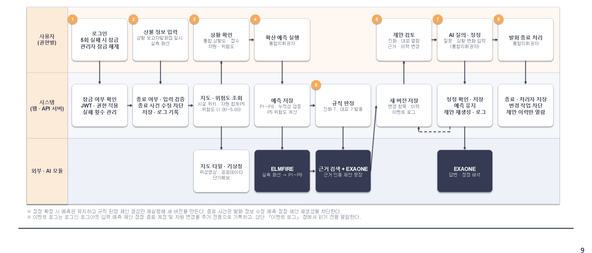

> ※ 정정 확정 시 예측은 유지하고 규칙 판정·제안 생성만 재실행해 새 버전을 만든다. 종료 사건은 발화 정보 수정·예측·정정·제안 재생성을 차단한다.  
> ※ 이벤트 로그는 로그인·로그아웃·입력·예측·제안·정정·종료·계정 및 자원 변경을 추가 전용으로 기록하고, 상단 「이벤트 로그」 창에서 읽기 전용 열람한다.

### 시스템 구성도 — 물리 엔진 · 규칙 엔진 · LLM 에이전트 2개, 인터페이스 / 서버 / 데이터 3계층 (10쪽)

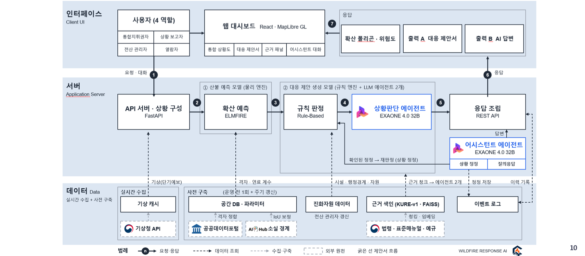

## 02. 역할별 주요 기능

### 역할 정의와 역할별 주요 기능  (사람 액터 4 · 시스템 액터 3) (12쪽)

| 역할 | 권한 · 대상 | 화면 | 주요 기능 |
|---|---|---|---|
| 통합지휘권자 | 조작 · 시장·군수·구청장 (주 액터) | 통합 상황도 + 대응 제안 | 1. 발생·접수 정보·통합 상황도 조회 — 산불 진행 상태, 확산 범위·시설·진화자원 현황 2. 확산 예측 실행 — 1시간 간격 P1\~P8 → 위험도·제안서 생성 3. 대응 제안 검토 — 진화 S1\~S7 · 대피 E1\~E7, 근거 [k] 조회 4. AI 질의·상황 정정 — 정정을 확정하면 제안서 새 버전 5. 이력 열람·종료 처리 — 버전 이력·변경사항·이벤트 로그, 발화 종료 |
| 상황 보고자 | 보고 · 현장 상황 보고 전담 | 지도 + 상황 입력 판 | 1. 산불 최초 보고 — 발화 위치·일시·신고 내용·신고자 정보·접수 기관 2. 실측 화선 보고 — 1시간마다 폴리곤, 초기대응에서는 생략 가능 3. 발생·접수 정보 조회 — 보고한 산불의 진행 상태 확인 |
| 열람자 | 열람 · 유관기관·상급 본부 담당자 | 통합 상황도 (읽기 전용) | 1. 발생·접수 정보 조회 — 발생 장소·신고 내용·신고자·진행 상태 2. 통합 상황도 조회 — 확산 범위 P1\~P8·시설·레이어 3. 진화자원 현황 — 헬기·인력·차량, 대기·투입·정비 상태 확인 4. 산불 위험도 조회 — 위험도·요소별 지표 (읽기 전용) |
| 전산 관리자 | 관리 · 평시 전산 시스템 관리 (개발자 아님) | 관리 화면 | 1. 계정·권한 관리 — 계정 발급·회수, 조작·열람·보고 권한 지정 2. 진화자원 데이터 관리 — 헬기·차량·인력 등록·수정·삭제 |

**시스템 액터**

- **확산예측 모듈** — 실측 화선·기상·지형·연료 → 1시간 간격 P1\~P8
- **AI 모델** — 규칙 판정 값은 바꾸지 않고, 근거로 제안·답변 작성·정정 해석
- **기상청 API·공공데이터** — 기상, 마을·시설·도로·지형 공간 데이터

## 03. 요구사항 분석

### 기능 요구사항 — 역할별 필요 기능과 요구사항 ID (14쪽)

**4개 역할 · 기능 요구사항 32개 · 유스케이스 15개**

**서비스 핵심 흐름 — 통합지휘권자**

1. 확산 예측 실행 (F-09)
2. 산불 위험도 확인 (F-10)
3. 진화·대피 대응 제안 검토 (F-11·12, F-15\~28)
4. 근거 조회 (F-13)
5. AI 질의응답 · 상황 정정 (F-29·30)

**역할 사이의 흐름**

- **평시** — 전산 관리자가 계정·진화자원 준비
- **발생** — 상황 보고자가 발화 정보·실측 화선 보고
- **대응** — 통합지휘권자가 예측·제안·정정
- **공유** — 열람자는 같은 상황도를 읽기 전용으로

| 역할 | 필요 기능 | 관련 요구사항 ID | 유스케이스 |
|---|---|---|---|
| 공통 (4개 역할) | 로그인·로그아웃, 권한별 첫 화면 | F-01 | UC-AUTH-01 |
| 상황 보고자 | 산불 최초 보고(신고자 정보 포함), 실측 화선 보고 (새 버전·정정) | F-02 | UC-REPORT-01 |
| 보고자·지휘권자·열람자 | 산불 발생·접수 정보 조회 | F-04 | UC-SIT-02 |
| 지휘권자·열람자 | 통합 상황도, 레이어, 주요 시설, 가용 현황 | F-05 \~ F-08 | UC-SIT-03 |
| 통합지휘권자 | 확산 예측 실행·갱신 | F-09 | UC-PRED-01 |
| 지휘권자·열람자 | 산불 위험도 조회 | F-10 | UC-PRED-02 |
| 통합지휘권자 | 대응 제안 생성·분류 (진화 S1\~S7 · 대피 E1\~E7) | F-11, F-12, F-15 \~ F-28 | UC-PRED-01 UC-PROP-01·02 |
| 통합지휘권자 | 대응 근거 조회 | F-13 | UC-PROP-03 |
| 통합지휘권자 | 제안 이력·변경사항, 이벤트 로그 열람 | F-14, F-32 | UC-PROP-04 |
| 통합지휘권자 | AI 질의응답, AI 상황 정정 | F-29, F-30 | UC-QA-01·02 |
| 통합지휘권자 | 발화 종료 처리 | F-03 | UC-SIT-01 |
| 전산 관리자 | 계정 발급·회수, 권한 지정 | F-01 | UC-ADMIN-01 |
| 전산 관리자 | 진화자원 데이터 관리 | F-31 | UC-ADMIN-02 |
| 시스템 | 이벤트 로그 추가 전용 기록 | F-32 | - |

### AI 성능 요구사항 ① 확산 예측 성능 지표 및 하한선 (15쪽)

| 성능 | 성능 지표 | 의미 | 하한 | 설정 근거 (하한이 의미하는 것) |
|---|---|---|---|---|
| 예측 영역 일치도 | IoU | 예측 범위와 실제로 탄 범위가 겹친 정도. 넓게 잡아도, 좁게 잡아도 깎임 | ≥ 0.582 | 국립산림과학원이 국내 산불 35건으로 검증한 과정 기반(물리) 모형의 일치도 58.2%. 같은 계열인 본 과제 모형이 이보다 낮으면 기존 물리 모형보다 못함. FARSITE 사례 0.535\*\~0.616\* |
| 예측 적중률 | 정밀도 | 예측한 범위 중 실제로 탄 비율. 낮으면 불필요한 대피·진화 자원 분산 | ≥ 0.599 | 같은 검증 59.9%: 예측 범위의 약 40%는 실제로 타지 않은, 과대 예측이었다는 의미. FARSITE 사례 0.550\~0.553\* |
| 연소 영역 탐지율 | 재현율 | 실제로 탄 범위 중 예측이 잡아낸 비율. 낮으면 놓친 화선으로 인명 위험 | ≥ 0.956 | 같은 검증 95.6%: 실제로 탄 범위의 4% 남짓만 놓침. 물리 모형은 넓게 예측해 높게 나오므로 적중률과 함께 봄. FARSITE 사례 0.942\*\~0.998\* |
| 예측 종합 점수 | F1-Score | 적중률과 탐지율을 같은 비중으로 합친 점수. 한쪽만 높으면 낮게 나옴 | ≥ 0.699 | 같은 검증 69.9%. FARSITE 사례 Sørensen(= F1) 0.69\~0.70 |
| 탐지 중심 종합 점수 | F2-Score (핵심 지표) | 탐지율에 적중률의 4배 비중을 둔 종합 점수. 놓친 범위를 더 크게 감점 | ≥ 0.805 | 같은 검증 80.5%로, 설명서도 미탐지가 인명 피해로 이어진다는 이유로 핵심 지표로 지정. FARSITE 사례 0.802\*\~0.826\* |

**하한 = 국내 물리 모형 검증치**

국립산림과학원이 국내 산불 35건(화선 335개)에서 과정 기반(물리) 확산모형을 실제 화선과 비교한 성능. 본 과제도 물리 모형(ELMFIRE)을 보정해 쓰므로 최소한 이 수준은 넘어야 함. 같은 검증의 AI 모형(일치도 67.1%, 탐지 중심 종합 점수 84.0%)은 목표 참고값

**평가 데이터·시점**

연료 파라미터는 일치도(IoU)로 보정하고, 성능은 보정에 쓰지 않은 hold-out 산불 사건의 평균으로 판정. 예측 최종 시점 P8(누적 8시간)을 AI Hub 실측 최종 소실 경계와 비교(설명서는 시점별 진화상황도 화선과 비교)

**핵심 지표: 탐지 중심 종합 점수**

놓친 화선은 인명 피해로 이어지므로 탐지율에 4배 비중을 둔 F2를 핵심으로 봄. 탐지율은 넓게 예측하면 오르므로 적중률과 함께 판단

\* 논문의 일치·과대·과소 면적으로 환산한 값 /  검증치: 국립산림과학원(2026) 「AI 기반 산불확산예측 알고리즘 설명서」 연구자료 제1207호 p.45 표 11 /  FARSITE 사례: Price & Germino(2022) Fire Ecology 18:23 표 2 · Jahdi 외(2015) NHESS 15:443 표 4 · Kuhnen 외(2026) Fire 9:311 표 3

### AI 성능 요구사항 ② 대응 제안 성능 지표 및 하한선 (16쪽)

| 성능 | 성능 지표 (RAGAS) | 의미 | 하한 | 설정 근거 (하한이 의미하는 것) |
|---|---|---|---|---|
| 제안 근거 충실도 | Faithfulness (생성) | 제안 문장의 주장 중 검색한 매뉴얼 근거로 뒷받침되는 비율. 낮으면 근거 없는 내용(환각)을 덧붙인 것 | ≥ 0.79 | 재난·공공 분야 RAG 연구 11편 중 하위 25% 수준(중앙값 0.845): 제안 속 주장의 약 80% 이상이 매뉴얼로 뒷받침돼야 함. 예: 자연재해 대응 권고 0.87(Chernysheva 외, 2026) |
| 제안 질의 관련도 | Answer Relevancy (생성) | 제안이 항목 질문(지금 무엇을 해야 하나)에 맞게 답한 정도. 질문에서 벗어나거나 여러 항목을 뭉치면 낮음 | ≥ 0.82 | 10편 중 하위 25% 수준(중앙값 0.85): 제안만 보고 되짚은 질문이 원래 질문과 0.82 이상 비슷해야 함. 예: 자연재해 대응 권고 0.86(Chernysheva 외, 2026) |
| 근거 순위 정밀도@K | Context Precision@K (검색) | 검색한 상위 K개 중 쓸모 있는 근거가 앞 순위에 놓인 정도. 낮으면 엉뚱한 조항이 위에 옴 | ≥ 0.82 | 7편 중 하위 25% 수준(중앙값 0.87): 쓸모 있는 근거가 대부분 상위에 와야 함. 예: 비상대응계획·법규 0.87(Ma 외, 2026) |
| 필요 근거 확보율@K | Context Recall@K (검색, K 선택 기준) | 정답 제안에 필요한 매뉴얼 근거를 상위 K개 안에 가져온 비율. 낮으면 제안이 근거 부족으로 비거나 틀림 | ≥ 0.80 | 6편 중 하위 25% 수준(중앙값 0.90): 필요한 근거의 80% 이상을 가져와야 하며, 검색 청크 수 K를 고르는 문턱 조건. 예: 자연재해 대응 권고 0.91(Chernysheva 외, 2026) |

**평가 단위**

시나리오 시점 × 진화 S1\~S7·대피 E1\~E7 항목 1건 = 항목 질문 + 상위 K 청크 + 제안 문장 + 정답 답변

**하한 = 유사 연구 하위 25%**

산불 분야 RAGAS 선례가 없어 가장 가까운 재난·공공 규정·한국어 공공 문서 RAG 연구값을 모음. 단순 벡터 검색·4비트 로컬 모델인 우리 구성을 고려해 논문 최고 구성의 중앙값 대신 하위 25%(넷 중 셋 수준)를 최소 기준으로, 중앙값은 목표로 둠

**K 선택**

개발용 시나리오에서 K = 3·5·7·10 비교 → 확보율@K ≥ 0.80인 K 중 (충실도 + 관련도) ÷ 2가 가장 높은 K, 차이 0.01 이내면 작은 K. 하한 판정은 시험용 시나리오 평균

**자동 채점 (LLM-as-a-Judge)**

로컬 EXAONE 4.0 32B가 RAGAS v0.4.3 한국어 프롬프트로 채점. 생성 2종은 정답 없이, 검색 2종은 팀이 매뉴얼 쪽수로 미리 쓴 정답 답변을 기준으로 청크·문장마다 판정해, 사람은 정답만 작성하고 채점은 자동. 채점 실패율·95% 신뢰구간 함께 보고

근거 부족으로 비운 칸은 4개 지표 평균에서 빼고 건수만 따로 적음 · 참고: Es 외(2024) RAGAS, EACL 2024 System Demonstrations

### AI 성능 요구사항 ③ 평가 방법 (17쪽)

1. **평가 데이터 분리** — 확산 예측은 보정에 쓰지 않은 hold-out 산불 사건, 대응 제안은 K 선택(개발용)에 쓰지 않은 시험용 시나리오로 평가
2. **주요 지표** — 확산 예측 5종(IoU·정밀도·재현율·F1·F2) · 대응 제안 4종(근거 충실도·질의 관련도·근거 순위 정밀도@K·필요 근거 확보율@K)
3. **Ablation 실험** — 같은 질의·사건에서 RAG 유무를 비교해 근거 검색의 효과 확인
4. **로컬 채점** — 로컬 EXAONE 4.0 32B가 RAGAS 한국어 프롬프트로 자동 채점(LLM-as-a-Judge). 정답 답변 기준과 채점 설정은 104쪽
5. **형식 검증** — 항목 순서, 근거 번호 ↔ 근거 목록 일치, 권한 표기를 코드 규칙으로 검사
6. **판정 기준** — 확산: P8 예측 영역과 실측 최종 소실 경계로 TP·FP·FN을 구해 hold-out 평균을 하한선과 대조(103쪽). 대응 제안: 고른 K에서 시험용 평균이 하한선 이상이면 통과(104쪽)

출처: 수정 요구사항 분석서 107쪽 「평가 방법」 (본문의 103·104쪽은 분석서 쪽 번호 — 이 보고서의 AI 성능 요구사항 ①·②)

## 04. 프로토타입 개발

### 개발 방법론 — 애자일 적용과 로드맵 (19쪽)

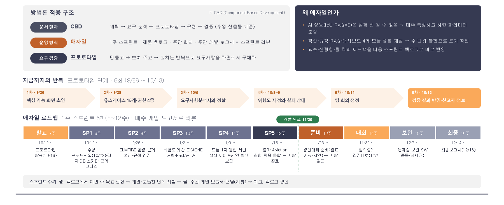

| 구분 | 방식 | 내용 |
|---|---|---|
| 문서 절차 | CBD (Component Based Development) | 계획 → 요구 분석 → 프로토타입 → 구현 → 검증 (수업 산출물 기준) |
| 운영 방식 | 애자일 | 1주 스프린트 · 제품 백로그 · 주간 회의 · 주간 개발 보고서 = 스프린트 리뷰 |
| 요구 검증 | 프로토타입 | 만들고 → 보여 주고 → 고치는 반복으로 요구사항을 화면에서 구체화 |

**왜 애자일인가**

- AI 성능(IoU·RAGAS)은 실험 전 알 수 없음 → 매주 측정하고 하한·파라미터 조정
- 확산·규칙·RAG·대시보드 4개 모듈 병렬 개발 → 주 단위 통합으로 조기 확인
- 교수·산림청·팀 회의 피드백을 다음 스프린트 백로그로 바로 반영

**지금까지의 반복 — 프로토타입 단계 6회 (9/26 \~ 10/13)**

| 차수 | 날짜 | 내용 |
|---|---|---|
| 1차 | 9/26 | 핵심 기능 화면 초안 |
| 2차 | 9/28 | 유스케이스 15개·권한 4종 |
| 3차 | 10/5 | 요구사항분석서와 정합 |
| 4차 | 10/8\~9 | 위험도 재정의·실패 상태 |
| 5차 | 10/11 | 팀 회의 정정 |
| 6차 | 10/13 | 검증 결과 반영·신고자 정보 |

**애자일 로드맵 — 1주 스프린트 5회(8\~12주) · 매주 개발 보고서로 리뷰 · 개발 완료 11/20**

| 구분 | 주차 | 시작 | 목표 |
|---|---|---|---|
| 발표 | 7주 | 10/12\~ | 프로토타입 발표(10/16) |
| SP1 | 8주 | 10/19\~ | 수정 프로토타입(10/22)·격자·DB 스키마·근거 코퍼스 |
| SP2 | 9주 | 10/26\~ | ELMFIRE 환경·근거 색인·규칙 엔진 |
| SP3 | 10주 | 11/2\~ | 위험도 계산·EXAONE 서빙·FastAPI 서버 |
| SP4 | 11주 | 11/9\~ | 모듈 1차 통합·제안 생성 파이프라인·확산 보정 |
| SP5 | 12주 | 11/16\~ | 평가·Ablation 실험·최종 통합 → 개발 완료 |
| 준비 | 13주 | 11/23\~ | 경진대회 준비(발표 자료·시연) — 개발 없음 |
| 대회 | 14주 | 11/30\~ | 창의설계 경진대회(12/4) |
| 보완 | 15주 | 12/7\~ | 문제점 보완·SW 등록(지재권) |
| 최종 | 16주 | 12/14\~ | 최종보고서(12/18) |

> 스프린트 주기 — 월: 백로그에서 이번 주 목표 선정 → 개발·모듈별 단위 시험 → 금: 주간 개발 보고서·면담(리뷰) → 회고, 백로그 갱신

### 기술 스택 — 프로토타입과 본 개발 (20쪽)

| 구분 | 프로토타입 (현재) | 본 개발 (계획) |
|---|---|---|
| 화면 | HTML·CSS·JavaScript 정적 웹(빌드 없음) | React + MapLibre GL JS |
| 지도·공간 자료 | MapLibre GL JS, Esri 위성영상·OpenFreeMap 라벨, SGIS 경계·OSM 시설·도로 | 동일 + PostGIS 공간 레이어 |
| 서버·API | 없음(브라우저 메모리, 정적 호스팅) | FastAPI(Python) REST API |
| 확산 예측 | 합성 타원 모델(풍향·풍속 기반, 1시간 간격 P1\~P8) | ELMFIRE(Docker), 30 m 격자(DEM·임상도) |
| 판정·제안 생성 | 규칙 판정(JavaScript) + 문장 템플릿 | 규칙 엔진(Python) + EXAONE 4.0 32B(vLLM) |
| 근거 검색 | 표준매뉴얼 쪽수별 요약 | KURE-v1 임베딩 + FAISS, 조항 단위 청킹 |
| AI 어시스턴트 | 키워드 대본 답변 · 정규식 정정 해석 | EXAONE + RAG 답변 · 정정 해석 |
| 데이터 | 시나리오 파일(2025-03-22 의성 산불) | PostgreSQL + PostGIS, 기상청 단기예보 API |
| 인증 | 브라우저 세션 저장소 토큰 | JWT, 서버 측 잠금·권한 검사 |
| 배포 | GitHub Pages · 로컬 정적 서버 | Docker 컨테이너, GPU 서버(예측·AI 추론) |

**프로토타입 구현 원칙**

**누구나 같은 화면을 열어 검토할 수 있게**

1. **설치 없이 열리는 정적 웹** — 빌드·서버 없이 정적 서버나 GitHub Pages 주소로 접속해 팀원 누구나 같은 화면을 검토
2. **실제 동작과 연출 구분** — 판정·버전·이력·권한·입력 검사는 실제 계산, 확산 모델·AI 문장은 정해 둔 값으로 연출
3. **실제 지역 자료 사용** — 2025-03-22 의성 산불 경과, SGIS 경계·OSM 시설·도로는 실제 자료, 인구·자원 수는 가상값
4. **본 개발과 같은 지도 엔진** — MapLibre GL JS를 그대로 쓰므로 화면 배치와 레이어 구성을 React 화면으로 옮길 수 있음

### 프로토타입 개발 절차 (21쪽)

| 단계 | 내용 | 설명 |
|---|---|---|
| STEP 01 | 요구사항 확인 | 요구사항분석서의 기능 32개·유스케이스 15개·권한 4종을 화면 단위로 정리 |
| STEP 02 | 화면 구조 설계 | 산림청 산불상황관제시스템 화면을 참고해 지도 중심 배치, 권한별 첫 화면 정의 |
| STEP 03 | 시나리오 데이터 구성 | 2025-03-22 의성 산불 8시간, SGIS 경계·OSM 시설은 실제, 인구·자원 수 등은 가상값으로 구분 |
| STEP 04 | 화면 구현 | 정적 웹 + MapLibre 지도. 판정·버전·이력은 실제 계산(동작), AI 문장은 템플릿(연출) |
| STEP 05 | 시나리오 연결 | 보고 → 예측 → 위험도 → 제안 → 근거 → 질의·정정 → 이력 → 종료, 실패·병합 장면 |
| STEP 06 | 팀 검토 | 주간 회의에서 요구사항분석서와 화면을 대조, 정정 사항을 목록으로 정리 |
| STEP 07 | 수정·보완 (반복) | 6회 반복(9/26 → 10/13) |
| STEP 08 | 검증·개발 연계 | 유스케이스·추가 시나리오 점검(06장), 연출 부분을 실제 모듈로 바꿀 목록 작성 |

### 개발 일정 및 진행 현황 (22쪽)

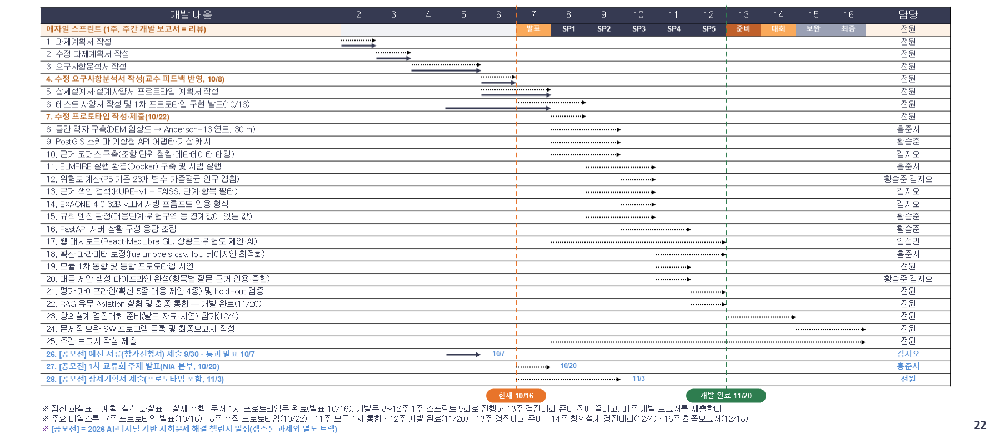

> ※ 점선 화살표 = 계획, 실선 화살표 = 실제 수행. 문서·1차 프로토타입은 완료(발표 10/16). 개발은 8\~12주 1주 스프린트 5회로 진행해 13주 경진대회 준비 전에 끝내고, 매주 개발 보고서를 제출한다.  
> ※ 주요 마일스톤: 7주 프로토타입 발표(10/16) · 8주 수정 프로토타입(10/22) · 11주 모듈 1차 통합 · 12주 개발 완료(11/20) · 13주 경진대회 준비 · 14주 창의설계 경진대회(12/4) · 16주 최종보고서(12/18)  
> ※ [공모전] = 2026 AI·디지털 기반 사회문제 해결 챌린지 일정(캡스톤 과제와 별도 트랙)

## 05. 프로토타입 구현

### 화면 구성 — 통합지휘권자 기준 (확산 예측 후) (24쪽)

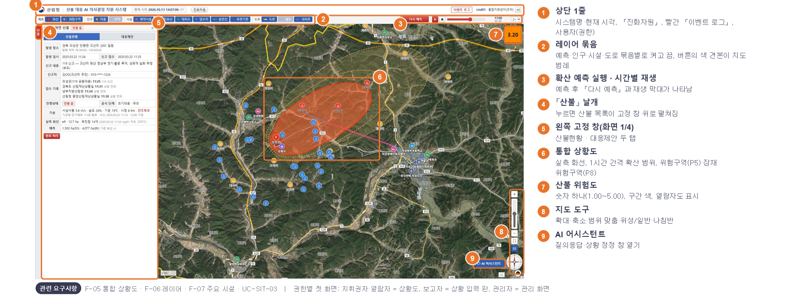

1. **상단 1줄** — 시스템명·현재 시각, 「진화자원」, 빨간 「이벤트 로그」, 사용자(권한)
2. **레이어 묶음** — 예측·인구·시설·도로 묶음별로 켜고 끔, 버튼의 색 견본이 지도 범례
3. **확산 예측 실행 · 시간별 재생** — 예측 후 「다시 예측」과 재생 막대가 나타남
4. **「산불」 날개** — 누르면 산불 목록이 고정 창 위로 펼쳐짐
5. **왼쪽 고정 창(화면 1/4)** — 산불현황 · 대응제안 두 탭
6. **통합 상황도** — 실측 화선, 1시간 간격 확산 범위, 위험구역(P5)·잠재 위험구역(P8)
7. **산불 위험도** — 숫자 하나(1.00\~5.00), 구간 색, 열람자도 표시
8. **지도 도구** — 확대·축소·범위 맞춤·위성/일반·나침반
9. **AI 어시스턴트** — 질의응답·상황 정정 창 열기

**관련 요구사항** — F-05 통합 상황도 · F-06 레이어 · F-07 주요 시설 · UC-SIT-03   |   권한별 첫 화면: 지휘권자·열람자 = 상황도, 보고자 = 상황 입력 판, 관리자 = 관리 화면

### 로그인 · 권한별 첫 화면 (25쪽)

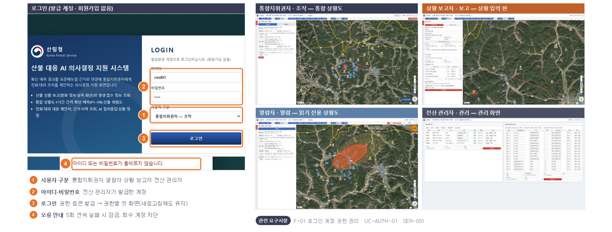

**로그인 (발급 계정 · 회원가입 없음)**

1. **사용자 구분 — 통합지휘권자·열람자·상황 보고자·전산 관리자**
2. **아이디·비밀번호 — 전산 관리자가 발급한 계정**
3. **로그인 — 권한 토큰 발급 → 권한별 첫 화면(새로고침해도 유지)**
4. **오류 안내 — 5회 연속 실패 시 잠금, 회수 계정 차단**

**통합지휘권자 · 조작 — 통합 상황도**

**상황 보고자 · 보고 — 상황 입력 판**

**열람자 · 열람 — 읽기 전용 상황도**

**전산 관리자 · 관리 — 관리 화면**

**관련 요구사항** — F-01 로그인·계정·권한 관리 · UC-AUTH-01 · SER-001

### 상황 보고자 ① 새 산불 보고 (UC-REPORT-01) (26쪽)

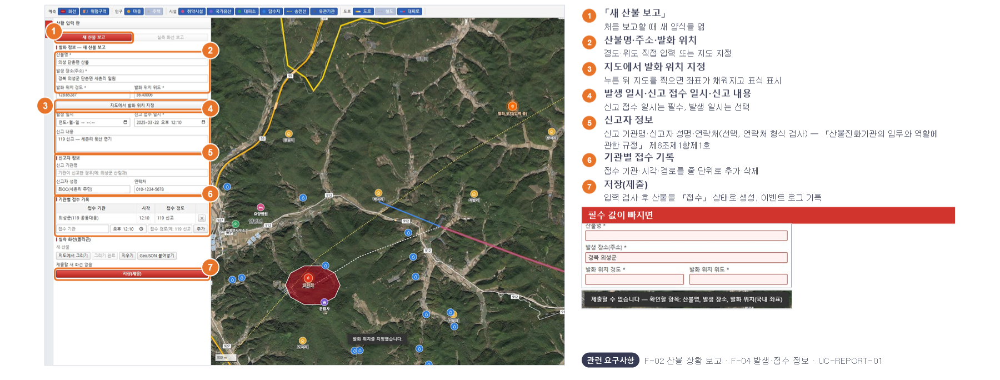

1. **「새 산불 보고」** — 처음 보고할 때 새 양식을 엶
2. **산불명·주소·발화 위치** — 경도·위도 직접 입력 또는 지도 지정
3. **지도에서 발화 위치 지정** — 누른 뒤 지도를 찍으면 좌표가 채워지고 표식 표시
4. **발생 일시·신고 접수 일시·신고 내용** — 신고 접수 일시는 필수, 발생 일시는 선택
5. **신고자 정보** — 신고 기관명·신고자 성명·연락처(선택, 연락처 형식 검사) — 「산불진화기관의 임무와 역할에 관한 규정」 제6조제1항제1호
6. **기관별 접수 기록** — 접수 기관·시각·경로를 줄 단위로 추가·삭제
7. **저장(제출)** — 입력 검사 후 산불을 「접수」 상태로 생성, 이벤트 로그 기록

**필수 값이 빠지면**

**관련 요구사항** — F-02 산불 상황 보고 · F-04 발생·접수 정보 · UC-REPORT-01

### 상황 보고자 ② 실측 화선 보고 — 1시간마다 (UC-REPORT-01 대안 흐름) (27쪽)

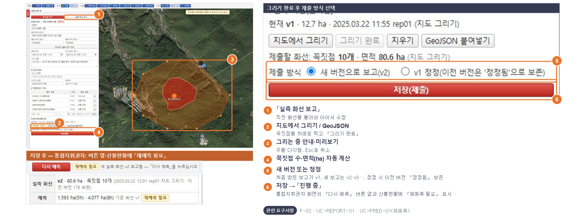

**그리기 완료 후 제출 방식 선택**

1. **「실측 화선 보고」** — 직전 화선을 불러와 이어서 수정
2. **지도에서 그리기 / GeoJSON** — 꼭짓점을 차례로 찍고 「그리기 완료」
3. **그리는 중 안내·미리보기** — 주황 다각형, Esc로 취소
4. **꼭짓점 수·면적(ha) 자동 계산**
5. **새 버전 또는 정정** — 처음 받은 보고가 v1, 새 보고는 v2·v3…, 정정 시 이전 버전 「정정됨」 보존
6. **저장 → 「진행 중」** — 통합지휘권자 화면의 「다시 예측」 버튼 옆과 산불현황에 「재예측 필요」 표시

**저장 후 — 통합지휘권자: 버튼 옆·산불현황에 「재예측 필요」**

**관련 요구사항** — F-02 · UC-REPORT-01 · UC-PRED-01(재예측)

### 통합지휘권자 ① 산불 목록 · 산불현황 (UC-SIT-02) (28쪽)

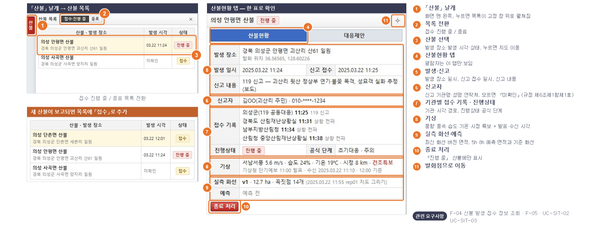

**「산불」 날개 → 산불 목록**

3. **접수·진행 중 / 종료 목록 전환**

**새 산불이 보고되면 목록에 「접수」로 추가**

**산불현황 탭 — 한 표로 확인**

1. **「산불」 날개** — 화면 맨 왼쪽, 누르면 목록이 고정 창 위로 펼쳐짐
2. **목록 전환** — 접수·진행 중 / 종료
3. **산불 선택** — 발생 장소·발생 시각·상태, 누르면 지도 이동
4. **산불현황 탭** — 열람자는 이 탭만 보임
5. **발생·신고** — 발생 장소·일시, 신고 접수 일시, 신고 내용
6. **신고자** — 신고 기관명·성명·연락처, 모르면 「미확인」(규정 제6조제1항제1호)
7. **기관별 접수 기록 · 진행상태** — 기관·시각·경로, 진행상태·공식 단계
8. **기상** — 풍향·풍속·습도·기온·시정·특보 + 발표·수신 시각
9. **실측 화선·예측** — 최신 화선 버전·면적, 5h·8h 예측 면적과 기준 화선
10. **종료 처리** — 「진행 중」 산불에만 표시
11. **발화점으로 이동**

**관련 요구사항** — F-04 산불 발생·접수 정보 조회 · F-05 · UC-SIT-02 · UC-SIT-03

### 통합지휘권자 ② 확산 예측 실행 · 시간별 재생 (UC-PRED-01) (29쪽)

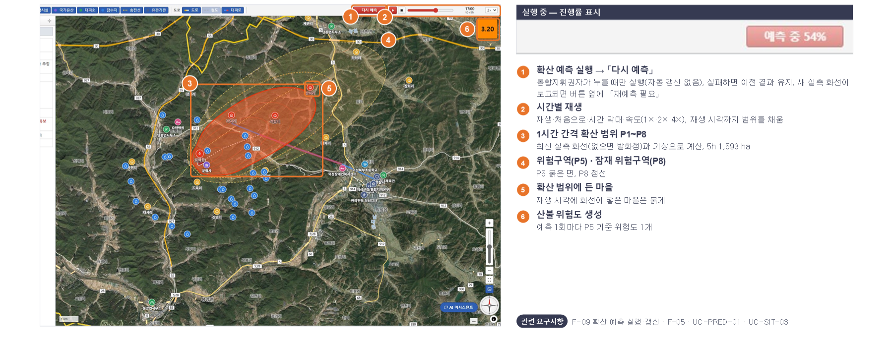

**실행 중 — 진행률 표시**

1. **확산 예측 실행 → 「다시 예측」** — 통합지휘권자가 누를 때만 실행(자동 갱신 없음), 실패하면 이전 결과 유지. 새 실측 화선이 보고되면 버튼 옆에 「재예측 필요」
2. **시간별 재생** — 재생·처음으로·시간 막대·속도(1×·2×·4×), 재생 시각까지 범위를 채움
3. **1시간 간격 확산 범위 P1\~P8** — 최신 실측 화선(없으면 발화점)과 기상으로 계산, 5h 1,593 ha
4. **위험구역(P5) · 잠재 위험구역(P8)** — P5 붉은 면, P8 점선
5. **확산 범위에 든 마을** — 재생 시각에 화선이 닿은 마을은 붉게
6. **산불 위험도 생성** — 예측 1회마다 P5 기준 위험도 1개

**관련 요구사항** — F-09 확산 예측 실행·갱신 · F-05 · UC-PRED-01 · UC-SIT-03

### 통합지휘권자 ③ 산불 위험도 — 열람자도 열람 (UC-PRED-02) (30쪽)

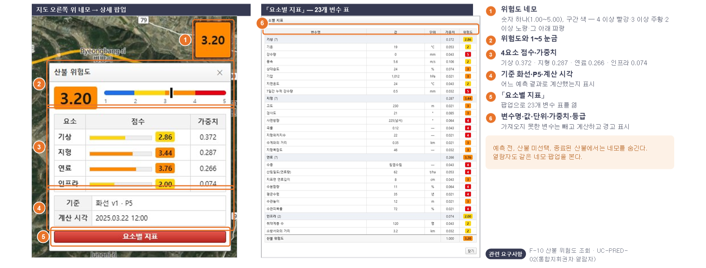

**지도 오른쪽 위 네모 → 상세 팝업**

**「요소별 지표」 — 23개 변수 표**

1. **위험도 네모** — 숫자 하나(1.00\~5.00), 구간 색 — 4 이상 빨강·3 이상 주황·2 이상 노랑·그 아래 파랑
2. **위험도와 1\~5 눈금**
3. **4요소 점수·가중치** — 기상 0.372 · 지형 0.287 · 연료 0.266 · 인프라 0.074
4. **기준 화선·P5·계산 시각** — 어느 예측 결과로 계산했는지 표시
5. **「요소별 지표」** — 팝업으로 23개 변수 표를 엶
6. **변수명·값·단위·가중치·등급** — 가져오지 못한 변수는 빼고 계산하고 경고 표시

예측 전, 산불 미선택, 종료된 산불에서는 네모를 숨긴다. 열람자도 같은 네모·팝업을 본다.

**관련 요구사항** — F-10 산불 위험도 조회 · UC-PRED-02(통합지휘권자·열람자)

### 통합지휘권자 ④ 진화 대응 제안 S1~S7 (UC-PROP-01) (31쪽)

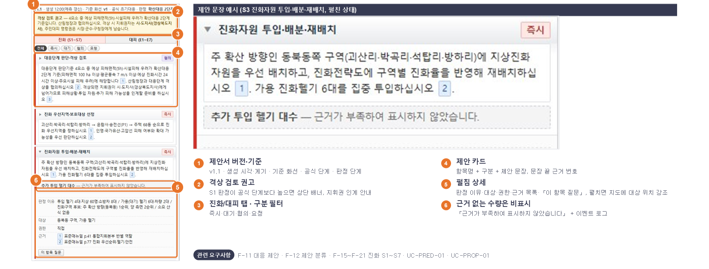

**제안 문장 예시 (S3 진화자원 투입·배분·재배치, 펼친 상태)**

1. **제안서 버전·기준** — v1.1 · 생성 시각·계기 · 기준 화선 · 공식 단계 · 판정 단계
2. **격상 검토 권고** — S1 판정이 공식 단계보다 높으면 상단 배너, 지휘권 인계 안내
3. **진화/대피 탭 · 구분 필터** — 즉시·대기·협의·요청
4. **제안 카드** — 항목명 + 구분 + 제안 문장, 문장 끝 근거 번호
5. **펼침 상세** — 판정 이유·대상·권한·근거 목록·「이 항목 질문」, 펼치면 지도에 대상 위치 강조
6. **근거 없는 수량은 비표시** — 「근거가 부족하여 표시하지 않았습니다」 + 이벤트 로그

**관련 요구사항** — F-11 대응 제안 · F-12 제안 분류 · F-15\~F-21 진화 S1\~S7 · UC-PRED-01 · UC-PROP-01

### 통합지휘권자 ⑤ 대피 대응 제안 E1~E7 · 카드와 지도 연동 (UC-PROP-02) (32쪽)

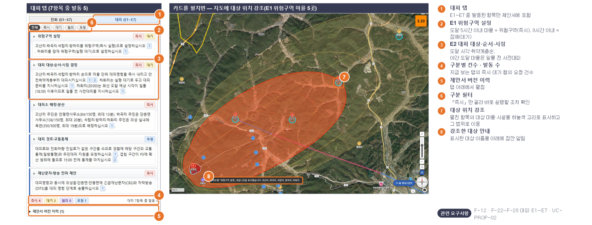

**대피 탭 (7항목 중 발동 5)**

**카드를 펼치면 — 지도에 대상 위치 강조(E1 위험구역 마을 5곳)**

1. **대피 탭** — E1\~E7 중 발동한 항목만 제안서에 포함
2. **E1 위험구역 설정** — 도달 5시간 이내 마을 = 위험구역(즉시), 8시간 이내 = 잠재(대기)
3. **E2 대피 대상·순서·시점** — 도달 시각·취약계층순, 야간 도달 마을은 일몰 전 사전대피
4. **구분별 건수 · 발동 수** — 지금 보는 탭의 즉시·대기·협의·요청 건수
5. **제안서 버전 이력** — 탭 아래에서 펼침
6. **구분 필터** — 「즉시」만 골라 바로 실행할 조치 확인
7. **대상 위치 강조** — 펼친 항목의 대상 마을·시설을 하늘색 고리로 표시하고 그 범위로 이동
8. **강조한 대상 안내** — 표시한 대상 이름을 아래에 잠깐 알림

**관련 요구사항** — F-12 · F-22\~F-28 대피 E1\~E7 · UC-PROP-02

### 통합지휘권자 ⑥ 근거 조회 (UC-PROP-03) (33쪽)

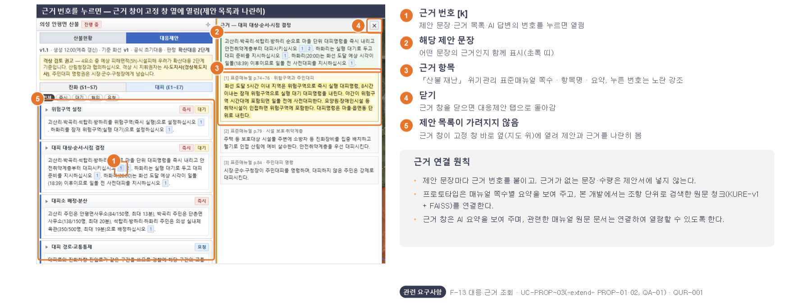

**근거 번호를 누르면 — 근거 창이 고정 창 옆에 열림(제안 목록과 나란히)**

1. **근거 번호 [k]** — 제안 문장·근거 목록·AI 답변의 번호를 누르면 열림
2. **해당 제안 문장** — 어떤 문장의 근거인지 함께 표시(초록 띠)
3. **근거 항목** — 「산불 재난」 위기관리 표준매뉴얼 쪽수 · 항목명 · 요약, 누른 번호는 노란 강조
4. **닫기** — 근거 창을 닫으면 대응제안 탭으로 돌아감
5. **제안 목록이 가려지지 않음** — 근거 창이 고정 창 바로 옆(지도 위)에 열려 제안과 근거를 나란히 봄

**근거 연결 원칙**

제안 문장마다 근거 번호를 붙이고, 근거가 없는 문장·수량은 제안서에 넣지 않는다.  
프로토타입은 매뉴얼 쪽수별 요약을 보여 주고, 본 개발에서는 조항 단위로 검색한 원문 청크(KURE-v1 + FAISS)를 연결한다.  
근거 창은 AI 요약을 보여 주며, 관련한 매뉴얼 원문 문서는 연결하여 열람할 수 있도록 한다.

**관련 요구사항** — F-13 대응 근거 조회 · UC-PROP-03(«extend» PROP-01·02, QA-01) · QUR-001

### 통합지휘권자 ⑦ AI 어시스턴트 질의응답 (UC-QA-01) (34쪽)

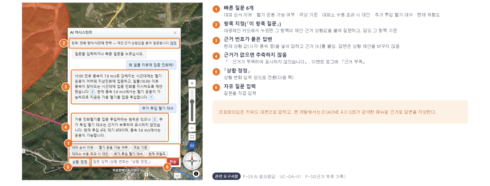

1. **빠른 질문 6개** — 대피 순서 이유 · 헬기 운용 가능 여부 · 격상 기준 · 대피소 수용 초과 시 대안 · 추가 투입 헬기 대수 · 현재 위험도
2. **항목 지정(「이 항목 질문」)** — 대응제안 카드에서 누르면 그 항목의 제안·근거·상황값을 붙여 질문하고, 답도 그 항목 기준
3. **근거 번호가 붙은 답변** — 현재 상황 값(시각·풍속 등)을 넣어 답하고 근거 [k]를 붙임. 답변은 상황·제안을 바꾸지 않음
4. **근거가 없으면 추측하지 않음** — 「…근거가 부족하여 표시하지 않았습니다」, 이벤트 로그에 「근거 부족」
5. **「상황 정정」** — 상황 변화 입력 모드로 전환(다음 쪽)
6. **자유 질문 입력** — 질문을 직접 입력

프로토타입은 키워드 대본으로 답하고, 본 개발에서는 EXAONE 4.0 32B가 검색한 매뉴얼 근거로 답변을 작성한다.

**관련 요구사항** — F-29 AI 질의응답 · UC-QA-01 · F-32(근거 부족 기록)

### 통합지휘권자 ⑧ AI 상황 정정 → 제안서 새 버전 (UC-QA-02) (35쪽)

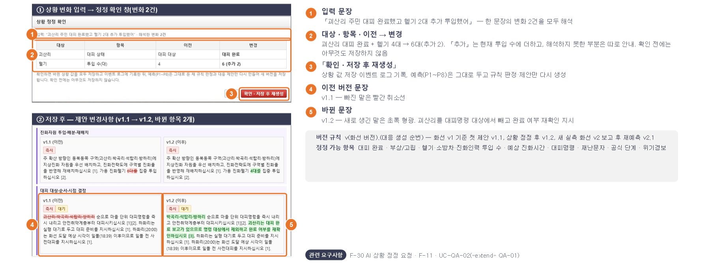

**① 상황 변화 입력 → 정정 확인 창(변화 2건)**

**② 저장 후 — 제안 변경사항 (v1.1 → v1.2, 바뀐 항목 2개)**

1. **입력 문장** — 「괴산리 주민 대피 완료했고 헬기 2대 추가 투입했어」 — 한 문장의 변화 2건을 모두 해석
2. **대상 · 항목 · 이전 → 변경** — 괴산리 대피 완료 + 헬기 4대 → 6대(추가 2). 「추가」는 현재 투입 수에 더하고, 해석하지 못한 부분은 따로 안내. 확인 전에는 아무것도 저장하지 않음
3. **「확인 · 저장 후 재생성」** — 상황 값 저장·이벤트 로그 기록, 예측(P1\~P8)은 그대로 두고 규칙 판정·제안만 다시 생성
4. **이전 버전 문장** — v1.1 — 빠진 말은 빨간 취소선
5. **바뀐 문장** — v1.2 — 새로 생긴 말은 초록 형광. 괴산리를 대피명령 대상에서 빼고 완료 여부 재확인 지시

버전 규칙  v(화선 버전).(대응 생성 순번) — 화선 v1 기준 첫 제안 v1.1, 상황 정정 후 v1.2, 새 실측 화선 v2 보고 후 재예측 v2.1

정정 가능 항목  대피 완료 · 부상/고립 · 헬기·소방차·진화인력 투입 수 · 예상 진화시간 · 대피명령 · 재난문자 · 공식 단계 · 위기경보

**관련 요구사항** — F-30 AI 상황 정정 요청 · F-11 · UC-QA-02(«extend» QA-01)

### 통합지휘권자 ⑨ 제안서 버전 이력 · 변경사항 · 이벤트 로그 (UC-PROP-04) (36쪽)

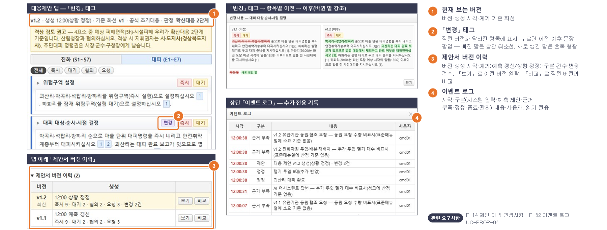

**대응제안 탭 — 「변경」 태그**

**탭 아래 「제안서 버전 이력」**

**「변경」 태그 → 항목별 이전 → 이후(바뀐 말 강조)**

**상단 「이벤트 로그」 — 추가 전용 기록**

1. **현재 보는 버전** — 버전·생성 시각·계기·기준 화선
2. **「변경」 태그** — 직전 버전과 달라진 항목에 표시, 누르면 이전·이후 문장 팝업 — 빠진 말은 빨간 취소선, 새로 생긴 말은 초록 형광
3. **제안서 버전 이력** — 버전·생성 시각·계기(예측 갱신/상황 정정)·구분 건수·변경 건수, 「보기」로 이전 버전 열람, 「비교」로 직전 버전과 비교
4. **이벤트 로그** — 시각·구분(시스템·입력·예측·제안·근거 부족·정정·종료·관리)·내용·사용자, 읽기 전용

**관련 요구사항** — F-14 제안 이력·변경사항 · F-32 이벤트 로그 · UC-PROP-04

### 통합지휘권자 ⑩ 진화자원 현황 · 발화 종료 처리 (UC-SIT-03 · UC-SIT-01) (37쪽)

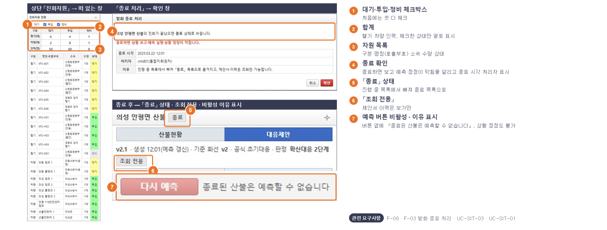

**상단 「진화자원」 → 떠 있는 창**

**「종료 처리」 → 확인 창**

**종료 후 — 「종료」 상태 · 조회 전용 · 비활성 이유 표시**

1. **대기·투입·정비 체크박스** — 처음에는 셋 다 체크
2. **합계** — 헬기·차량·인력, 체크한 상태만 열로 표시
3. **자원 목록** — 구분·명칭(호출부호)·소속·수량·상태
4. **종료 확인** — 종료하면 보고·예측·정정이 막힘을 알리고 종료 시각·처리자 표시
5. **「종료」 상태** — 진행 중 목록에서 빠져 종료 목록으로
6. **「조회 전용」** — 제안서·이력은 보기만
7. **예측 버튼 비활성 · 이유 표시** — 버튼 옆에 「종료된 산불은 예측할 수 없습니다」, 상황 정정도 불가

**관련 요구사항** — F-08 · F-03 발화 종료 처리 · UC-SIT-03 · UC-SIT-01

### 열람자 — 읽기 전용 통합 상황도 · 산불 위험도 (38쪽)

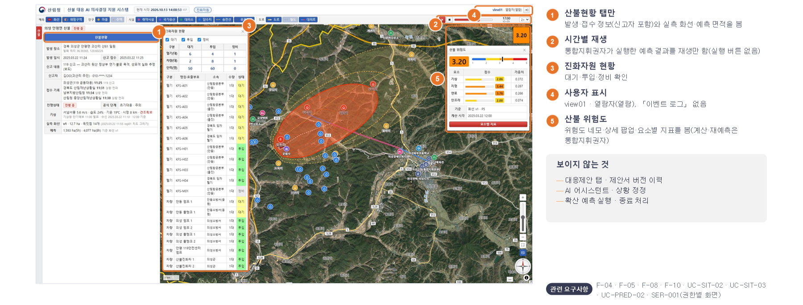

1. **산불현황 탭만** — 발생·접수 정보(신고자 포함)와 실측 화선·예측 면적을 봄
2. **시간별 재생** — 통합지휘권자가 실행한 예측 결과를 재생만 함(실행 버튼 없음)
3. **진화자원 현황** — 대기·투입·정비 확인
4. **사용자 표시** — view01 · 열람자(열람), 「이벤트 로그」 없음
5. **산불 위험도** — 위험도 네모·상세 팝업·요소별 지표를 봄(계산·재예측은 통합지휘권자)

**보이지 않는 것**

대응제안 탭 · 제안서 버전 이력  
AI 어시스턴트 · 상황 정정  
확산 예측 실행 · 종료 처리

**관련 요구사항** — F-04 · F-05 · F-08 · F-10 · UC-SIT-02 · UC-SIT-03 · UC-PRED-02 · SER-001(권한별 화면)

### 전산 관리자 — 계정·권한 · 진화자원 데이터 관리 (UC-ADMIN-01·02) (39쪽)

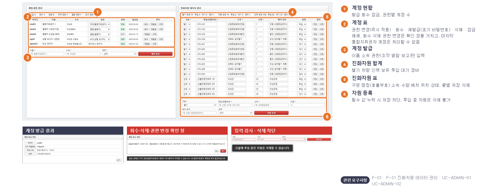

**계정 발급 결과**

**회수·삭제·권한 변경 확인 창**

**입력 검사 · 삭제 차단**

1. **계정 현황** — 발급·회수·잠금, 권한별 계정 수
2. **계정 표** — 권한 변경(즉시 적용) · 회수 · 재발급(초기 비밀번호) · 삭제 · 잠금 해제. 회수·삭제·권한 변경은 확인 창을 거치고, 마지막 통합지휘권자 계정은 처리할 수 없음
3. **계정 발급** — 이름·소속·권한(조작·열람·보고)만 입력
4. **진화자원 합계** — 헬기·차량·인력 보유·투입·대기·정비
5. **진화자원 표** — 구분·명칭(호출부호)·소속·수량·배치 위치·상태, 줄별 저장·삭제
6. **자원 등록** — 필수 값 누락 시 저장 차단, 투입 중 자원은 삭제 불가

**관련 요구사항** — F-01 · F-31 진화자원 데이터 관리 · UC-ADMIN-01 · UC-ADMIN-02

### 개발자 전용 ① 외부 연동 실패 장면 (40쪽)

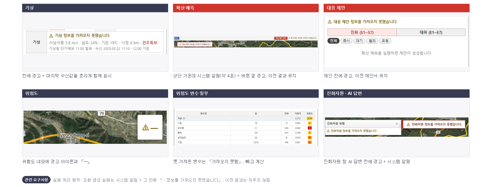

**기상**

**칸에 경고 + 마지막 수신값을 흐리게 함께 표시**

**확산 예측**

**상단 가운데 시스템 알림(약 4초) + 버튼 옆 경고, 이전 결과 유지**

**대응 제안**

**제안 칸에 경고, 이전 제안서 유지**

**위험도**

**위험도 네모에 경고 아이콘과 「—」**

**위험도 변수 일부**

**못 가져온 변수는 「가져오지 못함」, 빼고 계산**

**진화자원 · AI 답변**

**진화자원 창·AI 답변 칸에 경고 + 시스템 알림**

**관련 요구사항** — 실패 처리 원칙: 조회·생성 실패는 시스템 알림 + 그 칸에 「…정보를 가져오지 못했습니다」, 이전 결과는 지우지 않음

### 개발자 전용 ② 병합 산불 장면 (41쪽)

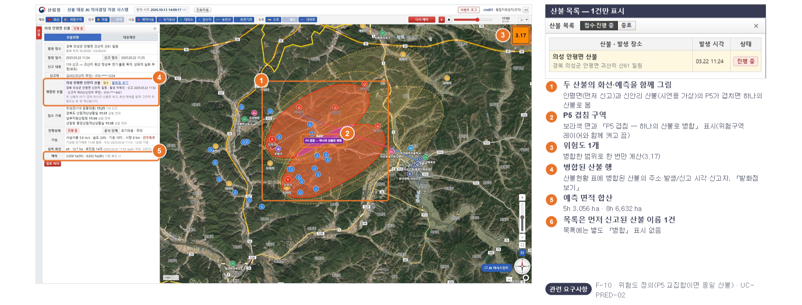

**산불 목록 — 1건만 표시**

1. **두 산불의 화선·예측을 함께 그림** — 안평면(먼저 신고)과 신안리 산불(시연용 가상)의 P5가 겹치면 하나의 산불로 봄
2. **P5 겹침 구역** — 보라색 면과 「P5 겹침 — 하나의 산불로 병합」 표시(위험구역 레이어와 함께 켜고 끔)
3. **위험도 1개** — 병합한 범위로 한 번만 계산(3.17)
4. **병합된 산불 행** — 산불현황 표에 병합된 산불의 주소·발생/신고 시각·신고자, 「발화점 보기」
5. **예측 면적 합산** — 5h 3,056 ha · 8h 6,632 ha
6. **목록은 먼저 신고된 산불 이름 1건** — 목록에는 별도 「병합」 표시 없음

**관련 요구사항** — F-10 · 위험도 정의(P5 교집합이면 동일 산불) · UC-PRED-02

## 06. 프로토타입 검증

### 검증 기준과 방법 — UI · UX (43쪽)

| 구분 | 검증 항목 | 기준 | 방법 | 개선 전 발견 | 검증 후 결과 |
|---|---|---|---|---|---|
| UI | 요구사항 반영 | 기능 32개가 모두 화면에 있는가 | 기능 목록과 화면을 하나씩 대조 | 32 / 32 반영 (동작 13 · 혼합 1 · 연출 18) | 통과( 32 / 32 + 신고자 정보 추가) |
| UI | 권한별 화면 분리 | 권한에 없는 메뉴·버튼이 보이지 않는가 | 계정 4개로 로그인해 화면 요소 확인 | 4개 권한에서의 화면 모두 일치 | 통과(열람자 위험도 공개 반영) |
| UI | 화면 배치 | 가려지는 곳이 없고 지도 표시의 의미들을 알 수 있는가 | 1920×1080 · 1366×768 · 1280×720 | 창 겹침·범례 없음·라벨 겹침 3건 | 통과(3건 모두 개선) |
| UX | 유스케이스 시나리오 | UC 15개의 기본·대안·예외 흐름이 끝까지 되는가 | 실제 클릭으로 수행 | 개선 필요 6 · 결함 2 | 통과(15개 모두 확인) |
| UX | 사용 편의 | 헷갈리거나 불편한 지점 | 가시성·일관성·오류 예방·피드백 관점 팀 자체 점검 | 개선 항목 11건 | 통과 (11건 모두 반영) |

수행 환경  Chrome(1920×1080), 시연 계정 4개(cmd01·rep01·view01·admin01)로 2026-10-11에 직접 조작하고, 검증 후 수정본(10/13)은 같은 방법으로 다시 확인.                 UI 검증은 상용 에이전트(Claude)를 활용해 설계·실험·검증을 진행하였음.

### UI 검증 결과 — 요구사항 반영 · 권한별 화면 · 화면 배치 (44쪽)

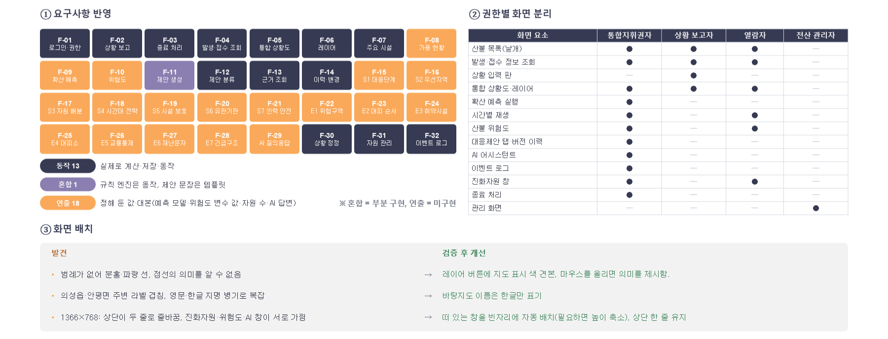

기능 32개 반영 상태 — **동작 13**(실제로 계산·저장·동작) · **혼합 1**(규칙 엔진은 동작, 제안 문장은 템플릿) · **연출 18**(정해 둔 값·대본: 예측 모델·위험도 변수 값·자원 수·AI 답변). 기능별 구분은 위 그림의 색으로 표시했습니다.

**② 권한별 화면 분리**

| 화면 요소 | 통합지휘권자 | 상황 보고자 | 열람자 | 전산 관리자 |
|---|---|---|---|---|
| 산불 목록(날개) | ● | ● | ● | — |
| 발생·접수 정보 조회 | ● | ● | ● | — |
| 상황 입력 판 | — | ● | — | — |
| 통합 상황도·레이어 | ● | ● | ● | — |
| 확산 예측 실행 | ● | — | — | — |
| 시간별 재생 | ● | — | ● | — |
| 산불 위험도 | ● | — | ● | — |
| 대응제안 탭·버전 이력 | ● | — | — | — |
| AI 어시스턴트 | ● | — | — | — |
| 이벤트 로그 | ● | — | — | — |
| 진화자원 창 | ● | — | ● | — |
| 종료 처리 | ● | — | — | — |
| 관리 화면 | — | — | — | ● |

**③ 화면 배치 — 발견 → 검증 후 개선**

| 발견 | 검증 후 개선 |
|---|---|
| 범례가 없어 분홍·파랑 선, 점선의 의미를 알 수 없음 | 레이어 버튼에 지도 표시 색 견본, 마우스를 올리면 의미를 제시 |
| 의성읍·안평면 주변 라벨 겹침, 영문·한글 지명 병기로 복잡 | 바탕지도 이름은 한글만 표기 |
| 1366×768: 상단이 두 줄로 줄바꿈, 진화자원·위험도·AI 창이 서로 가림 | 떠 있는 창을 빈자리에 자동 배치(필요하면 높이 축소), 상단 한 줄 유지 |

> ※ 혼합 = 부분 구현, 연출 = 미구현

### UX 검증 ① 유스케이스 시나리오 수행 결과 (45쪽)

| 유스케이스 | 수행한 흐름 (기본 · 대안 · 예외) | 결과 | 개선 전 발견 사항 | 검증 후 개선 |
|---|---|---|---|---|
| UC-AUTH-01 로그인 | 성공 · 오류 문구 · 5회 잠금 · 회수 계정 · 새로고침 재진입 | 통과 | — | — |
| UC-REPORT-01 산불 상황 보고 | 새 산불(필수 값·지도 지정·접수 기록) · 화선 그리기 · 새 버전 · 정정 · GeoJSON 오류 | 통과 | — | 신고자 정보 칸 추가(규정 제6조①) |
| UC-SIT-01 발화 종료 처리 | 확인 창 · 종료 후 예측 버튼 비활성 · 정정 거부 · 조회 전용 | 통과 | — | 비활성 예측 버튼 옆에 이유 표시 |
| UC-SIT-02 발생·접수 정보 조회 | 목록 접수·진행 중 / 종료 전환 · 선택 시 지도 이동 | 통과 | — | 산불현황에 신고자 행 |
| UC-SIT-03 통합 상황도 조회 | 레이어 켜기·끄기 · 시간별 재생 · 진화자원 필터 · 기상 | 통과 | [개선 필요] 범례 없음, 라벨 겹침 | 색 견본(범례), 한글 이름만 |
| UC-PRED-01 확산 예측 → 제안 생성 | 예측 중 % · 다시 예측(새 화선) · 실패 시 이전 결과 유지 | 통과 | [개선 필요] 「재예측 필요」가 표 맨 아래에만 표시 | 버튼 옆에 표시·깜박임 |
| UC-PRED-02 산불 위험도 확인 | 네모 · 팝업 · 23개 변수 · 변수 결측 · 실패 · 예측 전/종료 숨김 | 통과 | — | 열람자도 열람 |
| UC-PROP-01 진화 제안 열람 | S1\~S7 발동 7 · 펼침 · 격상 배너 · 근거 부족 비표시 | 통과 | [개선 필요] 카드와 지도 대상이 연동되지 않음 | 펼치면 지도에 대상 강조 |
| UC-PROP-02 대피 제안 열람 | E1\~E7 발동 5 · 구분 필터 | 통과 | — | — |
| UC-PROP-03 근거 조회 | 근거 번호 → 근거 창(문장·쪽·요약) · 닫기 | 통과 | [개선 필요] 근거 창이 제안 목록을 덮어 나란히 볼 수 없음 | 고정 창 옆에 열림 |
| UC-PROP-04 이력·변경사항 조회 | 버전 3개 · 보기 · 비교 · 변경 태그 · 이벤트 로그 | 통과 | [개선 필요] 바뀐 구절 강조 없음 | 빠진 말·새로 생긴 말 강조 |
| UC-QA-01 AI 질의응답 | 빠른 질문 · 자유 질문 · 무관한 질문 거절 · 답변 실패 | 통과 | [결함] 「이 항목 질문」(S4 야간 진화)에 대피 순서 답변 | 지정 항목 기준으로 답변 |
| UC-QA-02 AI 상황 정정 요청 | 정정 확인 → v1.2 · 종료 산불 거부 | 통과 | [결함] 「대피 완료 + 헬기 2대 투입」 중 헬기 누락, 안내 없음 | 변화를 모두 해석·확인 |
| UC-ADMIN-01 계정·권한 관리 | 발급 · 필수 값 · 권한 변경 · 잠금 해제 · 회수 · 재발급 · 삭제 | 통과 | [개선 필요] 회수·삭제·권한 변경이 확인 없이 즉시, 유일한 조작 계정도 삭제됨 | 확인 창, 마지막 통합지휘권자 보호 |
| UC-ADMIN-02 진화자원 데이터 관리 | 등록 필수 값 · 투입 중 삭제 차단 · 상태 변경 | 통과 | — | — |

검증 후 15개 모두 통과   (개선 전 10/11: 통과 7 · 개선 필요 6 · 결함 2 → 검증 후 8건 반영)

### UX 검증 ② 유스케이스 밖 추가 시나리오 (46쪽)

| 시나리오 | 확인 내용 | 결과 | 개선 전 발견 사항 | 검증 후 개선 |
|---|---|---|---|---|
| 1시간 갱신 루프 | 보고자 실측 화선 v2 → 지휘권자 「재예측 필요」 → 다시 예측 → 제안 v2.1 | 통과 |  | — |
| 열람자 권한 | 제안·AI·이벤트 로그·종료 버튼이 보이지 않음, 재생만 가능 | 통과 |  | 위험도는 보이게 바꿈(요구 변경) |
| 종료 산불 차단 | 종료 후 예측 버튼 비활성, 상황 정정 거부 문구 | 통과 |  | 비활성 이유 표시 |
| 근거 없는 질문 | 추측 없이 「근거 부족」 답변 + 이벤트 로그 기록 | 통과 |  | — |
| 외부 연동 실패 7종 | 칸별 경고·시스템 알림·이전 결과 유지 | 통과 |  | — |
| 같은 브라우저에서 역할 전환 | 보고자 → 지휘권자로 바꿔도 이전 사용자의 입력 표식이 남지 않음 | 통과 | [문제] 「발화 위치(입력 중)」 표식이 지도에 남음 | 로그아웃 때 입력 상태 초기화 |
| 병합 산불 | 목록 1건 · 위험도 1개 · 화선 함께 표시 | 통과 | [개선 필요] 두 P5의 겹침이 보이지 않고, 두 번째 산불 정보를 볼 곳이 없음 | 겹침 구역 표시, 병합된 산불 행 |
| 작은 화면 1366×768 | 떠 있는 창을 함께 열어도 서로 가리지 않음 | 통과 | [개선 필요] 상단 줄바꿈, 진화자원·위험도·AI 창 겹침 | 빈자리 자동 배치, 상단 한 줄 |
| 새로고침 | 로그인은 유지, 예측·제안은 초기화 | 본 개발 |  | 서버가 없는 프로토타입 한계 — 본 개발에서 DB 저장 |

**발견 당시 — 역할 전환 후 남은 「발화 위치(입력 중)」 표식**

**발견 당시 — 1366×768에서 떠 있는 창 3개가 겹침**

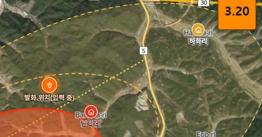

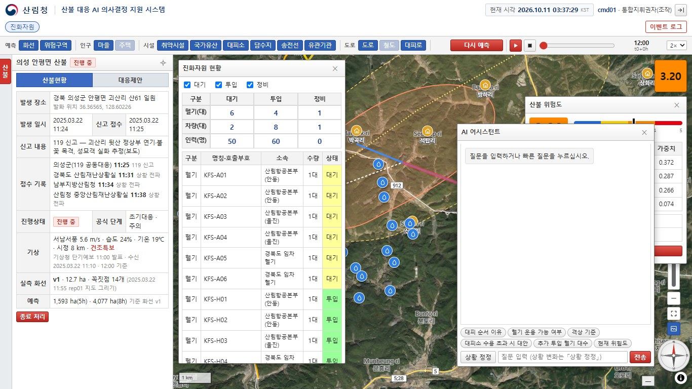

### 발견된 문제와 검증 후 개선 결과 (47쪽)

| 번호 | 초기 | 내용 | 개선 방향 | 검증 후 개선 결과 | 상태 |
|---|---|---|---|---|---|
| 1 | 결함 | AI 정정에 변화를 두 개 이상 넣으면 첫 번째만 반영, 누락 안내 없음 | 확인 창에 모든 변화를 표시하고 못 읽은 부분 안내 | 절 단위로 모두 해석·확인 카드에 전부 표시, 「추가」는 현재 값에 더함 | 해결 |
| 2 | 결함 | 「이 항목 질문」이 항목과 무관한 답(대피 순서) 반환 | 항목 맥락을 우선 매칭, 본 개발은 항목 제안·근거를 프롬프트에 포함 | 지정한 항목의 답을 먼저 고르고 S4 시간대 전략 답 추가 | 해결 |
| 3 | 결함 | 계정 회수·삭제·권한 변경이 확인 없이 즉시, 마지막 조작 계정도 삭제 | 확인 창 추가, 마지막 조작 권한 계정 삭제 차단 | 확인 창, 마지막 통합지휘권자 계정은 회수·삭제·권한 변경 차단 | 해결 |
| 4 | 결함 | 역할 전환 시 보고자 입력 표식이 다른 계정 지도에 남음 | 로그아웃 때 입력 상태 초기화 | 로그아웃하면 표식·그리던 화선·양식 상태 초기화 | 해결 |
| 5 | 개선 | 범례 없음 · 지도 라벨 겹침 · 영문 병기 | 레이어 버튼에 색 견본, 한글 라벨만·겹침 우선순위 | 색 견본(마우스를 올리면 의미 제시), 바탕지도 한글 이름만 | 해결 |
| 6 | 개선 | 「재예측 필요」가 표 맨 아래에만 | 「다시 예측」 버튼 옆에 강조 표시 | 버튼 옆에 「재예측 필요」와 화선 버전, 버튼 깜박임 | 해결 |
| 7 | 개선 | 변경 비교에서 바뀐 구절이 강조되지 않음 | 추가·삭제 구절 색 표시 | 빠진 말 빨간 취소선, 새로 생긴 말 초록 형광 | 해결 |
| 8 | 개선 | 근거 창이 제안 목록을 덮음 | 근거 창을 지도 쪽에 나란히 열기 | 고정 창 옆(지도 위)에 열림 | 해결 |
| 9 | 개선 | 1366×768에서 상단 줄바꿈·떠 있는 창 겹침 | 창 자동 배치·도킹, 상단 압축 | 빈자리 자동 배치(필요하면 높이 축소), 상단 한 줄 | 해결 |
| 10 | 개선 | 병합 산불의 겹침 근거·두 번째 산불 정보가 안 보임 | 겹친 P5 구역 표시, 병합된 산불 정보 펼침 | P5 겹침 구역 보라색 표시, 산불현황에 병합된 산불 행 | 해결 |
| 11 | 개선 | 제안 카드와 지도 대상이 연동되지 않음 | 카드를 펼치면 지도에 대상 강조 | 대상 마을·시설을 하늘색 고리로 표시하고 그 범위로 이동 | 해결 |

검증 후  2026-10-13에 결함 4건·개선 7건을 모두 반영하고 같은 시나리오로 다시 확인했다. 새로고침 시 초기화는 서버가 없는 프로토타입의 한계로 본 개발(DB 저장)에서 해결한다.

### 프로토타입으로 구체화된 요구사항 (48쪽)

| 요구사항 | 요구사항분석서 | 프로토타입 검토 후 |
|---|---|---|
| F-02 화선 버전 | 실측 화선 v1, v2 … | 처음 받은 보고가 v1(보고에 화선이 없으면 발화점 자체), 이후 v2, v3 …, 정정 시 이전 버전 「정정됨」 |
| F-11 제안서 버전 | 버전 n | v(화선 버전).(대응 생성 순번) — v1.1 → 정정 v1.2 → 새 화선 재예측 v2.1 |
| F-10 위험도 표시 | R(1.00\~5.00)과 요인 점수, 위험도 탭 | 지도 오른쪽 위 숫자 네모(구간 색 4단계), 예측 전·종료 시 숨김, 요소별 지표 팝업, 「R」 표기 삭제 |
| F-08 진화자원 필터 | 「가용만 보기」 | 대기·투입·정비 체크박스, 합계는 체크한 상태만 |
| F-05·06 지도 레이어 | 인구·시설·도로·기관 | 읍면 경계·진화대 삭제, 유관기관은 시설 묶음, 의성군 테두리 상시 표시 |
| 병합 산불 | 「병합 계산」 표시 | 먼저 신고된 산불 하나로 목록 1건, 화선·예측 함께, 위험도 1개 |
| 화면 구조 | 탭·빨간 메뉴 여러 개 | 왼쪽 1/4 고정 창(산불현황·대응제안), 이벤트 로그는 상단 버튼, 산불 목록은 왼쪽 날개 |
| 실패 처리 | 명시 없음 | 시스템 알림 + 칸별 경고, 이전 결과 유지, 기상은 마지막 값 흐리게 |
| 신고자 정보(F-02·F-04) | 신고 내용만 | 신고 기관명·신고자 성명·연락처 입력·표시 — 「산불진화기관의 임무와 역할에 관한 규정」 제6조제1항제1호 |
| F-10 위험도 열람 권한 | 통합지휘권자 | 통합지휘권자·열람자(예측 실행·재예측은 통합지휘권자만) |
| 비활성 기능 안내 | 명시 없음 | 비활성 버튼 옆에 이유를 작은 글씨로(예: 종료된 산불은 예측할 수 없습니다) |

프로토타입의 목적 — 문서만으로는 정하지 못한 「언제·어디에·어떤 형식으로 보이는가」를 화면에서 합의했다.

### MVP 범위와 개발 전환 계획 (49쪽)

**MVP — 12주차까지 개발 완료**

1. **상황 보고(발화 정보·신고자·실측 화선)**
2. **확산 예측(ELMFIRE) · P1\~P8**
3. **위험도(P5 · 23개 변수)**
4. **규칙 판정 → 근거 검색 → 제안서**
5. **근거 조회 · AI 질의응답 · 상황 정정**
6. **제안서 버전 이력 · 이벤트 로그 · 종료**
7. **계정·권한 · 진화자원 데이터 관리** — 이후 확장

경상북도 다른 시·군 데이터로 확장  
현업(산림청·지자체) 의견 반영 화면 개선  
평가 결과로 하한·프롬프트 재조정

| 프로토타입 구현 | 본 개발 구성요소 | 스프린트 |
|---|---|---|
| 합성 타원 확산 모델 | ELMFIRE(Docker) · 30 m 격자 | SP1\~SP5 |
| 시나리오 고정 기상 | 기상청 단기예보 API | SP1\~SP2 |
| 위험도 변수 시연값 | P5 폴리곤 × 격자 자료 23개 변수 계산 | SP3 |
| 규칙 판정(JavaScript) | 규칙 엔진(Python) + FastAPI | SP2\~SP4 |
| 문장 템플릿 | EXAONE 4.0 32B(vLLM) 제안 생성 | SP3\~SP4 |
| 키워드 대본·정규식 정정 | EXAONE + KURE-v1·FAISS RAG | SP2\~SP4 |
| 쪽수별 요약 근거 | 조항 단위 청킹·근거 색인 | SP1\~SP2 |
| 세션 저장소 토큰 | JWT · 서버 측 잠금·권한 | SP3\~SP4 |
